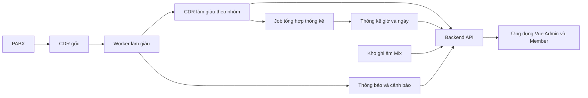

# BÁO CÁO TỔNG QUAN DỰ ÁN EVN CDR AS

**Ngày lập:** 06/11/2026 (UTC+7).  
**Phạm vi:** tổng quan nghiệp vụ, kiến trúc dự kiến, hiện trạng kho mã, tiến độ tài liệu và đề xuất triển khai.  
**Căn cứ:** các tệp hiện có trong workspace; commit HEAD khi khảo sát: `5c176d3` — `docs: ghi commit G03`.

## 1. Nhận định tổng quan

EVN CDR AS hướng tới giám sát và phân tích cuộc gọi thoại IP trên mạng PABX EVN: tra cứu CDR, đánh giá chất lượng thoại, thống kê lưu lượng và cung cấp ghi âm theo quyền của từng nhóm người dùng.

Dự án hiện ở giai đoạn **chuẩn hóa đặc tả và hoàn thiện giao diện mẫu trước khi triển khai ứng dụng**. Kho làm việc có bộ tài liệu kiến trúc, API, thiết kế dữ liệu và 15 phân hệ; có 30 trang HTML chia hai cổng. Tuy nhiên, `backend/` chưa có mã TypeScript ứng dụng và `frontend/` chưa có tệp ứng dụng. Chưa có cơ sở để xác nhận hệ thống đã chạy tích hợp hoặc sẵn sàng vận hành.

Điểm cần thống nhất ngay khi bắt đầu lập trình là sử dụng đặc tả hiện hành trong `docs/`: **không tính cước tiền tệ**, cô lập dữ liệu theo **nhóm người dùng**, chỉ cung cấp ghi âm **Mix**. Một số nội dung trong README vẫn mô tả thiết kế cũ.

## 2. Mục tiêu và phạm vi nghiệp vụ

| Nhóm chức năng | Nội dung theo đặc tả hiện hành |
|---|---|
| Tổ chức và nhóm người dùng | Quản lý cây tổ chức, nhóm và thành viên; tổ chức phục vụ tham chiếu, lọc danh sách nhóm |
| Xác thực và phân quyền | Hai cổng Admin/Member; vai trò cố định, kiểm tra quyền và phạm vi nhóm ở backend |
| Kho số và cấp phát | Quản lý kho số nội bộ 5 chữ số, nhóm đầu số, dải số cấp phát và lịch sử thay đổi |
| Tra cứu CDR | Tìm kiếm, lọc, phân trang, xem chi tiết cuộc gọi và các leg liên quan |
| Ghi âm | Nghe và tải tệp Mix theo quyền; hỗ trợ phát có tua qua HTTP Range |
| Phân tích QoS | MOS, R-Value, jitter, packet loss, chỉ số kết nối và phân tích lỗi cuộc gọi theo đặc tả |
| Lưu lượng và thời lượng | Thống kê cuộc đi, đến, nội bộ nhóm; thời gian đàm thoại thực tế; không áp đơn giá hoặc hạn mức tiền |
| Dashboard và báo cáo | Chỉ số tổng hợp, biểu đồ, báo cáo và xuất Excel/PDF |
| Thông báo và vận hành | Thông báo trong ứng dụng, email cảnh báo, cài đặt hệ thống, hồ sơ, phiên đăng nhập và nhật ký kiểm toán |

Nguồn: [kiến trúc](../docs/00_overview_and_architecture.md), [API](../docs/02_api_contracts.md), [các phân hệ](../docs/modules/).

## 3. Kiến trúc mục tiêu

### 3.1. Thành phần và công nghệ

| Thành phần | Thiết kế dự kiến | Trạng thái quan sát được |
|---|---|---|
| Frontend | Một ứng dụng Vue 3, Vite, TypeScript, Pinia, Vue Router; tách khu vực Admin/Member | Có đặc tả và mẫu HTML; chưa có ứng dụng Vue |
| Backend API | NestJS, Express, TypeORM; REST API và Socket.IO | Có đặc tả; chưa có mã ứng dụng NestJS |
| Backend worker | Cùng project backend, tiến trình riêng, không mở HTTP, đúng một instance | Có mô tả job và quy tắc xử lý; chưa có mã worker |
| Lưu trữ | MariaDB 10.6+; CDR gốc, dữ liệu làm giàu và thống kê tổng hợp | Có thiết kế trong tài liệu; chưa kiểm chứng DB trong đợt lập báo cáo này |
| Ghi âm | Tệp WAV trên thư mục SMB/NFS gắn chỉ đọc | Có phương án tích hợp; chưa kiểm chứng kết nối thực tế |
| Truy cập web | Nginx, một domain, định tuyến theo URL | Có phương án kiến trúc; chưa xác nhận triển khai |

### 3.2. Luồng dữ liệu dự kiến

PABX ghi CDR gốc; worker polling làm giàu theo quy hoạch số và nhóm sở hữu. Các API chi tiết truy cập dữ liệu làm giàu, còn dashboard và báo cáo tổng hợp đọc bảng thống kê theo nguyên tắc Zero CDR Scan. Đây là thiết kế dự kiến, chưa phải luồng đã được chạy xác nhận.

Backend dự kiến chia `apps/admin`, `apps/member`, `apps/worker` và `core`; frontend chia `apps/admin`, `apps/member` và `shared`. API được phép mở rộng nhiều instance; worker chỉ chạy một instance để tránh job chạy trùng.

### 3.3. Quy tắc nghiệp vụ và bảo mật cần giữ

- Năm vai trò cố định: `ROOT_ADMIN`, `SYSTEM_ADMIN`, `GROUP_ADMIN`, `USER_RECORDING`, `REGULAR_USER`.
- Phạm vi dữ liệu Member lấy theo nhóm sở hữu số gọi hoặc số nhận; cây tổ chức không quyết định quyền truy cập.
- Hai cổng dùng JWT secret, store xác thực và cookie refresh riêng. Access Token chỉ giữ trong bộ nhớ; Refresh Token dùng cookie `HttpOnly` có `Path` riêng.
- Thống kê số cuộc gọi chỉ đếm leg chính; không cộng số liệu các nhóm để suy ra tổng toàn hệ thống vì cuộc liên nhóm xuất hiện ở cả nhóm gọi và nhóm nhận.
- Thời lượng PABX `Answered_Duration` được đặc tả theo mili-giây; chỉ số nghiệp vụ `answered_duration_sec` tính theo giây.

Nguồn: `docs/00_overview_and_architecture.md`, `docs/modules/10_permissions_and_roles.md`, `docs/modules/14_core_business_call_traffic.md`.

## 4. Hiện trạng tài sản dự án

| Khu vực | Kết quả khảo sát | Ý nghĩa |
|---|---|---|
| `docs/` | Có 4 tài liệu nền tảng: kiến trúc, CSDL, API, UI; có tài liệu định hướng trong `intent/` | Là căn cứ chính cho triển khai |
| `docs/modules/` | 15 tài liệu phân hệ | Phạm vi nghiệp vụ đã được mô tả thành từng phần |
| `templates/admin/` | 18 tệp HTML | Bộ mẫu cho cổng quản trị; số tệp không đồng nghĩa số màn hình đã nghiệm thu |
| `templates/member/` | 12 tệp HTML | Bộ mẫu cho cổng thành viên |
| `backend/` | Chỉ thấy cấu hình IDE trong `.idea/`, không có tệp TypeScript ứng dụng hoặc `package.json` | Chưa có backend có thể cài đặt và chạy từ thư mục này |
| `frontend/` | Không có tệp | Chưa có frontend Vue có thể build |
| `tasks/` | Có kế hoạch chuẩn hóa tài liệu và kế hoạch rà từng endpoint | Có cơ chế theo dõi tiến độ; cần phân biệt tiến độ đặc tả với tiến độ sản phẩm |
| Dữ liệu tham chiếu | Có SQL CDR và bảng quy hoạch đầu số trong `docs/` | Cần dùng để kiểm chứng với môi trường thử nghiệm phù hợp |

Các mẫu JavaScript có xử lý tương tác và mock dữ liệu. Ví dụ `templates/member/group-summary.js` giả lập API chi tiết nhóm, trạng thái bảo trì, lỗi mạng và lỗi phạm vi truy cập. Các mô phỏng này hỗ trợ chuẩn hóa giao diện, chưa chứng minh backend thực thi đúng nghiệp vụ.

## 5. Tiến độ chuẩn hóa và việc đang mở

### 5.1. Tiến độ theo kế hoạch endpoint

Tại thời điểm khảo sát, bảng theo dõi trong [tasks/endpoint_review_plan.md](../tasks/endpoint_review_plan.md) có **99 dòng mang mã endpoint: 42 dòng đánh dấu hoàn tất và 57 dòng chưa làm**. Các số này được đếm từ trạng thái trong bảng, không phải số route đang hoạt động hoặc tỷ lệ hoàn thành sản phẩm.

Mục G03 — chi tiết nhóm người dùng — đã đánh dấu hoàn tất ngày 06/11/2026. Mục G04 — danh bạ thành viên nhóm `GET /api/v1/user-groups/me/members` — là dòng chưa làm tiếp theo sau G03. Nhật ký ghi nhận G03 đã kiểm giao diện mẫu trên trình duyệt; báo cáo này không chạy lại các kịch bản đó.

### 5.2. Tham chiếu tình trạng CSDL

Mọi kết quả rà soát CSDL tiếp tục được quản lý duy nhất tại [DB_AUDIT_CONSOLIDATED.md](../DB_AUDIT_CONSOLIDATED.md), đặc biệt mục 2 về công việc đang mở. Báo cáo tổng quan này không thực hiện lần rà soát CSDL mới và không thay thế hồ sơ đó.

Theo hồ sơ hiện có, cần tiếp tục kiểm chứng DDL/seed trên đúng MariaDB 10.6, đồng bộ các giao diện mẫu còn lệch và kiểm thử quy tắc tầng service khi có backend. Chi tiết, lịch sử sửa và tiêu chí kiểm chứng phải đọc tại hồ sơ tập trung; thiết kế chuẩn vẫn là `docs/`.

## 6. Khoảng trống và ảnh hưởng tới triển khai

| Ưu tiên | Khoảng trống quan sát được | Ảnh hưởng | Hành động đề xuất |
|---|---|---|---|
| Cao | Chưa có ứng dụng backend/frontend và manifest phụ thuộc | Hướng dẫn `npm install`/khởi chạy trong README chưa thể thực hiện với trạng thái thư mục hiện tại | Khởi tạo hai project đúng kiến trúc đã chốt |
| Cao | Chưa có bằng chứng chạy tích hợp từ PABX tới API và giao diện | Chưa xác nhận xử lý dữ liệu thật, phạm vi truy cập, thống kê và nghe ghi âm | Làm một luồng hoàn chỉnh trên dữ liệu thử trước khi mở rộng |
| Cao | Việc kiểm chứng DB đúng phiên bản còn mở theo hồ sơ tập trung | Cần xác nhận nền tảng lưu trữ trước khi nghiệm thu | Thực hiện checklist tại `DB_AUDIT_CONSOLIDATED.md` mục 2.1 và cập nhật kết quả tại đó |
| Trung bình | README vẫn nêu tính cước block 6s + 1s, hạn mức chi phí và ghi âm RX/TX | Có thể khiến người triển khai làm sai phạm vi hiện hành | Đồng bộ README với kiến trúc và Module 14; không đưa billing tiền tệ vào backlog mặc định |
| Trung bình | README còn trỏ `14_core_business_call_billing.md`, trong khi tệp hiện có là `14_core_business_call_traffic.md` | Liên kết tham chiếu nghiệp vụ không còn đúng | Sửa đường dẫn và mô tả module khi cập nhật README |
| Trung bình | Kế hoạch endpoint còn 57 dòng chưa đánh dấu hoàn tất | Chưa thể coi mọi mẫu và hợp đồng đã được đối chiếu xong | Tiếp tục theo thứ tự của kế hoạch; giữ trạng thái cập nhật sau từng mục |

Đây là nhận định về mức sẵn sàng triển khai từ các tệp đã khảo sát, không phải kết luận kiểm thử bảo mật, hiệu năng hay nghiệm thu chức năng.

## 7. Lộ trình triển khai đề xuất

| Bước | Nội dung | Điều kiện hoàn thành |
|---|---|---|
| 1. Đồng bộ căn cứ | Cập nhật README theo `docs/`; tiếp tục kế hoạch endpoint và xác nhận việc mở trong hồ sơ tập trung | Tài liệu khởi đầu phản ánh đúng phạm vi; các việc còn mở có trạng thái rõ |
| 2. Chuẩn bị nền tảng | Khởi tạo NestJS/Vue, cấu hình môi trường, kết nối MariaDB, migration/seed và ranh giới module | Backend API, worker và frontend khởi động được; cấu hình mẫu không chứa bí mật |
| 3. Xác thực và phạm vi nhóm | Đăng nhập/refresh/logout hai cổng, vai trò, quyền, quản lý tổ chức/nhóm và cấp phát số | Kiểm thử được phiên đăng nhập và ngăn truy cập chéo nhóm |
| 4. Luồng CDR hoàn chỉnh | Nạp dữ liệu thử, làm giàu, gộp leg, tra cứu, nghe Mix theo quyền | Đối soát được cuộc gọi và thời lượng; API trả đúng phạm vi và mã lỗi |
| 5. Thống kê và vận hành | Tổng hợp giờ/ngày, QoS, dashboard, xuất báo cáo, thông báo, email và sức khỏe worker | Số liệu khớp bộ dữ liệu kiểm chứng; job có thể theo dõi và phục hồi theo đặc tả |
| 6. Chuẩn bị vận hành | Kiểm thử tích hợp, tải, sao lưu/khôi phục, triển khai và giám sát | Có bằng chứng đáp ứng tiêu chí nghiệm thu và hướng dẫn vận hành |

Lộ trình trên là đề xuất thứ tự phụ thuộc, chưa phải cam kết lịch hoặc ước lượng nhân công. Cần xác định quy mô CDR thực tế, môi trường tích hợp và nguồn lực trước khi lập tiến độ theo tuần.

## 8. Phương pháp và giới hạn báo cáo

Báo cáo được lập bằng cách đọc tài liệu nền tảng, các phần liên quan trong module, kế hoạch công việc, hồ sơ rà soát tập trung và một mẫu JavaScript; đồng thời kiểm kê thư mục, số trang HTML và tệp mã ứng dụng. Không chỉnh sửa mã nguồn, tài liệu thiết kế hoặc trạng thái task trong đợt này.

Không chạy ứng dụng, kết nối PABX/MariaDB/kho ghi âm, thực thi DDL hay đo hiệu năng. Các thời gian polling, ràng buộc kiến trúc và quy tắc nghiệp vụ trong báo cáo là yêu cầu thiết kế, không phải kết quả đo. Không đọc hoặc khôi phục các báo cáo CSDL cũ bị cấm trong `AGENTS.md`.

## 9. Tài liệu tham chiếu chính

- [Tổng quan và kiến trúc](../docs/00_overview_and_architecture.md).
- [Thiết kế CSDL chuẩn](../docs/01_database_schema.md).
- [Hợp đồng API](../docs/02_api_contracts.md).
- [Thiết kế giao diện](../docs/03_ui_design.md).
- [Vai trò và quyền hạn](../docs/modules/10_permissions_and_roles.md).
- [CDR và ghi âm](../docs/modules/12_core_business_cdr_and_audio.md).
- [Lưu lượng và thời lượng](../docs/modules/14_core_business_call_traffic.md).
- [Kế hoạch rà soát endpoint](../tasks/endpoint_review_plan.md).
- [Hồ sơ rà soát CSDL duy nhất](../DB_AUDIT_CONSOLIDATED.md).
