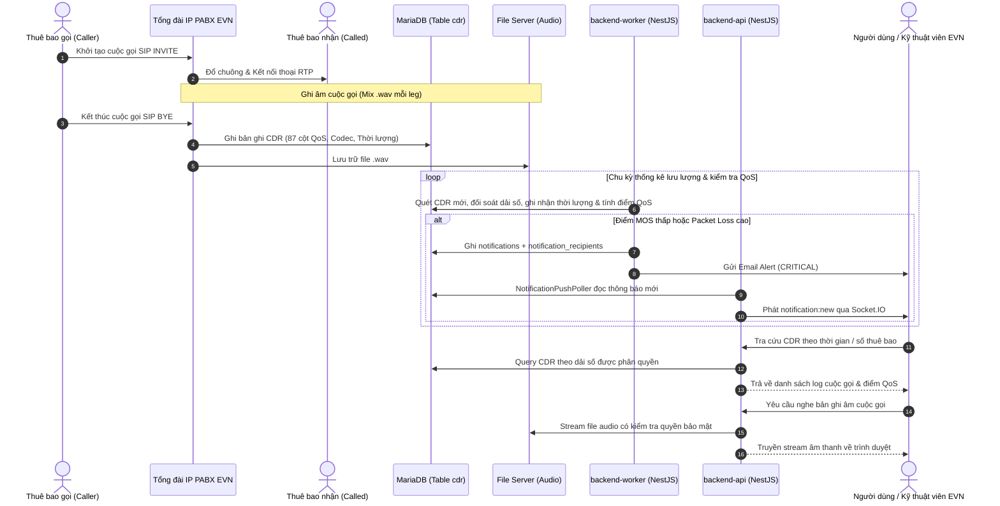

# TÀI LIỆU TỔNG QUAN & KIẾN TRÚC HỆ THỐNG (SYSTEM OVERVIEW & ARCHITECTURE)

## Dự án: Hệ Thống Giám Sát, Phân Tích Log Cuộc Gọi, Đánh Giá Chất Lượng QoS, Thống Kê Lưu Lượng Thoại & Ghi Âm PABX EVN (EVN CDR AS)

---

## 1. Giới thiệu tổng quan

### 1.1. Bối cảnh bài toán

Tập đoàn Điện lực Việt Nam (EVN) giao cho Công ty Viễn thông Điện lực & Công nghệ Thông tin (EVNICT) vận hành mạng lưới viễn thông dùng riêng và hệ thống tổng đài IP PABX quy mô toàn quốc, phục vụ điều hành sản xuất kinh doanh điện năng, chỉ huy điều độ hệ thống điện và trao đổi nội bộ giữa các Tổng công ty, Công ty, Chi nhánh, Điện lực trực thuộc.

Tổng đài PABX ghi nhận toàn bộ thông tin cuộc gọi thoại IP dưới dạng bản ghi chi tiết cuộc gọi (**CDR - Call Detail Record**) vào cơ sở dữ liệu MariaDB, đồng thời lưu trữ các tệp tin ghi âm cuộc gọi (`.wav`).

### 1.2. Mục tiêu của hệ thống EVN CDR AS

1. **Thu thập & Giám sát dữ liệu CDR**: Tự động đồng bộ và quản lý hàng triệu bản ghi CDR từ các tổng đài PABX phân tán.
2. **Đánh giá chất lượng thoại IP (QoS Analysis)**: Phân tích các chỉ số kỹ thuật chuyên sâu theo chuẩn ITU-T (MOS G.107, R-Factor, Jitter RFC 3550, Packet Loss, độ trễ thiết lập SIP, ASR, NER, Disconnection Codes) nhằm phát hiện sớm các sự cố suy giảm chất lượng âm thanh hoặc rớt cuộc gọi.
3. **Quản lý & Cung cấp ghi âm cuộc gọi có kiểm soát**: Cho phép các đơn vị thành viên nghe lại trực tuyến và tải về bản ghi âm kênh trộn hai chiều (Mix, định dạng `.wav`; PABX không ghi kênh RX/TX riêng) phục vụ nghiệp vụ giám sát công tác vận hành mạng lưới, tuân thủ chính sách bảo mật thông tin.
4. **Thống kê Thời lượng & Lưu lượng thoại (Traffic & Duration Engine)**: Phân loại cuộc gọi nội bộ EVN theo hướng đi đến từ các đơn vị thành viên; ghi nhận và tổng hợp thời lượng đàm thoại thực tế theo từng đơn vị phục vụ công tác giám sát lưu lượng mạng viễn thông và các nhu cầu quản trị khác của Tập đoàn.
5. **Phân quyền đa cấp độ (Multi-tenancy by User Group)**: Hệ thống chứng thực 2 cấp riêng biệt (**System Admin Portal** và **Tenant User Portal**). Dữ liệu được cô lập **theo Nhóm người dùng** (`user_groups`), thông qua dải đầu số cấp cho nhóm. Cây tổ chức EVN chỉ dùng để tham chiếu và lọc danh sách nhóm, không dùng để phân quyền hay cộng số liệu.

---

## 2. Kiến trúc công nghệ (Technology Stack)

```mermaid
flowchart TD
    subgraph Clients["Clients Layer"]
        BrowserAdmin["Admin Browser (EVN ICT Admin)"]
        BrowserUser["User Browser (Các đơn vị EVN)"]
    end

    WebGateway["Nginx - 1 domain, định tuyến theo prefix URL"]

    subgraph Frontend["Frontend Layer - Vue.js 3 (Monorepo pnpm, 2 ứng dụng)"]
        AdminApp["Admin App - apps/admin (/admin/*)"]
        MemberApp["Member App - apps/member (/*)"]
        SharedPkg["packages/shared (API client, components, CSS, router helpers)"]
        PiniaStore["State Management (Pinia)"]
        VueRouter["Vue Router (RBAC Guard, 1 router mỗi app)"]
        ChartUI["Chart.js / Data Visualization"]
        AudioPlayer["Web Audio Player (Streaming)"]
    end

    subgraph Backend["Backend Layer - NestJS (1 codebase, 2 tiến trình)"]
        subgraph ApiProcess["backend-api: main.ts (HTTP + Socket.IO, scale N instance)"]
            APIGateway["NestJS API Gateway (Admin /api/v1/admin/* và Member /api/v1/*)"]
            AuthAdminGuard["AdminAuthGuard (JWT - Secret A)"]
            AuthUserGuard["UserAuthGuard (JWT - Secret B)"]

            subgraph Modules["NestJS Modules"]
                ModAuth["Auth & Security Module"]
                ModOrg["Organization & Group Module"]
                ModPhone["Phone Prefix Management"]
                ModCDR["CDR & Audio Stream Module"]
                ModQoS["QoS & Network Debug Module"]
                ModTraffic["Call Duration & Traffic Module"]
                ModReport["Report & Export Module (Zero CDR Scan)"]
                ModNotify["Notification Module (Socket.IO push)"]
                ModSettings["System Settings Module"]
            end
        end

        subgraph WorkerProcess["backend-worker: main.worker.ts (không mở HTTP, đúng 1 instance)"]
            EnrichScheduler["Direct Batch Scheduler (Polling 3-5s, In-Memory Prefix Cache)"]
            CronStatsJob["Stats Aggregation Job (Rolling 10m & Daily Finalize 00:05)"]
            AlertEngine["Alert Engine (QOS_ALERT, PABX_OFFLINE, Email)"]
        end
    end

    subgraph Storage["Storage & Network Layer"]
        subgraph MariaDB["MariaDB 10.6+ - Database Layer"]
            TableCDR[("Table cdr (Raw PABX Data)")]
            TableCDREnriched[("Table cdr_enriched (Group Enriched)")]
            TableStatsHourly[("Table stats_hourly (Hourly Aggregated)")]
            TableStatsDaily[("Table stats_daily (Daily Aggregated)")]
            AppDB[("App Tables (Users, Groups, Org, Prefixes, Notifications)")]
        end

        FileServer["Thư mục ghi âm PABX (SMB/NFS, gắn chỉ đọc) - WAV"]
        PABX["EVN PABX Telephony Server"]
        MailServer["EVN SMTP Email Gateway"]
    end

    BrowserAdmin --> WebGateway
    BrowserUser --> WebGateway
    WebGateway -->|"/admin/*"| AdminApp
    WebGateway -->|"/*"| MemberApp
    WebGateway -->|"/api/v1/*, /socket.io/*"| APIGateway
    AdminApp --> SharedPkg
    MemberApp --> SharedPkg

    APIGateway --> AuthAdminGuard
    APIGateway --> AuthUserGuard
    AuthAdminGuard --> ModAuth
    AuthUserGuard --> ModAuth

    APIGateway --> ModCDR
    APIGateway --> ModQoS
    APIGateway --> ModTraffic
    APIGateway --> ModReport
    APIGateway --> ModPhone
    APIGateway --> ModOrg
    APIGateway --> ModNotify
    APIGateway --> ModSettings

    PABX -.->|Ghi CDR gốc trực tiếp| TableCDR
    PABX -.->|Sync Audio| FileServer

    EnrichScheduler -->|1. Đọc batch mới - Watermark ID| TableCDR
    EnrichScheduler -->|2. Tra cứu dải số - máy cố định 5 số| AppDB
    EnrichScheduler -->|3. Bulk Insert| TableCDREnriched

    CronStatsJob -->|1. Tính lại 3 giờ gần nhất| TableCDREnriched
    CronStatsJob -->|2. Rolling UPSERT mỗi 10 phút| TableStatsHourly
    CronStatsJob -->|3. Rolling UPSERT và chốt sổ ngày| TableStatsDaily
    CronStatsJob -->|4. Đánh giá khung giờ vừa kết thúc| AlertEngine

    AlertEngine -->|Ghi notifications + recipients| AppDB
    AlertEngine -->|Email CRITICAL| MailServer
    ModNotify -->|"Đọc notifications mới - Watermark ID, push notification:new"| AppDB

    ModCDR -->|Truy vấn theo nhóm| TableCDREnriched
    ModCDR --> FileServer
    ModQoS --> TableStatsDaily
    ModTraffic --> TableStatsDaily
    ModReport -->|Zero CDR Scan - chỉ đọc thống kê| TableStatsDaily
    ModReport -->|Dashboard hôm nay| TableStatsHourly
    ModNotify --> MailServer
```



### 2.1. Backend: NestJS (Node.js)

- **Framework**: NestJS (Typescript, Express engine).
- **ORM / Database Access**: TypeORM và tối ưu hóa câu query raw và upsert trên bảng thống kê.
- **Authentication**: Passport-JWT, `bcrypt` băm mật khẩu, hệ thống Guard kép tách biệt cho Admin và User.
- **Mô hình tiến trình (1 codebase, 2 tiến trình)**: cùng một project `backend/`, build một lần, chạy bằng 2 entry point:
  - **`backend-api`** (`src/main.ts`, `AppModule`): phục vụ REST API của **cả hai cổng** (Admin `/api/v1/admin/*`, Member `/api/v1/*`) và Socket.IO. Không chạy job định kỳ nào ngoài bộ đọc thông báo mới (bên dưới). Có thể chạy nhiều instance sau Nginx.
  - **`backend-worker`** (`src/main.worker.ts`, `WorkerModule`, khởi động bằng `NestFactory.createApplicationContext`, không mở cổng HTTP): chạy toàn bộ tác vụ nền: Direct Batch Scheduler làm giàu CDR, job tổng hợp `stats_*`, Alert Engine (`QOS_ALERT`, `PABX_OFFLINE`, gửi email). **Luôn chạy đúng 1 instance**.
  - **Không tách backend Admin và Member**: hai cổng dùng chung DB, entity, service nghiệp vụ, `PermissionsGuard`; khác biệt chỉ ở route prefix, guard JWT và phạm vi dữ liệu, xử lý bằng controller/guard trong cùng tiến trình API.
  - **Lý do tách worker**: scale API nhiều instance không làm job chạy trùng; job enrich/tổng hợp nặng không chiếm event loop của API; deploy, restart API không làm gián đoạn việc làm giàu CDR và ngược lại.
- **Background Tasks & Pre-aggregation Engine**: `@nestjs/schedule` (`ScheduleModule.forRoot()`) **chỉ được import trong `WorkerModule`**, thực thi các Cron Job định kỳ (mỗi 10 phút tính lại `stats_hourly`/`stats_daily` cho 3 giờ gần nhất; chốt sổ ngày lúc 00:05). Các lớp `*.scheduler.ts` / `*.job.ts` không khai báo trong `providers` của feature module mà chỉ đăng ký ở `WorkerModule`; feature module chỉ export service. Không cần dựng Redis hay hàng đợi BullMQ.
- **Đồng bộ cache giữa các tiến trình**: cache sở hữu số (`NumberOwnershipCacheService`) và cache `system_settings` nằm trong bộ nhớ của **từng** tiến trình. Mọi thao tác làm đổi dữ liệu này (cấp phát/thu hồi dải số, sửa nhóm sở hữu, lưu `system_settings`, `POST /api/v1/admin/settings/reload-cache`) tăng `cdr_enrichment_state.cache_version` trong cùng transaction. Worker đọc `cache_version` ở đầu mỗi chu kỳ làm giàu, mỗi instance API đọc mỗi 5 giây; giá trị khác với bản đang giữ thì nạp lại cache.
- **File Streaming**: Hỗ trợ HTTP Range Requests (`206 Partial Content`) để người dùng có thể tua âm thanh nghe ghi âm tức thì mà không cần load toàn bộ file.
- **Exporting**: `exceljs` để xuất báo cáo Excel định dạng chuẩn EVN, `pdfmake` hoặc `puppeteer` để xuất báo cáo PDF (trích xuất tức thì từ `stats_daily`, thời gian phản hồi $< 1\text{s}$).
- **Realtime**: `@nestjs/websockets` (Socket.IO) chạy trong `backend-api`, gửi thông báo tức thời (In-app alerts). Worker không giữ kết nối WebSocket: nó chỉ ghi `notifications` + `notification_recipients`. Mỗi instance API chạy bộ đọc `NotificationPushPoller` (mỗi 3 giây, đọc `notifications.id >` watermark trong bộ nhớ, khởi tạo bằng `MAX(id)` lúc khởi động) và phát `notification:new` tới room người nhận đang kết nối vào chính instance đó. Thông báo do Admin soạn qua API **cũng** đi đường này, không emit trực tiếp, để mỗi thông báo chỉ được phát một lần.

### 2.2. Frontend: Vue.js 3

- **Ứng dụng**: **2 ứng dụng Vue riêng biệt**, build và triển khai độc lập, đặt trong một monorepo pnpm workspace (`frontend/`): **Admin App** (`apps/admin`, Cổng Quản trị hệ thống) và **Member App** (`apps/member`, Cổng Người dùng đơn vị). Hai app **chung một hệ thống route**: cùng một domain, phân tách bằng prefix URL (`/admin/*` → Admin App, `/*` → Member App, `/api/v1/*` → NestJS). Mã dùng chung đặt trong `packages/shared`. Quy tắc chi tiết tại mục 5.3.
- **Framework**: Vue 3 (Composition API với `<script setup lang="ts">`).
- **Build Tool**: Vite cho tốc độ bundle và hot-reload tối ưu (mỗi app một `vite.config.ts`).
- **UI Architecture**: Xây dựng theo bộ giao diện HTML/CSS chuẩn trong thư mục `templates/`, đảm bảo nhận diện thương hiệu EVN (màu xanh dương EVN `#0033A0`, cam `#EA580C`, layout hiện đại, hỗ trợ Dark Mode / Light Mode).
- **State Management**: Pinia (Modules: `cdr`, `qos`, `organization`, `notifications`, `settings`). Store xác thực tách theo app: `authAdmin` chỉ có trong Admin App, `authUser` chỉ có trong Member App.
- **Routing**: Vue Router 4, **mỗi app một router riêng** (Admin: `createWebHistory('/admin/')`; Member: `createWebHistory('/')`), lazy-load view và Navigation Guards kiểm tra Permissions dựng từ helper chung trong `packages/shared/router`.
- **Data Visualization**: `chart.js` & `vue-chartjs` để biểu diễn biểu đồ thống kê cuộc gọi, QoS MOS, Packet Loss theo thời gian.
- **Audio Control**: HTML5 Custom Audio Player với thanh sóng âm thanh và điều khiển tua nhanh, phát file Mix của từng leg (chọn leg A/B trong modal chi tiết).

### 2.3. Cơ sở dữ liệu: MariaDB 10.6+

- **Múi giờ**: DB, backend và PABX cùng dùng giờ Việt Nam (UTC+7). Cấu hình bắt buộc: MariaDB `default-time-zone = '+07:00'`, TypeORM `timezone: '+07:00'`, biến môi trường `TZ=Asia/Ho_Chi_Minh` cho tiến trình Node. Chi tiết tại `docs/01_database_schema.md` (đầu tài liệu).

- **Động cơ lưu trữ**: InnoDB (Hỗ trợ ACID, Foreign Keys, Row-level Locking).
- **Bảng CDR gốc `cdr`**: Tiếp nhận trực tiếp từ tổng đài PABX với 87 cột dữ liệu SIP/RTP/RTCP. Dữ liệu thuần túy kỹ thuật của tổng đài, giữ nguyên vẹn để đối soát và bảo toàn log cuộc gọi.
- **Bảng CDR làm giàu `cdr_enriched`**: Bảng trung tâm phục vụ toàn bộ nghiệp vụ Backend, API và Phân quyền. Chứa các cột gốc kế thừa từ `cdr` và các cột làm giàu: nhóm sở hữu (`caller_group_id`, `called_group_id`), gộp leg (`leg_role`, `call_group_key`, `is_primary_leg`), `call_status`, `answered_duration_sec`, `call_type`, MOS (`mos_*_x100`). Partition theo tháng trên `Created`. Định nghĩa đầy đủ tại `docs/01_database_schema.md` mục 2.1.
- **Bảng dữ liệu nghiệp vụ phụ trợ**: Lưu trữ tổ chức, nhóm người dùng, dải số điện thoại EVN 5 số đã quy hoạch - cấp phát, thống kê thời lượng & lưu lượng, cảnh báo QoS.

### 2.4. Kiến trúc Đồng bộ Làm giàu CDR & Cô lập Dữ liệu theo Nhóm (CDR Enrichment & Group-Based Isolation Pipeline)

```
[Tổng đài PABX] ──(Ghi trực tiếp)──> [Bảng cdr]
                                          │
                               (Batch Polling 3-5s)
                                          ▼
                [Direct Batch Scheduler (NestJS, tiến trình backend-worker)]
                                          │
                     ┌────────────────────┴────────────────────┐
                     ▼                                         ▼
         [Tra cứu kho số In-Memory]                  [Cập nhật Watermark ID]
   phone_numbers.range_id -> nhóm người dùng           (cdr_enrichment_state)
   (số ngoài kho / chưa gán dải: NULL)
                     │
                     ▼
          [Bulk Insert cdr_enriched]
      (caller_group_id, called_group_id)
                     │
                     ▼
        [Backend API Data Isolation]
    ┌────────────────┬────────────────┐
    ▼                                 ▼
[User Portal]                  [Admin Portal]
WHERE caller_group_id = G      Xem toàn bộ bản ghi
   OR called_group_id = G      Kèm Badge tên nhóm
                               Bộ lọc theo Nhóm
```

1. **Tiến trình chạy ngầm định thời (Direct Batch Scheduler)**:
   - Chạy trong tiến trình `backend-worker` (đúng 1 instance, mục 2.1), polling mỗi **3 - 5 giây**.
   - Truy vấn bản ghi mới từ bảng `cdr` theo cơ chế Watermark ID (`WHERE id > last_processed_cdr_id ORDER BY id ASC LIMIT 1000`) lưu trong bảng `cdr_enrichment_state`.
2. **Thuật toán xác định nhóm sở hữu số (Number Ownership Lookup)**:
   - Phần lớn cuộc gọi là mạng thoại nội bộ dùng riêng EVN giữa các máy lẻ 5 số `[H][C][XXX]` (kho 10000–99999). Rà soát dữ liệu thật vẫn có số ngoài kho (`Anonymous`, `0xxxx` dịch vụ đặc biệt, số di động, số không đủ 5 chữ số), các số này được coi là số chưa quy hoạch và có nhóm sở hữu = NULL.
   - **Quy tắc duy nhất**: số khớp `analysis_internal_extension_pattern` được tra cứu **duy nhất** qua chuỗi `phone_numbers.range_id → phone_prefix_ranges.prefix_group_id → user_groups.phone_prefix_group_id` (mọi trạng thái số, quy tắc trình bày tại `docs/01_database_schema.md` mục 8); không so khớp theo `prefix` hay `range_from..range_to`. Map được nạp vào bộ nhớ của worker lúc khởi động và nạp lại khi `cdr_enrichment_state.cache_version` thay đổi (API tăng giá trị này sau mỗi lần cấp phát/thu hồi dải số, mục 2.1).
   - **Xử lý số chưa quy hoạch**: Nếu số điện thoại không thuộc bất kỳ nhóm nào, trường tương ứng nhận giá trị `NULL`.
3. **Nguyên tắc Cô lập dữ liệu theo nhóm (Group-Based Data Isolation)**:
   - **Tra cứu danh sách & Nghe ghi âm**: Thực hiện trên bảng `cdr_enriched`.
   - **Phạm vi dữ liệu Người dùng Đơn vị (User Portal)**: Backend tự động áp đặt điều kiện:
     `WHERE (caller_group_id = :currentUserGroupId OR called_group_id = :currentUserGroupId)`
     Một cuộc gọi xuất hiện trong danh sách tra cứu của nhóm khi có số gọi đi HOẶC số nhận cuộc gọi thuộc quyền quản lý của nhóm đó.
   - **Phạm vi dữ liệu Quản trị viên hệ thống (Admin Portal)**: Quản trị viên hệ thống có toàn quyền xem 100% bản ghi CDR (bao gồm cả các cuộc gọi có `caller_group_id` hoặc `called_group_id` bằng `NULL`). Trên giao diện, thông tin nhóm của người gọi và người nhận được hiển thị trực quan dưới dạng nhãn Badge; kèm theo bộ lọc "Nhóm người dùng" cho phép Admin lọc nhanh dữ liệu theo từng đơn vị.
4. **Mô hình Phân quyền Truy cập ghi âm Kiểm soát 2 Tầng (2-Tier Recording Access Gate)**:
   - **Tầng 1 (Cấp nhóm - Do Quản trị viên hệ thống cấp quyền)**:
     - Trường `user_groups.allow_recording_access` (tinyint 0/1) đóng vai trò Chốt chặn Tầng 1 do Quản trị viên hệ thống quản lý.
     - **Khi nhóm chưa được cấp phép (`allow_recording_access = 0`)**: Mọi tính năng liên quan đến ghi âm đều không xuất hiện trên giao diện của toàn bộ người dùng nhóm đó: Bảng lưới CDR ẩn hoàn toàn cột "File ghi âm"; trong Modal chi tiết cuộc gọi, khối Audio Player được thay thế bằng thông báo: *"Tính năng ghi âm chưa được kích hoạt cho đơn vị của bạn"*; trên giao diện Quản trị nhóm (`group-admin.html`), các nút bấm, cột và switch phân quyền ghi âm thành viên bị ẩn triệt để. Quản trị viên nhóm không có quyền nghe/tải và không thể cấp quyền cho thành viên. Backend chặn tuyệt đối mọi yêu cầu stream và download với mã lỗi `403 Forbidden`.
     - **Khi nhóm được cấp phép (`allow_recording_access = 1`)**: Kích hoạt phân quyền Tầng 2.
   - **Tầng 2 (Vai trò - Do Quản trị viên nhóm phân quyền khi Tầng 1 đã mở)**: quyền nghe/tải thuộc vai trò được thiết lập theo nhóm quyền.
     - **Quản trị viên nhóm (`GROUP_ADMIN`)**: Mặc định có quyền nghe trực tuyến và tải về máy bản ghi âm của nhóm mà không cần thêm cấu hình nào.
     - **Quản trị viên nhóm có quyền cấp phép cho thành viên**: Đổi vai trò thành viên giữa `REGULAR_USER` (Thành viên) và `USER_RECORDING` (Thành viên nghe ghi âm) qua giao diện Quản trị nhóm (`group-admin.html`).
     - Thành viên `USER_RECORDING` được quyền nghe & tải ghi âm của nhóm; thành viên `REGULAR_USER` thấy nhãn khóa `Chưa cấp quyền` và không thể phát hoặc tải file.
   - **Mô hình vai trò – quyền**: 5 vai trò seed cố định (`roles`), quyền seed cố định (`permissions`, `permission_roles`), gán vai trò qua `admin_roles` / `user_roles` (mỗi tài khoản 1 vai trò). Admin chỉ kiểm tra quyền vai trò; User kiểm tra quyền nhóm trước rồi đến quyền vai trò (`docs/modules/10_permissions_and_roles.md`).
5. **Nguyên tắc Thống kê Sẵn & Zero CDR Scan (Pre-aggregated Reporting Engine)**:
   - **Số liệu tổng hợp chỉ đọc `stats_*`**: thẻ KPI, biểu đồ, thống kê QoS/lưu lượng, xem trước và xuất báo cáo không bao giờ `GROUP BY` trên `cdr`/`cdr_enriched`. Danh sách từng cuộc gọi (lịch sử CDR, QoS debug, cuộc gọi gần đây, xuất CDR) được đọc `cdr_enriched` với khoảng thời gian ≤ 31 ngày, qua index và có giới hạn số dòng (nguyên tắc đầy đủ tại `docs/01_database_schema.md` mục 15).
   - **Cơ chế tính toán định kỳ**: Cron Job `@nestjs/schedule` mỗi 10 phút (`*/10 * * * *`) **tính lại toàn bộ** (không cộng dồn) các khung giờ trong 3 giờ gần nhất và các khung giờ trong hàng đợi `stats_recompute_queue`, ghi `stats_hourly` rồi tính lại `stats_daily` của ngày bị tác động. Khóa thời gian là `Created` (thời điểm bắt đầu cuộc gọi) của leg chính. Thuật toán đầy đủ tại `docs/01_database_schema.md` mục 15.0.
   - **Chốt sổ ngày tự động**: 00:05 mỗi sáng, job tính lại cả 24 giờ của ngày hôm trước lần cuối rồi đặt `is_finalized = 1`.
   - **Cô lập dữ liệu báo cáo**: Người dùng đơn vị chỉ truy vấn được dữ liệu có `group_id = currentUser.user_group_id`. Quản trị viên hệ thống mặc định xem Toàn hệ thống hoặc lọc theo nhóm bất kỳ.
   - **Thời gian phản hồi siêu tốc**: Mọi API thống kê và xuất báo cáo chỉ quét từ 1 đến vài chục dòng trong bảng `stats_daily`, trả kết quả tức thì trong $< 50\text{ms}$.

---

## 3. Kiến trúc phân quyền & Đa người dùng (Dual-Portal Architecture)

Hệ thống thiết kế theo cơ chế **Hai cổng đăng nhập độc lập (Dual Portal)** để bảo vệ an toàn dữ liệu:

```
+-----------------------------------------------------------------------------------+
|                              HỆ THỐNG EVN CDR AS                                  |
+-----------------------------------------+-----------------------------------------+
|        1. QUẢN TRỊ VIÊN HỆ THỐNG        |          2. NGƯỜI DÙNG ĐƠN VỊ           |
|            (ADMIN PORTAL)               |              (USER PORTAL)              |
+-----------------------------------------+-----------------------------------------+
| - Ứng dụng: `frontend/apps/admin`       | - Ứng dụng: `frontend/apps/member`      |
| - URL giao diện: /admin/*               | - URL giao diện: /* (trừ /admin, /api)  |
| - Bảng dữ liệu: `admins`                | - Bảng dữ liệu: `users`                 |
| - Đăng nhập: /api/v1/admin/auth/login   | - Đăng nhập: /api/v1/auth/login         |
| - Secret Key JWT riêng biệt             | - Secret Key JWT riêng biệt             |
| - Quản trị viên tối cao (Root Admin)    | - Người dùng gắn với Nhóm người dùng    |
|   duy nhất có quyền tạo Admin khác.     |   (User Group) và Nút cây Tổ chức       |
| - Cấu hình hệ thống, ngưỡng QoS,        | - Trưởng nhóm (Group Admin): Quản lý    |
|   cấp dải số cho các đơn vị EVN...      |   thành viên trong đơn vị mình.         |
| - Toàn quyền xem log mọi đơn vị.        | - Xem log CDR theo Dải số được gán.     |
+-----------------------------------------+-----------------------------------------+
```

---

## 4. Mô hình dữ liệu & Luồng xử lý nghiệp vụ (End-to-End Workflow)



---

## 5. Quy chuẩn cấu trúc thư mục mã nguồn (Source Code Directory Standards)

### 5.1. Backend (`backend/`)

```
backend/
├── src/
│   ├── main.ts                    <-- Entry backend-api: NestFactory.create(AppModule), HTTP + Socket.IO
│   ├── main.worker.ts             <-- Entry backend-worker: NestFactory.createApplicationContext(WorkerModule), không mở HTTP
│   ├── app.module.ts              <-- Controller + gateway của cả 2 cổng; KHÔNG import ScheduleModule
│   ├── worker.module.ts           <-- ScheduleModule.forRoot() + đăng ký mọi *.scheduler.ts / *.job.ts; không có controller
│   ├── common/                    <-- Tiện ích chung, decorators, interceptors, filters
│   │   ├── constants/
│   │   ├── decorators/            <-- @CurrentUser(), @CurrentAdmin(), @RequirePermissions()
│   │   ├── filters/               <-- AllExceptionsFilter (chuẩn hóa lỗi HTTP)
│   │   ├── guards/                <-- AdminAuthGuard, UserAuthGuard, PermissionsGuard
│   │   ├── interceptors/          <-- TransformResponseInterceptor, AuditLogInterceptor
│   │   └── pipes/                 <-- ValidationPipe
│   ├── config/                    <-- Cấu hình database, jwt (ngưỡng QoS và SMTP đọc từ DB, không đặt ở đây)
│   ├── database/
│   │   ├── database.module.ts
│   │   ├── migrations/
│   │   └── seeds/                 <-- Root admin, vai trò mặc định, cây tổ chức EVN
│   └── modules/                   <-- Các module tính năng chuyên biệt
│       ├── admin-auth/            <-- Đăng nhập & quản lý Admin
│       ├── admin-profile/         <-- Hồ sơ cá nhân của Admin
│       ├── user-auth/             <-- Đăng nhập & quản lý User
│       ├── user-profile/          <-- Hồ sơ cá nhân của User
│       ├── user-groups/           <-- Nhóm người dùng (Tổ chức quản lý người dùng)
│       ├── organizations/         <-- Cây tổ chức EVN (Tham chiếu cho Nhóm người dùng)
│       ├── phone-numbers/         <-- Quản lý đầu số & dải số
│       ├── cdr/                   <-- Tra cứu CDR, phát stream audio; cdr-enrichment.scheduler.ts (chỉ chạy ở worker)
│       ├── stats/                 <-- stats-aggregation.job.ts (10 phút, 00:05) + qos-alert.service.ts (chỉ chạy ở worker)
│       ├── qos/                   <-- Phân tích chất lượng thoại, MOS, Jitter, SIP code
│       ├── traffic/               <-- Thống kê lưu lượng, phân loại hướng gọi & thời lượng
│       ├── reports/               <-- Xuất báo cáo Excel, PDF
│       ├── notifications/         <-- In-app notification, WebSocket gateway + NotificationPushPoller (API), Mailer
│       ├── permissions/           <-- Vai trò & quyền (seed cố định), PermissionsGuard
│       ├── system-settings/       <-- Cài đặt hệ thống PABX, retention
│       └── dashboard/             <-- API tổng hợp số liệu Dashboard
├── package.json                   <-- scripts: start:api (node dist/main.js), start:worker (node dist/main.worker.js)
├── tsconfig.json
└── .env.example                   <-- Dùng chung cho cả 2 tiến trình
```

**Triển khai 2 tiến trình** (cùng image/bản build, khác lệnh chạy):

| Service | Lệnh | Số instance | Cổng | Ghi chú |
| :--- | :--- | :--- | :--- | :--- |
| `backend-api` | `node dist/main.js` | 1..N | 3000 | Nginx proxy `/api/`, `/socket.io/` tới đây. Nhiều instance thì bật sticky session cho `/socket.io/` (Socket.IO polling fallback). |
| `backend-worker` | `node dist/main.worker.js` | **đúng 1** | không | Cần quyền đọc DB, ghi `cdr_enriched`/`stats_*`/`notifications` và truy cập SMTP; không cần gắn thư mục ghi âm. |

- Cả hai đặt `TZ=Asia/Ho_Chi_Minh` và dùng chung biến môi trường DB (mục 2.3).
- Khi dev: `npm run start:dev` (API) và `npm run start:worker:dev` chạy song song trong 2 terminal.
- Worker dừng thì API vẫn phục vụ bình thường; dữ liệu `cdr_enriched` và `stats_*` chỉ ngừng cập nhật. Trạng thái worker xem qua `cdr_enrichment_state.status` / `last_success_at`.

### 5.2. Frontend (`frontend/`) – Monorepo 2 ứng dụng

Frontend là **monorepo pnpm workspace** gồm 2 ứng dụng độc lập và 1 package dùng chung. `apps/admin` ánh xạ từ `templates/admin/`, `apps/member` ánh xạ từ `templates/member/`.

```
frontend/
├── pnpm-workspace.yaml            <-- packages: ['apps/*', 'packages/*']
├── package.json                   <-- scripts: dev:admin, dev:member, build (build cả 2 app)
├── tsconfig.base.json
├── packages/
│   └── shared/                    <-- @evn-cdr/shared: mã dùng chung, KHÔNG chứa route/view cụ thể
│       ├── api/
│       │   ├── createClient.ts    <-- Factory Axios: nhận { baseURL, getAccessToken, refresh, onUnauthorized }
│       │                          (Admin: baseURL /api/v1/admin, Member: baseURL /api/v1 – xem 02_api_contracts.md)
│       │   ├── cdr.api.ts         <-- Hàm gọi API dùng chung, nhận client làm tham số
│       │   ├── qos.api.ts
│       │   ├── reports.api.ts
│       │   └── notifications.api.ts
│       ├── assets/                <-- CSS, fonts, SVG (logo_evn.svg)
│       │   └── css/
│       │       ├── style.css      <-- Biến CSS dùng chung, theme EVN
│       │       └── dark-mode.css
│       ├── components/
│       │   ├── layout/            <-- AppShell.vue, Header.vue, Footer.vue, Sidebar.vue (nhận menu qua props)
│       │   ├── audio/
│       │   │   └── AudioPlayerModal.vue  <-- Trình nghe audio Mix theo leg
│       │   ├── common/
│       │   │   ├── Pagination.vue
│       │   │   ├── TreeTable.vue
│       │   │   ├── ConfirmDialog.vue
│       │   │   └── ToastContainer.vue
│       │   ├── charts/
│       │   │   ├── LineChart.vue
│       │   │   └── BarChart.vue
│       │   └── cdr/               <-- CdrTable.vue, CdrDetailModal.vue, QosPanel.vue dùng cho cả 2 cổng
│       ├── router/
│       │   ├── createAuthGuard.ts <-- Guard factory: { useAuthStore, loginRouteName, getPermissions }
│       │   └── types.ts           <-- Khai báo RouteMeta { requiresAuth, permissions?, title }
│       └── stores/
│           ├── theme.store.ts
│           └── notification.store.ts
└── apps/
    ├── admin/                     <-- Admin App, phục vụ tại /admin/*
    │   ├── index.html
    │   ├── vite.config.ts         <-- base: '/admin/', outDir: '../../dist/admin'
    │   ├── .env.example           <-- VITE_API_BASE=/api/v1/admin
    │   └── src/
    │       ├── main.ts
    │       ├── App.vue
    │       ├── api/client.ts      <-- createClient({ baseURL: '/api/v1/admin', getAccessToken, refresh, ... }) lấy từ authAdmin.store
    │       ├── api/               <-- auth.api.ts (/auth → /api/v1/admin/auth), organization.api.ts, phone.api.ts, settings.api.ts...
    │       ├── router/index.ts    <-- createWebHistory('/admin/'), route name tiền tố admin.*
    │       ├── stores/authAdmin.store.ts
    │       ├── menu.ts            <-- Cây menu sidebar Admin
    │       └── views/
    │           ├── auth/AdminLoginView.vue
    │           ├── dashboard/DashboardView.vue
    │           ├── cdr/CdrHistoryView.vue, QosDebugView.vue
    │           ├── reports/ReportsView.vue
    │           ├── traffic/TrafficSummaryView.vue
    │           ├── notifications/NotificationsView.vue
    │           ├── organization/OrganizationView.vue, UserGroupView.vue,
    │           │                PrefixManagementView.vue, PrefixHistoryView.vue
    │           ├── users/UserListView.vue, RolesView.vue
    │           ├── settings/SystemSettingsView.vue, AccountSettingsView.vue
    │           │   └── sections/  AnalysisSection.vue, ReportingSection.vue, AdvancedSection.vue,
    │           │                  QosThresholdsSection.vue, AdminAccountsSection.vue, AuditLogSection.vue
    │           └── profile/AdminProfileView.vue, ChangePasswordView.vue
    └── member/                    <-- Member App, phục vụ tại /* (trừ /admin, /api, /socket.io)
        ├── index.html
        ├── vite.config.ts         <-- base: '/', outDir: '../../dist/member'
        ├── .env.example           <-- VITE_API_BASE=/api/v1
        └── src/
            ├── main.ts
            ├── App.vue
            ├── api/client.ts      <-- createClient({ baseURL: '/api/v1', getAccessToken, refresh, ... }) lấy từ authUser.store
            ├── api/               <-- auth.api.ts (/auth → /api/v1/auth), group.api.ts, phone.api.ts...
            ├── router/index.ts    <-- createWebHistory('/'), route name tiền tố member.*
            ├── stores/authUser.store.ts
            ├── menu.ts            <-- Cây menu sidebar Member
            └── views/
                ├── auth/LoginView.vue
                ├── dashboard/DashboardView.vue
                ├── cdr/CdrHistoryView.vue, QosDebugView.vue
                ├── reports/ReportsView.vue
                ├── traffic/TrafficSummaryView.vue
                ├── notifications/NotificationsView.vue
                ├── phone/OrgPrefixView.vue
                ├── group/GroupAdminView.vue, GroupMembersView.vue
                ├── settings/AccountSettingsView.vue
                └── profile/UserProfileView.vue, ChangePasswordView.vue
```

Màn hình có ở cả 2 cổng (Dashboard, CDR, QoS, Báo cáo, Thông báo, Hồ sơ) có **view riêng trong mỗi app** (khác phạm vi dữ liệu, bộ lọc nhóm, menu); phần giao diện giống nhau đặt ở `packages/shared/components`.

### 5.3. Định tuyến & triển khai 2 ứng dụng frontend (chung hệ thống route)

#### 5.3.1. Bản đồ URL trên một domain

Toàn hệ thống chạy trên **một domain** (`https://cdr-pabx.evn.com.vn`). Nginx định tuyến theo prefix, theo thứ tự ưu tiên:

| Prefix URL | Đích | Ghi chú |
| :--- | :--- | :--- |
| `/api/v1/*` | NestJS `backend-api` | REST API cả 2 cổng (`/api/v1/admin/...` cho Admin) |
| `/socket.io/*` | NestJS `backend-api` | WebSocket thông báo in-app |
| `/admin`, `/admin/*` | `dist/admin` | Admin App; `/admin` redirect 301 sang `/admin/`; URL không khớp file tĩnh trả `/admin/index.html` |
| `/*` (còn lại) | `dist/member` | Member App; URL không khớp file tĩnh trả `/index.html` |

```nginx
server {
    server_name cdr-pabx.evn.com.vn;

    # backend-worker không nhận request HTTP, chỉ backend-api đứng sau Nginx
    location /api/      { proxy_pass http://backend-api:3000; }
    location /socket.io/ {
        proxy_pass http://backend-api:3000;
        proxy_http_version 1.1;
        proxy_set_header Upgrade $http_upgrade;
        proxy_set_header Connection "upgrade";
    }

    location = /admin { return 301 /admin/; }
    location /admin/ {
        alias /var/www/evn-cdr/dist/admin/;
        try_files $uri $uri/ /admin/index.html;
    }

    location / {
        root /var/www/evn-cdr/dist/member;
        try_files $uri $uri/ /index.html;
    }
}
```

#### 5.3.2. Quy tắc route

1. **Mỗi app một router**, không import route, view hay store xác thực của app kia. Dùng chung chỉ qua `packages/shared`.
2. **Không trùng không gian URL**: mọi path của Member App không được bắt đầu bằng `/admin`, `/api`, `/socket.io`. Path trong router Admin khai báo **tương đối** với base `/admin/` (vd. `path: 'cdr'` → URL `/admin/cdr`).
3. **Route name** có tiền tố cổng: `admin.cdr`, `member.cdr`... để log, breadcrumb và test không nhầm lẫn.
4. **Chuyển cổng là điều hướng toàn trang**: liên kết "Cổng Người dùng" trên trang đăng nhập Admin là `<a href="/login">`, liên kết "Cổng Quản trị" trên trang đăng nhập Member là `<a href="/admin/login">`. Không dùng `router.push` sang app kia.
5. **Phiên tách theo app** (chính sách token tại `docs/01_database_schema.md` mục 6.1):
   - Access Token chỉ giữ trong bộ nhớ, trong store xác thực của chính app (`authAdmin` / `authUser`); **không** lưu `localStorage`/`sessionStorage`. Hai app cùng origin nhưng không đọc được token của nhau.
   - Refresh Token nằm trong cookie `HttpOnly` có `Path` riêng: `/api/v1/admin/auth` (Admin) và `/api/v1/auth` (Member). Trình duyệt chỉ gửi cookie tới endpoint refresh của đúng cổng, nên đăng nhập/đăng xuất một cổng không ảnh hưởng phiên của cổng kia.
   - Khi khởi động hoặc tải lại trang, app gọi `POST <base>/auth/refresh` một lần trước khi chạy guard: thành công thì lưu Access Token mới vào store rồi gọi `GET <base>/auth/me`; thất bại thì coi là chưa đăng nhập. Token `PASSWORD_CHANGE_ONLY` không kèm Refresh Token, nên tải lại trang khi đang đổi mật khẩu bắt buộc sẽ phải đăng nhập lại.
   - Admin App chỉ gọi `/api/v1/admin/*`; Member App chỉ gọi `/api/v1/*` không có tiền tố `/admin` (`docs/02_api_contracts.md`).
6. **Guard**: route có `meta.requiresAuth = true` mặc định (trừ trang login). Store chưa có Access Token (sau bước refresh lúc khởi động) → về login của chính app; có token nhưng thiếu quyền trong `meta.permissions` → trang 403 của app. API trả `401` → client gọi refresh **một lần** (các request đồng thời chờ chung một lần refresh) rồi gửi lại request; refresh cũng lỗi → xóa phiên trong store và về login của app đó. Backend vẫn là chốt chặn cuối (guard JWT riêng, `PermissionsGuard`).
7. **Route 404**: mỗi app có route `/:pathMatch(.*)*` hiển thị trang Không tìm thấy của chính app.

#### 5.3.3. Bảng route Admin App (base `/admin/`)

| URL | Route name | View | Template nguồn | `meta.permissions` |
| :--- | :--- | :--- | :--- | :--- |
| `/admin/login` | `admin.login` | `AdminLoginView` | `templates/admin/login.html` | *(public)* |
| `/admin/` | `admin.dashboard` | `DashboardView` | `dashboard.html` | `report:view` |
| `/admin/notifications` | `admin.notifications` | `NotificationsView` | `notifications.html` | — |
| `/admin/cdr` | `admin.cdr` | `CdrHistoryView` | `cdr-history.html` | `cdr:view` |
| `/admin/qos` | `admin.qos` | `QosDebugView` | `qos-debug.html` | `qos:view` |
| `/admin/reports` | `admin.reports` | `ReportsView` | `reports.html` | `report:view` |
| `/admin/traffic` | `admin.traffic` | `TrafficSummaryView` | *(không có template riêng, theo `docs/modules/14_core_business_call_traffic.md`)* | `report:view` |
| `/admin/organizations` | `admin.organizations` | `OrganizationView` | `organization.html` | `org:view` |
| `/admin/prefixes` | `admin.prefixes` | `PrefixManagementView` | `prefix-management.html` | `prefix:view` |
| `/admin/prefix-history` | `admin.prefix-history` | `PrefixHistoryView` | `prefix-history.html` | `prefix:view` |
| `/admin/user-groups` | `admin.user-groups` | `UserGroupView` | `user_group.html` | `user_group:view` |
| `/admin/users` | `admin.users` | `UserListView` | `users.html` | `user:view` |
| `/admin/roles` | `admin.roles` | `RolesView` | `roles.html` | `role:view` |
| `/admin/settings` | `admin.settings` | `SystemSettingsView` | `system-settings.html` | `system:manage` |
| `/admin/profile` | `admin.profile` | `AdminProfileView` | `profile.html` | — |
| `/admin/change-password` | `admin.change-password` | `ChangePasswordView` | `change-password.html` | — |
| `/admin/account-settings` | `admin.account-settings` | `AccountSettingsView` | `user-settings.html` | — |

`templates/admin/permissions.html` và `data-permissions.html` không triển khai, không có route.

**Chức năng đặt bên trong màn hình** (không có route riêng). Mục/nút bị **ẩn** khi tài khoản thiếu quyền ghi ở cột "Quyền"; backend vẫn kiểm tra quyền ở từng API. Mục của `/admin/settings` mở trực tiếp bằng query `?section=<key>`; thiếu quyền thì về mục đầu tiên được phép.

| Màn hình (route) | Mục / thành phần | Quyền | API |
| :--- | :--- | :--- | :--- |
| `admin.settings` | `analysis`, `reporting`, `advanced` (template `system-settings.html`); nút "Tính lại thống kê" trong `reporting` | `system:manage` | `/admin/settings/system`, `/admin/settings/reload-cache`, `/admin/stats/recalculate` |
| `admin.settings` | `qos-thresholds` – Ngưỡng cảnh báo QoS (`docs/modules/13_core_business_qos_analysis.md` mục 3.3) | xem `qos:view`, lưu `qos:manage` | `/admin/qos/thresholds` |
| `admin.settings` | `admins` – Quản lý Quản trị viên (`docs/modules/04_auth_admin.md` mục 5.2) | `admin:manage` (chỉ `ROOT_ADMIN`) | `/admin/admins*` |
| `admin.settings` | `audit-logs` – Nhật ký kiểm toán | `audit:view` | `/admin/audit-logs` |
| `admin.notifications` | Nút + modal "Soạn thông báo" (`docs/modules/06_notifications.md` mục 5.2) | `system:manage` | `POST /admin/notifications` |
| `admin.prefixes` | Modal Kho số chung (`#poolModal`), danh sách số trong dải (`#numbersListModal`) kèm khóa/dự phòng/sửa thông tin số | xem `prefix:view`, sửa `prefix:manage` | `/admin/phone-numbers/pool`, `/admin/phone-numbers/pool/summary`, `PUT /admin/phone-numbers/:number` |
| `admin.prefixes` | Quản lý Nhóm đầu số (danh sách + modal thêm/sửa/xóa) | xem `prefix:view`, sửa `prefix:manage` | `/admin/prefix-groups*` |
| `admin.dashboard` | Bảng xếp hạng nhóm theo lưu lượng, widget kho số (`docs/modules/05_dashboard_analytics.md`) | `report:view` | `/admin/dashboard/groups`, `/admin/phone-numbers/pool/summary` |
| `admin.prefix-history` | Tab "Lịch sử số" bên cạnh lịch sử cấp phát dải | `prefix:view` | `/admin/phone-numbers/history` |
| `admin.users` | Nút "Thu hồi phiên đăng nhập" của người dùng | `user:edit` | `DELETE /admin/users/:id/sessions` |
| `admin.profile` | Phiên đăng nhập của tôi, hoạt động gần đây | — | `/admin/auth/sessions*`, `/admin/profile/recent-activity` |

#### 5.3.4. Bảng route Member App (base `/`)

| URL | Route name | View | Template nguồn | `meta.permissions` |
| :--- | :--- | :--- | :--- | :--- |
| `/login` | `member.login` | `LoginView` | `templates/member/login.html` | *(public)* |
| `/` | `member.dashboard` | `DashboardView` | `dashboard.html` | `report:view` |
| `/notifications` | `member.notifications` | `NotificationsView` | `notifications.html` | — |
| `/cdr` | `member.cdr` | `CdrHistoryView` | `cdr-history.html` | `cdr:view` |
| `/qos` | `member.qos` | `QosDebugView` | `qos-debug.html` | `qos:view` |
| `/reports` | `member.reports` | `ReportsView` | `reports.html` | `report:view` |
| `/traffic` | `member.traffic` | `TrafficSummaryView` | *(không có template riêng, theo `docs/modules/14_core_business_call_traffic.md`)* | `report:view` |
| `/org-prefix` | `member.org-prefix` | `OrgPrefixView` | `org-prefix.html` | `prefix:view` |
| `/group-admin` | `member.group-admin` | `GroupAdminView` | `group-admin.html` | `user:view` |
| `/group-members` | `member.group-members` | `GroupMembersView` | `group-members.html` | `user_group:view` |
| `/profile` | `member.profile` | `UserProfileView` | `profile.html` | — |
| `/change-password` | `member.change-password` | `ChangePasswordView` | `change-password.html` | — |
| `/account-settings` | `member.account-settings` | `AccountSettingsView` | `user-settings.html` | — |

`—` nghĩa là chỉ cần đăng nhập. Mã quyền theo `docs/modules/10_permissions_and_roles.md`; menu sidebar ẩn mục khi tài khoản thiếu quyền tương ứng. Với Member App, quyền ghi âm còn phụ thuộc Tầng 1 `allow_recording_access` của nhóm (mục 2.4).

#### 5.3.5. Môi trường phát triển

- `pnpm dev:member` chạy Member App tại `http://localhost:5173`; `pnpm dev:admin` chạy Admin App tại `http://localhost:5174/admin/`.
- `apps/member/vite.config.ts` cấu hình `server.proxy`: `/admin` → `http://localhost:5174` (kèm `ws: true` cho HMR), `/api` và `/socket.io` → backend `http://localhost:3000`. Nhờ đó khi dev chỉ cần mở `http://localhost:5173` và 2 app chạy cùng origin giống production.
- `apps/admin/vite.config.ts` cũng proxy `/api`, `/socket.io` về backend để chạy độc lập được.
- `pnpm build` build cả 2 app ra `frontend/dist/admin` và `frontend/dist/member`; hai thư mục triển khai độc lập (có thể cập nhật một app mà không build lại app kia).

---

## 6. Hướng dẫn thực thi cho AI Coding Agent

Khi thực hiện sinh code cho từng thành phần, Agent bắt buộc phải tuân theo các nguyên tắc:

1. **Bảo tồn Schema CDR**: Không tự ý xóa bỏ hoặc thay đổi tên các trường trong bảng `cdr` do PABX ghi vào.
2. **Tuân thủ chuẩn bảo mật EVN**:
   - Mật khẩu phải được hash bằng `bcrypt` với cost factor tối thiểu 10.
   - Luôn kiểm tra quyền truy cập vào file ghi âm: chỉ thuê bao có thẩm quyền đối với đầu số trong CDR mới được phép stream hoặc download file.
   - Ghi lại đầy đủ `audit_logs` khi có hành vi nghe lại hoặc tải file ghi âm.
3. **Hiệu năng cao**: Mọi thao tác truy vấn CDR đều phải có điều kiện lọc theo mốc thời gian (`Created` / `fromDate`, `toDate`, tối đa 31 ngày) để tận dụng Partitioning và Index của MariaDB.
4. **Tách biệt 2 ứng dụng frontend**: Mã Cổng Quản trị đặt trong `frontend/apps/admin`, mã Cổng Người dùng đặt trong `frontend/apps/member`. Không import chéo giữa 2 app; mã dùng chung đặt trong `frontend/packages/shared`. Route và URL tuân theo mục 5.3.
5. **Tính nhất quán giao diện**: Kế thừa **bảng màu, class CSS, icon và bố cục** từ `templates/admin/` (cho `apps/admin`) và `templates/member/` (cho `apps/member`). **Không** kế thừa mock data, tên trường, enum, mã quyền hay luồng nghiệp vụ trong JS của templates: khi templates mâu thuẫn với `docs/`, `docs/` luôn là chuẩn (danh sách điểm lệch đã biết ở `docs/intent/docs-readiness-for-codegen.md`).
