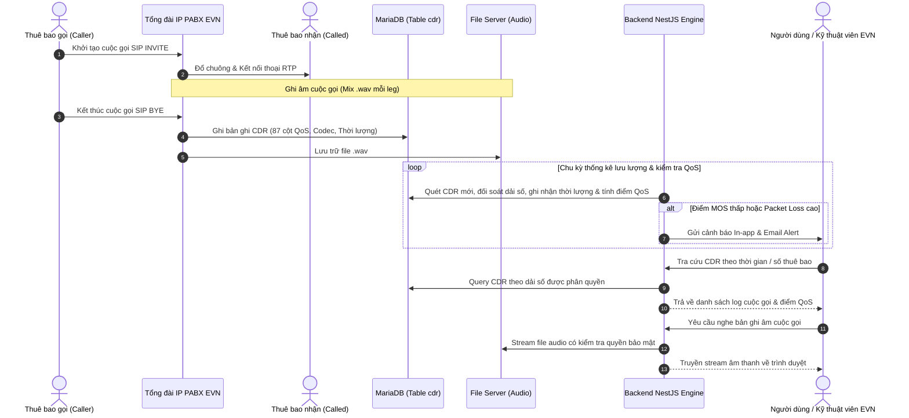

# TÀI LIỆU TỔNG QUAN & KIẾN TRÚC HỆ THỐNG (SYSTEM OVERVIEW & ARCHITECTURE)

## Dự án: Hệ Thống Giám Sát, Phân Tích Log Cuộc Gọi, Đánh Giá Chất Lượng QoS, Thống Kê Lưu Lượng Thoại & Ghi Âm PABX EVN (EVN CDR AS)

---

## 1. Giới thiệu tổng quan

### 1.1. Bối cảnh bài toán

Tập đoàn Điện lực Việt Nam (EVN) giao cho Công ty Viễn thông Điện lực & Công nghệ Thông tin (EVNICT) vận hành mạng lưới viễn thông dùng riêng và hệ thống tổng đài IP PABX quy mô toàn quốc, phục vụ điều hành sản xuất kinh doanh điện năng, chỉ huy điều độ hệ thống điện và trao đổi nội bộ giữa các Tổng công ty, Công ty, Chi nhánh, Điện lực trực thuộc.

Tổng đài PABX ghi nhận toàn bộ thông tin cuộc gọi thoại IP dưới dạng bản ghi chi tiết cuộc gọi (**CDR - Call Detail Record**) vào cơ sở dữ liệu MariaDB, đồng thời lưu trữ các tệp tin ghi âm cuộc gọi (`.wav`).

### 1.2. Mục tiêu của hệ thống EVN CDR AS

1. **Thu thập & Giám sát dữ liệu CDR**: Tự động đồng bộ và quản lý hàng triệu bản ghi CDR từ các tổng đài PABX phân tán.
2. **Đánh giá chất lượng thoại IP (QoS Analysis)**: Phân tích các chỉ số kỹ thuật chuyên sâu theo chuẩn ITU-T (MOS G.107, R-Factor, Jitter RFC 3550, Packet Loss, độ trễ thiết lập SIP, ASR, NER, Disconnection Codes) nhằm phát hiện sớm các sự cố suy giảm chất lượng âm thanh hoặc rớt cuộc gọi.
3. **Quản lý & Cung cấp ghi âm cuộc gọi có kiểm soát**: Cho phép các đơn vị thành viên nghe lại trực tuyến và tải về bản ghi âm kênh trộn hai chiều (Mix, định dạng `.wav`; PABX không ghi kênh RX/TX riêng) phục vụ nghiệp vụ đối soát, giải quyết khiếu nại khách hàng sử dụng điện, tuân thủ chính sách bảo mật thông tin.
4. **Thống kê Thời lượng & Lưu lượng thoại (Traffic & Duration Engine)**: Phân loại cuộc gọi nội bộ EVN theo hướng đi đến từ các đơn vị thành viên; ghi nhận và tổng hợp thời lượng đàm thoại thực tế theo từng đơn vị phục vụ công tác giám sát lưu lượng mạng viễn thông và các nhu cầu quản trị khác của Tập đoàn.
5. **Phân quyền đa cấp độ (Multi-tenancy by User Group)**: Hệ thống chứng thực 2 cấp riêng biệt (**System Admin Portal** và **Tenant User Portal**). Dữ liệu được cô lập **theo Nhóm người dùng** (`user_groups`), thông qua dải đầu số cấp cho nhóm. Cây tổ chức EVN chỉ dùng để tham chiếu và lọc danh sách nhóm, không dùng để phân quyền hay cộng số liệu.

---

## 2. Kiến trúc công nghệ (Technology Stack)

```mermaid
flowchart TD
    subgraph Clients["Clients Layer"]
        BrowserAdmin["Admin Browser (EVN ICT Admin)"]
        BrowserUser["User Browser (Các đơn vị EVN)"]
    end

    subgraph Frontend["Frontend Layer - Vue.js 3"]
        VueApp["Vue 3 (Vite + TypeScript)"]
        PiniaStore["State Management (Pinia)"]
        VueRouter["Vue Router (RBAC Guard)"]
        ChartUI["Chart.js / Data Visualization"]
        AudioPlayer["Web Audio Player (Streaming)"]
    end

    subgraph Backend["Backend Layer - NestJS"]
        APIGateway["NestJS API Gateway"]
        AuthAdminGuard["AdminAuthGuard (JWT - Secret A)"]
        AuthUserGuard["UserAuthGuard (JWT - Secret B)"]

        subgraph Modules["NestJS Modules"]
            ModAuth["Auth & Security Module"]
            ModOrg["Organization & Group Module"]
            ModPhone["Phone Prefix Management"]
            ModCDR["CDR & Audio Stream Module"]
            ModQoS["QoS & Network Debug Module"]
            ModTraffic["Call Duration & Traffic Module"]
            ModReport["Report & Export Module (Zero CDR Scan)"]
            ModNotify["Notification & Mailer Module"]
            ModSettings["System Settings Module"]
            ModStats["Pre-Aggregation Cron Engine"]
        end

        EnrichScheduler["Direct Batch Scheduler (Polling 3-5s, In-Memory Prefix Cache)"]
        CronStatsJob["Scheduled Task (Rolling 10m & Daily Finalize 00:05)"]
    end

    subgraph Storage["Storage & Network Layer"]
        subgraph MariaDB["MariaDB 10.6+ - Database Layer"]
            TableCDR[("Table cdr (Raw PABX Data)")]
            TableCDREnriched[("Table cdr_enriched (Group Enriched)")]
            TableStatsHourly[("Table stats_hourly (Hourly Aggregated)")]
            TableStatsDaily[("Table stats_daily (Daily Aggregated)")]
            AppDB[("App Tables (Users, Groups, Org, Prefixes)")]
        end

        FileServer["Thư mục ghi âm PABX (SMB/NFS, gắn chỉ đọc) - WAV"]
        PABX["EVN PABX Telephony Server"]
        MailServer["EVN SMTP Email Gateway"]
    end

    BrowserAdmin --> VueApp
    BrowserUser --> VueApp

    VueApp --> APIGateway
    APIGateway --> AuthAdminGuard
    APIGateway --> AuthUserGuard
    AuthAdminGuard --> ModAuth
    AuthUserGuard --> ModAuth

    APIGateway --> ModCDR
    APIGateway --> ModQoS
    APIGateway --> ModTraffic
    APIGateway --> ModReport
    APIGateway --> ModPhone
    APIGateway --> ModOrg
    APIGateway --> ModNotify
    APIGateway --> ModSettings
    APIGateway --> ModStats

    PABX -.->|Ghi CDR gốc trực tiếp| TableCDR
    PABX -.->|Sync Audio| FileServer

    EnrichScheduler -->|1. Đọc batch mới - Watermark ID| TableCDR
    EnrichScheduler -->|2. Tra cứu dải số - máy cố định 5 số| AppDB
    EnrichScheduler -->|3. Bulk Insert| TableCDREnriched

    CronStatsJob -->|1. Tính lại 3 giờ gần nhất| TableCDREnriched
    CronStatsJob -->|2. Rolling UPSERT mỗi 10 phút| TableStatsHourly
    CronStatsJob -->|3. Rolling UPSERT và chốt sổ ngày| TableStatsDaily

    ModCDR -->|Truy vấn theo nhóm| TableCDREnriched
    ModCDR --> FileServer
    ModQoS --> TableStatsDaily
    ModTraffic --> TableStatsDaily
    ModReport -->|Zero CDR Scan - chỉ đọc thống kê| TableStatsDaily
    ModReport -->|Dashboard hôm nay| TableStatsHourly
    ModNotify --> MailServer
```



### 2.1. Backend: NestJS (Node.js)

- **Framework**: NestJS (Typescript, Express engine).
- **ORM / Database Access**: TypeORM và tối ưu hóa câu query raw và upsert trên bảng thống kê.
- **Authentication**: Passport-JWT, `bcrypt` băm mật khẩu, hệ thống Guard kép tách biệt cho Admin và User.
- **Background Tasks & Pre-aggregation Engine**: `@nestjs/schedule` nội bộ thực thi các Cron Job định kỳ (mỗi 10 phút tính lại `stats_hourly`/`stats_daily` cho 3 giờ gần nhất; chốt sổ ngày lúc 00:05). Tinh gọn hạ tầng, chạy trực tiếp trong NestJS process, không cần dựng Redis hay hàng đợi BullMQ.
- **File Streaming**: Hỗ trợ HTTP Range Requests (`206 Partial Content`) để người dùng có thể tua âm thanh nghe ghi âm tức thì mà không cần load toàn bộ file.
- **Exporting**: `exceljs` để xuất báo cáo Excel định dạng chuẩn EVN, `pdfmake` hoặc `puppeteer` để xuất báo cáo PDF (trích xuất tức thì từ `stats_daily`, thời gian phản hồi $< 1\text{s}$).
- **Realtime**: `@nestjs/websockets` (Socket.IO) gửi thông báo tức thời (In-app alerts) và cập nhật số liệu giám sát.

### 2.2. Frontend: Vue.js 3

- **Framework**: Vue 3 (Composition API với `<script setup lang="ts">`).
- **Build Tool**: Vite cho tốc độ bundle và hot-reload tối ưu.
- **UI Architecture**: Xây dựng theo bộ giao diện HTML/CSS chuẩn trong thư mục `templates/`, đảm bảo nhận diện thương hiệu EVN (màu xanh dương EVN `#0033A0`, cam `#EA580C`, layout hiện đại, hỗ trợ Dark Mode / Light Mode).
- **State Management**: Pinia (Modules: `authAdmin`, `authUser`, `cdr`, `qos`, `organization`, `notifications`, `settings`).
- **Routing**: Vue Router 4 tích hợp Dynamic Route Loading và Navigation Guards kiểm tra Permissions.
- **Data Visualization**: `chart.js` & `vue-chartjs` để biểu diễn biểu đồ thống kê cuộc gọi, QoS MOS, Packet Loss theo thời gian.
- **Audio Control**: HTML5 Custom Audio Player với thanh sóng âm thanh và điều khiển tua nhanh, phát file Mix của từng leg (chọn leg A/B trong modal chi tiết).

### 2.3. Cơ sở dữ liệu: MariaDB 10.6+

- **Múi giờ**: DB, backend và PABX cùng dùng giờ Việt Nam (UTC+7). Cấu hình bắt buộc: MariaDB `default-time-zone = '+07:00'`, TypeORM `timezone: '+07:00'`, biến môi trường `TZ=Asia/Ho_Chi_Minh` cho tiến trình Node. Chi tiết tại `docs/01_database_schema.md` (đầu tài liệu).

- **Động cơ lưu trữ**: InnoDB (Hỗ trợ ACID, Foreign Keys, Row-level Locking).
- **Bảng CDR gốc `cdr`**: Tiếp nhận trực tiếp từ tổng đài PABX với 87 cột dữ liệu SIP/RTP/RTCP. Dữ liệu thuần túy kỹ thuật của tổng đài, giữ nguyên vẹn để đối soát và bảo toàn log viễn thông.
- **Bảng CDR làm giàu `cdr_enriched`**: Bảng trung tâm phục vụ toàn bộ nghiệp vụ Backend, API và Phân quyền. Chứa các cột gốc kế thừa từ `cdr` và các cột làm giàu: nhóm sở hữu (`caller_group_id`, `called_group_id`), gộp leg (`leg_role`, `call_group_key`, `is_primary_leg`), `call_status`, `answered_duration_sec`, `call_type`, MOS (`mos_*_x100`). Partition theo tháng trên `Created`. Định nghĩa đầy đủ tại `docs/01_database_schema.md` mục 2.1.
- **Bảng dữ liệu nghiệp vụ phụ trợ**: Lưu trữ tổ chức, nhóm người dùng, dải số viễn thông, thống kê thời lượng & lưu lượng, cảnh báo QoS.

### 2.4. Kiến trúc Đồng bộ Làm giàu CDR & Cô lập Dữ liệu theo Nhóm (CDR Enrichment & Group-Based Isolation Pipeline)

```
[Tổng đài PABX] ──(Ghi trực tiếp)──> [Bảng cdr]
                                          │
                               (Batch Polling 3-5s)
                                          ▼
                         [Direct Batch Scheduler (NestJS)]
                                          │
                     ┌────────────────────┴────────────────────┐
                     ▼                                         ▼
         [Tra cứu kho số In-Memory]                  [Cập nhật Watermark ID]
   phone_numbers.range_id -> nhóm người dùng           (cdr_enrichment_state)
   (số ngoài kho / chưa gán dải: NULL)
                     │
                     ▼
          [Bulk Insert cdr_enriched]
      (caller_group_id, called_group_id)
                     │
                     ▼
        [Backend API Data Isolation]
    ┌────────────────┬────────────────┐
    ▼                                 ▼
[User Portal]                  [Admin Portal]
WHERE caller_group_id = G      Xem toàn bộ bản ghi
   OR called_group_id = G      Kèm Badge tên nhóm
                               Bộ lọc theo Nhóm
```

1. **Tiến trình chạy ngầm định thời (Direct Batch Scheduler)**:
   - Module NestJS Scheduler thực thi polling mỗi **3 - 5 giây**.
   - Truy vấn bản ghi mới từ bảng `cdr` theo cơ chế Watermark ID (`WHERE id > last_processed_cdr_id ORDER BY id ASC LIMIT 1000`) lưu trong bảng `cdr_enrichment_state`.
2. **Thuật toán xác định nhóm sở hữu số (Number Ownership Lookup)**:
   - Phần lớn cuộc gọi là mạng thoại nội bộ dùng riêng EVN giữa các máy lẻ 5 số `[H][C][XXX]` (kho 10000–99999). Dữ liệu thật vẫn có số ngoài kho (`Anonymous`, `0xxxx` dịch vụ đặc biệt, số di động, số không đủ 5 chữ số); phía đó có nhóm sở hữu = NULL.
   - **Quy tắc duy nhất**: số khớp `analysis_internal_extension_pattern` được tra cứu **duy nhất** qua chuỗi `phone_numbers.range_id → phone_prefix_ranges.prefix_group_id → user_groups.phone_prefix_group_id` (mọi trạng thái số, quy tắc tại `docs/01_database_schema.md` mục 8); không so khớp theo `prefix` hay `range_from..range_to`. Map được nạp vào bộ nhớ và nạp lại sau mỗi lần cấp phát/thu hồi dải số.
   - **Xử lý số chưa quy hoạch**: Nếu số điện thoại không thuộc bất kỳ nhóm nào, trường tương ứng nhận giá trị `NULL`.
3. **Nguyên tắc Cô lập dữ liệu theo nhóm (Group-Based Data Isolation)**:
   - **Tra cứu danh sách & Nghe ghi âm**: Thực hiện trên bảng `cdr_enriched`.
   - **Phạm vi dữ liệu Người dùng Đơn vị (User Portal)**: Backend tự động áp đặt điều kiện:
     `WHERE (caller_group_id = :currentUserGroupId OR called_group_id = :currentUserGroupId)`
     Một cuộc gọi xuất hiện trong danh sách tra cứu của nhóm khi có số gọi đi HOẶC số nhận cuộc gọi thuộc quyền quản lý của nhóm đó.
   - **Phạm vi dữ liệu Quản trị viên hệ thống (Admin Portal)**: Quản trị viên hệ thống có toàn quyền xem 100% bản ghi CDR (bao gồm cả các cuộc gọi có `caller_group_id` hoặc `called_group_id` bằng `NULL`). Trên giao diện, thông tin nhóm của người gọi và người nhận được hiển thị trực quan dưới dạng nhãn Badge; kèm theo bộ lọc "Nhóm người dùng" cho phép Admin lọc nhanh dữ liệu theo từng đơn vị.
4. **Mô hình Phân quyền Ghi âm Kiểm soát 2 Tầng (2-Tier Recording Access Gate)**:
   - **Tầng 1 (Cấp nhóm - Do Quản trị viên hệ thống cấp quyền)**:
     - Trường `user_groups.allow_recording_access` (tinyint 0/1) đóng vai trò Chốt chặn Tầng 1 do Quản trị viên hệ thống quản lý.
     - **Khi nhóm chưa được cấp phép (`allow_recording_access = 0`)**: Mọi tính năng liên quan đến ghi âm đều không xuất hiện trên giao diện của toàn bộ người dùng nhóm đó: Bảng lưới CDR ẩn hoàn toàn cột "File ghi âm"; trong Modal chi tiết cuộc gọi, khối Audio Player được thay thế bằng thông báo: *"Tính năng ghi âm chưa được kích hoạt cho đơn vị của bạn"*; trên giao diện Quản trị nhóm (`group-admin.html`), các nút bấm, cột và switch phân quyền ghi âm thành viên bị ẩn triệt để. Quản trị viên nhóm không có quyền nghe/tải và không thể cấp quyền cho thành viên. Backend chặn tuyệt đối mọi yêu cầu stream và download với mã lỗi `403 Forbidden`.
     - **Khi nhóm được cấp phép (`allow_recording_access = 1`)**: Kích hoạt phân quyền Tầng 2.
   - **Tầng 2 (Vai trò - Do Quản trị viên nhóm phân quyền khi Tầng 1 đã mở)**: quyền nghe/tải thuộc vai trò, không lưu cờ trên người dùng.
     - **Quản trị viên nhóm (`GROUP_ADMIN`)**: Mặc định có quyền nghe trực tuyến và tải về máy bản ghi âm của nhóm mà không cần thêm cấu hình nào.
     - **Quản trị viên nhóm có quyền cấp phép cho thành viên**: Đổi vai trò thành viên giữa `REGULAR_USER` (Thành viên) và `USER_RECORDING` (Thành viên nghe ghi âm) qua giao diện Quản trị nhóm (`group-admin.html`).
     - Thành viên `USER_RECORDING` được quyền nghe & tải ghi âm của nhóm; thành viên `REGULAR_USER` thấy nhãn khóa `Chưa cấp quyền` và không thể phát hoặc tải file.
   - **Mô hình vai trò – quyền**: 5 vai trò seed cố định (`roles`), quyền seed cố định (`permissions`, `permission_roles`), gán vai trò qua `admin_roles` / `user_roles` (mỗi tài khoản 1 vai trò). Admin chỉ kiểm tra quyền vai trò; User kiểm tra quyền nhóm trước rồi đến quyền vai trò (`docs/modules/10_permissions_and_roles.md`).
5. **Nguyên tắc Thống kê Sẵn & Zero CDR Scan (Pre-aggregated Reporting Engine)**:
   - **Số liệu tổng hợp chỉ đọc `stats_*`**: thẻ KPI, biểu đồ, thống kê QoS/lưu lượng, xem trước và xuất báo cáo không bao giờ `GROUP BY` trên `cdr`/`cdr_enriched`. Danh sách từng cuộc gọi (lịch sử CDR, QoS debug, cuộc gọi gần đây, xuất CDR) được đọc `cdr_enriched` với khoảng thời gian ≤ 31 ngày, qua index và có giới hạn số dòng (nguyên tắc đầy đủ tại `docs/01_database_schema.md` mục 15).
   - **Cơ chế tính toán định kỳ**: Cron Job `@nestjs/schedule` mỗi 10 phút (`*/10 * * * *`) **tính lại toàn bộ** (không cộng dồn) các khung giờ trong 3 giờ gần nhất và các khung giờ trong hàng đợi `stats_recompute_queue`, ghi `stats_hourly` rồi tính lại `stats_daily` của ngày bị tác động. Khóa thời gian là `Created` (thời điểm bắt đầu cuộc gọi) của leg chính. Thuật toán đầy đủ tại `docs/01_database_schema.md` mục 15.0.
   - **Chốt sổ ngày tự động**: 00:05 mỗi sáng, job tính lại cả 24 giờ của ngày hôm trước lần cuối rồi đặt `is_finalized = 1`.
   - **Cô lập dữ liệu báo cáo**: Người dùng đơn vị chỉ truy vấn được dữ liệu có `group_id = currentUser.user_group_id`. Quản trị viên hệ thống mặc định xem Toàn hệ thống (`group_id IS NULL`) hoặc lọc theo nhóm bất kỳ.
   - **Thời gian phản hồi siêu tốc**: Mọi API thống kê và xuất báo cáo chỉ quét từ 1 đến vài chục dòng trong bảng `stats_daily`, trả kết quả tức thì trong $< 50\text{ms}$.

---

## 3. Kiến trúc phân quyền & Đa người dùng (Dual-Portal Architecture)

Hệ thống thiết kế theo cơ chế **Hai cổng đăng nhập độc lập (Dual Portal)** để bảo vệ an toàn dữ liệu:

```
+-----------------------------------------------------------------------------------+
|                              HỆ THỐNG EVN CDR AS                                  |
+-----------------------------------------+-----------------------------------------+
|        1. QUẢN TRỊ VIÊN HỆ THỐNG        |          2. NGƯỜI DÙNG ĐƠN VỊ           |
|            (ADMIN PORTAL)               |              (USER PORTAL)              |
+-----------------------------------------+-----------------------------------------+
| - Bảng dữ liệu: `admins`                | - Bảng dữ liệu: `users`                 |
| - Đăng nhập: /api/v1/admin/auth/login   | - Đăng nhập: /api/v1/auth/login         |
| - Secret Key JWT riêng biệt             | - Secret Key JWT riêng biệt             |
| - Quản trị viên tối cao (Root Admin)    | - Người dùng gắn với Nhóm người dùng    |
|   duy nhất có quyền tạo Admin khác.     |   (User Group) và Nút cây Tổ chức       |
| - Cấu hình hệ thống, ngưỡng QoS,        | - Trưởng nhóm (Group Admin): Quản lý    |
|   cấp dải số cho các đơn vị EVN...      |   thành viên trong đơn vị mình.         |
| - Toàn quyền xem log mọi đơn vị.        | - Xem log CDR theo Dải số được gán.     |
+-----------------------------------------+-----------------------------------------+
```

---

## 4. Mô hình dữ liệu & Luồng xử lý nghiệp vụ (End-to-End Workflow)



---

## 5. Quy chuẩn cấu trúc thư mục mã nguồn (Source Code Directory Standards)

### 5.1. Backend (`backend/`)

```
backend/
├── src/
│   ├── app.module.ts
│   ├── main.ts
│   ├── common/                    <-- Tiện ích chung, decorators, interceptors, filters
│   │   ├── constants/
│   │   ├── decorators/            <-- @CurrentUser(), @CurrentAdmin(), @RequirePermissions()
│   │   ├── filters/               <-- AllExceptionsFilter (chuẩn hóa lỗi HTTP)
│   │   ├── guards/                <-- AdminAuthGuard, UserAuthGuard, PermissionsGuard
│   │   ├── interceptors/          <-- TransformResponseInterceptor, AuditLogInterceptor
│   │   └── pipes/                 <-- ValidationPipe
│   ├── config/                    <-- Cấu hình database, jwt (ngưỡng QoS và SMTP đọc từ DB, không đặt ở đây)
│   ├── database/
│   │   ├── database.module.ts
│   │   ├── migrations/
│   │   └── seeds/                 <-- Root admin, vai trò mặc định, cây tổ chức EVN
│   └── modules/                   <-- Các module tính năng chuyên biệt
│       ├── admin-auth/            <-- Đăng nhập & quản lý Admin
│       ├── admin-profile/         <-- Hồ sơ cá nhân của Admin
│       ├── user-auth/             <-- Đăng nhập & quản lý User
│       ├── user-profile/          <-- Hồ sơ cá nhân của User
│       ├── user-groups/           <-- Nhóm người dùng (Tổ chức QLND)
│       ├── organizations/         <-- Cây tổ chức EVN
│       ├── phone-numbers/         <-- Quản lý đầu số & dải số
│       ├── cdr/                   <-- Tra cứu CDR, phát stream audio
│       ├── qos/                   <-- Phân tích chất lượng thoại, MOS, Jitter, SIP code
│       ├── traffic/               <-- Thống kê lưu lượng, phân loại hướng gọi & thời lượng
│       ├── reports/               <-- Xuất báo cáo Excel, PDF
│       ├── notifications/         <-- In-app notification, WebSocket, Mailer
│       ├── permissions/           <-- Vai trò & quyền (seed cố định), PermissionsGuard
│       ├── system-settings/       <-- Cài đặt hệ thống PABX, retention
│       └── dashboard/             <-- API tổng hợp số liệu Dashboard
├── package.json
├── tsconfig.json
└── .env.example
```

### 5.2. Frontend (`frontend/`)

```
frontend/
├── src/
│   ├── main.ts
│   ├── App.vue
│   ├── api/                       <-- Axios instances, API endpoints theo module
│   │   ├── client.ts              <-- Axios interceptors gắn token JWT & handle 401/403
│   │   ├── auth.api.ts
│   │   ├── cdr.api.ts
│   │   ├── qos.api.ts
│   │   ├── organization.api.ts
│   │   ├── phone.api.ts
│   │   ├── reports.api.ts
│   │   └── settings.api.ts
│   ├── assets/                    <-- CSS, fonts, SVG (logo_evn.svg)
│   │   ├── css/
│   │   │   ├── style.css          <-- Biến CSS dùng chung, theme EVN
│   │   │   └── dark-mode.css
│   ├── components/                <-- Tái sử dụng components
│   │   ├── layout/
│   │   │   ├── Sidebar.vue
│   │   │   ├── Header.vue
│   │   │   └── Footer.vue
│   │   ├── audio/
│   │   │   └── AudioPlayerModal.vue  <-- Trình nghe audio Mix theo leg
│   │   ├── common/
│   │   │   ├── Pagination.vue
│   │   │   ├── TreeTable.vue
│   │   │   ├── ConfirmDialog.vue
│   │   │   └── ToastContainer.vue
│   │   └── charts/
│   │       ├── LineChart.vue
│   │       └── BarChart.vue
│   ├── router/                    <-- Vue Router định tuyến và phân quyền
│   │   └── index.ts
│   ├── stores/                    <-- Pinia stores
│   │   ├── auth.store.ts
│   │   ├── cdr.store.ts
│   │   ├── notification.store.ts
│   │   └── theme.store.ts
│   └── views/                     <-- Các màn hình giao diện (ánh xạ từ templates)
│       ├── auth/
│       │   ├── LoginView.vue
│       │   └── AdminLoginView.vue
│       ├── dashboard/
│       │   └── DashboardView.vue
│       ├── cdr/
│       │   ├── CdrHistoryView.vue
│       │   └── QosDebugView.vue
│       ├── organization/
│       │   ├── OrganizationView.vue
│       │   ├── UserGroupView.vue
│       │   └── PrefixManagementView.vue
│       ├── users/
│       │   ├── UserListView.vue
│       │   ├── RoleListView.vue
│       │   └── PermissionMatrixView.vue
│       ├── reports/
│       │   └── ReportsView.vue
│       ├── notifications/
│       │   └── NotificationsView.vue
│       ├── profile/
│       │   ├── UserProfileView.vue
│       │   └── AdminProfileView.vue
│       └── settings/
│           ├── SystemSettingsView.vue
│           └── UserSettingsView.vue
├── index.html
├── package.json
├── vite.config.ts
└── .env.example
```

---

## 6. Hướng dẫn thực thi cho AI Coding Agent

Khi thực hiện sinh code cho từng thành phần, Agent bắt buộc phải tuân theo các nguyên tắc:

1. **Bảo tồn Schema CDR**: Không tự ý xóa bỏ hoặc thay đổi tên các trường trong bảng `cdr` do PABX ghi vào.
2. **Tuân thủ chuẩn bảo mật EVN**:
   - Mật khẩu phải được hash bằng `bcrypt` với cost factor tối thiểu 10.
   - Luôn kiểm tra quyền truy cập vào file ghi âm: chỉ thuê bao có thẩm quyền đối với đầu số trong CDR mới được phép stream hoặc download file.
   - Ghi lại đầy đủ `audit_logs` khi có hành vi nghe lại hoặc tải file ghi âm.
3. **Hiệu năng cao**: Mọi thao tác truy vấn CDR đều phải có điều kiện lọc theo mốc thời gian (`Created` / `fromDate`, `toDate`, tối đa 31 ngày) để tận dụng Partitioning và Index của MariaDB.
4. **Tính nhất quán giao diện**: Kế thừa **bảng màu, class CSS, icon và bố cục** từ `templates/admin/` và `templates/member/`. **Không** kế thừa mock data, tên trường, enum, mã quyền hay luồng nghiệp vụ trong JS của templates: khi templates mâu thuẫn với `docs/`, `docs/` luôn là chuẩn (danh sách điểm lệch đã biết ở `docs/intent/docs-readiness-for-codegen.md`).
