# THIẾT KẾ CƠ SỞ DỮ LIỆU TOÀN CỤC (GLOBAL DATABASE SCHEMA)
## Dự án: EVN CDR Analysis System (EVN CDR AS)
## Hệ quản trị cơ sở dữ liệu: MariaDB 10.6+ (Engine InnoDB, UTF8MB4)

> [!IMPORTANT]
> **Múi giờ**: mọi cột `datetime`/`timestamp` lưu **giờ Việt Nam (`Asia/Ho_Chi_Minh`, UTC+7), không kèm múi giờ**, khớp với dữ liệu PABX ghi vào bảng `cdr`. Cấu hình bắt buộc: MariaDB `default-time-zone = '+07:00'`; kết nối TypeORM `timezone: '+07:00'`; tiến trình Node `TZ=Asia/Ho_Chi_Minh`. `stat_date`/`stat_hour` và mọi mốc "hôm nay / 7 ngày / tháng này" tính theo giờ Việt Nam do backend tự tính rồi truyền làm tham số (không dùng `CURRENT_DATE()`/`NOW()` của DB trong truy vấn thống kê và truy vấn nghiệp vụ theo khoảng thời gian).
>
> **Giới hạn kiểu `timestamp`**: trên MariaDB 10.6, `timestamp` chỉ lưu tới `2038-01-19 03:14:07` UTC. Các cột `created_at`/`updated_at` dùng `timestamp` nên phải nâng lên MariaDB 11.5+ (giới hạn 2106) hoặc chuyển sang `datetime` trước năm 2037. Cột nghiệp vụ dài hạn (`Created`, `stat_date`, `expires_at`...) đã dùng `datetime`/`date`.

---

## 1. Sơ đồ thực thể quan hệ (Entity-Relationship Diagram)

> [!NOTE]
> **Nguyên tắc cốt lõi về phân quyền & phạm vi dữ liệu**:
> Toàn bộ dữ liệu cuộc gọi (CDR), giám sát chất lượng (QoS), thống kê thời lượng và báo cáo lưu lượng trong hệ thống **tập trung 100% vào thực thể Nhóm người dùng (`user_groups`)**.
> Cây tổ chức (`organizations`) trong phiên bản này thuần túy đóng vai trò là **danh mục phân cấp cây tham chiếu** để người dùng và quản trị viên trực quan hóa xem Nhóm người dùng đó thuộc nhánh đơn vị/tổng công ty nào trên cây tổ chức; cây tổ chức **hoàn toàn không tham gia vào việc phân bổ hay tính toán số liệu thống kê báo cáo lưu lượng**.

```mermaid
erDiagram
    ORGANIZATIONS ||--o{ ORGANIZATIONS : "parent_id (reference tree)"
    ORGANIZATIONS ||--o{ USER_GROUPS : "reference_belongs_to"

    USER_GROUPS ||--|| PHONE_PREFIX_GROUPS : "bound_1_to_1 (phone_prefix_group_id; prefix group auto-created with the user group)"
    PHONE_PREFIX_GROUPS ||--o{ PHONE_PREFIX_RANGES : "contains_ranges (0..N)"
    PHONE_PREFIX_RANGES |o--o{ PHONE_NUMBERS : "allocates_from_master_pool (range_id nullable: free pool)"

    USER_GROUPS ||..o{ PREFIX_ALLOCATION_HISTORY : "tracks_range_changes (snapshot, no FK)"
    PHONE_NUMBERS ||..o{ PHONE_NUMBER_RANGE_HISTORY : "tracks_range_movement (snapshot by phone_number, no FK)"

    USER_GROUPS ||--o{ USERS : "contains"

    USERS ||--|| USER_ROLES : "has_exactly_one_role"
    ADMINS ||--|| ADMIN_ROLES : "has_exactly_one_role"
    ADMINS |o--o{ ADMINS : "created_by_admin_id (SET NULL)"
    ADMINS |o--o{ PREFIX_ALLOCATION_HISTORY : "performed_by_admin_id (SET NULL)"
    ADMINS |o--o{ PHONE_NUMBER_RANGE_HISTORY : "performed_by_admin_id (SET NULL)"
    ADMINS |o--o{ NOTIFICATIONS : "created_by_admin_id (SET NULL)"
    ROLES ||--o{ USER_ROLES : "assigned_to_users (scope USER)"
    ROLES ||--o{ ADMIN_ROLES : "assigned_to_admins (scope ADMIN)"
    ROLES ||--o{ PERMISSION_ROLES : "has"
    PERMISSIONS ||--o{ PERMISSION_ROLES : "belongs_to"

    CDR ||--|| CDR_ENRICHED : "syncs_and_enriches"
    USER_GROUPS ||..o{ CDR_ENRICHED : "caller_group (logical, no FK - partitioned)"
    USER_GROUPS ||..o{ CDR_ENRICHED : "called_group (logical, no FK - partitioned)"

    USER_GROUPS ||--o{ STATS_HOURLY : "aggregates_for_group"
    USER_GROUPS ||--o{ STATS_DAILY : "aggregates_for_group"
    CDR_ENRICHED ||--o{ STATS_HOURLY : "aggregated_hourly_via_cron"
    STATS_HOURLY ||--o{ STATS_DAILY : "rolled_up_daily"

    NOTIFICATIONS ||--o{ NOTIFICATION_RECIPIENTS : "delivered_to"
    USERS ||..o{ NOTIFICATION_RECIPIENTS : "receives (polymorphic, no FK)"
    ADMINS ||..o{ NOTIFICATION_RECIPIENTS : "receives (polymorphic, no FK)"

    USERS ||..o{ USER_SETTINGS : "has_prefs (polymorphic, no FK)"
    ADMINS ||..o{ USER_SETTINGS : "has_prefs (polymorphic, no FK)"

    USERS ||..o{ AUTH_SESSIONS : "sessions (polymorphic, no FK)"
    ADMINS ||..o{ AUTH_SESSIONS : "sessions (polymorphic, no FK)"
    USERS ||..o{ AUDIT_LOGS : "performed_by_user (polymorphic, no FK)"
    ADMINS ||..o{ AUDIT_LOGS : "performed_by_admin (polymorphic, no FK)"
```



---

## 2. Bảng CDR nguyên bản từ tổng đài PABX (Call Detail Record)

Bảng `cdr` là bảng trung tâm tiếp nhận thông tin từ tổng đài PABX do hệ thống thu thập chuyên dụng bên ngoài đẩy trực tiếp vào theo thời gian thực cuộc gọi (Real-time Ingestion). Giữ nguyên toàn bộ 87 cột kỹ thuật theo đặc tả nguyên bản của tổng đài StarTrinity PABX (trong đó `Direction` lưu giá trị raw như `'remote'`, `DisconnectionStatus` lưu mã nguyên nhân SIP như `'OK'`, `'RequestTerminated'`), Hệ thống chỉ đọc bảng này (xem ghi chú bên dưới); chỉ mục và partition cho truy vấn nghiệp vụ đặt trên `cdr_enriched`. Quá trình chuẩn hóa hướng gọi nghiệp vụ (`INBOUND`, `OUTBOUND`, `INTERNAL`) và trạng thái chuẩn (`call_status`: `ANSWERED`, `BUSY`, `NO_ANSWER`, `FAILED`, ánh xạ từ `DisconnectionCode` theo mục 2.1) sẽ được xử lý tại bảng làm giàu `cdr_enriched`. Không bao giờ lọc hoặc đếm trực tiếp theo `Direction`/`DisconnectionStatus` thô.

```sql
CREATE TABLE IF NOT EXISTS `cdr` (
  `id` bigint(20) unsigned zerofill NOT NULL AUTO_INCREMENT,
  `Created` datetime DEFAULT NULL,
  `Answered` datetime DEFAULT NULL,
  `Destroyed` datetime DEFAULT NULL,
  `Direction` varchar(255) DEFAULT NULL,
  `CallerId` varchar(255) DEFAULT NULL,
  `CallerDisplayName` varchar(255) DEFAULT NULL,
  `CalledId` varchar(255) DEFAULT NULL,
  `CalledDisplayName` varchar(255) DEFAULT NULL,
  `SipCallId` varchar(255) DEFAULT NULL,
  `CallerIp` varchar(255) DEFAULT NULL,
  `CalledIp` varchar(255) DEFAULT NULL,
  `DisconnectionCode` varchar(255) DEFAULT NULL,
  `DisconnectionStatus` varchar(255) DEFAULT NULL,
  `ReleasedBy` varchar(255) DEFAULT NULL,
  `Answer_Delay` int(11) DEFAULT NULL,
  `_100_Delay` int(11) DEFAULT NULL,
  `_180_Delay` int(11) DEFAULT NULL,
  `_183_Delay` int(11) DEFAULT NULL,
  `_180_183_Delay` int(11) DEFAULT NULL,
  `Audio_Signal_Delay` int(11) DEFAULT NULL,
  `Latest_RBT_Delay` int(11) DEFAULT NULL,
  `Early_Media_Peak_Signal_Level` int(11) DEFAULT NULL,
  `Active_Media_Peak_Signal_Level` int(11) DEFAULT NULL,
  `Recorded_RX_FileName` varchar(255) DEFAULT NULL,
  `Recorded_TX_FileName` varchar(255) DEFAULT NULL,
  `Recorded_Mix_FileName` varchar(255) DEFAULT NULL,
  `Answered_Duration` int(11) DEFAULT NULL COMMENT 'Thời lượng đàm thoại thực tế tính bằng MILI-GIÂY (ms), do PABX ghi; nghiệp vụ dùng cdr_enriched.answered_duration_sec',
  `Current_Calls_Count` double DEFAULT NULL,
  `Calls_Per_Second` double DEFAULT NULL,
  `Sip_Pcap_FileName` varchar(255) DEFAULT NULL COMMENT 'PABX có ghi; hệ thống chưa khai thác PCAP trong phiên bản này (không có API)',
  `Sip_And_Rtp_Pcap_FileName` varchar(255) DEFAULT NULL COMMENT 'PABX có ghi; hệ thống chưa khai thác PCAP trong phiên bản này (không có API)',
  `RTP_Codec` varchar(255) DEFAULT NULL,
  `RTP_Caller_Address` varchar(255) DEFAULT NULL,
  `RTP_Caller_Port` int(11) DEFAULT NULL,
  `RTP_Caller_SSRC` varchar(255) DEFAULT NULL,
  `RTP_Caller_G107R` bigint(20) DEFAULT NULL,
  `RTP_Caller_G107MOS` bigint(20) DEFAULT NULL,
  `RTP_Caller_PacketsCount` int(11) DEFAULT NULL,
  `RTP_Caller_LostPackets` int(11) DEFAULT NULL,
  `RTP_Caller_MaxRfc3550Jitter` bigint(20) DEFAULT NULL,
  `RTP_Caller_MeanRfc3550Jitter` bigint(20) DEFAULT NULL,
  `RTP_Caller_MaxDelta` bigint(20) DEFAULT NULL,
  `RTP_Caller_MinDelta` bigint(20) DEFAULT NULL,
  `RTP_Caller_PacketTime` int(11) DEFAULT NULL,
  `RTP_Caller_NonSilentPercentage` bigint(20) DEFAULT NULL,
  `RTP_Caller_Delay` int(11) DEFAULT NULL,
  `RTP_Caller_DSCP` int(11) DEFAULT NULL,
  `SDP_RTP_Caller_Delay` int(11) DEFAULT NULL,
  `RTP_Called_Address` varchar(255) DEFAULT NULL,
  `RTP_Called_Port` int(11) DEFAULT NULL,
  `RTP_Called_SSRC` varchar(255) DEFAULT NULL,
  `RTP_Called_G107R` bigint(20) DEFAULT NULL,
  `RTP_Called_G107MOS` bigint(20) DEFAULT NULL,
  `RTP_Called_PacketsCount` int(11) DEFAULT NULL,
  `RTP_Called_LostPackets` int(11) DEFAULT NULL,
  `RTP_Called_MaxRfc3550Jitter` double DEFAULT NULL,
  `RTP_Called_MeanRfc3550Jitter` double DEFAULT NULL,
  `RTP_Called_MaxDelta` bigint(20) DEFAULT NULL,
  `RTP_Called_MinDelta` bigint(20) DEFAULT NULL,
  `RTP_Called_PacketTime` int(11) DEFAULT NULL,
  `RTP_Called_NonSilentPercentage` bigint(20) DEFAULT NULL,
  `RTP_Called_Delay` int(11) DEFAULT NULL,
  `RTP_Called_DSCP` int(11) DEFAULT NULL,
  `SDP_RTP_Called_Delay` int(11) DEFAULT NULL,
  `RTCP_RTT_Max` int(11) DEFAULT NULL,
  `RTCP_RTT_Mean` int(11) DEFAULT NULL,
  `RTCP_Caller_Jitter_Max` int(11) DEFAULT NULL,
  `RTCP_Caller_Jitter_Mean` int(11) DEFAULT NULL,
  `RTCP_Caller_LostPackets` int(11) DEFAULT NULL,
  `RTCP_Called_Jitter_Max` int(11) DEFAULT NULL,
  `RTCP_Called_Jitter_Mean` int(11) DEFAULT NULL,
  `RTCP_Called_LostPackets` int(11) DEFAULT NULL,
  `Test_ID` int(11) DEFAULT NULL,
  `RTP_Rx_PacketsTotal` int(11) DEFAULT NULL,
  `RTP_Rx_PacketsDiscarded` int(11) DEFAULT NULL,
  `RTP_Rx_PacketsDiscarded_Duplicated` int(11) DEFAULT NULL,
  `RTP_Rx_PacketsDiscarded_Early` int(11) DEFAULT NULL,
  `RTP_Rx_PacketsDiscarded_Late` int(11) DEFAULT NULL,
  `RTP_Rx_PacketsDiscarded_Error` int(11) DEFAULT NULL,
  `RTP_CodecSampleRate` int(11) DEFAULT NULL,
  `from_no` varchar(255) DEFAULT NULL,
  `to_no` varchar(255) DEFAULT NULL,
  `duration` int(11) DEFAULT NULL,
  `time_end` datetime DEFAULT NULL,
  `created_at` timestamp NULL DEFAULT NULL,
  `updated_at` timestamp NULL DEFAULT NULL,
  PRIMARY KEY (`id`)
) ENGINE=InnoDB DEFAULT CHARSET=utf8mb4 COLLATE=utf8mb4_unicode_ci;

```

> [!NOTE]
> **Index khuyến nghị trên bảng `cdr` (KHÔNG thuộc migration của hệ thống)**: bảng `cdr` thuộc PABX; chỉ DBA tạo các index dưới đây khi chủ hệ thống PABX đồng ý. Hệ thống EVN CDR AS không phụ thuộc chúng: tiến trình làm giàu chỉ đọc theo khóa chính (`id > watermark`, và `ORDER BY id DESC LIMIT 1` để phát hiện PABX ngừng ghi, mục 10).
>
> ```sql
> -- CHỈ THAM KHẢO, không đưa vào migration
> CREATE INDEX `idx_cdr_created` ON `cdr` (`Created`);
> ```

> [!NOTE]
> **Bảng `cdr` thuộc quyền sở hữu của PABX**: hệ thống EVN CDR AS **chỉ đọc**, không thay đổi cấu trúc, không partition và không xóa dữ liệu bảng này. Việc dọn dữ liệu cũ của bảng `cdr` (và file ghi âm, nếu PABX tự quản lý) thuộc trách nhiệm phía PABX. Partition và vòng đời dữ liệu nghiệp vụ áp dụng trên `cdr_enriched` (mục 2.1).

---

## 2.1. Bảng CDR Làm Giàu & Cô lập dữ liệu theo nhóm (cdr_enriched)

Bảng `cdr_enriched` là **bảng trung tâm cho toàn bộ nghiệp vụ Backend, API và Phân quyền** của hệ thống EVN CDR AS:
- Tiếp nhận dữ liệu được copy và làm giàu từ bảng `cdr` thông qua tiến trình Near-Realtime Batch Scheduler (chu kỳ 3 giây).
- Bổ sung các cột làm giàu: nhóm sở hữu (`caller_group_id`, `called_group_id`), gộp leg, `call_status`, `answered_duration_sec`, `call_type`, MOS thập phân (chi tiết ở các khối quy tắc bên dưới).
- Nếu số điện thoại thuộc dải cấp sở hữu cho nhóm người dùng (`phone_prefix_groups` -> `phone_prefix_ranges` -> `phone_numbers`), trường tương ứng lưu `id` của nhóm (`user_groups.id`).
- Nếu số điện thoại chưa được quy hoạch cấp cho nhóm nào (số nội bộ chưa khai báo), hoặc là **số ngoài kho** (không khớp `analysis_internal_extension_pattern`: `Anonymous`, `0xxxx`, số không đủ 5 chữ số, số di động… xem mục 8), trường tương ứng nhận giá trị `NULL`. Số ngoài kho không làm lỗi tiến trình làm giàu.
- Áp dụng các chỉ mục hợp bộ (`caller_group_id`, `Created`) và (`called_group_id`, `Created`) để tối ưu hóa truy vấn **Group-Based Data Isolation**.

> [!IMPORTANT]
> **Quy tắc gộp leg & chọn leg chính (Call Leg Grouping)**:
> Lõi PABX (B2BUA) ghi **2 bản ghi `cdr` cho một cuộc gọi đi qua lõi**: leg A (máy gọi → lõi) và leg B (lõi → máy nhận). Mỗi leg có `SipCallId`, file ghi âm và chỉ số QoS riêng.
> Trong dữ liệu thật `voip_cdr_20250817.sql`, 5.369 bản ghi ứng với khoảng 3.506 cuộc gọi: 1.863 cuộc có đủ leg A + leg B, phần còn lại chỉ có 1 leg. Nếu đếm theo bản ghi, số cuộc gọi bị thổi lên khoảng 53 %.
> 1. **Xác định vai trò leg (`leg_role`)** theo danh sách IP lõi trong setting `pabx_core_ip_list` (mặc định `10.128.16.252,10.128.16.253`):
>    - `A_LEG`: `CalledIp` thuộc danh sách IP lõi.
>    - `B_LEG`: `CallerIp` thuộc danh sách IP lõi.
>    - `UNKNOWN`: không khớp quy tắc nào ở trên.
> 2. **Khóa gom leg**: một leg A và một leg B cùng `CallerId`, cùng `CalledId`, có `Created` lệch nhau không quá 2 giây thuộc cùng một cuộc gọi.
>    - Mỗi cuộc gọi có **tối đa 1 leg A và 1 leg B**. Khi gọi lại liên tiếp trong vòng 2 giây, có thể có nhiều ứng viên: ghép leg B với leg A chưa có cặp có `Created` gần nhất, nếu bằng nhau thì chọn `id` gần nhất. Leg không tìm được cặp là một cuộc gọi riêng.
>    - Hai leg cùng vai trò (A–A hoặc B–B) **không bao giờ** được ghép với nhau.
> 3. **Leg chính (`is_primary_leg = 1`)**: là leg A nếu cuộc gọi có leg A. Cuộc gọi chỉ có 1 leg thì leg đó là leg chính, bất kể `leg_role`.
> 4. **`call_group_key`** = `id` của leg chính. Mọi leg của cùng một cuộc gọi mang cùng giá trị này.
> 5. **Leg đến muộn**: tiến trình làm giàu xử lý theo watermark `id`, nên leg thứ hai có thể rơi vào batch sau. Khi ghi một leg mới, tiến trình tìm các leg đã có cùng khóa gom trong `cdr_enriched`:
>    - Nếu leg mới là leg chính theo quy tắc 3, hạ leg chính cũ xuống `is_primary_leg = 0`.
>    - Cập nhật lại `call_group_key` cho cả nhóm.
> 6. **Phạm vi sử dụng**:
>    - Mọi số liệu đếm cuộc gọi, thời lượng và ASR/NER (`stats_hourly`, `stats_daily`, API lưu lượng `/traffic/*`) **chỉ tính leg chính**.
>    - Khối chất lượng âm thanh và truyền dẫn của `stats_*` (MOS, R, jitter, gói RTP) tính trên **mọi leg**, để có cả chất lượng phía máy nhận (mục 15).
>    - Danh sách lịch sử CDR mặc định chỉ hiển thị leg chính.
>    - Trang chi tiết và QoS debug hiển thị đủ cả 2 leg (gom theo `call_group_key`), để xem chất lượng âm thanh từng phía.

> [!IMPORTANT]
> **Quy tắc chuẩn hóa trạng thái cuộc gọi (`call_status`)**:
> `call_status` được ánh xạ từ `DisconnectionCode` (mã SIP cuối cùng) **của từng leg**. Trạng thái của một cuộc gọi là `call_status` của leg chính (`is_primary_leg = 1`), vì leg A và leg B đôi khi kết thúc bằng mã khác nhau (vd. A=480 / B=408).
>
> | `call_status` | `DisconnectionCode` | `DisconnectionStatus` thô (StarTrinity) | Ý nghĩa nghiệp vụ |
> |---|---|---|---|
> | `ANSWERED` | `200` | `OK` | Nhấc máy và đàm thoại (trùng 100 % với `Answered IS NOT NULL` trên dữ liệu thật) |
> | `BUSY` | `486`, `603` | `BusyHere`, `Declined` | Máy bận hoặc người nhận từ chối |
> | `NO_ANSWER` | `487`, `480` | `RequestTerminated`, `TemporarilyUnavailable` | Gọi nhỡ (phía gọi bỏ máy khi đang đổ chuông) hoặc máy nhận không sẵn sàng/không bắt máy |
> | `FAILED` | mọi mã còn lại (`404`, `408`, `503`, các mã 4xx/5xx/6xx khác, hoặc NULL) | `NotFound`, `RequestTimeout`, `ServiceUnavailable`… | Lỗi định tuyến, mạng hoặc hạ tầng |
>
> Bảng ánh xạ là quy tắc nghiệp vụ cố định (hằng số trong code), không cấu hình qua `system_settings`. Bổ sung mã mới phải cập nhật bảng này.

> [!IMPORTANT]
> **Các cột dẫn xuất khác & hướng gọi**:
> - **Thời lượng**: `Answered_Duration` của PABX tính bằng **mili-giây** (đã kiểm chứng 3.347/3.347 cuộc nhấc máy trong dữ liệu thật: `Answered_Duration / 1000 ≈ Destroyed − Answered`). Cột `answered_duration_sec` là nguồn duy nhất cho mọi thời lượng nghiệp vụ: `*_duration_sec` trong stats, ACD/ALOC, và trường `durationSec` trả về API (`docs/02_api_contracts.md` mục 2).
> - **`call_type`**: lưu sẵn trên từng leg, xác định từ `caller_group_id`/`called_group_id` (quy tắc tại mục 9).
> - **Hướng gọi (`INBOUND` / `OUTBOUND` / `INTERNAL`) không lưu thành cột**, vì nó phụ thuộc vào nhóm của người xem: cùng một cuộc gọi là `OUTBOUND` với nhóm gọi nhưng là `INBOUND` với nhóm nhận. API tính hướng gọi lúc truy vấn theo nhóm đang xem `:g`:
>   - `OUTBOUND`: `caller_group_id = :g AND (called_group_id <> :g OR called_group_id IS NULL)`
>   - `INBOUND`: `called_group_id = :g AND (caller_group_id <> :g OR caller_group_id IS NULL)`
>   - `INTERNAL`: `caller_group_id = :g AND called_group_id = :g`
>
>   Ở phạm vi toàn hệ thống (Admin, không chọn nhóm), bộ lọc hướng gọi được thay bằng bộ lọc `call_type`. Cột thô `Direction` (luôn là `'remote'`) không dùng cho nghiệp vụ.
> - **MOS (ITU-T G.107 E-model)**: PABX chỉ lưu MOS đã làm tròn thành số nguyên (`RTP_*_G107MOS` ∈ {1..5}) cùng hệ số R (`RTP_*_G107R`, 0–100). Trên dữ liệu thật, `ROUND(MOS_E-model(R))` khớp 8.334/8.334 giá trị số nguyên của PABX, nên MOS thập phân được tính lại từ R khi làm giàu:
>   - `MOS(R) = 1` nếu `R ≤ 0`; `4.5` nếu `R ≥ 100`; ngược lại `1 + 0.035·R + 7·10⁻⁶·R·(R − 60)·(100 − R)`.
>   - `mos_caller_x100 = ROUND(MOS(RTP_Caller_G107R) × 100)`, tương tự `mos_called_x100`. Bằng NULL nếu R là NULL.
>   - `mos_x100` = trung bình hai chiều (làm tròn), hoặc chiều duy nhất có dữ liệu, hoặc NULL.
>   - Cột số nguyên `RTP_*_G107MOS` chỉ dùng để hiển thị thô ở QoS debug. Mọi lọc, phân dải, trung bình và so sánh ngưỡng (`qos_threshold_configs.metric_name = 'MOS_G107'`, thang thập phân) dùng `mos_*_x100 / 100`. Hiển thị luôn 2 chữ số thập phân.
> - **Dải chất lượng MOS duy nhất toàn hệ thống** (áp dụng cho `mos_x100` của từng leg, mọi module và giao diện tham chiếu bảng này):
>
>   | Dải | Điều kiện | Lớp CSS / màu |
>   |---|---|---|
>   | Xuất sắc | `mos_x100 >= 400` | `.mos-excellent` – success `#10B981` |
>   | Tốt | `350 <= mos_x100 < 400` | `.mos-good` – success `#10B981` |
>   | Trung bình | `300 <= mos_x100 < 350` | `.mos-fair` – warning `#F59E0B` |
>   | Kém | `mos_x100 < 300` | `.mos-poor` – danger `#DC3545` |
>   | Không có dữ liệu | `mos_x100 IS NULL` | `.mos-na` – xám, không tính vào dải nào |
> - Bảng `call_duration_records` của thiết kế cũ **đã bị loại bỏ**: toàn bộ thông tin của nó (nhóm hai phía, `call_type`, thời lượng giây, 1 dòng/cuộc gọi) nằm trên `cdr_enriched` với điều kiện `is_primary_leg = 1`.

```sql
CREATE TABLE IF NOT EXISTS `cdr_enriched` (
  `id` bigint(20) unsigned zerofill NOT NULL COMMENT 'Định danh trùng khớp 1-1 với cdr.id',
  `Created` datetime NOT NULL COMMENT 'Khóa partition. Lấy từ cdr.Created; nếu NULL thì lấy cdr.Destroyed, rồi cdr.created_at; chỉ khi cả ba NULL mới lấy thời điểm làm giàu (mỗi bản ghi cdr chỉ được làm giàu đúng một lần nhờ watermark nên giá trị không đổi về sau)',
  `Answered` datetime DEFAULT NULL,
  `Destroyed` datetime DEFAULT NULL,
  `Direction` varchar(255) DEFAULT NULL,
  `CallerId` varchar(255) DEFAULT NULL,
  `CallerDisplayName` varchar(255) DEFAULT NULL,
  `CalledId` varchar(255) DEFAULT NULL,
  `CalledDisplayName` varchar(255) DEFAULT NULL,
  `SipCallId` varchar(255) DEFAULT NULL,
  `CallerIp` varchar(255) DEFAULT NULL,
  `CalledIp` varchar(255) DEFAULT NULL,
  `DisconnectionCode` varchar(255) DEFAULT NULL,
  `DisconnectionStatus` varchar(255) DEFAULT NULL,
  `ReleasedBy` varchar(255) DEFAULT NULL,
  `Answer_Delay` int(11) DEFAULT NULL,
  `_100_Delay` int(11) DEFAULT NULL,
  `_180_Delay` int(11) DEFAULT NULL,
  `_183_Delay` int(11) DEFAULT NULL,
  `_180_183_Delay` int(11) DEFAULT NULL,
  `Audio_Signal_Delay` int(11) DEFAULT NULL,
  `Latest_RBT_Delay` int(11) DEFAULT NULL,
  `Early_Media_Peak_Signal_Level` int(11) DEFAULT NULL,
  `Active_Media_Peak_Signal_Level` int(11) DEFAULT NULL,
  `Recorded_RX_FileName` varchar(255) DEFAULT NULL,
  `Recorded_TX_FileName` varchar(255) DEFAULT NULL,
  `Recorded_Mix_FileName` varchar(255) DEFAULT NULL,
  `Answered_Duration` int(11) DEFAULT NULL COMMENT 'Thời lượng đàm thoại thực tế tính bằng MILI-GIÂY (ms), do PABX ghi; nghiệp vụ dùng cdr_enriched.answered_duration_sec',
  `Current_Calls_Count` double DEFAULT NULL,
  `Calls_Per_Second` double DEFAULT NULL,
  `Sip_Pcap_FileName` varchar(255) DEFAULT NULL COMMENT 'PABX có ghi; hệ thống chưa khai thác PCAP trong phiên bản này (không có API)',
  `Sip_And_Rtp_Pcap_FileName` varchar(255) DEFAULT NULL COMMENT 'PABX có ghi; hệ thống chưa khai thác PCAP trong phiên bản này (không có API)',
  `RTP_Codec` varchar(255) DEFAULT NULL,
  `RTP_Caller_Address` varchar(255) DEFAULT NULL,
  `RTP_Caller_Port` int(11) DEFAULT NULL,
  `RTP_Caller_SSRC` varchar(255) DEFAULT NULL,
  `RTP_Caller_G107R` bigint(20) DEFAULT NULL,
  `RTP_Caller_G107MOS` bigint(20) DEFAULT NULL,
  `RTP_Caller_PacketsCount` int(11) DEFAULT NULL,
  `RTP_Caller_LostPackets` int(11) DEFAULT NULL,
  `RTP_Caller_MaxRfc3550Jitter` bigint(20) DEFAULT NULL,
  `RTP_Caller_MeanRfc3550Jitter` bigint(20) DEFAULT NULL,
  `RTP_Caller_MaxDelta` bigint(20) DEFAULT NULL,
  `RTP_Caller_MinDelta` bigint(20) DEFAULT NULL,
  `RTP_Caller_PacketTime` int(11) DEFAULT NULL,
  `RTP_Caller_NonSilentPercentage` bigint(20) DEFAULT NULL,
  `RTP_Caller_Delay` int(11) DEFAULT NULL,
  `RTP_Caller_DSCP` int(11) DEFAULT NULL,
  `SDP_RTP_Caller_Delay` int(11) DEFAULT NULL,
  `RTP_Called_Address` varchar(255) DEFAULT NULL,
  `RTP_Called_Port` int(11) DEFAULT NULL,
  `RTP_Called_SSRC` varchar(255) DEFAULT NULL,
  `RTP_Called_G107R` bigint(20) DEFAULT NULL,
  `RTP_Called_G107MOS` bigint(20) DEFAULT NULL,
  `RTP_Called_PacketsCount` int(11) DEFAULT NULL,
  `RTP_Called_LostPackets` int(11) DEFAULT NULL,
  `RTP_Called_MaxRfc3550Jitter` double DEFAULT NULL,
  `RTP_Called_MeanRfc3550Jitter` double DEFAULT NULL,
  `RTP_Called_MaxDelta` bigint(20) DEFAULT NULL,
  `RTP_Called_MinDelta` bigint(20) DEFAULT NULL,
  `RTP_Called_PacketTime` int(11) DEFAULT NULL,
  `RTP_Called_NonSilentPercentage` bigint(20) DEFAULT NULL,
  `RTP_Called_Delay` int(11) DEFAULT NULL,
  `RTP_Called_DSCP` int(11) DEFAULT NULL,
  `SDP_RTP_Called_Delay` int(11) DEFAULT NULL,
  `RTCP_RTT_Max` int(11) DEFAULT NULL,
  `RTCP_RTT_Mean` int(11) DEFAULT NULL,
  `RTCP_Caller_Jitter_Max` int(11) DEFAULT NULL,
  `RTCP_Caller_Jitter_Mean` int(11) DEFAULT NULL,
  `RTCP_Caller_LostPackets` int(11) DEFAULT NULL,
  `RTCP_Called_Jitter_Max` int(11) DEFAULT NULL,
  `RTCP_Called_Jitter_Mean` int(11) DEFAULT NULL,
  `RTCP_Called_LostPackets` int(11) DEFAULT NULL,
  `Test_ID` int(11) DEFAULT NULL,
  `RTP_Rx_PacketsTotal` int(11) DEFAULT NULL,
  `RTP_Rx_PacketsDiscarded` int(11) DEFAULT NULL,
  `RTP_Rx_PacketsDiscarded_Duplicated` int(11) DEFAULT NULL,
  `RTP_Rx_PacketsDiscarded_Early` int(11) DEFAULT NULL,
  `RTP_Rx_PacketsDiscarded_Late` int(11) DEFAULT NULL,
  `RTP_Rx_PacketsDiscarded_Error` int(11) DEFAULT NULL,
  `RTP_CodecSampleRate` int(11) DEFAULT NULL,
  `from_no` varchar(255) DEFAULT NULL,
  `to_no` varchar(255) DEFAULT NULL,
  `duration` int(11) DEFAULT NULL,
  `time_end` datetime DEFAULT NULL,
  `caller_group_id` int(11) unsigned DEFAULT NULL COMMENT 'ID nhóm sở hữu số gọi đi (user_groups.id), NULL nếu số chưa gán nhóm',
  `called_group_id` int(11) unsigned DEFAULT NULL COMMENT 'ID nhóm sở hữu số nhận cuộc gọi (user_groups.id), NULL nếu số chưa gán nhóm',
  `leg_role` enum('A_LEG','B_LEG','UNKNOWN') NOT NULL DEFAULT 'UNKNOWN' COMMENT 'A_LEG: máy gọi -> lõi PABX (CalledIp thuộc pabx_core_ip_list); B_LEG: lõi -> máy nhận (CallerIp thuộc pabx_core_ip_list)',
  `call_group_key` bigint(20) unsigned NOT NULL COMMENT 'id của leg chính; các leg cùng một cuộc gọi mang cùng giá trị',
  `is_primary_leg` tinyint(1) NOT NULL DEFAULT 1 COMMENT '1: leg chính (được đếm vào thống kê), 0: leg phụ (chỉ hiển thị ở chi tiết/QoS debug)',
  `call_status` enum('ANSWERED','BUSY','NO_ANSWER','FAILED') NOT NULL COMMENT 'Trạng thái chuẩn hóa từ DisconnectionCode của leg này (bảng ánh xạ mục 2.1)',
  `answered_duration_sec` int(11) unsigned NOT NULL DEFAULT 0 COMMENT 'Thời lượng đàm thoại (giây) = ROUND(Answered_Duration / 1000) nếu call_status = ANSWERED, ngược lại 0',
  `call_type` enum('INTRA_GROUP','INTER_GROUP','UNASSIGNED') NOT NULL COMMENT 'Phân loại lưu lượng theo nhóm (quy tắc mục 9)',
  `mos_caller_x100` smallint(5) unsigned DEFAULT NULL COMMENT 'MOS phía gọi ×100, tính từ RTP_Caller_G107R theo E-model (ví dụ 441 = 4.41); NULL nếu không có RTP',
  `mos_called_x100` smallint(5) unsigned DEFAULT NULL COMMENT 'MOS phía nhận ×100, tính từ RTP_Called_G107R theo E-model; NULL nếu không có RTP',
  `mos_x100` smallint(5) unsigned DEFAULT NULL COMMENT 'MOS của leg ×100 = trung bình hai chiều (hoặc chiều duy nhất có dữ liệu); NULL nếu cả hai chiều NULL',
  `enriched_at` timestamp NOT NULL DEFAULT CURRENT_TIMESTAMP COMMENT 'Thời điểm hoàn tất làm giàu dữ liệu',
  `created_at` timestamp NULL DEFAULT NULL COMMENT 'Chép nguyên cdr.created_at (cột PABX, thuộc object raw của GET /cdr/:id); không phải thời điểm ghi dòng làm giàu (xem enriched_at)',
  `updated_at` timestamp NULL DEFAULT NULL COMMENT 'Chép nguyên cdr.updated_at (cột PABX, thuộc object raw của GET /cdr/:id)',
  PRIMARY KEY (`id`, `Created`) COMMENT 'Created bắt buộc có trong PK vì bảng partition theo Created',
  KEY `idx_cdre_caller_group` (`caller_group_id`, `Created`),
  KEY `idx_cdre_called_group` (`called_group_id`, `Created`),
  KEY `idx_cdre_created` (`Created`),
  KEY `idx_cdre_call_group` (`call_group_key`),
  KEY `idx_cdre_primary_created` (`is_primary_leg`, `Created`),
  KEY `idx_cdre_status_created` (`call_status`, `Created`),
  KEY `idx_cdre_type_created` (`call_type`, `Created`),
  KEY `idx_cdre_caller_created` (`CallerId`, `Created`),
  KEY `idx_cdre_called_created` (`CalledId`, `Created`),
  KEY `idx_cdre_mos_created` (`mos_x100`, `Created`)
  -- Không có index SipCallId (không API hay tiến trình nào tra theo cột này) và DisconnectionCode
  -- (bộ lọc disconnectionCode luôn kèm khoảng Created và nhóm, đi qua idx_cdre_*_group / idx_cdre_primary_created)
) ENGINE=InnoDB DEFAULT CHARSET=utf8mb4 COLLATE=utf8mb4_unicode_ci
PARTITION BY RANGE (TO_DAYS(`Created`)) (
  -- Partition theo tháng; job hằng tháng tạo trước partition cho 2 tháng tiếp theo bằng REORGANIZE PARTITION p_future
  -- DANH SÁCH DƯỚI ĐÂY CHỈ LÀ VÍ DỤ theo dữ liệu mẫu. Migration sinh danh sách thật lúc cài: từ tháng của bản ghi cdr đầu tiên
  -- (SELECT Created FROM cdr ORDER BY id ASC LIMIT 1, đọc theo PK) đến tháng hiện tại + 2, rồi p_future (xem ghi chú bên dưới)
  PARTITION p_2025_06 VALUES LESS THAN (TO_DAYS('2025-07-01')),
  PARTITION p_2025_07 VALUES LESS THAN (TO_DAYS('2025-08-01')),
  PARTITION p_2025_08 VALUES LESS THAN (TO_DAYS('2025-09-01')),
  PARTITION p_future  VALUES LESS THAN MAXVALUE
);
-- Bảng partition không có khóa ngoại (giới hạn của InnoDB): caller_group_id / called_group_id là tham chiếu logic tới user_groups.id,
-- tính toàn vẹn do tiến trình làm giàu đảm bảo. Nhóm người dùng chỉ bị xóa mềm (mục 14) nên không phát sinh tham chiếu mồ côi.
```

> [!IMPORTANT]
> **Partition & vòng đời dữ liệu `cdr_enriched`**:
> - **Partition khởi tạo**: khối DDL ở trên chỉ minh họa. Migration tạo bảng sinh danh sách partition theo dữ liệu thật: partition đầu tiên là tháng của bản ghi `cdr` đầu tiên (`SELECT Created FROM cdr ORDER BY id ASC LIMIT 1`, đọc theo PK; NULL thì dùng `Destroyed`; bảng `cdr` rỗng thì lấy tháng hiện tại), mỗi tháng một partition đến hết tháng hiện tại + 2, cuối cùng là `p_future`. Nhờ đó mỗi partition chỉ chứa đúng một tháng và `DROP PARTITION` theo hạn `retention_archive_months` xóa đúng kỳ.
> - **Partition theo tháng** trên `Created` (`RANGE` + `TO_DAYS`). Job `src/apps/worker/partition-maintenance` (tiến trình `backend-worker`) chạy 02:00 ngày 1 hằng tháng (mục 2.3): tách `p_future` để luôn có sẵn partition cho tháng hiện tại và 2 tháng kế tiếp. Job cũng chạy **một lần khi `backend-worker` khởi động**: tách `p_future` (dùng `REORGANIZE PARTITION`, làm được cả khi `p_future` đã có dữ liệu) thành các partition tháng còn thiếu đến hết tháng hiện tại + 2 tháng.
> - **Tra theo `id`** (`GET /cdr/:id`, API audio): dùng phần đầu của PK (`id`) nên quét qua mọi partition theo index, chấp nhận được vì mỗi partition chỉ trả tối đa 1 dòng. Danh sách `legs[]` của trang chi tiết đọc `WHERE call_group_key = :k AND Created BETWEEN :created - INTERVAL 2 SECOND AND :created + INTERVAL 2 SECOND` (`:created` = `Created` của leg vừa đọc; các leg cùng cuộc gọi lệch nhau không quá 2 giây theo khóa gom leg), để chỉ quét 1–2 partition.
> - **Mọi truy vấn** trên `cdr_enriched` bắt buộc có điều kiện `Created` (khoảng thời gian) để MariaDB chỉ quét các partition liên quan (partition pruning).
> - **Trực tuyến** (`Created >= :onlineFrom`, với `:onlineFrom` = 00:00 giờ Việt Nam của ngày hiện tại lùi `retention_online_months` tháng, do backend tính và truyền làm tham số như quy định đầu tài liệu; mặc định 6 tháng): mọi API tra cứu CDR, QoS debug, `/traffic/records` mặc định chỉ trong cửa sổ này.
> - **Lưu trữ** (từ `retention_online_months` đến `retention_archive_months`, mặc định 6–60 tháng): dữ liệu **vẫn nằm trong `cdr_enriched`** (các partition cũ). Chỉ Admin truy cập được, qua tham số `includeArchive=true` trên `GET /api/v1/admin/cdr`, bắt buộc kèm `fromDate`/`toDate`, khoảng tối đa 31 ngày. Người dùng nhóm không tra cứu được dữ liệu lưu trữ qua các API danh sách (`fromDate` cũ hơn `:onlineFrom` trả `400`, `docs/modules/12_core_business_cdr_and_audio.md` mục 3.1). Riêng tra theo `id` (`GET /cdr/:id`, API audio) **không** giới hạn theo cửa sổ trực tuyến: người dùng nhóm vẫn mở được chi tiết và ghi âm của bản ghi lưu trữ thuộc nhóm mình (vẫn kiểm tra cô lập nhóm và quyền ghi âm 2 tầng).
> - **Xóa hẳn**: job hằng tháng `ALTER TABLE cdr_enriched DROP PARTITION` các partition có toàn bộ `Created` cũ hơn `retention_archive_months` (60 tháng), ghi `audit_logs` (`actor_type = 'SYSTEM'`, `action = 'PURGE_CDR_PARTITION'`). **Trước** mỗi `DROP PARTITION`, job ghi (autocommit) `cdr_enrichment_state.cdr_purged_before = GREATEST(COALESCE(cdr_purged_before, :bound), :bound)` với `:bound` = cận trên (`VALUES LESS THAN`) của partition sắp xóa. `DROP PARTITION` là DDL, tự commit, không gộp được vào transaction, nên ghi mốc trước: nếu `DROP` lỗi thì mốc chỉ chặn sớm việc tính lại kỳ sắp bị xóa (vô hại, lần chạy sau xóa tiếp); ghi sau thì job dừng giữa chừng sẽ để lại kỳ đã mất CDR mà vẫn được tính lại.
> - **Giảm `retention_archive_months` phải xác nhận**: giảm giá trị này làm job tháng kế tiếp `DROP PARTITION` các kỳ cũ hơn mốc mới, không khôi phục được. `PUT /api/v1/admin/settings/system` có giá trị mới nhỏ hơn giá trị đang lưu thì bắt buộc kèm `confirmPurge: true`; thiếu thì trả `409` (`RETENTION_PURGE_CONFIRM_REQUIRED`) kèm số tháng CDR sẽ bị xóa, không lưu gì (`docs/modules/07_system_settings.md` mục 3.2). Tăng giá trị thì không cần xác nhận.
> - **Không bị dọn**: `stats_hourly`, `stats_daily`, `audit_logs`, `prefix_allocation_history`, `phone_number_range_history`. Đây là các bảng nhỏ cần cho báo cáo dài hạn và kiểm toán. Báo cáo theo thống kê vẫn chạy được cho kỳ đã bị xóa CDR.
> - **Phương án không làm**: tách bảng lưu trữ nén riêng qua `EXCHANGE PARTITION`. Cách này không khả thi, vì `EXCHANGE PARTITION` yêu cầu hai bảng cùng định nghĩa, kể cả `ROW_FORMAT`.

---

## 2.2. Bảng Theo dõi trạng thái tiến trình làm giàu CDR (cdr_enrichment_state)

Bảng cấu hình và theo dõi High-Watermark cho tiến trình đồng bộ ngầm:

```sql
CREATE TABLE IF NOT EXISTS `cdr_enrichment_state` (
  `id` tinyint(3) unsigned NOT NULL AUTO_INCREMENT,
  `last_processed_cdr_id` bigint(20) unsigned NOT NULL DEFAULT 0 COMMENT 'Watermark ID cao nhất từ bảng cdr đã hoàn tất làm giàu',
  `batch_size` int(11) NOT NULL DEFAULT 1000 COMMENT 'Số lượng bản ghi tối đa đọc trong 1 chu kỳ polling',
  `records_enriched_total` bigint(20) unsigned NOT NULL DEFAULT 0 COMMENT 'Tổng số bản ghi đã làm giàu tích lũy (không gồm bản ghi bị cách ly)',
  `last_new_cdr_seen_at` datetime DEFAULT NULL COMMENT 'Giờ backend (không phải giờ PABX) của batch gần nhất đọc được bản ghi cdr mới; căn cứ PABX_OFFLINE (mục 10). NULL = chưa từng đọc được bản ghi nào',
  `qos_alert_evaluated_until` datetime DEFAULT NULL COMMENT 'Giờ bắt đầu của khung giờ gần nhất đã đánh giá cảnh báo QoS (mục 10); NULL = chưa đánh giá khung nào',
  `cache_version` int(10) unsigned NOT NULL DEFAULT 0 COMMENT 'Tăng khi dữ liệu sở hữu số hoặc system_settings thay đổi; worker và API so sánh để nạp lại cache',
  `cdr_purged_before` date DEFAULT NULL COMMENT 'Mốc :purgeBoundary: CDR có Created trước ngày này đã bị DROP PARTITION. Job partition ghi trước mỗi lần DROP; NULL = chưa xóa partition nào',
  `updated_at` timestamp NOT NULL DEFAULT CURRENT_TIMESTAMP ON UPDATE CURRENT_TIMESTAMP,
  PRIMARY KEY (`id`)
) ENGINE=InnoDB DEFAULT CHARSET=utf8mb4 COLLATE=utf8mb4_unicode_ci;

-- Khởi tạo bản ghi trạng thái ban đầu:
INSERT INTO `cdr_enrichment_state` (`id`, `last_processed_cdr_id`, `batch_size`)
VALUES (1, 0, 1000)
ON DUPLICATE KEY UPDATE `id` = 1;
```

> [!IMPORTANT]
> - Bảng này chỉ giữ **dữ liệu điều khiển** (watermark, mốc, phiên bản cache). Trạng thái chạy của tiến trình làm giàu (đang chạy, lỗi, lần thành công gần nhất) ghi ở `worker_job_status` (mục 2.3), là dòng khác, nên ghi trạng thái không bao giờ chờ khóa `FOR UPDATE` mà batch giữ trên dòng `id = 1`.
> - `last_new_cdr_seen_at` ghi bằng giờ của backend (`TZ=Asia/Ho_Chi_Minh`) trong cùng transaction của batch có ít nhất 1 bản ghi mới. Batch rỗng không ghi cột này.

---

## 2.3. Bảng Trạng thái các job nền (`worker_job_status`)

Mỗi job của `backend-worker` có đúng **1 dòng**, ghi đè sau mỗi lần chạy (không lưu lịch sử từng lần chạy; việc có hậu quả như `DROP PARTITION` đã ghi `audit_logs`). Đọc qua `GET /api/v1/admin/system/jobs` (`docs/modules/07_system_settings.md` mục 3.5).

```sql
CREATE TABLE IF NOT EXISTS `worker_job_status` (
  `job_name` varchar(50) NOT NULL COMMENT 'cdr-enrichment, stats-aggregation, qos-alert, pabx-offline, email-dispatch, partition-maintenance, session-cleanup',
  `status` enum('IDLE','RUNNING','ERROR') NOT NULL DEFAULT 'IDLE' COMMENT 'IDLE: lần chạy gần nhất thành công; RUNNING: đang chạy; ERROR: lần chạy gần nhất lỗi',
  `last_started_at` datetime DEFAULT NULL,
  `last_finished_at` datetime DEFAULT NULL COMMENT 'Kết thúc lần chạy gần nhất, thành công hay lỗi',
  `last_success_at` datetime DEFAULT NULL COMMENT 'Kết thúc lần chạy thành công gần nhất (kể cả lần không có việc, vd. batch làm giàu rỗng)',
  `last_duration_ms` int(10) unsigned DEFAULT NULL,
  `consecutive_failures` int(10) unsigned NOT NULL DEFAULT 0 COMMENT 'Số lần lỗi liên tiếp; về 0 khi chạy thành công',
  `last_error` text DEFAULT NULL COMMENT 'Thông báo lỗi của lần lỗi gần nhất (cắt 2000 ký tự, không chứa mật khẩu SMTP); giữ lại khi đã chạy thành công để tra cứu',
  `last_error_at` datetime DEFAULT NULL,
  `last_result` json DEFAULT NULL COMMENT 'Kết quả tóm tắt của lần chạy gần nhất, khóa camelCase, vd. { "records": 1000 }, { "hoursRecomputed": 3 }, { "sent": 12, "failed": 1 }',
  `updated_at` timestamp NOT NULL DEFAULT CURRENT_TIMESTAMP ON UPDATE CURRENT_TIMESTAMP,
  PRIMARY KEY (`job_name`)
) ENGINE=InnoDB DEFAULT CHARSET=utf8mb4 COLLATE=utf8mb4_unicode_ci;

INSERT INTO `worker_job_status` (`job_name`) VALUES
  ('cdr-enrichment'), ('stats-aggregation'), ('qos-alert'), ('pabx-offline'),
  ('email-dispatch'), ('partition-maintenance'), ('session-cleanup')
ON DUPLICATE KEY UPDATE `job_name` = VALUES(`job_name`);
```

> [!IMPORTANT]
> **Lịch chạy và quy tắc chung của job nền** (mọi job chạy trong `backend-worker`, đúng 1 instance):
>
> | Job | Lịch | Ghi chú |
> |---|---|---|
> | `cdr-enrichment` | mỗi 3 giây; batch đủ `batch_size` dòng thì chạy batch kế tiếp ngay, không chờ | M12 §4.2 |
> | `stats-aggregation` | `*/10 * * * *` | mục 15.0 |
> | `qos-alert` | ngay sau mỗi lần `stats-aggregation` (kể cả khi lần đó bị bỏ qua vì không lấy được khóa) | mục 10 |
> | `pabx-offline` | mỗi 1 phút | mục 10 |
> | `email-dispatch` | mỗi 1 phút | mục 11 |
> | `partition-maintenance` | 02:00 ngày 1 hằng tháng, và một lần khi `backend-worker` khởi động | mục 2.1; `DROP`/`REORGANIZE PARTITION` giữ khóa metadata trên `cdr_enriched`, nên chạy giờ thấp điểm |
> | `session-cleanup` | 03:00 hằng ngày | mục 6.1 |
>
> - **Chống chạy chồng**: mỗi job có cờ `isRunning` trong bộ nhớ (lần trước chưa xong thì bỏ qua lượt này) **và** `GET_LOCK('<job_name>', 0)` để chặn trường hợp lỡ chạy 2 instance worker. `GET_LOCK` gắn với **kết nối**, nên phải lấy trên một `QueryRunner` riêng (`connect()` trước), giữ kết nối đó suốt lần chạy và `RELEASE_LOCK` rồi `release()` trong `finally`; gọi qua `dataSource.query` sẽ lấy khóa trên một kết nối ngẫu nhiên của pool và không nhả được. Không lấy được khóa thì bỏ qua, không ghi `worker_job_status`.
> - **Ghi trạng thái**: đầu lần chạy `status = 'RUNNING'`, `last_started_at`; cuối lần chạy `IDLE` (thành công: `last_success_at`, `consecutive_failures = 0`) hoặc `ERROR` (`last_error`, `last_error_at`, `consecutive_failures + 1`), kèm `last_finished_at`, `last_duration_ms`, `last_result`. Mọi câu ghi bảng này là autocommit, ngoài transaction nghiệp vụ của job. Riêng `cdr-enrichment` chạy 3 giây/lần: chỉ ghi `RUNNING` khi lượt trước không phải `RUNNING`, và lượt thành công liên tiếp chỉ cập nhật `last_success_at`/`last_finished_at`/`last_result` tối đa mỗi 30 giây (lỗi luôn ghi ngay), để không ghi 2 câu mỗi 3 giây.
> - **Worker khởi động**: đặt mọi dòng `RUNNING` về `ERROR` với `last_error = 'Tiến trình dừng khi job đang chạy'`, vì lần chạy đó đã bị cắt ngang.
> - **Giám sát từ `backend-api`** (`WorkerHealthWatcher`, mỗi instance chạy 60 giây/lần bằng `setInterval` như `CacheVersionWatcher`, `docs/00_overview_and_architecture.md` mục 5.1): nếu `cdr-enrichment.last_success_at` cũ hơn **10 phút** (hoặc NULL khi worker đã từng chạy) thì tạo thông báo `SYSTEM_JOB` `CRITICAL` "Tiến trình làm giàu CDR ngừng hoạt động", `dedupe_key = 'JOB_STALE:cdr-enrichment:{last_success_at}'`; khi `last_success_at` mới trở lại thì tạo `SYSTEM_JOB` `INFO` "Tiến trình làm giàu CDR đã hoạt động lại", `dedupe_key = 'JOB_RECOVERED:cdr-enrichment:{last_success_at mới}'`. Trạng thái đang báo hay không đọc từ thông báo `SYSTEM_JOB` có `metadata.jobName = 'cdr-enrichment'` gần nhất (như `PABX_OFFLINE`, mục 10). Nhiều instance API cùng tạo thì `uniq_notif_dedupe` chặn trùng (bắt lỗi `1062`, bỏ qua). Do batch rỗng vẫn cập nhật `last_success_at`, ban đêm không có cuộc gọi không gây báo sai. Email của cảnh báo này do `email-dispatch` gửi, nên chỉ đi khi worker chạy lại; trong lúc worker dừng chỉ có thông báo trong ứng dụng.

---

## 2.4. Bảng Bản ghi CDR bị cách ly khi làm giàu (`cdr_enrichment_errors`)

Bản ghi `cdr` làm tiến trình làm giàu ném lỗi **dữ liệu** được cách ly ở đây để watermark đi tiếp, thay vì chặn toàn bộ pipeline.

```sql
CREATE TABLE IF NOT EXISTS `cdr_enrichment_errors` (
  `cdr_id` bigint(20) unsigned NOT NULL COMMENT 'cdr.id của bản ghi lỗi',
  `cdr_created` datetime DEFAULT NULL COMMENT 'cdr.Created thô (có thể NULL), để Admin lọc theo thời gian',
  `error_message` text NOT NULL COMMENT 'Lỗi gần nhất (cắt 2000 ký tự)',
  `attempts` int(10) unsigned NOT NULL DEFAULT 1 COMMENT 'Số lần làm giàu thất bại (lần đầu + các lần Admin bấm làm giàu lại)',
  `first_failed_at` datetime NOT NULL,
  `last_failed_at` datetime NOT NULL,
  PRIMARY KEY (`cdr_id`),
  KEY `idx_cee_last_failed` (`last_failed_at`)
) ENGINE=InnoDB DEFAULT CHARSET=utf8mb4 COLLATE=utf8mb4_unicode_ci COMMENT='CDR bị cách ly khi làm giàu; xóa dòng khi làm giàu lại thành công';
```

> [!IMPORTANT]
> **Cách ly bản ghi lỗi** (M12 §4.2):
> - Batch ném lỗi thì rollback, rồi chạy lại **từng bản ghi** của batch đó, mỗi bản ghi một transaction (vẫn khóa `FOR UPDATE` dòng `cdr_enrichment_state`). Bản ghi thành công được ghi như bình thường; bản ghi vẫn lỗi thì `INSERT ... ON DUPLICATE KEY UPDATE attempts = attempts + 1, error_message, last_failed_at` vào bảng này. Watermark tiến qua cả bản ghi bị cách ly.
> - **Chỉ cách ly lỗi dữ liệu**. Lỗi hạ tầng (mất kết nối DB, `1205` lock wait timeout, `1213` deadlock, `ER_LOCK_*`, hết bộ nhớ, `ECONNREFUSED`…) không cách ly: rollback, ghi `worker_job_status` `ERROR`, watermark giữ nguyên, lượt sau chạy lại. Nếu không phân biệt, một lần DB chập chờn sẽ cách ly cả nghìn bản ghi lành.
> - Bản ghi bị cách ly **không có** trong `cdr_enriched`, nên không có trong tra cứu, thống kê và cảnh báo cho đến khi làm giàu lại thành công.
> - **Thông báo**: ngày nào có bản ghi mới bị cách ly thì tạo một thông báo `SYSTEM_JOB` `WARNING` cho mọi Admin `ACTIVE`, `dedupe_key = 'ENRICH_QUARANTINE:{YYYY-MM-DD}'` (tối đa 1 thông báo/ngày; nội dung ghi số bản ghi bị cách ly tại thời điểm tạo).
> - **Làm giàu lại**: `POST /api/v1/admin/system/enrichment-errors/:cdrId/retry` (`docs/modules/07_system_settings.md` mục 3.7) gọi `CdrEnrichmentService.enrichOne(cdrId)` ngay trong `backend-api`: một transaction khóa `FOR UPDATE` dòng `cdr_enrichment_state` (để không chạy xen với batch, nhất là bước gộp leg), đọc `cdr` theo `id`, áp dụng đúng quy tắc mục 2.1 (kể cả gộp với leg đã có, đổi leg chính), ghi `cdr_enriched`, đưa khung giờ vào `stats_recompute_queue`, xóa dòng cách ly, cộng `records_enriched_total`. Lỗi thì rollback, tăng `attempts`, trả `422 ENRICHMENT_FAILED` kèm `errors.message`. Bản ghi có `Created` trước `cdr_purged_before` vẫn được ghi vào partition thấp nhất nhưng không đưa vào hàng đợi (mục 15.0 bước 5). Đây là ngoại lệ duy nhất cho phép API đọc bảng `cdr` (mục 15), chỉ theo khóa chính.
> - Bảng không tự dọn: dòng chỉ mất khi làm giàu lại thành công hoặc DBA xóa.

---

## 3. Bảng Quản trị viên hệ thống (Admin Portal - Tách biệt hoàn toàn)

```sql
CREATE TABLE IF NOT EXISTS `admins` (
  `id` int(11) unsigned NOT NULL AUTO_INCREMENT,
  `username` varchar(100) NOT NULL,
  `email` varchar(150) NOT NULL,
  `password_hash` varchar(255) NOT NULL,
  `full_name` varchar(150) NOT NULL,
  `phone_number` varchar(30) DEFAULT NULL,
  `avatar_url` varchar(255) DEFAULT NULL COMMENT 'Đường dẫn tương đối /media/avatars/<uuid>.png|jpg do POST .../profile/avatar ghi (Nginx phục vụ từ AVATAR_STORAGE_DIR); NULL: chưa có ảnh',
  `status` enum('ACTIVE','LOCKED','INACTIVE') NOT NULL DEFAULT 'ACTIVE',
  `last_login_at` datetime DEFAULT NULL,
  `password_changed_at` datetime DEFAULT NULL COMMENT 'Lần đổi mật khẩu gần nhất; quá security_password_max_age_days thì bắt đổi khi đăng nhập',
  `must_change_password` tinyint(1) NOT NULL DEFAULT 1 COMMENT '1: bắt đổi mật khẩu ở lần đăng nhập kế tiếp (mật khẩu ban đầu hoặc do quản trị viên đặt lại)',
  `failed_login_count` tinyint(3) unsigned NOT NULL DEFAULT 0 COMMENT 'Số lần nhập sai mật khẩu liên tiếp (đăng nhập, tự đổi mật khẩu); đặt lại 0 khi nhập đúng',
  `locked_until` datetime DEFAULT NULL COMMENT 'Khóa tạm do sai mật khẩu quá security_login_max_failed lần; tách biệt với status = LOCKED do quản trị viên đặt',
  `created_by_admin_id` int(11) unsigned DEFAULT NULL,
  `created_at` timestamp NOT NULL DEFAULT CURRENT_TIMESTAMP,
  `updated_at` timestamp NOT NULL DEFAULT CURRENT_TIMESTAMP ON UPDATE CURRENT_TIMESTAMP,
  `username_active` varchar(100) GENERATED ALWAYS AS (IF(`status` <> 'INACTIVE', `username`, NULL)) VIRTUAL COMMENT 'Chỉ có giá trị khi tài khoản chưa INACTIVE; dùng cho UNIQUE',
  `email_active` varchar(150) GENERATED ALWAYS AS (IF(`status` <> 'INACTIVE', `email`, NULL)) VIRTUAL COMMENT 'Chỉ có giá trị khi tài khoản chưa INACTIVE; dùng cho UNIQUE',
  PRIMARY KEY (`id`),
  UNIQUE KEY `uniq_admins_username` (`username_active`) COMMENT 'Username duy nhất trong các tài khoản chưa INACTIVE (cho phép tái sử dụng khi chuyển công tác)',
  UNIQUE KEY `uniq_admins_email` (`email_active`),
  KEY `idx_admins_username` (`username`),
  KEY `idx_admins_email` (`email`),
  CONSTRAINT `fk_admins_created_by` FOREIGN KEY (`created_by_admin_id`) REFERENCES `admins` (`id`) ON DELETE SET NULL
) ENGINE=InnoDB DEFAULT CHARSET=utf8mb4 COLLATE=utf8mb4_unicode_ci;
```


> [!NOTE]
> **Root Admin đầu tiên** không tạo qua API. Lệnh seed của backend `npm run seed:root` đọc `ROOT_ADMIN_USERNAME`, `ROOT_ADMIN_EMAIL`, `ROOT_ADMIN_FULL_NAME`, `ROOT_ADMIN_INITIAL_PASSWORD` từ biến môi trường và tạo một dòng `admins` với `must_change_password = 1` cùng dòng `admin_roles` mang vai trò `ROOT_ADMIN`, trong một transaction. Nếu đã có tài khoản mang vai trò `ROOT_ADMIN` thì lệnh không làm gì. Vai trò của Admin không lưu trên bảng `admins` mà ở `admin_roles` (mục 7). Thứ tự seed khi cài mới: `roles` → `permissions` + `permission_roles` → `system_settings` → `qos_threshold_configs` → `cdr_enrichment_state` → kho số `phone_numbers` (90.000 dòng) → Root Admin.

---

## 4. Bảng Cây tổ chức EVN (Organizations)

Phản ánh cấu trúc phân cấp ngành điện: Tập đoàn -> Tổng công ty (EVNNPC, EVNCPC, EVNSPC, EVNHANOI, EVNHCMC, EVNNPT, EVNGENCO...) -> Công ty / Ban -> Chi nhánh / Điện lực.

```sql
CREATE TABLE IF NOT EXISTS `organizations` (
  `id` int(11) unsigned NOT NULL AUTO_INCREMENT,
  `parent_id` int(11) unsigned DEFAULT NULL,
  `code` varchar(50) NOT NULL COMMENT 'Mã đơn vị (ví dụ: EVN, TC-71, EVNNPC, IT-01). Bất biến sau khi tạo (PUT gửi code thì 400); chỉ được giải phóng khi đơn vị bị xóa cứng (mục 14)',
  `name` varchar(255) NOT NULL COMMENT 'Tên đơn vị (ví dụ: Tổng công ty 71, Khối CNTT)',
  `description` text DEFAULT NULL,
  `representative_name` varchar(150) DEFAULT NULL COMMENT 'Người đại diện đơn vị',
  `representative_phone` varchar(30) DEFAULT NULL,
  `representative_email` varchar(150) DEFAULT NULL,
  `level` tinyint(2) NOT NULL DEFAULT 0 COMMENT 'Độ sâu trên cây, backend tự tính: gốc (parent_id NULL) = 0, con = parent.level + 1, tối đa 3. 0: Tập đoàn, 1: Tổng công ty, 2: Khối/Công ty, 3: Phòng ban/Điện lực',
  `sort_order` int(11) NOT NULL DEFAULT 0,
  `status` enum('ACTIVE','INACTIVE') NOT NULL DEFAULT 'ACTIVE',
  `created_at` timestamp NOT NULL DEFAULT CURRENT_TIMESTAMP,
  `updated_at` timestamp NOT NULL DEFAULT CURRENT_TIMESTAMP ON UPDATE CURRENT_TIMESTAMP,
  PRIMARY KEY (`id`),
  UNIQUE KEY `uniq_org_code` (`code`),
  KEY `idx_org_parent` (`parent_id`),
  CONSTRAINT `fk_org_parent` FOREIGN KEY (`parent_id`) REFERENCES `organizations` (`id`) ON DELETE RESTRICT
) ENGINE=InnoDB DEFAULT CHARSET=utf8mb4 COLLATE=utf8mb4_unicode_ci;
```

> [!NOTE]
> **Quy tắc `level` và `status` của đơn vị** (chi tiết API tại `docs/modules/01_organization.md` mục 3):
> - `code` bất biến sau khi tạo: `PUT` có trường `code` thì `400`.
> - `level` không nhận từ request. Tạo đơn vị: gốc = 0, con = `parent.level + 1`; vượt 3 thì `400`. `PUT` đổi `parentId` thì tính lại `level` của đơn vị và **toàn bộ nhánh con** trong cùng transaction; nhánh nào sau khi chuyển có `level` > 3 thì `400`, không đổi gì.
> - `status = 'INACTIVE'` không ảnh hưởng nhóm người dùng đã gắn và số liệu. Chỉ chặn (`409 ORGANIZATION_INACTIVE`): tạo đơn vị con dưới đơn vị `INACTIVE`, chuyển đơn vị sang cha `INACTIVE`, tạo nhóm người dùng hoặc đổi `organization_id` của nhóm sang đơn vị `INACTIVE` (sửa nhóm mà giữ nguyên `organization_id` thì không bị chặn).

---

## 4.1. Bảng Nhóm đầu số điện thoại PABX (`phone_prefix_groups`)

Thực thể gom nhóm các dải đầu số viễn thông PABX, là phần mở rộng của Nhóm người dùng (`user_groups`) theo quan hệ 1 - 1. Toàn bộ lưu lượng cuộc gọi và file ghi âm phát sinh từ nhóm đầu số này được cô lập thuộc quyền quản lý của nhóm người dùng tương ứng.

> [!IMPORTANT]
> **Vòng đời nhóm đầu số đi liền nhóm người dùng**:
> - **Tạo tự động** trong cùng transaction `POST /api/v1/admin/user-groups`: `code = 'PG-' + user_groups.code`, `name = 'Nhóm đầu số ' + user_groups.name`, rồi gắn vào `user_groups.phone_prefix_group_id`. Không có API tạo, xóa hay chọn nhóm đầu số riêng; chỉ sửa được `name`, `description` (`PUT /api/v1/admin/prefix-groups/:id`). Vì vậy không tồn tại nhóm đầu số chưa gắn nhóm người dùng, và chỉ cấp được dải cho nhóm đầu số của nhóm người dùng `ACTIVE`.
> - **Không có cột trạng thái**: trạng thái của nhóm đầu số là trạng thái của nhóm người dùng gắn với nó. Không bao giờ bị xóa (nhóm người dùng chỉ xóa mềm, mục 14).
> - **Nhóm đầu số rỗng là hợp lệ**: nhóm mới tạo chưa có dải, hoặc mọi dải đã bị thu hồi (kể cả khi ngừng hoạt động nhóm có chọn thu hồi dải, mục 14).

```sql
CREATE TABLE IF NOT EXISTS `phone_prefix_groups` (
  `id` int(11) unsigned NOT NULL AUTO_INCREMENT,
  `code` varchar(53) NOT NULL COMMENT 'Sinh tự động = PG- + user_groups.code (ví dụ: PG-UMO-IT), dài hơn user_groups.code 3 ký tự; duy nhất vì user_groups.code duy nhất; không sửa được',
  `name` varchar(255) NOT NULL COMMENT 'Mặc định = Nhóm đầu số + user_groups.name; Admin sửa được',
  `description` text DEFAULT NULL,
  `created_at` timestamp NOT NULL DEFAULT CURRENT_TIMESTAMP,
  `updated_at` timestamp NOT NULL DEFAULT CURRENT_TIMESTAMP ON UPDATE CURRENT_TIMESTAMP,
  PRIMARY KEY (`id`),
  UNIQUE KEY `uniq_ppg_code` (`code`)
) ENGINE=InnoDB DEFAULT CHARSET=utf8mb4 COLLATE=utf8mb4_unicode_ci;
```

---

## 5. Bảng Nhóm người dùng (User Groups - Tổ chức QLND)

Mỗi nhóm người dùng tham chiếu vào một nút trên cây tổ chức (`organizations`) để người dùng định vị trực quan và liên kết 1 - 1 bắt buộc với 1 nhóm đầu số viễn thông (`phone_prefix_groups`).

```sql
CREATE TABLE IF NOT EXISTS `user_groups` (
  `id` int(11) unsigned NOT NULL AUTO_INCREMENT,
  `organization_id` int(11) unsigned DEFAULT NULL COMMENT 'ID đơn vị trên cây tổ chức (tham chiếu trực quan danh mục, NULL nếu là nhóm độc lập)',
  `phone_prefix_group_id` int(11) unsigned NOT NULL COMMENT 'Khóa ngoại liên kết 1-1 với nhóm đầu số điện thoại, tạo tự động cùng nhóm (mục 4.1)',
  `code` varchar(50) NOT NULL COMMENT 'Mã nhóm QLND (ví dụ: UMO-IT-01). Bất biến sau khi tạo (PUT gửi code thì 400), vì phone_prefix_groups.code = PG- + code và mã không được dùng lại (mục 14)',
  `name` varchar(255) NOT NULL COMMENT 'Tên nhóm (ví dụ: Nhóm QLND Khối CNTT)',
  `description` text DEFAULT NULL,
  `representative_user_id` int(11) unsigned DEFAULT NULL COMMENT 'ID user đại diện nhóm (phải mang vai trò GROUP_ADMIN)',
  `allow_recording_access` tinyint(1) NOT NULL DEFAULT 0 COMMENT '1: Quản trị viên hệ thống cấp quyền nghe/tải ghi âm cho nhóm, 0: Chưa cấp phép (Chốt chặn Tầng 1; quyền cấp nhóm duy nhất, lưu trực tiếp trên nhóm)',
  `status` enum('ACTIVE','INACTIVE') NOT NULL DEFAULT 'ACTIVE',
  `created_at` timestamp NOT NULL DEFAULT CURRENT_TIMESTAMP,
  `updated_at` timestamp NOT NULL DEFAULT CURRENT_TIMESTAMP ON UPDATE CURRENT_TIMESTAMP,
  PRIMARY KEY (`id`),
  UNIQUE KEY `uniq_ug_code` (`code`),
  UNIQUE KEY `uniq_ug_prefix_group` (`phone_prefix_group_id`),
  KEY `idx_ug_org` (`organization_id`),
  CONSTRAINT `fk_ug_org` FOREIGN KEY (`organization_id`) REFERENCES `organizations` (`id`) ON DELETE RESTRICT,
  CONSTRAINT `fk_ug_prefix_group` FOREIGN KEY (`phone_prefix_group_id`) REFERENCES `phone_prefix_groups` (`id`) ON DELETE RESTRICT
) ENGINE=InnoDB DEFAULT CHARSET=utf8mb4 COLLATE=utf8mb4_unicode_ci;
```

---

## 6. Bảng Người dùng (Users - Thuộc User Group)

Mỗi người dùng thuộc một `user_group`. Vai trò của người dùng (Quản trị viên nhóm, Thành viên nghe ghi âm, Thành viên) không lưu trên bảng này mà ở `user_roles` (mục 7). Mỗi nhóm `ACTIVE` có ít nhất 1 người dùng `ACTIVE` mang vai trò `GROUP_ADMIN` (nhóm `INACTIVE` không còn thành viên hoạt động, mục 14).

```sql
CREATE TABLE IF NOT EXISTS `users` (
  `id` int(11) unsigned NOT NULL AUTO_INCREMENT,
  `user_group_id` int(11) unsigned NOT NULL,
  `username` varchar(100) NOT NULL COMMENT 'Bất biến sau khi tạo: không API nào sửa (PUT /users/:id, PUT /profile gửi username thì 400)',
  `email` varchar(150) NOT NULL COMMENT 'Bất biến sau khi tạo: không API nào sửa (PUT /users/:id, PUT /profile gửi email thì 400)',
  `password_hash` varchar(255) NOT NULL,
  `full_name` varchar(150) NOT NULL,
  `job_title` varchar(150) DEFAULT NULL COMMENT 'Chức danh công việc (ví dụ: Trưởng nhóm Kỹ thuật, Kỹ sư Quản trị Hệ thống)',
  `phone_number` varchar(30) DEFAULT NULL COMMENT 'Số điện thoại di động / liên hệ cá nhân',
  `avatar_url` varchar(255) DEFAULT NULL COMMENT 'Đường dẫn tương đối /media/avatars/<uuid>.png|jpg do POST .../profile/avatar ghi (Nginx phục vụ từ AVATAR_STORAGE_DIR); NULL: chưa có ảnh',
  `status` enum('ACTIVE','LOCKED','INACTIVE') NOT NULL DEFAULT 'ACTIVE',
  `last_login_at` datetime DEFAULT NULL,
  `password_changed_at` datetime DEFAULT NULL COMMENT 'Lần đổi mật khẩu gần nhất; quá security_password_max_age_days thì bắt đổi khi đăng nhập',
  `must_change_password` tinyint(1) NOT NULL DEFAULT 1 COMMENT '1: bắt đổi mật khẩu ở lần đăng nhập kế tiếp (mật khẩu ban đầu hoặc do quản trị viên đặt lại)',
  `failed_login_count` tinyint(3) unsigned NOT NULL DEFAULT 0 COMMENT 'Số lần nhập sai mật khẩu liên tiếp (đăng nhập, tự đổi mật khẩu); đặt lại 0 khi nhập đúng',
  `locked_until` datetime DEFAULT NULL COMMENT 'Khóa tạm do sai mật khẩu quá security_login_max_failed lần; tách biệt với status = LOCKED do quản trị viên đặt',
  `created_at` timestamp NOT NULL DEFAULT CURRENT_TIMESTAMP,
  `updated_at` timestamp NOT NULL DEFAULT CURRENT_TIMESTAMP ON UPDATE CURRENT_TIMESTAMP,
  `username_active` varchar(100) GENERATED ALWAYS AS (IF(`status` <> 'INACTIVE', `username`, NULL)) VIRTUAL COMMENT 'Chỉ có giá trị khi tài khoản chưa INACTIVE; dùng cho UNIQUE',
  `email_active` varchar(150) GENERATED ALWAYS AS (IF(`status` <> 'INACTIVE', `email`, NULL)) VIRTUAL COMMENT 'Chỉ có giá trị khi tài khoản chưa INACTIVE; dùng cho UNIQUE',
  PRIMARY KEY (`id`),
  UNIQUE KEY `uniq_users_username` (`username_active`) COMMENT 'Username duy nhất trong các tài khoản chưa INACTIVE (cho phép tái sử dụng khi chuyển công tác)',
  UNIQUE KEY `uniq_users_email` (`email_active`),
  KEY `idx_users_username` (`username`),
  KEY `idx_users_email` (`email`),
  KEY `idx_users_group` (`user_group_id`),
  CONSTRAINT `fk_users_group` FOREIGN KEY (`user_group_id`) REFERENCES `user_groups` (`id`) ON DELETE RESTRICT
) ENGINE=InnoDB DEFAULT CHARSET=utf8mb4 COLLATE=utf8mb4_unicode_ci;

-- Bổ sung ràng buộc người đại diện nhóm sau khi tạo bảng users:
ALTER TABLE `user_groups`
  ADD CONSTRAINT `fk_ug_rep_user` FOREIGN KEY (`representative_user_id`) REFERENCES `users` (`id`) ON DELETE SET NULL;
```

---

## 6.1. Bảng Phiên đăng nhập (`auth_sessions`)

Mỗi dòng là một phiên đăng nhập (một Refresh Token) của Admin hoặc User. Phục vụ refresh, logout, màn hình "Phiên đăng nhập đang hoạt động" và thu hồi phiên từ xa.

```sql
CREATE TABLE IF NOT EXISTS `auth_sessions` (
  `id` bigint(20) unsigned NOT NULL AUTO_INCREMENT,
  `actor_type` enum('ADMIN','USER') NOT NULL,
  `actor_id` int(11) unsigned NOT NULL COMMENT 'admins.id hoặc users.id theo actor_type (khóa polymorphic, không FK)',
  `refresh_token_hash` char(64) NOT NULL COMMENT 'SHA-256 hex của Refresh Token; không lưu token gốc',
  `ip_address` varchar(50) DEFAULT NULL,
  `user_agent` varchar(500) DEFAULT NULL,
  `remember_me` tinyint(1) NOT NULL DEFAULT 0 COMMENT 'rememberMe lúc đăng nhập; phiên sinh ra khi xoay vòng hoặc tự đổi mật khẩu chép giá trị này. 1 thì cookie Refresh Token có Max-Age = số giây còn lại tới expires_at, 0 thì cookie phiên trình duyệt',
  `logged_in_at` datetime NOT NULL COMMENT 'Thời điểm đăng nhập của chuỗi phiên: đăng nhập và tự đổi mật khẩu ghi NOW(); phiên sinh ra khi xoay vòng chép giá trị này (created_at của phiên xoay vòng là lúc refresh). Không có DEFAULT để buộc ghi tường minh',
  `created_at` timestamp NOT NULL DEFAULT CURRENT_TIMESTAMP,
  `last_used_at` datetime DEFAULT NULL COMMENT 'Lần refresh gần nhất: phiên mới sinh ra khi xoay vòng ghi NOW(); NULL nếu chưa refresh lần nào kể từ đăng nhập',
  `expires_at` datetime NOT NULL COMMENT 'Hạn tuyệt đối = thời điểm đăng nhập + security_refresh_token_days; phiên sinh ra khi xoay vòng giữ nguyên giá trị này',
  `revoked_at` datetime DEFAULT NULL,
  `revoked_reason` enum('LOGOUT','ROTATED','REVOKED_BY_SELF','REVOKED_BY_ADMIN','PASSWORD_CHANGED','ACCOUNT_LOCKED','REUSE_DETECTED') DEFAULT NULL,
  `replaced_by_session_id` bigint(20) unsigned DEFAULT NULL COMMENT 'Phiên sinh ra khi xoay vòng phiên này (chỉ có khi revoked_reason = ROTATED); dùng cho khoảng ân hạn refresh đồng thời',
  PRIMARY KEY (`id`),
  UNIQUE KEY `uniq_session_token` (`refresh_token_hash`),
  KEY `idx_session_actor` (`actor_type`, `actor_id`, `revoked_at`),
  KEY `idx_session_expires` (`expires_at`)
) ENGINE=InnoDB DEFAULT CHARSET=utf8mb4 COLLATE=utf8mb4_unicode_ci;
```

> [!IMPORTANT]
> **Chính sách xác thực (áp dụng cho cả Admin Portal và User Portal)**. Các ngưỡng là setting nhóm `ADVANCED` trong `system_settings`, giá trị trong ngoặc là mặc định:
> - **Access Token**: JWT sống `security_access_token_minutes` (15) phút, ký bằng secret riêng của từng portal (`JWT_ADMIN_SECRET` / `JWT_USER_SECRET`). Token đầy đủ mang claim `sid` = `auth_sessions.id` của phiên đã cấp nó (đăng nhập, refresh: phiên mới sau xoay vòng, hoặc phiên đích ở nhánh ân hạn; tự đổi mật khẩu: phiên mới), dùng để biết phiên hiện tại ở các API nằm ngoài `Path` của cookie (vd. `.../profile/change-password`); token `PASSWORD_CHANGE_ONLY` không có `sid`. Frontend chỉ giữ trong bộ nhớ (Pinia), **không** lưu `localStorage`/`sessionStorage`.
> - **Refresh Token**: chuỗi ngẫu nhiên 256 bit, sống `security_refresh_token_days` (7) ngày. Gửi qua cookie `HttpOnly; Secure; SameSite=Strict`, `Path` giới hạn theo portal (`/api/v1/admin/auth` / `/api/v1/auth`). Cookie có `Max-Age` = số giây còn lại tới `expires_at` khi `remember_me = 1`, không có `Max-Age` khi `remember_me = 0`; mọi lần đặt cookie mới (đăng nhập, refresh, tự đổi mật khẩu) theo quy tắc này. Mọi response `401` của `refresh` và response của `logout` xóa cookie (`Set-Cookie` cùng `Path`, `Max-Age=0`).
> - **Xoay vòng**: mỗi lần refresh tạo phiên mới, phiên cũ có `revoked_reason = 'ROTATED'`. Phiên mới **giữ nguyên `expires_at`** của phiên ban đầu (hạn tuyệt đối 7 ngày kể từ lần đăng nhập, không trượt); hết hạn thì phải đăng nhập lại. Nếu một Refresh Token đã `ROTATED` bị dùng lại **ngoài khoảng ân hạn** dưới đây, **thu hồi mọi phiên** của tài khoản đó (`REUSE_DETECTED`) và ghi `audit_logs` (`action = TOKEN_REUSE_DETECTED`).
> - **Refresh đồng thời (khoảng ân hạn 30 giây)**: các tab của cùng một cổng dùng chung cookie, và mỗi tab khi tải trang gọi `refresh` nếu chưa có Access Token (`docs/00_overview_and_architecture.md` mục 5.3.2). Mở hoặc khôi phục 2 tab cùng lúc sẽ gửi **cùng một** Refresh Token hai lần; nếu coi lần thứ hai là dùng lại thì người dùng bị đăng xuất khỏi mọi thiết bị. Quy tắc:
>   1. Đọc phiên theo `refresh_token_hash` bằng `SELECT ... FOR UPDATE` trong transaction, để hai request cùng token chạy tuần tự.
>   2. Phiên còn hiệu lực: xoay vòng như trên, ghi `replaced_by_session_id` = id phiên mới; phiên mới có `last_used_at = NOW()`, `ip_address`/`user_agent` của request refresh, chép `actor_type`, `actor_id`, `remember_me`, `logged_in_at`, `expires_at` của phiên cũ.
>   3. Phiên đã `ROTATED` và `revoked_at` cách hiện tại không quá 30 giây: đi theo chuỗi `replaced_by_session_id` tới phiên đang hiệu lực (tối đa 5 bước). Có phiên đó thì chỉ cấp Access Token mới cho phiên đó, **không** gửi `Set-Cookie` (trình duyệt đã nhận cookie mới từ response của request đầu). Không có (phiên con đã bị thu hồi vì lý do khác) thì trả `401`, không coi là dùng lại.
>   4. Các trường hợp còn lại (đã `ROTATED` quá 30 giây) là dùng lại token: `REUSE_DETECTED`.
> - **Logout** thu hồi phiên hiện tại (`LOGOUT`): phiên ứng với cookie, chỉ khi cùng `actor_type`/`actor_id` với Access Token; cookie đã `ROTATED` thì đi theo chuỗi `replaced_by_session_id` như `DELETE .../auth/sessions/:id` dưới đây. Luôn xóa cookie và trả `200`; chỉ ghi `audit_logs` `LOGOUT` khi thực sự thu hồi một phiên (`docs/modules/03_auth_user.md` mục 3.2.1). Người dùng tự thu hồi phiên khác (`REVOKED_BY_SELF`); Root Admin thu hồi phiên của admin khác, quản trị viên thu hồi phiên của user (`REVOKED_BY_ADMIN`).
> - **Id phiên đổi sau mỗi lần xoay vòng**: danh sách phiên (`GET .../auth/sessions`) trả các phiên `revoked_at IS NULL AND expires_at > NOW()` của chính người gọi (đọc qua `idx_session_actor`), "đăng nhập lúc" là `logged_in_at`, "hoạt động gần nhất" là `COALESCE(last_used_at, created_at)`; phiên hiện tại xác định từ claim `sid` của Access Token, đi theo chuỗi `replaced_by_session_id` như dưới đây (đặc tả `docs/modules/09_admin_profile.md` mục 3.5). `DELETE .../auth/sessions/:id` nhận cả id của phiên đã `ROTATED` (danh sách đọc trước đó, phiên vừa xoay vòng): đi theo chuỗi `replaced_by_session_id` (tối đa 5 bước, như khoảng ân hạn ở trên) tới phiên đang hiệu lực và thu hồi phiên đó; không tới được phiên hiệu lực thì không thu hồi gì. Mọi bước đọc phiên dùng `SELECT ... FOR UPDATE` theo khóa chính, và phiên hiện tại (để chặn tự thu hồi) được xác định **sau** khi khóa phiên đích bằng đọc khóa, vì đọc thường trả ảnh chụp có thể cũ khi tab khác vừa refresh (đặc tả `docs/modules/09_admin_profile.md` mục 3.5.2).
> - **Đổi mật khẩu, đặt lại mật khẩu, khóa hoặc ngừng hoạt động tài khoản** thu hồi toàn bộ phiên: đổi mật khẩu và đặt lại mật khẩu (`reset-password`) ghi `PASSWORD_CHANGED`; khóa và ngừng hoạt động ghi `ACCOUNT_LOCKED`. Access Token đã cấp của tài khoản bị khóa/ngừng hoạt động/đặt lại mật khẩu bị từ chối ngay ở request kế tiếp, vì mọi API đọc lại dòng tài khoản (khóa chính) ở mỗi request và trả `401 UNAUTHORIZED` khi `status` khác `ACTIVE`, hoặc khi token đầy đủ (không phải `PASSWORD_CHANGE_ONLY`) mà `must_change_password = 1` (đặt lại mật khẩu, `docs/modules/04_auth_admin.md` mục 3.1.1, 3.6; áp cả hai cổng); với các trường hợp chỉ thu hồi phiên (thu hồi phiên, tự đổi mật khẩu) Access Token đã cấp hết hiệu lực tối đa sau 15 phút. Riêng **tự đổi mật khẩu** (`change-password`): thu hồi mọi phiên cũ, kể cả phiên đang dùng để gọi API, rồi tạo đúng một phiên mới trong cùng transaction và trả cookie của phiên đó (phiên mới chép `remember_me` của phiên theo claim `sid` của Access Token, vì cookie không được gửi tới route này; gọi bằng token `PASSWORD_CHANGE_ONLY`, không có phiên, thì `remember_me = 0`; đặc tả `docs/modules/09_admin_profile.md` mục 3.3).
> - **Khóa tạm khi sai mật khẩu**: sai `security_login_max_failed` (5) lần liên tiếp thì `locked_until = NOW() + security_lockout_minutes` (15 phút). Bộ đếm tính chung lần sai `password` khi đăng nhập và lần sai `currentPassword` khi tự đổi mật khẩu (`change-password` trả `400`, không phải `401`); nhập đúng ở một trong hai API thì đặt `failed_login_count = 0`. Trong thời gian này API đăng nhập và API tự đổi mật khẩu trả `423` với `errorCode = "ACCOUNT_TEMPORARILY_LOCKED"` và thời điểm mở khóa trong `errors = { "lockedUntil": "<ISO 8601>" }` (khung lỗi `docs/02_api_contracts.md` mục 2.3). Đăng nhập đúng thì đặt `failed_login_count = 0`. Khóa tạm tách biệt với `status = 'LOCKED'` do quản trị viên đặt (đăng nhập trả `403` với `errorCode = "ACCOUNT_LOCKED"`).
>   - **Đặt lại bộ đếm khi khóa**: lúc đặt `locked_until`, đồng thời đặt `failed_login_count = 0`, nên hết khóa thì người dùng lại có đủ 5 lần thử. Nếu giữ bộ đếm, mỗi lần sai sau khi hết khóa đều tăng tiếp và cột `tinyint unsigned` tràn ở 255, khi đó câu `UPDATE` lỗi và API đăng nhập trả `500` thay vì `423`.
>   - **Tăng bộ đếm bằng một câu `UPDATE` nguyên tử**, không đọc lên rồi ghi lại giá trị từ code: nhiều request sai mật khẩu gửi song song cùng đọc `failed_login_count = 0` và cùng ghi `1`, nên kẻ tấn công thử được không giới hạn mà không bao giờ bị khóa. Câu lệnh (bảng `users` hoặc `admins`; MariaDB gán `SET` từ trái sang phải, nên `locked_until` phải đứng trước để còn đọc giá trị cũ của bộ đếm):
>
>     ```sql
>     UPDATE users
>        SET locked_until       = IF(failed_login_count + 1 >= :maxFailed, NOW() + INTERVAL :lockoutMinutes MINUTE, locked_until),
>            failed_login_count = IF(failed_login_count + 1 >= :maxFailed, 0, failed_login_count + 1)
>      WHERE id = :id;
>     ```
> - **Mật khẩu**: tối thiểu `security_password_min_length` (10) ký tự, tối đa 72 byte UTF-8 (`bcrypt` bỏ qua phần sau byte 72; vượt thì `400`), có ít nhất 3 trong 4 loại: chữ hoa `A–Z`, chữ thường `a–z`, chữ số `0–9`, ký tự đặc biệt (mọi ký tự còn lại, kể cả dấu cách và chữ có dấu); băm `bcrypt` cost 10. Mật khẩu mới phải khác mật khẩu hiện tại. Mật khẩu hết hạn sau `security_password_max_age_days` (90) ngày tính từ `password_changed_at`. Khi hết hạn hoặc `must_change_password = 1`, đăng nhập chỉ cấp một token giới hạn, chỉ được gọi API đổi mật khẩu.
> - **Token giới hạn**: khi `must_change_password = 1` hoặc mật khẩu quá hạn, đăng nhập chỉ cấp Access Token có claim `scope: "PASSWORD_CHANGE_ONLY"` (không cấp Refresh Token). Token này chỉ được chấp nhận ở `change-password`, `logout` và `auth/me` của portal tương ứng; mọi endpoint khác trả `403` với mã `PASSWORD_CHANGE_REQUIRED`. Đổi mật khẩu thành công thì cấp cặp Access/Refresh Token đầy đủ.
> - **Dọn dẹp**: job `src/apps/worker/session-cleanup` (tiến trình `backend-worker`, chạy 03:00 hằng ngày, mục 2.3) xóa phiên có `expires_at < NOW() - 30 ngày`.
> - **Refresh không xét lại mật khẩu**: `refresh` chỉ kiểm tra phiên và `status` tài khoản (cùng nhóm với User), không xét `locked_until`, `must_change_password` hay tuổi mật khẩu. Mật khẩu hết hạn giữa chừng phiên được buộc đổi ở lần đăng nhập kế tiếp (chậm tối đa `security_refresh_token_days`); `must_change_password = 1` chỉ đặt qua tạo tài khoản và `reset-password`, đều đã thu hồi mọi phiên.
> - **Ngoài phạm vi phiên bản này**: xác thực hai lớp (2FA).

---

## 7. Bảng Vai trò & Quyền hạn (RBAC)

```sql
CREATE TABLE IF NOT EXISTS `roles` (
  `id` int(11) unsigned NOT NULL AUTO_INCREMENT,
  `code` varchar(50) NOT NULL COMMENT 'Mã vai trò: ROOT_ADMIN, SYSTEM_ADMIN, GROUP_ADMIN, USER_RECORDING, REGULAR_USER',
  `name` varchar(150) NOT NULL,
  `description` text DEFAULT NULL,
  `scope` enum('ADMIN','USER') NOT NULL COMMENT 'ADMIN: gán cho admins (cổng chứng thực Admin); USER: gán cho users (cổng chứng thực User)',
  `is_system` tinyint(1) NOT NULL DEFAULT 1 COMMENT 'Luôn 1: chỉ có 5 vai trò seed cố định, không tạo/sửa/xóa qua API',
  `created_at` timestamp NOT NULL DEFAULT CURRENT_TIMESTAMP,
  `updated_at` timestamp NOT NULL DEFAULT CURRENT_TIMESTAMP ON UPDATE CURRENT_TIMESTAMP,
  PRIMARY KEY (`id`),
  UNIQUE KEY `uniq_roles_code` (`code`),
  UNIQUE KEY `uniq_roles_id_scope` (`id`, `scope`) COMMENT 'Đích của khóa ngoại phạm vi từ admin_roles / user_roles'
) ENGINE=InnoDB DEFAULT CHARSET=utf8mb4 COLLATE=utf8mb4_unicode_ci;

CREATE TABLE IF NOT EXISTS `permissions` (
  `id` int(11) unsigned NOT NULL AUTO_INCREMENT,
  `code` varchar(100) NOT NULL COMMENT 'Mã quyền theo catalog duy nhất tại docs/modules/10_permissions_and_roles.md (25 mã, ví dụ cdr:view, cdr:listen_audio, prefix:manage)',
  `name` varchar(150) NOT NULL,
  `category` varchar(50) NOT NULL COMMENT 'DATA, SPECIAL, QOS, USER_MGMT, ORG, SYSTEM',
  `scope` enum('ADMIN','USER','BOTH') NOT NULL DEFAULT 'BOTH',
  `description` text DEFAULT NULL,
  `created_at` timestamp NOT NULL DEFAULT CURRENT_TIMESTAMP,
  PRIMARY KEY (`id`),
  UNIQUE KEY `uniq_permissions_code` (`code`)
) ENGINE=InnoDB DEFAULT CHARSET=utf8mb4 COLLATE=utf8mb4_unicode_ci;

-- Quyền của từng vai trò (chỉ seed/migration ghi; không có API sửa)
CREATE TABLE IF NOT EXISTS `permission_roles` (
  `permission_id` int(11) unsigned NOT NULL,
  `role_id` int(11) unsigned NOT NULL,
  PRIMARY KEY (`permission_id`, `role_id`),
  KEY `idx_pr_role` (`role_id`),
  CONSTRAINT `fk_pr_permission` FOREIGN KEY (`permission_id`) REFERENCES `permissions` (`id`) ON DELETE CASCADE,
  CONSTRAINT `fk_pr_role` FOREIGN KEY (`role_id`) REFERENCES `roles` (`id`) ON DELETE CASCADE
) ENGINE=InnoDB DEFAULT CHARSET=utf8mb4 COLLATE=utf8mb4_unicode_ci;

-- Vai trò của Admin: mỗi admin đúng 1 vai trò thuộc scope ADMIN
CREATE TABLE IF NOT EXISTS `admin_roles` (
  `admin_id` int(11) unsigned NOT NULL,
  `role_id` int(11) unsigned NOT NULL,
  `role_scope` enum('ADMIN','USER') NOT NULL DEFAULT 'ADMIN' COMMENT 'Luôn ADMIN (chk_ar_scope); cùng role_id tạo khóa ngoại bảo đảm chỉ gán vai trò scope ADMIN. Bắt buộc cùng định nghĩa enum với roles.scope',
  `assigned_at` timestamp NOT NULL DEFAULT CURRENT_TIMESTAMP ON UPDATE CURRENT_TIMESTAMP COMMENT 'Thời điểm gán vai trò, cùng transaction tạo tài khoản. Không có API đổi vai trò Admin (ROOT_ADMIN chỉ từ seed, Admin tạo qua API luôn SYSTEM_ADMIN), nên không có CHANGE_ROLE cho ADMIN',
  PRIMARY KEY (`admin_id`) COMMENT 'Mỗi admin đúng 1 vai trò',
  KEY `idx_ar_role` (`role_id`, `role_scope`),
  CONSTRAINT `fk_ar_admin` FOREIGN KEY (`admin_id`) REFERENCES `admins` (`id`) ON DELETE RESTRICT,
  CONSTRAINT `fk_ar_role_scope` FOREIGN KEY (`role_id`, `role_scope`) REFERENCES `roles` (`id`, `scope`) ON DELETE RESTRICT,
  CONSTRAINT `chk_ar_scope` CHECK (`role_scope` = 'ADMIN')
) ENGINE=InnoDB DEFAULT CHARSET=utf8mb4 COLLATE=utf8mb4_unicode_ci;

-- Vai trò của người dùng: mỗi user đúng 1 vai trò thuộc scope USER
CREATE TABLE IF NOT EXISTS `user_roles` (
  `user_id` int(11) unsigned NOT NULL,
  `role_id` int(11) unsigned NOT NULL,
  `role_scope` enum('ADMIN','USER') NOT NULL DEFAULT 'USER' COMMENT 'Luôn USER (chk_ur_scope); cùng role_id tạo khóa ngoại bảo đảm chỉ gán vai trò scope USER. Bắt buộc cùng định nghĩa enum với roles.scope',
  `assigned_at` timestamp NOT NULL DEFAULT CURRENT_TIMESTAMP ON UPDATE CURRENT_TIMESTAMP COMMENT 'Thời điểm gán vai trò hiện tại (cập nhật khi đổi vai trò), không phải thời điểm tạo tài khoản; lịch sử đổi vai trò ở audit_logs (CHANGE_ROLE)',
  PRIMARY KEY (`user_id`) COMMENT 'Mỗi user đúng 1 vai trò',
  KEY `idx_ur_role` (`role_id`, `role_scope`),
  CONSTRAINT `fk_ur_user` FOREIGN KEY (`user_id`) REFERENCES `users` (`id`) ON DELETE RESTRICT,
  CONSTRAINT `fk_ur_role_scope` FOREIGN KEY (`role_id`, `role_scope`) REFERENCES `roles` (`id`, `scope`) ON DELETE RESTRICT,
  CONSTRAINT `chk_ur_scope` CHECK (`role_scope` = 'USER')
) ENGINE=InnoDB DEFAULT CHARSET=utf8mb4 COLLATE=utf8mb4_unicode_ci;

-- Seed cố định 5 vai trò hệ thống (không tạo/sửa/xóa qua API):
INSERT INTO `roles` (`id`, `code`, `name`, `description`, `scope`, `is_system`) VALUES
  (1, 'ROOT_ADMIN',     'Quản trị viên tối cao',  'Toàn quyền hệ thống, quản lý tài khoản quản trị viên',               'ADMIN', 1),
  (2, 'SYSTEM_ADMIN',   'Quản trị viên hệ thống', 'Toàn quyền vận hành, không quản lý tài khoản quản trị viên',         'ADMIN', 1),
  (3, 'GROUP_ADMIN',    'Quản trị viên nhóm',     'Quản lý thành viên và vai trò trong nhóm, nghe/tải ghi âm của nhóm', 'USER',  1),
  (4, 'USER_RECORDING', 'Thành viên nghe ghi âm', 'Xem dữ liệu của nhóm, nghe/tải ghi âm khi nhóm được cấp phép',       'USER',  1),
  (5, 'REGULAR_USER',   'Thành viên',             'Xem dữ liệu của nhóm, không nghe/tải ghi âm',                        'USER',  1)
ON DUPLICATE KEY UPDATE `code` = VALUES(`code`), `name` = VALUES(`name`), `description` = VALUES(`description`), `scope` = VALUES(`scope`);
```

Seed `permissions` và `permission_roles`: `docs/modules/10_permissions_and_roles.md` mục 2.1.

> [!IMPORTANT]
> **Mô hình vai trò – quyền**:
> - Hệ thống có **đúng 5 vai trò cố định** (seed ở trên). `roles`, `permissions`, `permission_roles` chỉ đổi bằng migration/seed; không có API hay giao diện chỉnh sửa. Giao diện chỉ có màn hình xem danh sách vai trò kèm quyền.
> - **Gán vai trò**: mỗi Admin có đúng 1 dòng `admin_roles`, mỗi User có đúng 1 dòng `user_roles` (PK là id tài khoản), tạo cùng transaction với tài khoản. Khóa ngoại `(role_id, role_scope) → roles(id, scope)` chặn ở mức CSDL việc gán vai trò User cho Admin và ngược lại. Cột `role_scope` phải khai báo **đúng** `enum('ADMIN','USER')` như `roles.scope` và cố định giá trị bằng `CHECK`: InnoDB so khóa ngoại trên ENUM theo chỉ số nội bộ, nên nếu khai báo `enum('USER')` thì `'USER'` (chỉ số 1) bị so với `'ADMIN'` (chỉ số 1 của `roles.scope`), dẫn tới chặn vai trò hợp lệ và cho qua vai trò Admin.
> - **Không lưu quyền trên tài khoản**: các cột `admins.is_root`, `users.is_group_admin`, `users.can_access_recording` của thiết kế cũ **đã bị loại bỏ**. Quyền cấp nhóm duy nhất là `user_groups.allow_recording_access`, lưu trực tiếp trên nhóm.
> - **Kiểm tra quyền Admin**: chỉ xét vai trò trong `admin_roles` và quyền của vai trò đó trong `permission_roles`.
> - **Kiểm tra quyền User**: xét quyền nhóm trước (nhóm `ACTIVE`; `cdr:listen_audio`/`cdr:download_audio` cần `allow_recording_access = 1`), sau đó xét vai trò trong `user_roles` và quyền của vai trò đó trong `permission_roles`. Thuật toán chi tiết: `docs/modules/10_permissions_and_roles.md` mục 2.3.
> - **Thời điểm có hiệu lực**: Access Token mang `roleCode`. Đổi vai trò có hiệu lực từ lần cấp token kế tiếp (tối đa 15 phút); cờ nhóm có hiệu lực ngay vì đọc từ CSDL ở mỗi request.

---

## 8. Bảng Quản lý Dải số và Kho số tổng thể PABX (Master Phone Inventory & Ranges)

> [!NOTE]
> **Đặc thù nghiệp vụ Kho số điện thoại EVN**:
> 1. **Kho số tổng thể (Master Pool)**: Hệ thống quản lý toàn bộ **90.000 số 5 số** cố định PABX từ `10000` đến `99999` trên toàn quốc (khối 1–9 theo `docs/evn_pabx_prefix_numbers_catalog.md`). Các số này được seed khởi tạo sẵn trong bảng `phone_numbers`. **Khối 0 (`0xxxx`) là đầu số dịch vụ đặc biệt** (PTT, liên tỉnh, di động, quốc tế), không phải máy lẻ, nên **không** có trong kho.
>    - **Ràng buộc dải số**: mỗi dải `phone_prefix_ranges` có `number_length = 5`, nằm trọn trong khoảng `10000`–`99999`, và mọi số trong dải bắt đầu bằng đúng `prefix` của dải. Dải trùng hoặc giao với dải khác bị từ chối.
>    - **Số ngoài kho**: số không khớp setting `analysis_internal_extension_pattern` (mặc định `^[1-9]\d{4}$`), ví dụ `Anonymous`, số `0xxxx`, số 1–4 chữ số (kể cả số 4 chữ số của trạm cũ đi qua bảng dịch số tổng đài), số di động 10–11 chữ số. Trên dữ liệu thật có 241 cuộc gọi `Anonymous` và 214 số bị gọi không phải 5 chữ số. Các số này không bao giờ thuộc nhóm nào.
> 2. **Không cấp phát máy lẻ cho cá nhân**: Trong mạng viễn thông PABX EVN, số máy cố định 5 số không gắn với tài khoản cá nhân người dùng (`users`), mà gắn với bàn trực vận hành, vị trí thiết bị đầu cuối điều độ, phòng ban trạm biến áp, cơ quan trực thuộc.
> 3. **Cơ chế gán dải và chuẩn hóa quan hệ (Strict 3NF)**: Khi dải đầu số (`phone_prefix_ranges`) được phân bổ cho Nhóm đầu số (`phone_prefix_groups`) và gắn với Nhóm người dùng (`user_groups`), các số thuộc khoảng tương ứng trong kho tổng chỉ cần liên kết với dải số (`range_id`). Thông qua chuỗi quan hệ `phone_numbers.range_id -> phone_prefix_ranges.prefix_group_id -> user_groups`, hệ thống tự động suy luận ra nhóm người dùng thụ hưởng mà không gây dư thừa dữ liệu (tránh dị thường dữ liệu).
>    - **Cấp phát**: **mọi** số trong khoảng nhận `range_id`. Số `FREE` chuyển sang `ALLOCATED`; số `RESERVED`/`LOCKED` **giữ nguyên trạng thái**.
>    - **Thu hồi**: mọi số trong dải về `range_id = NULL`. Số `ALLOCATED` chuyển về `FREE`; số `RESERVED`/`LOCKED` giữ nguyên trạng thái.
>    - **Quyền sở hữu số khi làm giàu CDR**: số có `range_id` thuộc nhóm của dải đó, **bất kể trạng thái** (kể cả `RESERVED`/`LOCKED`). Nhóm được **chốt tại thời điểm làm giàu** và không đổi khi dải số thay đổi về sau. Khi cài mới, CDR lịch sử được làm giàu theo dải số hiện có, nên phải cấp phát dải số trước khi bật tiến trình làm giàu (`docs/modules/12_core_business_cdr_and_audio.md` mục 4.2).
>    - Mỗi số thay đổi `range_id` sinh một dòng `phone_number_range_history`, cùng transaction với thao tác cấp phát/thu hồi.
>    - **Sửa dải** (`PUT /api/v1/admin/prefixes/:id`): phần **mở rộng** chỉ được chứa số chưa thuộc dải nào (`range_id IS NULL`), sai thì `409`; các số đó xử lý như khi cấp phát. Phần **thu hẹp** xử lý như khi thu hồi. Ghi 1 dòng `prefix_allocation_history` (`UPDATE`) và 1 dòng `phone_number_range_history` cho mỗi số thay đổi, cùng transaction.
>    - **Không có thao tác gán/thu hồi từng số lẻ**: `range_id` của một số chỉ thay đổi qua thao tác trên dải. Thao tác trên từng số chỉ sửa `display_name`, `description` và trạng thái `RESERVED`/`LOCKED`. Mỗi lần đổi trạng thái ghi `phone_number_range_history` theo cặp trạng thái: bỏ khóa/bỏ dự phòng ghi `UNLOCK`/`UNRESERVE`, khóa/đặt dự phòng ghi `LOCK`/`RESERVE`; chuyển thẳng giữa `RESERVED` và `LOCKED` ghi **2 dòng** trong cùng transaction (vd. `RESERVED` → `LOCKED` ghi `UNRESERVE` rồi `LOCK`).
>    - **Kiểm tra giao nhau**: dải mới hoặc dải sau khi sửa không được giao với **bất kỳ** dải nào khác, kể cả dải của cùng nhóm đầu số.
>    - **Chống giao nhau khi chạy đồng thời**: phép kiểm tra giao nhau bằng `SELECT` thường không khóa gì, nên hai request cấp phát chồng lấn chạy cùng lúc đều qua được và request sau âm thầm chuyển số của dải trước sang dải của nó. Vì kho `phone_numbers` có đủ mọi số 10000–99999, giao nhau tương đương "có số trong khoảng đã có `range_id`", nên CSDL chặn được: câu `UPDATE phone_numbers` khi cấp phát (và phần mở rộng khi sửa dải) có thêm điều kiện `AND range_id IS NULL`, và service so `affectedRows` với số lượng số của khoảng; khác nhau thì rollback, trả `409`. Câu `UPDATE` khóa từng dòng số, nên request thứ hai chờ request đầu commit rồi mới đọc lại `range_id` mới nhất.
>    - **Nhóm đầu số của một nhóm người dùng không đổi sau khi tạo**. Muốn chuyển số sang nhóm khác: thu hồi dải ở nhóm cũ rồi cấp dải cho nhóm mới.
>    - **Chỉ cấp phát / sửa dải cho nhóm người dùng `ACTIVE`** (nhóm `INACTIVE` trả `409 GROUP_INACTIVE`). Thu hồi dải thì được cả với nhóm `INACTIVE` (dải còn giữ lại khi ngừng hoạt động nhóm, mục 14). Vì nhóm đầu số luôn được tạo cùng nhóm người dùng (mục 4.1), quyền sở hữu số chỉ đổi qua cấp phát / sửa / thu hồi dải, và các thao tác này luôn tăng `cache_version`.
> 4. **Lưu vết biến động**: Bảng `phone_number_range_history` ghi nhận lịch sử gán số vào dải số, thu hồi số về kho tự do, hoặc khóa/mở khóa số. Nguồn `decision_number` / `note`: dòng `ASSIGN_TO_RANGE` / `REVOKE_FROM_RANGE` chép đúng giá trị `decision_number` / `note` của dòng `prefix_allocation_history` cùng thao tác dải (điểm 5, kể cả thu hồi do ngừng hoạt động nhóm); dòng `LOCK`/`UNLOCK`/`RESERVE`/`UNRESERVE`/`UPDATE_INFO` do `PUT /admin/phone-numbers/:number` ghi cả hai NULL.
> 5. **Giá trị ghi vào `prefix_allocation_history` theo `action_type`** (mỗi thao tác trên dải ghi đúng 1 dòng):
>
>    | `action_type` | `previous_range_from`/`to` | `range_from`/`to` | `range_text` | `numbers_count` | `status_before` → `status_after` |
>    |---|---|---|---|---|---|
>    | `ALLOCATE` | NULL | khoảng được cấp | `từ -> đến` | số số của khoảng | `FREE` → `ALLOCATED` |
>    | `REVOKE` | NULL | khoảng bị thu hồi | `từ -> đến` | số số của khoảng | `ALLOCATED` → `FREE` |
>    | `UPDATE` | khoảng trước khi sửa | khoảng sau khi sửa | `cũ_từ-cũ_đến -> mới_từ-mới_đến` | số số thêm vào + số số bớt ra | `ALLOCATED` → `ALLOCATED` |
>
>    Nguồn `decision_number` / `note`: `ALLOCATE` lấy `decisionNumber` (bắt buộc) / `historyNote` của `POST /admin/prefixes`; `UPDATE` lấy từ body `PUT /admin/prefixes/:id`; `REVOKE` qua `DELETE /admin/prefixes/:id` lấy từ body tùy chọn `{ decisionNumber?, historyNote? }`, thiếu thì NULL; `REVOKE` do ngừng hoạt động nhóm (`revokeRanges=true`, mục 14) ghi `decision_number = NULL`, `note` nêu lý do ngừng hoạt động nhóm. `decisionNumber` bắt buộc ở cả `POST` và `PUT`, tùy chọn ở `DELETE`.
>
>    Nguồn `cdr_ownership_note`: chỉ `ALLOCATE` có giá trị (`cdrOwnershipNote`, bắt buộc, của `POST /admin/prefixes`); dòng `UPDATE` và `REVOKE` ghi NULL.
>
>    Nhãn hiển thị: `FREE` = "Kho tự do", `ALLOCATED` = "Đang dùng". `status_*` mô tả khoảng số của dải, không phải trạng thái từng số (số `RESERVED`/`LOCKED` giữ trạng thái riêng, lịch sử từng số ở `phone_number_range_history`).

```sql
-- 8.1. Bảng Dải số chi tiết thuộc Nhóm đầu số (phone_prefix_ranges)
-- Không có cột trạng thái: dải số chỉ tồn tại khi đang cấp; thu hồi dải là xóa cứng (mục 14), lịch sử nằm ở prefix_allocation_history
CREATE TABLE IF NOT EXISTS `phone_prefix_ranges` (
  `id` int(11) unsigned NOT NULL AUTO_INCREMENT,
  `prefix_group_id` int(11) unsigned NOT NULL COMMENT 'Nhóm đầu số sở hữu dải số (liên kết 1-1 với user_groups)',
  `prefix` varchar(10) NOT NULL COMMENT 'Đầu số, ví dụ 42, 46, 48, 15',
  `number_length` tinyint(2) NOT NULL DEFAULT 5 COMMENT 'Độ dài số: 5 chữ số theo chuẩn PABX EVN [H][C][XXX]',
  `range_from` varchar(10) NOT NULL COMMENT 'Đầu khoảng số (ví dụ: 42000, 15100)',
  `range_to` varchar(10) NOT NULL COMMENT 'Cuối khoảng số (ví dụ: 42499, 15499)',
  `total_numbers` int(11) NOT NULL DEFAULT 0 COMMENT 'Tổng số lượng số trong dải (tính tự động: range_to - range_from + 1)',
  `note` varchar(255) DEFAULT NULL COMMENT 'Ghi chú vị trí lắp đặt / mục đích sử dụng',
  `allocated_at` datetime NOT NULL DEFAULT CURRENT_TIMESTAMP,
  `created_at` timestamp NOT NULL DEFAULT CURRENT_TIMESTAMP,
  `updated_at` timestamp NOT NULL DEFAULT CURRENT_TIMESTAMP ON UPDATE CURRENT_TIMESTAMP,
  PRIMARY KEY (`id`),
  KEY `idx_ppr_group` (`prefix_group_id`),
  KEY `idx_ppr_prefix` (`prefix`),
  CONSTRAINT `fk_ppr_group` FOREIGN KEY (`prefix_group_id`) REFERENCES `phone_prefix_groups` (`id`) ON DELETE RESTRICT
) ENGINE=InnoDB DEFAULT CHARSET=utf8mb4 COLLATE=utf8mb4_unicode_ci;

-- 8.2. Bảng Kho số tổng thể 90.000 số máy 5 số PABX EVN (phone_numbers)
CREATE TABLE IF NOT EXISTS `phone_numbers` (
  `id` int(11) unsigned NOT NULL AUTO_INCREMENT,
  `phone_number` varchar(10) NOT NULL COMMENT 'Số máy 5 số cố định PABX EVN từ 10000 đến 99999',
  `range_id` int(11) unsigned DEFAULT NULL COMMENT 'Dải đầu số PABX đang chứa số này (NULL nếu thuộc kho tự do)',
  `status` enum('FREE','ALLOCATED','RESERVED','LOCKED') NOT NULL DEFAULT 'FREE' COMMENT 'FREE: Tự do chưa gán dải, ALLOCATED: Đã gán vào dải số của nhóm, RESERVED: Dự phòng quy hoạch, LOCKED: Khóa cách ly',
  `display_name` varchar(150) DEFAULT NULL COMMENT 'Tên định danh bàn trực / vị trí lắp đặt (vd: Bàn trực Điều độ A0, Phòng trực ca Trạm 500kV)',
  `description` text DEFAULT NULL COMMENT 'Mô tả vị trí thiết bị / mục đích sử dụng máy cố định',
  `allocated_at` datetime DEFAULT NULL COMMENT 'Thời điểm gán vào dải đầu số của nhóm',
  `created_at` timestamp NOT NULL DEFAULT CURRENT_TIMESTAMP,
  `updated_at` timestamp NOT NULL DEFAULT CURRENT_TIMESTAMP ON UPDATE CURRENT_TIMESTAMP,
  PRIMARY KEY (`id`),
  UNIQUE KEY `uniq_pn_number` (`phone_number`),
  KEY `idx_pn_range` (`range_id`),
  KEY `idx_pn_status` (`status`),
  CONSTRAINT `fk_pn_range` FOREIGN KEY (`range_id`) REFERENCES `phone_prefix_ranges` (`id`) ON DELETE RESTRICT
) ENGINE=InnoDB DEFAULT CHARSET=utf8mb4 COLLATE=utf8mb4_unicode_ci;

-- 8.3. Khung nhìn tra cứu chi tiết kho số (v_phone_numbers_detail)
CREATE OR REPLACE VIEW `v_phone_numbers_detail` AS
SELECT 
  pn.id,
  pn.phone_number,
  pn.status,
  pn.display_name,
  pn.description,
  pn.allocated_at,
  pn.range_id,
  ppr.prefix,
  ppr.range_from,
  ppr.range_to,
  ppr.prefix_group_id,
  ppg.name AS prefix_group_name,
  ug.id AS user_group_id,
  ug.name AS user_group_name,
  ug.code AS user_group_code
FROM phone_numbers pn
LEFT JOIN phone_prefix_ranges ppr ON pn.range_id = ppr.id
LEFT JOIN phone_prefix_groups ppg ON ppr.prefix_group_id = ppg.id
LEFT JOIN user_groups ug ON ug.phone_prefix_group_id = ppg.id;

-- 8.4. Bảng Lịch sử cấp phát dải số cho Nhóm người dùng (prefix_allocation_history)
CREATE TABLE IF NOT EXISTS `prefix_allocation_history` (
  `id` bigint(20) unsigned NOT NULL AUTO_INCREMENT,
  `prefix_group_id` int(11) unsigned DEFAULT NULL COMMENT 'Nhóm đầu số tác động',
  `user_group_id` int(11) unsigned DEFAULT NULL COMMENT 'Nhóm người dùng thụ hưởng/bị thu hồi',
  `action_type` enum('ALLOCATE','REVOKE','UPDATE') NOT NULL COMMENT 'ALLOCATE: cấp dải mới, REVOKE: thu hồi dải, UPDATE: mở rộng/thu hẹp dải',
  `range_id` int(11) unsigned DEFAULT NULL COMMENT 'Snapshot id dải tác động (không FK: dải có thể đã bị xóa cứng khi thu hồi)',
  `previous_range_from` varchar(10) DEFAULT NULL COMMENT 'Chỉ UPDATE: đầu khoảng số trước khi sửa; NULL với ALLOCATE/REVOKE',
  `previous_range_to` varchar(10) DEFAULT NULL COMMENT 'Chỉ UPDATE: cuối khoảng số trước khi sửa; NULL với ALLOCATE/REVOKE',
  `range_from` varchar(10) DEFAULT NULL COMMENT 'ALLOCATE: đầu khoảng được cấp; REVOKE: đầu khoảng bị thu hồi; UPDATE: đầu khoảng sau khi sửa',
  `range_to` varchar(10) DEFAULT NULL COMMENT 'ALLOCATE: cuối khoảng được cấp; REVOKE: cuối khoảng bị thu hồi; UPDATE: cuối khoảng sau khi sửa',
  `range_text` varchar(50) NOT NULL COMMENT 'Khoảng số hiển thị, chỉ lưu trong DB (API không trả, docs/02_api_contracts.md mục 2). ALLOCATE/REVOKE: 15100 -> 15499; UPDATE: khoảng cũ và mới, ví dụ 48000-48499 -> 48000-48999',
  `numbers_count` int(11) NOT NULL DEFAULT 0 COMMENT 'Số lượng số thay đổi range_id: ALLOCATE/REVOKE = số số của khoảng; UPDATE = số số thêm vào + số số bớt ra',
  `status_before` enum('FREE','ALLOCATED') DEFAULT NULL COMMENT 'Tình trạng khoảng số trước thao tác: FREE = Kho tự do, ALLOCATED = Đang dùng (nhãn hiển thị do API/giao diện ánh xạ)',
  `status_after` enum('FREE','ALLOCATED') DEFAULT NULL COMMENT 'Tình trạng khoảng số sau thao tác: FREE = Kho tự do, ALLOCATED = Đang dùng',
  `decision_number` varchar(100) DEFAULT NULL COMMENT 'Căn cứ pháp lý (QĐ 1444/EVN-VT&CNTT, QĐ 214/QĐ-EVN...)',
  `performed_by_admin_id` int(11) unsigned DEFAULT NULL COMMENT 'Quản trị viên thực hiện',
  `performed_by_name` varchar(150) NOT NULL COMMENT 'Tên người thực hiện',
  `note` text DEFAULT NULL COMMENT 'Lý do / Ghi chú thu hồi hoặc cấp phát',
  `cdr_ownership_note` text DEFAULT NULL COMMENT 'Quy định chốt quyền CDR của nhóm; chỉ ALLOCATE có giá trị, UPDATE/REVOKE ghi NULL',
  `created_at` timestamp NOT NULL DEFAULT CURRENT_TIMESTAMP,
  PRIMARY KEY (`id`),
  KEY `idx_pah_group` (`prefix_group_id`),
  KEY `idx_pah_user_group` (`user_group_id`),
  KEY `idx_pah_range` (`range_id`),
  KEY `idx_pah_range_from_to` (`range_from`, `range_to`),
  CONSTRAINT `fk_pah_admin` FOREIGN KEY (`performed_by_admin_id`) REFERENCES `admins` (`id`) ON DELETE SET NULL
) ENGINE=InnoDB DEFAULT CHARSET=utf8mb4 COLLATE=utf8mb4_unicode_ci;

-- 8.5. Bảng Lịch sử gán số điện thoại vào dải số & điều chuyển (phone_number_range_history)
CREATE TABLE IF NOT EXISTS `phone_number_range_history` (
  `id` bigint(20) unsigned NOT NULL AUTO_INCREMENT,
  `phone_number` varchar(10) NOT NULL COMMENT 'Số máy 5 số PABX (10000 đến 99999)',
  `range_id` int(11) unsigned DEFAULT NULL COMMENT 'Dải liên quan, dùng để lọc: ASSIGN_TO_RANGE = new_range_id; REVOKE_FROM_RANGE = previous_range_id; LOCK/UNLOCK/RESERVE/UNRESERVE/UPDATE_INFO = dải đang chứa số (NULL nếu số ở kho tự do)',
  `prefix_group_id` int(11) unsigned DEFAULT NULL COMMENT 'Nhóm đầu số của range_id tại thời điểm ghi (snapshot)',
  `user_group_id` int(11) unsigned DEFAULT NULL COMMENT 'Nhóm người dùng của range_id tại thời điểm ghi (snapshot); lọc lịch sử theo nhóm (kể cả khu vực Member) dùng cột này, nên dòng thu hồi vẫn hiện cho nhóm bị thu hồi',
  `action_type` enum('ASSIGN_TO_RANGE','REVOKE_FROM_RANGE','LOCK','UNLOCK','RESERVE','UNRESERVE','UPDATE_INFO') NOT NULL COMMENT 'Gán vào dải, Thu hồi về kho tự do, Khóa, Mở khóa, Đặt dự phòng, Bỏ dự phòng, Sửa display_name/description',
  `previous_range_id` int(11) unsigned DEFAULT NULL COMMENT 'Dải đầu số trước biến động (NULL nếu từ kho tự do)',
  `new_range_id` int(11) unsigned DEFAULT NULL COMMENT 'Dải đầu số sau biến động (NULL nếu thu hồi về kho tự do)',
  `previous_user_group_id` int(11) unsigned DEFAULT NULL COMMENT 'Nhóm người dùng trước biến động',
  `new_user_group_id` int(11) unsigned DEFAULT NULL COMMENT 'Nhóm người dùng sau biến động',
  `decision_number` varchar(100) DEFAULT NULL COMMENT 'Căn cứ quy hoạch/văn bản điều phối',
  `performed_by_admin_id` int(11) unsigned DEFAULT NULL COMMENT 'Admin thực hiện thao tác',
  `performed_by_name` varchar(150) NOT NULL COMMENT 'Tên người thực hiện',
  `note` text DEFAULT NULL COMMENT 'Ghi chú lý do gán/thu hồi/khóa',
  `created_at` timestamp NOT NULL DEFAULT CURRENT_TIMESTAMP,
  PRIMARY KEY (`id`),
  KEY `idx_pnrh_number` (`phone_number`),
  KEY `idx_pnrh_range` (`range_id`),
  KEY `idx_pnrh_group` (`user_group_id`),
  KEY `idx_pnrh_action` (`action_type`),
  CONSTRAINT `fk_pnrh_admin` FOREIGN KEY (`performed_by_admin_id`) REFERENCES `admins` (`id`) ON DELETE SET NULL
) ENGINE=InnoDB DEFAULT CHARSET=utf8mb4 COLLATE=utf8mb4_unicode_ci;
```

---

## 9. Phân loại Lưu lượng theo Nhóm (Traffic Accounting)

> [!NOTE]
> Phần lớn cuộc gọi là mạng thoại nội bộ dùng riêng EVN giữa các máy lẻ 5 số `[H][C][XXX]` (kho 10000–99999). Dữ liệu thật vẫn có số ngoài kho (`Anonymous`, `0xxxx` dịch vụ đặc biệt, số di động, số không đủ 5 chữ số); phía đó có nhóm sở hữu = NULL (mục 8). Phân loại cuộc gọi tập trung vào phạm vi lưu lượng theo Nhóm người dùng (`user_groups`): `INTRA_GROUP` (nội bộ trong cùng nhóm), `INTER_GROUP` (gọi giữa các nhóm người dùng khác nhau trên toàn quốc), và `UNASSIGNED` (chưa xác định nhóm). Cây tổ chức không tham gia phân loại lưu lượng.

Phân loại lưu lượng được lưu trực tiếp tại cột `cdr_enriched.call_type` (mục 2.1). Thời lượng tính từ `cdr_enriched.answered_duration_sec`. Các API lưu lượng (`/api/v1/traffic/*`) và tiến trình tổng hợp `stats_*` đọc `cdr_enriched` với điều kiện `is_primary_leg = 1`, mỗi cuộc gọi đúng 1 dòng. **Không có bảng ghi nhận thời lượng riêng**: bảng `call_duration_records` của thiết kế cũ đã bị loại bỏ để tránh hai nguồn sự thật.

| `call_type` | Điều kiện trên `cdr_enriched` |
|---|---|
| `INTRA_GROUP` | `caller_group_id IS NOT NULL AND caller_group_id = called_group_id` |
| `INTER_GROUP` | `caller_group_id IS NOT NULL AND called_group_id IS NOT NULL AND caller_group_id <> called_group_id` |
| `UNASSIGNED` | Ít nhất một phía `NULL` (số chưa quy hoạch cho nhóm nào, hoặc số ngoài kho). Nhãn hiển thị: "Chưa xác định nhóm" |

---

## 10. Bảng Cấu hình Ngưỡng QoS & Cảnh báo (QoS Alerting)

```sql
CREATE TABLE IF NOT EXISTS `qos_threshold_configs` (
  `id` int(11) unsigned NOT NULL AUTO_INCREMENT,
  `metric_name` varchar(50) NOT NULL COMMENT 'MOS_G107, PACKET_LOSS_PERCENT, JITTER_MS, RTT_DELAY_MS, ASR_PERCENT',
  `warning_threshold` double NOT NULL,
  `critical_threshold` double NOT NULL,
  `operator` enum('LESS_THAN','GREATER_THAN') NOT NULL,
  `description` varchar(255) DEFAULT NULL,
  `is_enabled` tinyint(1) NOT NULL DEFAULT 1,
  `updated_at` timestamp NOT NULL DEFAULT CURRENT_TIMESTAMP ON UPDATE CURRENT_TIMESTAMP,
  PRIMARY KEY (`id`),
  UNIQUE KEY `uniq_qos_metric` (`metric_name`)
) ENGINE=InnoDB DEFAULT CHARSET=utf8mb4 COLLATE=utf8mb4_unicode_ci;

-- Seed ngưỡng mặc định (MOS theo thang thập phân, khớp các dải MOS mục 2.1)
INSERT INTO `qos_threshold_configs` (`metric_name`, `operator`, `warning_threshold`, `critical_threshold`, `is_enabled`, `description`) VALUES
  ('MOS_G107',            'LESS_THAN',    3.5, 3.0, 1, 'MOS trung bình của khung giờ'),
  ('PACKET_LOSS_PERCENT', 'GREATER_THAN', 1.0, 2.0, 1, 'Tỷ lệ mất gói hai chiều của khung giờ (%)'),
  ('JITTER_MS',           'GREATER_THAN', 30,  50,  1, 'Jitter trung bình của khung giờ (ms)'),
  ('ASR_PERCENT',         'LESS_THAN',    70,  50,  1, 'ASR của khung giờ (%)'),
  ('RTT_DELAY_MS',        'GREATER_THAN', 150, 300, 0, 'Tắt: dữ liệu RTCP của PABX luôn NULL')
ON DUPLICATE KEY UPDATE `metric_name` = VALUES(`metric_name`);
```

> [!IMPORTANT]
> **Sinh cảnh báo (Alert Engine)**. Đây là nơi duy nhất định nghĩa ngưỡng; các module không viết cứng ngưỡng.
> - **`QOS_ALERT` theo giờ**: ngay sau mỗi lần job tổng hợp (mục 15.0), đánh giá **khung giờ đã kết thúc ít nhất 60 phút**, tức khung giờ bắt đầu lúc `giờ hiện tại (làm tròn xuống) − 2 giờ` (vd. lần chạy 10:00–10:50 đánh giá khung 08:00–09:00), trên dòng toàn hệ thống và từng dòng nhóm của `stats_hourly`.
>   - **Đánh giá bù theo mốc**: job đánh giá mọi khung giờ từ `cdr_enrichment_state.qos_alert_evaluated_until + 1 giờ` đến `H − 2` (`H` = khung giờ chứa thời điểm chạy), tối đa **24 khung** gần nhất (khung cũ hơn bỏ qua), rồi đặt mốc = `H − 2`; mốc NULL (lần chạy đầu) thì chỉ đánh giá `H − 2`. Khung `H − 2` vẫn được đánh giá lại ở mọi lần chạy trong giờ `H` (mốc đã bằng nó thì vẫn xét lại riêng khung này), để bắt trường hợp số liệu xấu đi khi cuộc gọi dài kết thúc. Nhờ mốc, worker dừng hoặc job tổng hợp bị bỏ qua quá 1 giờ không làm mất cảnh báo của khung đó. Khung không có dòng `stats_hourly` (chưa được tính hoặc không có cuộc gọi) thì không cảnh báo; khung đánh giá bù (không phải `H − 2`) ghi thêm câu "Đánh giá bù sau khi tiến trình nền gián đoạn" trong `content` và `metadata.lateEvaluation = true`. Lý do chờ: PABX chỉ ghi `cdr` khi cuộc gọi kết thúc, nên ngay sau khi khung giờ kết thúc, cuộc gọi ngắn/thất bại đã có nhưng cuộc nhấc máy còn đang đàm thoại chưa có, làm ASR và MOS lệch. Cuộc gọi dài hơn 60 phút có thể chưa được tính vào lần đánh giá; chấp nhận được vì cảnh báo không chấm lại (chống trùng bên dưới). Chỉ xét khi `total_calls >= qos_alert_min_calls` (mặc định 20). Với mỗi ngưỡng `is_enabled = 1`: vượt `critical_threshold` thì `severity = CRITICAL`, chỉ vượt `warning_threshold` thì `WARNING`. Chỉ số so sánh: MOS = `avg_mos / 100`, mất gói = `rtp_lost_packets_total / rtp_packets_total * 100`, `avg_jitter_ms`, `asr_percentage`.
> - **Chống trùng**: `notifications.dedupe_key = 'QOS:{scope}:{metric}:{stat_date}:{stat_hour}:{severity}'` (`scope` = `SYSTEM` hoặc `G{group_id}`). Tạo lại cùng khóa thì bỏ qua. Khóa có `severity` vì cùng một khung giờ được đánh giá ở mọi lần chạy trong giờ `H` (6 lần), và số liệu của khung vẫn đổi khi cuộc gọi dài kết thúc: lần đầu có thể chỉ `WARNING`, lần sau mới vượt `CRITICAL`. Thiếu `severity` thì `CRITICAL` bị bỏ qua và không có email. Ngược lại, đã có `CRITICAL` thì không tạo `WARNING` cho cùng scope/chỉ số/khung giờ. Mỗi khung giờ có tối đa 2 cảnh báo cho mỗi chỉ số.
> - **`PABX_OFFLINE`**: job `pabx-offline` (mỗi 1 phút, mục 2.3) so `cdr_enrichment_state.last_new_cdr_seen_at` (giờ **backend** của batch gần nhất đọc được bản ghi `cdr` mới, mục 2.2) với giờ hiện tại của backend. Không dùng thời gian trên bản ghi của PABX (`Created`/`Destroyed`): đồng hồ PABX lệch hoặc PABX ghi trễ sẽ làm báo sai, và không cần truy vấn bảng `cdr` riêng. Quá `pabx_offline_minutes` (mặc định 60) không có bản ghi mới thì tạo một cảnh báo `CRITICAL` (`dedupe_key = 'PABX_OFFLINE:{last_new_cdr_seen_at}'`). Khi có bản ghi mới trở lại thì tạo thông báo `type = PABX_OFFLINE`, `severity = INFO`, tiêu đề "Đã nhận lại dữ liệu từ PABX", `dedupe_key = 'PABX_RECOVERED:{last_new_cdr_seen_at mới}'`. `last_new_cdr_seen_at` NULL (chưa từng có CDR) thì không đánh giá.
>   - **Hạn chế đã biết**: tiến trình làm giàu dừng thì `last_new_cdr_seen_at` cũng đứng, nên `PABX_OFFLINE` có thể báo kèm cảnh báo `SYSTEM_JOB` (mục 2.3); nội dung cảnh báo `PABX_OFFLINE` ghi chú "kiểm tra cả trạng thái tiến trình làm giàu". Chưa có số liệu về lưu lượng ban đêm/ngày nghỉ: nếu có khoảng 60 phút không có cuộc gọi nào thì cảnh báo này báo sai; Admin tăng `pabx_offline_minutes` ở màn hình Cài đặt hệ thống (không có ngưỡng riêng theo giờ trong phiên bản này).
>   - **Trạng thái offline không giữ trong bộ nhớ** (mất khi `backend-worker` khởi động lại, làm thiếu thông báo phục hồi hoặc báo offline lặp): đọc từ thông báo `PABX_OFFLINE` gần nhất, `SELECT severity FROM notifications WHERE type = 'PABX_OFFLINE' ORDER BY id DESC LIMIT 1` (qua `idx_notif_type`). `CRITICAL` = đang offline, `INFO` hoặc không có dòng = bình thường. Thứ tự `id` dùng được vì chỉ `backend-worker` (1 instance) tạo loại thông báo này.
> - **Người nhận** (luôn tạo **một dòng `notification_recipients` cho mỗi tài khoản**):
>   - Cảnh báo toàn hệ thống, `PABX_OFFLINE` và `SYSTEM_JOB` (mục 2.3, 2.4): mọi Admin `ACTIVE`.
>   - Cảnh báo của một nhóm: mọi Admin `ACTIVE` và các Quản trị viên nhóm `ACTIVE` của nhóm đó.
>   - Thông báo do Admin soạn (`POST /api/v1/admin/notifications`): theo `target` = `ALL_ADMINS` | `ALL_USERS` | `GROUP:{id}` | `EVERYONE`, chỉ tài khoản `ACTIVE` (người dùng chỉ thuộc nhóm `ACTIVE`). `GROUP:{id}` của nhóm `INACTIVE` trả `409 GROUP_INACTIVE`, không tạo thông báo.
> - **Email**: chỉ gửi thông báo `CRITICAL`, tới người nhận có `user_settings.email_notification_enabled = 1` (thiếu dòng `user_settings` thì coi là bật, mục 12), qua SMTP cấu hình ở `system_settings` (`smtp_host`, `smtp_port`, `smtp_user`, `smtp_password` (secret), `smtp_from`). Email không gửi trong tiến trình tạo thông báo mà qua hàng đợi `notification_recipients.email_status` do job `email-dispatch` của `backend-worker` xử lý (mục 11), áp dụng cho mọi nguồn: cảnh báo của worker, `SYSTEM_JOB` do `backend-api` tạo, thông báo Admin soạn.
> - **WebSocket**: một sự kiện duy nhất `notification:new`, phát tới room của từng người nhận.

---

## 11. Bảng Thông báo (Notifications: In-App & Email)

```sql
CREATE TABLE IF NOT EXISTS `notifications` (
  `id` bigint(20) unsigned NOT NULL AUTO_INCREMENT,
  `type` enum('QOS_ALERT','PABX_OFFLINE','SYSTEM_JOB','SYSTEM_MAINTENANCE','GENERAL') NOT NULL COMMENT 'SYSTEM_JOB: cảnh báo về tiến trình nền (mục 2.3, 2.4), chỉ hệ thống tạo',
  `title` varchar(255) NOT NULL,
  `content` text NOT NULL,
  `severity` enum('INFO','WARNING','CRITICAL') NOT NULL DEFAULT 'INFO',
  `metadata` json DEFAULT NULL COMMENT 'Thông tin bổ sung, lưu khóa camelCase như API trả về: { userGroupId, metric, value, threshold, statDate, statHour... }',
  `dedupe_key` varchar(150) DEFAULT NULL COMMENT 'Khóa chống trùng cho thông báo tự sinh (quy tắc mục 10); NULL với thông báo do Admin soạn',
  `created_by_admin_id` int(11) unsigned DEFAULT NULL COMMENT 'Admin soạn thông báo; NULL nếu do hệ thống sinh',
  `created_at` timestamp NOT NULL DEFAULT CURRENT_TIMESTAMP,
  PRIMARY KEY (`id`),
  UNIQUE KEY `uniq_notif_dedupe` (`dedupe_key`),
  KEY `idx_notif_created` (`created_at`) COMMENT 'NotificationPushPoller đọc thông báo trong cửa sổ 5 phút gần nhất',
  KEY `idx_notif_type` (`type`, `id`) COMMENT 'Đọc thông báo PABX_OFFLINE gần nhất để biết trạng thái offline (mục 10)',
  CONSTRAINT `fk_notif_admin` FOREIGN KEY (`created_by_admin_id`) REFERENCES `admins` (`id`) ON DELETE SET NULL
) ENGINE=InnoDB DEFAULT CHARSET=utf8mb4 COLLATE=utf8mb4_unicode_ci;

CREATE TABLE IF NOT EXISTS `notification_recipients` (
  `id` bigint(20) unsigned NOT NULL AUTO_INCREMENT,
  `notification_id` bigint(20) unsigned NOT NULL,
  `recipient_type` enum('ADMIN','USER') NOT NULL,
  `recipient_id` int(11) unsigned NOT NULL,
  `is_read` tinyint(1) NOT NULL DEFAULT 0,
  `read_at` datetime DEFAULT NULL,
  `email_status` enum('NOT_REQUIRED','PENDING','SENT','FAILED') NOT NULL DEFAULT 'NOT_REQUIRED' COMMENT 'PENDING khi thông báo CRITICAL và người nhận bật email lúc tạo; job email-dispatch gửi (mục 11)',
  `email_attempts` tinyint(3) unsigned NOT NULL DEFAULT 0 COMMENT 'Số lần đã thử gửi',
  `email_last_error` varchar(500) DEFAULT NULL COMMENT 'Lỗi SMTP của lần thử gần nhất',
  `emailed_at` datetime DEFAULT NULL COMMENT 'Thời điểm gửi thành công',
  PRIMARY KEY (`id`),
  UNIQUE KEY `uniq_notif_recipient` (`notification_id`, `recipient_type`, `recipient_id`) COMMENT 'Mỗi người nhận tối đa 1 dòng cho mỗi thông báo',
  KEY `idx_notif_recipient` (`recipient_type`, `recipient_id`, `is_read`),
  KEY `idx_nr_email_status` (`email_status`, `id`) COMMENT 'email-dispatch đọc các dòng PENDING',
  CONSTRAINT `fk_nr_notif` FOREIGN KEY (`notification_id`) REFERENCES `notifications` (`id`) ON DELETE CASCADE
) ENGINE=InnoDB DEFAULT CHARSET=utf8mb4 COLLATE=utf8mb4_unicode_ci;
```

> [!IMPORTANT]
> **Ghi và phát thông báo**:
> - Dòng `notifications` và **toàn bộ** dòng `notification_recipients` của nó được ghi trong **một transaction**, không gửi email hay gọi mạng bên trong transaction đó. Nhờ vậy, khi poller thấy dòng `notifications` thì đã thấy đủ người nhận.
> - **Hàng đợi email (`email_status`)**: khi tạo dòng người nhận, `email_status = 'PENDING'` nếu thông báo `CRITICAL` và người nhận bật email (`COALESCE(us.email_notification_enabled, 1) = 1`, mục 12); ngược lại `NOT_REQUIRED`. Job `email-dispatch` (`backend-worker`, mỗi 1 phút, mục 2.3) đọc tối đa 200 dòng `PENDING` theo `idx_nr_email_status`, lấy email của tài khoản (`admins.email` / `users.email`), gửi bằng `MailerService` (`docs/modules/06_notifications.md` mục 4.2), rồi cập nhật từng dòng: thành công `SENT` + `emailed_at`; lỗi thì `email_attempts + 1`, `email_last_error`, và chuyển `FAILED` khi đủ **3 lần** thử. Lần thử kế tiếp của một dòng lỗi cách lần trước ít nhất `5 × email_attempts` phút (5, 10 phút). Dòng `PENDING` của thông báo tạo quá **24 giờ** chuyển `FAILED` (`email_last_error = 'EXPIRED'`) mà không gửi, để worker dừng lâu rồi chạy lại không gửi dồn email cũ. `smtp_host` rỗng thì job không gửi, không tăng `email_attempts` (dòng giữ `PENDING` tới khi cấu hình SMTP hoặc hết 24 giờ). Tài khoản đã `INACTIVE`/`LOCKED` lúc gửi thì chuyển `NOT_REQUIRED`. Worker chết giữa lúc gửi và lúc cập nhật có thể làm một email gửi 2 lần; chấp nhận (ít hơn mất email).
> - **Không dùng watermark `id` cho poller**: `backend-api` và `backend-worker` ghi thông báo đồng thời, nên `AUTO_INCREMENT` được cấp lúc `INSERT` nhưng commit có thể đảo thứ tự (thông báo `EVERYONE` id 101 với hàng nghìn người nhận commit sau thông báo id 102). Poller đọc thấy 102, đặt watermark 102, và id 101 không bao giờ được phát. Poller dùng cửa sổ thời gian kèm danh sách id đã phát (`docs/modules/06_notifications.md` mục 4.1).

---

## 12. Bảng Cài đặt & Thiết lập (System Settings & User Preferences)

```sql
CREATE TABLE IF NOT EXISTS `system_settings` (
  `id` int(11) unsigned NOT NULL AUTO_INCREMENT,
  `setting_key` varchar(100) NOT NULL COMMENT 'Danh mục key cố định theo seed bên dưới',
  `setting_value` text NOT NULL,
  `category` enum('ANALYSIS','REPORTING','ADVANCED') NOT NULL COMMENT 'Phân nhóm cài đặt: ANALYSIS (phân tích), REPORTING (báo cáo & lưu trữ), ADVANCED (nâng cao & bảo trì)',
  `description` varchar(255) DEFAULT NULL,
  `is_secret` tinyint(1) NOT NULL DEFAULT 0 COMMENT '1: Mật khẩu/Token (cần che giấu khi trả về API)',
  `updated_at` timestamp NOT NULL DEFAULT CURRENT_TIMESTAMP ON UPDATE CURRENT_TIMESTAMP,
  PRIMARY KEY (`id`),
  UNIQUE KEY `uniq_settings_key` (`setting_key`)
) ENGINE=InnoDB DEFAULT CHARSET=utf8mb4 COLLATE=utf8mb4_unicode_ci;

-- Seed đầy đủ danh mục setting (key nào không có trong danh sách này thì backend không nhận)
INSERT INTO `system_settings` (`setting_key`, `setting_value`, `category`, `is_secret`, `description`) VALUES
  ('analysis_internal_extension_pattern', '^[1-9]\\d{4}$',                'ANALYSIS',  0, 'Regex số máy lẻ 5 số thuộc kho 10000-99999'),
  ('pabx_core_ip_list',                   '10.128.16.252,10.128.16.253', 'ANALYSIS',  0, 'IP lõi PABX để xác định leg A/B'),
  ('retention_online_months',             '6',                           'REPORTING', 0, 'Số tháng CDR tra cứu trực tuyến'),
  ('retention_archive_months',            '60',                          'REPORTING', 0, 'Số tháng giữ CDR trước khi DROP PARTITION'),
  ('system_maintenance_mode',             'false',                       'ADVANCED',  0, 'Chế độ bảo trì User Portal'),
  ('recording_path_map',                  '[{"from": "D:\\\\StarTrinity\\\\recordings\\\\", "to": "/mnt/pabx_recordings/"}]', 'ADVANCED', 0, 'Ánh xạ đường dẫn file ghi âm PABX sang thư mục gắn trên backend'),
  ('qos_alert_min_calls',                 '20',                          'ADVANCED',  0, 'Số cuộc gọi tối thiểu của khung giờ để xét cảnh báo QoS'),
  ('pabx_offline_minutes',                '60',                          'ADVANCED',  0, 'Số phút không có CDR mới thì cảnh báo PABX_OFFLINE'),
  ('smtp_host',                           '',                            'ADVANCED',  0, 'Máy chủ SMTP gửi email cảnh báo CRITICAL'),
  ('smtp_port',                           '587',                         'ADVANCED',  0, 'Cổng SMTP'),
  ('smtp_user',                           '',                            'ADVANCED',  0, 'Tài khoản SMTP'),
  ('smtp_password',                       '',                            'ADVANCED',  1, 'Mật khẩu SMTP'),
  ('smtp_from',                           '',                            'ADVANCED',  0, 'Địa chỉ người gửi'),
  ('security_access_token_minutes',       '15',                          'ADVANCED',  0, 'Thời hạn Access Token (phút)'),
  ('security_refresh_token_days',         '7',                           'ADVANCED',  0, 'Hạn tuyệt đối của phiên đăng nhập (ngày)'),
  ('security_password_min_length',        '10',                          'ADVANCED',  0, 'Độ dài mật khẩu tối thiểu'),
  ('security_password_max_age_days',      '90',                          'ADVANCED',  0, 'Số ngày trước khi bắt đổi mật khẩu'),
  ('security_login_max_failed',           '5',                           'ADVANCED',  0, 'Số lần đăng nhập sai trước khi khóa tạm'),
  ('security_lockout_minutes',            '15',                          'ADVANCED',  0, 'Thời gian khóa tạm (phút)')
ON DUPLICATE KEY UPDATE `category` = VALUES(`category`), `is_secret` = VALUES(`is_secret`), `description` = VALUES(`description`);

CREATE TABLE IF NOT EXISTS `user_settings` (
  `id` int(11) unsigned NOT NULL AUTO_INCREMENT,
  `user_type` enum('ADMIN','USER') NOT NULL,
  `user_id` int(11) unsigned NOT NULL,
  `theme` enum('LIGHT','DARK','SYSTEM') NOT NULL DEFAULT 'SYSTEM',
  `is_sidebar_collapsed` tinyint(1) NOT NULL DEFAULT 0 COMMENT '0: Mở rộng, 1: Thu gọn thanh sidebar',
  `sound_alert_enabled` tinyint(1) NOT NULL DEFAULT 1 COMMENT '0: Tắt chuông, 1: Bật chuông cảnh báo sự cố',
  `email_notification_enabled` tinyint(1) NOT NULL DEFAULT 1,
  `items_per_page` int(11) NOT NULL DEFAULT 10 COMMENT 'Chỉ 10, 20 hoặc 50 (PUT .../preferences giá trị khác trả 400), khớp limit của GET /cdr',
  `custom_preferences` json DEFAULT NULL COMMENT 'Tùy chọn giao diện mở rộng, khóa camelCase như API trả về. Hiện chỉ có dashboardWidgets (Admin, docs/modules/09_admin_profile.md mục 1)',
  `updated_at` timestamp NOT NULL DEFAULT CURRENT_TIMESTAMP ON UPDATE CURRENT_TIMESTAMP,
  PRIMARY KEY (`id`),
  UNIQUE KEY `uniq_user_settings` (`user_type`, `user_id`)
) ENGINE=InnoDB DEFAULT CHARSET=utf8mb4 COLLATE=utf8mb4_unicode_ci;
```

> [!IMPORTANT]
> **Dòng `user_settings` của mỗi tài khoản**: tạo với giá trị mặc định của DDL **trong cùng transaction tạo tài khoản** (`POST /users`, `POST /admin/admins`, tạo Quản trị viên nhóm ban đầu khi tạo nhóm, `npm run seed:root`). Mọi chỗ đọc vẫn coi **thiếu dòng = giá trị mặc định** (vd. tài khoản tạo trước khi có quy tắc này): `GET /profile/preferences` trả mặc định, `PUT` dùng upsert, và truy vấn chọn người nhận email dùng `LEFT JOIN user_settings ... COALESCE(us.email_notification_enabled, 1) = 1`. Nếu dùng `JOIN` thường, tài khoản chưa từng lưu thiết lập sẽ không bao giờ nhận email cảnh báo `CRITICAL`, dù mặc định là bật.

---

## 13. Bảng Nhật ký kiểm toán an toàn thông tin (Audit Logs)

Tuân thủ quy định bảo mật của EVN: Mọi thao tác **Nghe file ghi âm**, **Tải file ghi âm**, **Thay đổi quyền hạn**, **Đổi mật khẩu** bắt buộc phải được ghi lại vào bảng này và không được phép cập nhật/xóa.

```sql
CREATE TABLE IF NOT EXISTS `audit_logs` (
  `id` bigint(20) unsigned NOT NULL AUTO_INCREMENT,
  `actor_type` enum('ADMIN','USER','SYSTEM') NOT NULL COMMENT 'SYSTEM: tiến trình nền (job dọn partition, làm giàu CDR...)',
  `actor_id` int(11) unsigned DEFAULT NULL COMMENT 'admins.id / users.id; NULL khi actor_type = SYSTEM hoặc đăng nhập thất bại với username không tồn tại',
  `actor_name` varchar(150) NOT NULL COMMENT 'Tên hiển thị; với đăng nhập thất bại là username đã nhập; với SYSTEM là tên job',
  `action` varchar(100) NOT NULL COMMENT 'Mã hành động theo danh mục cố định ở bảng dưới',
  `resource_name` varchar(100) NOT NULL COMMENT 'AUTH, CDR, AUDIO, REPORT, USER, ADMIN, USER_GROUP, PREFIX, ORGANIZATION, SYSTEM',
  `resource_id` varchar(255) DEFAULT NULL COMMENT 'Id tài nguyên dạng chuỗi (id tài khoản đích, số điện thoại, cdr_id...); GET /admin/audit-logs lọc khớp chính xác, cùng resource_name',
  `ip_address` varchar(50) DEFAULT NULL,
  `user_agent` text DEFAULT NULL,
  `action_details` json DEFAULT NULL,
  `created_at` timestamp NOT NULL DEFAULT CURRENT_TIMESTAMP,
  PRIMARY KEY (`id`),
  KEY `idx_audit_actor` (`actor_type`, `actor_id`, `created_at`, `id`) COMMENT 'Lọc theo tác nhân, sắp created_at/id giảm dần không filesort (GET /admin/profile/recent-activity, GET /admin/audit-logs lọc actorType/actorId)',
  KEY `idx_audit_action` (`action`, `created_at`, `id`) COMMENT 'GET /admin/audit-logs lọc action + khoảng ngày, sắp created_at/id giảm dần không filesort',
  KEY `idx_audit_resource` (`resource_name`, `created_at`, `id`) COMMENT 'GET /admin/audit-logs lọc resourceName (± resourceId lọc sau) + khoảng ngày',
  KEY `idx_audit_created` (`created_at`) COMMENT 'GET /admin/audit-logs chỉ lọc khoảng ngày (InnoDB tự kèm id)'
) ENGINE=InnoDB DEFAULT CHARSET=utf8mb4 COLLATE=utf8mb4_unicode_ci;
```

> [!IMPORTANT]
> **Chặn sửa/xóa `audit_logs` ở mức CSDL** (không chỉ dựa vào code):
> - Ứng dụng (`backend-api`, `backend-worker`) kết nối bằng tài khoản DB riêng, ví dụ `evn_cdr_app`, chỉ có `SELECT, INSERT` trên `audit_logs`. Các bảng ứng dụng khác cấp `SELECT, INSERT, UPDATE, DELETE`; `cdr` chỉ `SELECT`; `cdr_enriched` thêm `ALTER` và `DROP` để job partition làm việc.
> - Migration chạy bằng tài khoản khác, ví dụ `evn_cdr_migrator`, có quyền DDL; tài khoản này không được cấu hình trong tiến trình chạy thường xuyên.
> - Thêm trigger dự phòng, để kể cả khi cấp quyền nhầm thì DB vẫn từ chối:
>
> ```sql
> CREATE TRIGGER `trg_audit_logs_no_update` BEFORE UPDATE ON `audit_logs` FOR EACH ROW
>   SIGNAL SQLSTATE '45000' SET MESSAGE_TEXT = 'audit_logs is append-only';
> CREATE TRIGGER `trg_audit_logs_no_delete` BEFORE DELETE ON `audit_logs` FOR EACH ROW
>   SIGNAL SQLSTATE '45000' SET MESSAGE_TEXT = 'audit_logs is append-only';
> ```

**Danh mục hành động duy nhất** (mọi module chỉ dùng các mã này; `actor_type` phân biệt Admin/User nên không có mã riêng kiểu `ADMIN_LOGIN`):

| `resource_name` | `action` |
|---|---|
| `AUTH` | `LOGIN`, `LOGIN_FAILED` (`action_details.reason`: `BAD_PASSWORD`, `UNKNOWN_USER` (kể cả tài khoản `INACTIVE`, vì không tìm thấy qua `username_active`/`email_active`), `ACCOUNT_LOCKED` (`status = LOCKED`, `403`), `TEMPORARILY_LOCKED` (`locked_until` còn hiệu lực, `423`), `GROUP_INACTIVE` (nhóm của user đã `INACTIVE`, `403`)), `LOGOUT`, `SESSION_REVOKED`, `TOKEN_REUSE_DETECTED`, `PASSWORD_CHANGED`, `PASSWORD_RESET` (`PUT /admin/admins/:id/reset-password`, `PUT /users/:id/reset-password`; `resource_id` = id tài khoản đích, `action_details = { "targetActorType": "ADMIN"\|"USER", "revokedCount": n }`, không chứa mật khẩu) |
| `AUDIO` | `LISTEN_AUDIO`, `DOWNLOAD_AUDIO` |
| `CDR` | `EXPORT_CDR`, `PURGE_CDR_PARTITION` (actor `SYSTEM`) |
| `REPORT` | `EXPORT_REPORT` (`action_details.format`: `EXCEL`/`PDF`) |
| `USER` / `ADMIN` | `CREATE`, `UPDATE` (kể cả tự sửa hồ sơ `PUT /profile`, `PUT /admin/profile`, tự đổi ảnh `POST .../avatar` và sửa Admin khác `PUT /admin/admins/:id`, `action_details = { "changedFields": [...] }`, chỉ ghi khi có trường thực sự đổi; `PUT .../preferences` không ghi), `LOCK` (`action_details = { "revokedCount": n }`, số phiên bị thu hồi), `UNLOCK` (`action_details = NULL`), `DEACTIVATE`, `CHANGE_ROLE` (chỉ `USER`; `action_details = { "from": "<roleCode>", "to": "<roleCode>" }`) |
| `USER_GROUP` | `CREATE`, `UPDATE`, `DEACTIVATE`, `TOGGLE_GROUP_RECORDING` (`allow_recording_access`) |
| `PREFIX` | `UPDATE_PREFIX_GROUP`, `ALLOCATE_RANGE`, `UPDATE_RANGE`, `REVOKE_RANGE`, `UPDATE_NUMBER` |
| `ORGANIZATION` | `CREATE`, `UPDATE`, `DELETE` |
| `SYSTEM` | `UPDATE_SETTINGS` (kể cả nạp lại bộ nhớ đệm, `action_details.op = "RELOAD_CACHE"`, và `PUT /admin/qos/thresholds` sửa `qos_threshold_configs`), `RECALCULATE_STATS` (`POST /admin/stats/recalculate`; `action_details = { "fromDate", "toDate", "queuedHours" }`), `CREATE_NOTIFICATION` (`POST /admin/notifications`; `resource_id` = `notifications.id`, `action_details = { "type", "severity", "target" }`), `RETRY_ENRICHMENT` (`POST /admin/system/enrichment-errors/:cdrId/retry`; `resource_id` = `cdr_id`, `action_details = { "success": true|false }`) |
| (mọi resource) | `ACCESS_DENIED`: thao tác bị chặn có ý nghĩa an ninh (vd. thử xóa Root Admin, gọi API ngoài phạm vi nhóm) |

---

## 14. Chính sách Xóa Dữ liệu (Deletion Policy)

> [!IMPORTANT]
> **Nguyên tắc**: dữ liệu đã phát sinh lịch sử (CDR, thống kê, nhật ký kiểm toán, lịch sử cấp phát) **không bị xóa cứng**. Khóa ngoại dùng `ON DELETE RESTRICT` để DB chặn mọi xóa cứng vô tình. Service thực hiện "xóa" theo bảng dưới, trong một transaction, và ghi `audit_logs`.

| Thực thể | Thao tác "xóa" của API | Điều kiện xóa / Lỗi | Điều kiện khóa (`status = 'LOCKED'`) | Khóa ngoại liên quan |
|---|---|---|---|---|
| `user_groups` | **Xóa mềm** (`DELETE /api/v1/admin/user-groups/:id?revokeRanges=true\|false`, mặc định `false`): trong một transaction, chuyển **mọi** user chưa `INACTIVE` của nhóm sang `INACTIVE` (kể cả Quản trị viên nhóm cuối cùng) và thu hồi toàn bộ phiên của họ (`ACCOUNT_LOCKED`), đặt `representative_user_id = NULL`, `status = 'INACTIVE'`. Chỉ khi `revokeRanges=true` mới thu hồi toàn bộ dải số của nhóm (quy tắc thu hồi mục 8). Không thu hồi thì các số vẫn thuộc nhóm `INACTIVE`, CDR mới của các số đó vẫn gán cho nhóm này; Admin thu hồi sau bằng `DELETE /api/v1/admin/prefixes/:id`. Giữ liên kết `phone_prefix_group_id`, CDR và stats để báo cáo lịch sử vẫn đúng | Không chặn theo số thành viên. Giao diện hiển thị số thành viên sẽ bị ngừng hoạt động, số dải đang có và ô chọn "Thu hồi toàn bộ dải số" (mặc định không chọn), yêu cầu xác nhận | — | `stats_*.group_id`, `users.user_group_id`: RESTRICT; `cdr_enriched.*_group_id` là tham chiếu logic (bảng partition, không FK) |
| `users` | **Xóa mềm**: `status = 'INACTIVE'`; nếu là `representative_user_id` của nhóm thì set NULL | Chặn `409` nếu là `GROUP_ADMIN` cuối cùng còn hoạt động của nhóm `ACTIVE`. Ngoại lệ duy nhất: thao tác ngừng hoạt động cả nhóm (dòng `user_groups` ở trên) | Chặn `409` nếu là `GROUP_ADMIN` cuối cùng còn hoạt động của nhóm (giống xóa mềm). Áp dụng cho mọi đường đổi trạng thái (`PUT /users/:id/status`, `DELETE /users/:id`). Khóa **không** đổi `representative_user_id`: người đại diện bị `LOCKED` vẫn giữ vị trí (chỉ đặt NULL khi ngừng hoạt động hoặc hạ quyền khỏi `GROUP_ADMIN`) | `user_groups.representative_user_id`: SET NULL; `user_roles.user_id`: RESTRICT (giữ dòng vai trò) |
| `admins` | **Xóa mềm**: `status = 'INACTIVE'` | Chặn nếu admin mang vai trò `ROOT_ADMIN` hoặc tự xóa chính mình | Chặn nếu admin mang vai trò `ROOT_ADMIN` hoặc tự khóa chính mình | `*.performed_by_admin_id`, `admins.created_by_admin_id`: SET NULL (chỉ áp dụng nếu sau này có xóa cứng bằng tay); `admin_roles.admin_id`: RESTRICT (giữ dòng vai trò) |
| `phone_prefix_groups` | Không xóa, không có trạng thái riêng: tạo và ngừng hoạt động cùng nhóm người dùng (mục 4.1) | — | — | `user_groups.phone_prefix_group_id`, `phone_prefix_ranges.prefix_group_id`: RESTRICT |
| `phone_prefix_ranges` | **Thu hồi**: dọn số theo quy tắc mục 8 → ghi `prefix_allocation_history` + `phone_number_range_history` → xóa dòng dải | — | — | `phone_numbers.range_id`: RESTRICT (bắt buộc dọn số trước) |
| `organizations` | **Xóa cứng** khi không còn đơn vị con và không còn nhóm tham chiếu | `409` nếu còn con hoặc còn nhóm | — | `organizations.parent_id`, `user_groups.organization_id`: RESTRICT |
| `notifications` | Phiên bản này không có API hay job xóa: thông báo giữ vĩnh viễn. DDL cho phép DBA xóa cứng thủ công thông báo cũ khi cần | — | — | `notification_recipients`: CASCADE |
| `roles`, `permissions` | Không xóa (seed cố định) | — | — | `permission_roles`: CASCADE; `admin_roles`/`user_roles`.`role_id`: RESTRICT |

- **Khóa dòng nhóm khi kiểm tra ràng buộc của nhóm**: quy tắc "nhóm `ACTIVE` có ít nhất 1 Quản trị viên nhóm `ACTIVE`" được kiểm tra bằng câu `SELECT COUNT(*)` thường, mà câu này đọc snapshot và không khóa dòng của người khác. Nhóm có 2 Quản trị viên A và B: request hạ quyền A và request khóa (hoặc hạ quyền, ngừng hoạt động) B chạy cùng lúc, mỗi bên đếm thấy người kia vẫn là Quản trị viên nên cả hai đều qua, và nhóm không còn Quản trị viên nào. Vì vậy câu đầu tiên trong transaction của các thao tác dưới đây là `SELECT id, status FROM user_groups WHERE id = :groupId FOR UPDATE` (nhóm của tài khoản đích, hoặc nhóm gắn với nhóm đầu số), rồi mới khóa/đọc `users`, `user_roles`, `phone_numbers`. Các thao tác cùng nhóm chạy tuần tự, và thứ tự khóa thống nhất (nhóm trước) tránh deadlock:
  - `PUT /users/:id/role`, `PUT /users/:id/status`, `DELETE /users/:id` (kể cả bản `/admin`): đếm Quản trị viên nhóm còn lại sau khi đã giữ khóa nhóm.
  - `POST /users`: kiểm tra nhóm còn `ACTIVE` sau khi giữ khóa, để không tạo tài khoản `ACTIVE` trong nhóm vừa ngừng hoạt động.
  - `PUT /admin/user-groups/:id`: kiểm tra người đại diện mới còn là Quản trị viên nhóm `ACTIVE` sau khi giữ khóa.
  - `DELETE /admin/user-groups/:id`: ngừng hoạt động nhóm, thành viên và (nếu `revokeRanges=true`) thu hồi dải số.
  - Cấp phát và sửa dải số: khóa dòng nhóm người dùng gắn với nhóm đầu số của dải, kiểm tra nhóm còn `ACTIVE` sau khi giữ khóa. Thu hồi dải cũng khóa dòng nhóm trước (để chạy tuần tự với ngừng hoạt động nhóm) nhưng không đòi nhóm `ACTIVE`.
- **`INACTIVE` là trạng thái cuối** của `users`, `admins` và `user_groups`: không có API kích hoạt lại. `PUT /users/:id/status` và `PUT /admin/admins/:id/status` chỉ chuyển giữa `ACTIVE` và `LOCKED`, gọi trên tài khoản `INACTIVE` trả `409` (`ACCOUNT_INACTIVE`); `PUT /admin/user-groups/:id` không nhận `status` (`400`) và trả `409` (`GROUP_INACTIVE`) nếu nhóm đã `INACTIVE`. Lý do: kích hoạt lại tài khoản có thể đụng `UNIQUE` của `username_active`/`email_active` (tên đã được tài khoản mới dùng lại), và kích hoạt lại nhóm tạo ra nhóm `ACTIVE` không có Quản trị viên nhóm nào. Cần dùng lại thì tạo tài khoản/nhóm mới.
- Tài khoản `INACTIVE` không đăng nhập được và bị ẩn khỏi danh sách mặc định (có bộ lọc "Đã ngừng hoạt động"). `username`/`email` của tài khoản `INACTIVE` được phép dùng lại cho tài khoản mới (UNIQUE chỉ áp cho tài khoản chưa `INACTIVE`, qua cột ảo `username_active`/`email_active`), phục vụ chuyển công tác.
- Nhóm `INACTIVE` không cho đăng nhập thành viên, không nhận cấp phát hay sửa dải số, nhưng vẫn xuất hiện trong báo cáo lịch sử. Nếu ngừng hoạt động mà không thu hồi dải, nhóm vẫn có dòng `stats_*` mới và vẫn được tính trong cảnh báo QoS cấp nhóm (người nhận chỉ còn Admin, vì nhóm không còn Quản trị viên nhóm `ACTIVE`).
- **Mã (`code`) không được dùng lại sau xóa mềm** (chủ ý, khác với `username`/`email`): `user_groups.code` của nhóm `INACTIVE` và `phone_prefix_groups.code` của nhóm đầu số gắn với nó vẫn giữ `UNIQUE`, vì báo cáo lịch sử, `audit_logs` và lịch sử cấp phát tham chiếu tới nhóm cũ qua mã; dùng lại mã sẽ làm hai nhóm khác nhau trông như một. Tạo nhóm thay thế thì dùng mã mới (vd. thêm hậu tố `-2`). `organizations.code` chỉ được giải phóng khi đơn vị bị xóa cứng.

---

## 15. Bảng Lưu Trữ Số Liệu Thống Kê Tổng Hợp Sẵn (Pre-Aggregated Statistics Tables)

> [!IMPORTANT]
> **Nguyên tắc Thiết kế Zero CDR Scan**:
> - **Số liệu tổng hợp** (thẻ KPI, biểu đồ, thống kê QoS/lưu lượng, xem trước và xuất báo cáo Excel/PDF) **chỉ đọc `stats_hourly` / `stats_daily`**, không bao giờ `GROUP BY` trên `cdr` hay `cdr_enriched`.
> - **Danh sách từng cuộc gọi** (lịch sử CDR, chi tiết cuộc gọi, QoS debug, `/traffic/records`, cuộc gọi gần đây, xuất danh sách CDR) **được đọc `cdr_enriched`** với 3 điều kiện bắt buộc: (1) có khoảng `Created` tối đa 31 ngày; (2) truy vấn đi qua index có `Created`; (3) có giới hạn: trang tối đa 100 dòng, xuất file tối đa 100.000 dòng (vượt thì `400` kèm yêu cầu thu hẹp bộ lọc). Bảng `cdr` của PABX không bao giờ được truy vấn bởi API, trừ việc làm giàu lại một bản ghi bị cách ly theo khóa chính (mục 2.4).
>
> **Cơ chế Cô lập Dữ liệu (Data Isolation / Multi-tenancy)**:
> - `group_id IS NULL`: Lưu trữ dữ liệu thống kê tổng hợp của **Toàn hệ thống** (System Scope - dành riêng cho Quản trị viên hệ thống).
> - `group_id = X`: Lưu trữ dữ liệu thống kê tổng hợp của **Nhóm người dùng có `id = X`** (Group Scope - cô lập dữ liệu cho người dùng thuộc nhóm).
> - Cột ảo `group_scope_id` (`COALESCE(group_id, 0)`) kết hợp với `UNIQUE KEY` giải quyết triệt để vấn đề ràng buộc duy nhất trên cột `NULL` của MariaDB/MySQL.
>
> **Đơn vị đếm**:
> - **Sản lượng, trạng thái, thời lượng, độ trễ SIP, mã ngắt và bên cúp máy** (khối 1, 2, 3, 6, 7 của `stats_*`): đơn vị là **cuộc gọi**, chỉ tổng hợp từ các dòng `cdr_enriched` có `is_primary_leg = 1` (quy tắc gộp leg tại mục 2.1). Khóa thời gian là `Created` của leg chính.
> - **Chất lượng âm thanh và truyền dẫn** (khối 4, 5: `qos_sample_count`, MOS, R, dải MOS, gói RTP, jitter): đơn vị là **leg**, tổng hợp từ **mọi** dòng `cdr_enriched` (cả `is_primary_leg = 0`). Lý do: leg A chỉ đo đoạn máy gọi ↔ lõi, leg B đo đoạn lõi ↔ máy nhận; chỉ lấy leg chính thì chất lượng phía máy nhận không bao giờ vào thống kê và cảnh báo (trên dữ liệu thật, jitter phía máy nhận của leg B có trung vị 2,25 ms, còn phía lõi của leg A chỉ 0,08 ms). Khóa thời gian là `Created` của chính leg đó; nhóm của leg lấy từ `caller_group_id`/`called_group_id` của leg đó theo cùng quy tắc quy chiếu bên dưới.
> - **Giá trị QoS của một leg**: MOS = `mos_x100`; R = trung bình các phía có `RTP_*_G107R`; jitter = trung bình các phía có `RTP_*_MeanRfc3550Jitter`; gói = tổng `RTP_*_PacketsCount` / `RTP_*_LostPackets` các phía có giá trị. Phía nào NULL thì bỏ qua phía đó, cả hai NULL thì leg không có mẫu cho chỉ số đó.
>
> **Quy tắc cuộn (roll-up) chỉ số**: khi gộp giờ → ngày → kỳ báo cáo, không lấy trung bình của các giá trị trung bình:
> - **Tỷ lệ** (`asr_percentage`, `ner_percentage`): cộng bộ đếm rồi chia, ví dụ `SUM(answered_calls) / NULLIF(SUM(total_calls), 0) * 100`.
> - **Trung bình QoS**: mỗi trung bình gia quyền theo **đúng bộ đếm mẫu của nó**, vì tập leg có dữ liệu của từng chỉ số khác nhau (trên dữ liệu thật có 24 leg chỉ có RTP một phía):
>
>   | Trung bình | Trọng số |
>   |---|---|
>   | `avg_mos`, `avg_r_value_x100` | `qos_sample_count` (leg có `mos_x100`; trùng tập leg có R ở ít nhất một phía) |
>   | `avg_caller_mos` | `caller_mos_sample_count` (leg có `mos_caller_x100`) |
>   | `avg_called_mos` | `called_mos_sample_count` (leg có `mos_called_x100`) |
>   | `avg_jitter_ms` | `jitter_sample_count` (leg có jitter ở ít nhất một phía) |
>
>   Ví dụ `SUM(avg_mos * qos_sample_count) / NULLIF(SUM(qos_sample_count), 0) / 100`. Khi bộ đếm mẫu bằng 0, API trả `null` (không có dữ liệu), không trả 0.
> - **ACD** (`avg_duration_sec`): `SUM(total_duration_sec) / NULLIF(SUM(answered_calls), 0)`.
> - **Cột dạng tổng/số mẫu** (`sum_*_delay_ms`, `cnt_*_delay`, `rtp_packets_total`, `rtp_lost_packets_total`): cộng thẳng khi roll-up; API tính trung bình/tỷ lệ ở bước cuối (`SUM(sum_x) / NULLIF(SUM(cnt_x), 0)`, `SUM(rtp_lost_packets_total) / NULLIF(SUM(rtp_packets_total), 0) * 100`). Mẫu số bằng 0 thì trả `null`.
> - **`max_*`** lấy `MAX`.
> - **`high_packet_loss_legs_count`** đếm theo `critical_threshold` của `PACKET_LOSS_PERCENT` **tại thời điểm tính** khung giờ. Đổi ngưỡng không tính lại khung đã tính (chỉ áp dụng cho khung tính sau thời điểm lưu ngưỡng), nên giao diện ghi chú cột này "theo ngưỡng tại thời điểm tổng hợp". Tỷ lệ mất gói theo ngưỡng mới luôn tính được từ `rtp_lost_packets_total / rtp_packets_total`.
> - **Không có chỉ số RTCP RTT, gói bị loại bỏ (`RTP_Rx_*`) hay `Audio_Signal_Delay`**: các cột PABX tương ứng luôn NULL trên dữ liệu thật. Khi PABX bật các tính năng này sẽ bổ sung bằng migration riêng.
>
> **Quy tắc quy chiếu lưu lượng (Traffic Attribution)** – áp dụng cho số cuộc gọi và cho thời lượng `*_duration_sec` tương ứng:
>
> | Cột | Dòng nhóm (`group_id = g`) | Dòng toàn hệ thống (`group_id IS NULL`) |
> |---|---|---|
> | `calls_outbound` | `caller_group_id = g` và (`called_group_id <> g` hoặc `called_group_id IS NULL`) | luôn `0` |
> | `calls_inbound` | `called_group_id = g` và (`caller_group_id <> g` hoặc `caller_group_id IS NULL`) | luôn `0` |
> | `calls_intra_group` | `caller_group_id = g` và `called_group_id = g` | số cuộc `call_type = INTRA_GROUP` |
> | `calls_inter_group` | luôn `0` | số cuộc `call_type = INTER_GROUP` |
> | `calls_unassigned` | luôn `0` | số cuộc `call_type = UNASSIGNED` |
> | `total_calls` | `calls_outbound + calls_inbound + calls_intra_group` | `calls_intra_group + calls_inter_group + calls_unassigned` (mọi cuộc gọi leg chính, kể cả cuộc mà cả hai phía đều không có nhóm) |
>
> - Dòng nhóm chỉ đếm cuộc gọi mà nhóm `g` tham gia. Cuộc gọi tới hoặc từ số chưa quy hoạch hay số ngoài kho vẫn là cuộc đi/đến của nhóm.
> - **Không bao giờ cộng các dòng nhóm để ra số liệu toàn hệ thống**: một cuộc `INTER_GROUP` xuất hiện ở 2 dòng nhóm (đi của nhóm gọi, đến của nhóm nhận). Số liệu toàn hệ thống chỉ đọc từ dòng `group_id IS NULL`. Danh sách so sánh nhiều nhóm (`GET /api/v1/admin/dashboard/groups`, `GET /api/v1/admin/traffic/summary`) hiển thị từng dòng nhóm, không có dòng "Tổng cộng" cộng dồn các nhóm. Báo cáo xuất file (`docs/modules/15_core_business_reports_export.md`) luôn một phạm vi.

### 15.0. Thuật toán tổng hợp (Stats Aggregation Job)

> [!IMPORTANT]
> **Tính lại idempotent, không cộng dồn**. Một cuộc gọi chỉ có bản ghi sau khi kết thúc, còn leg A có thể đến muộn và đổi leg chính. Nếu cộng dồn từng phần thì sẽ đếm thiếu hoặc đếm đôi, nên job luôn tính lại toàn bộ khung giờ từ `cdr_enriched`.
> 1. **Khóa thời gian**: `stat_date = DATE(Created)`, `stat_hour = HOUR(Created)`, tức thời điểm **bắt đầu** của leg chính (bộ đếm cuộc gọi) hoặc của từng leg (khối QoS), theo "Đơn vị đếm" ở trên.
> 2. **Job giờ** (`*/10 * * * *`): với mỗi khung giờ lấy từ `stats_recompute_queue` (bước 5; job **chỉ** tính các khung có trong hàng đợi, không có cửa sổ cố định), chạy một câu `INSERT INTO stats_hourly (...) SELECT ... FROM cdr_enriched WHERE Created >= :hourStart AND Created < :hourEnd GROUP BY ...` kèm `ON DUPLICATE KEY UPDATE` (ghi đè mọi cột). Bộ đếm cuộc gọi dùng tổng có điều kiện trên leg chính (vd. `SUM(is_primary_leg = 1 AND call_status = 'ANSWERED')`), khối QoS tổng hợp trên mọi leg. Mỗi khung giờ sinh **1 dòng toàn hệ thống** (`group_id IS NULL`) và **1 dòng cho mỗi nhóm** có tham gia cuộc gọi (leg chính) hoặc có leg trong khung đó, theo quy tắc quy chiếu lưu lượng bên dưới. Dòng nhóm của khung giờ đã từng có nhưng nay không còn leg nào của nhóm thì bị xóa trong cùng transaction.
> 3. **Job ngày**: ngay sau job giờ, tính lại dòng `stats_daily` của các ngày vừa bị tác động, từ các dòng `stats_hourly` cùng ngày theo quy tắc roll-up (cộng bộ đếm; tỷ lệ và trung bình tính lại, không lấy trung bình của trung bình). Trong cùng transaction, xóa các dòng nhóm `stats_daily` của ngày đó mà không còn dòng `stats_hourly` nào cùng `group_id` (`DELETE d FROM stats_daily d WHERE d.stat_date = :d AND d.group_id IS NOT NULL AND NOT EXISTS (SELECT 1 FROM stats_hourly h WHERE h.stat_date = d.stat_date AND h.group_id = d.group_id)`). Câu `INSERT ... SELECT ... GROUP BY` chỉ ghi đè dòng của nhóm còn dữ liệu, nên nếu không xóa thì khi mọi dòng giờ của nhóm đã bị xóa ở bước 2 (vd. đổi leg chính làm nhóm không còn tham gia), dòng ngày cũ vẫn còn và báo cáo đếm sai.
> 4. **Không có bước chốt sổ** cuối ngày: mọi leg ghi vào `cdr_enriched` đều đưa khung giờ của nó vào hàng đợi (bước 5), nên khung giờ nào có dữ liệu mới đều được tính lại, không cần quét lại 24 giờ.
> 5. **Hàng đợi là nguồn duy nhất**: mỗi batch làm giàu, trong cùng transaction ghi `cdr_enriched`, đưa (`stat_date`, `stat_hour`) của **mọi** leg vừa ghi vào `stats_recompute_queue` (mỗi khung khác nhau một dòng, thường 1–2 dòng/batch). Khi đổi leg chính, đưa thêm khung giờ của **leg chính cũ**, vì hai leg lệch tới 2 giây có thể nằm ở hai khung giờ khác nhau (vd. 10:59:59 và 11:00:01). `POST /admin/stats/recalculate` cũng chỉ ghi vào hàng đợi.
>    - **Ghi hàng đợi**: `INSERT INTO stats_recompute_queue (stat_date, stat_hour) VALUES (...) ON DUPLICATE KEY UPDATE queued_at = CURRENT_TIMESTAMP(6)`, không dùng `INSERT IGNORE`, để một yêu cầu mới đến trong lúc job đang tính khung đó vẫn được nhận ra.
>    - **Xử lý hàng đợi**: mỗi lần chạy, job đọc (a) **mọi** dòng có khung giờ từ `H − 2` trở đi (`H` = khung giờ chứa thời điểm chạy; tối đa 3 dòng), rồi (b) tối đa 144 dòng cũ nhất còn lại (`ORDER BY queued_at`), kèm `queued_at` đã đọc của từng dòng. Phần (a) đi trước để số liệu gần thời gian thực và cảnh báo QoS (mục 10) không bị trễ khi hàng đợi đang có yêu cầu tính lại hàng loạt (`POST /admin/stats/recalculate` 366 ngày xong sau khoảng 61 lần chạy, tức 10 giờ). Mỗi khung giờ tính lại trong một transaction riêng, rồi xóa dòng hàng đợi bằng `DELETE ... WHERE stat_date = ? AND stat_hour = ? AND queued_at <= :queuedAtRead`. Nếu tiến trình làm giàu vừa ghi lại khung đó thì `queued_at` đã lớn hơn nên dòng được giữ cho lần chạy sau.
>    - **Mốc dưới (`:purgeBoundary`)**: giá trị `cdr_enrichment_state.cdr_purged_before` (NULL = không giới hạn), **không** tính từ setting `retention_archive_months`: Admin có thể tăng setting này sau khi partition đã bị xóa (vd. 60 → 72 tháng), khi đó mốc tính từ setting lùi về 12 tháng mà CDR không còn, và `POST /admin/stats/recalculate` sẽ ghi đè 12 tháng thống kê bằng số liệu rỗng. Khung giờ có `stat_date` trước mốc này **không bao giờ được tính lại**: CDR của kỳ đó đã bị `DROP PARTITION`, tính lại sẽ ghi đè dòng `stats_*` bằng số liệu rỗng (hoặc chỉ vài leg lạc kỳ rơi vào partition thấp nhất) và xóa các dòng nhóm, làm mất báo cáo dài hạn. Tiến trình làm giàu không đưa các khung đó vào hàng đợi; job gặp dòng như vậy thì xóa khỏi hàng đợi mà không tính; `POST /admin/stats/recalculate` trả `400` nếu `fromDate` trước mốc.
> 6. **Không chạy chồng**: job giữ khóa `GET_LOCK('stats-aggregation', 0)` trên một `QueryRunner` riêng theo quy tắc chung ở mục 2.3; không lấy được khóa thì bỏ qua lần chạy đó (job `qos-alert` vẫn chạy sau đó, mục 10). Job độc lập với tiến trình làm giàu.

```sql
CREATE TABLE IF NOT EXISTS `stats_recompute_queue` (
  `stat_date` date NOT NULL,
  `stat_hour` tinyint(2) unsigned NOT NULL,
  `queued_at` timestamp(6) NOT NULL DEFAULT CURRENT_TIMESTAMP(6) COMMENT 'Lần yêu cầu gần nhất; ghi lại khi có yêu cầu trùng (ON DUPLICATE KEY UPDATE), job chỉ xóa dòng có queued_at <= giá trị đã đọc',
  PRIMARY KEY (`stat_date`, `stat_hour`),
  KEY `idx_srq_queued` (`queued_at`)
) ENGINE=InnoDB DEFAULT CHARSET=utf8mb4 COLLATE=utf8mb4_unicode_ci COMMENT='Khung giờ cần tính lại: mọi khung có leg mới làm giàu, khung của leg chính cũ khi đổi leg chính, yêu cầu tính lại của Admin. Job tổng hợp chỉ tính các khung trong bảng này';
```

### 15.1. Bảng Thống kê Tổng hợp Theo Giờ (`stats_hourly`)

Phục vụ hiển thị biểu đồ phân bố 24 giờ và các thẻ KPI trong ngày trên Dashboard. Được **tính lại** (không cộng dồn) mỗi 10 phút theo thuật toán tổng hợp ở mục 15.0.

```sql
CREATE TABLE IF NOT EXISTS `stats_hourly` (
  `id` bigint(20) unsigned NOT NULL AUTO_INCREMENT,
  `stat_date` date NOT NULL COMMENT 'Ngày phát sinh dữ liệu (YYYY-MM-DD)',
  `stat_hour` tinyint(2) unsigned NOT NULL COMMENT 'Khung giờ thống kê (0 - 23)',
  `group_id` int(11) unsigned DEFAULT NULL COMMENT 'ID nhóm sở hữu (user_groups.id). NULL = Toàn hệ thống',
  `group_scope_id` int(11) unsigned GENERATED ALWAYS AS (COALESCE(`group_id`, 0)) VIRTUAL COMMENT 'Cột ảo chuẩn hóa NULL thành 0 để thiết lập ràng buộc UNIQUE',

  -- 1. Sản lượng cuộc gọi (Call Volume)
  `total_calls` int(11) unsigned NOT NULL DEFAULT 0 COMMENT 'Tổng số cuộc gọi phát sinh liên quan (chỉ đếm leg chính is_primary_leg = 1)',
  `calls_outbound` int(11) unsigned NOT NULL DEFAULT 0 COMMENT 'Chỉ dòng nhóm: cuộc gọi đi từ nhóm tới nhóm khác hoặc số không thuộc nhóm (dòng toàn hệ thống luôn 0)',
  `calls_inbound` int(11) unsigned NOT NULL DEFAULT 0 COMMENT 'Chỉ dòng nhóm: cuộc gọi đến nhóm từ nhóm khác hoặc số không thuộc nhóm (dòng toàn hệ thống luôn 0)',
  `calls_intra_group` int(11) unsigned NOT NULL DEFAULT 0 COMMENT 'Số cuộc gọi nội bộ giữa các máy 5 số cùng nhóm',
  `calls_inter_group` int(11) unsigned NOT NULL DEFAULT 0 COMMENT 'Chỉ dòng toàn hệ thống: số cuộc call_type = INTER_GROUP (dòng nhóm luôn 0)',
  `calls_unassigned` int(11) unsigned NOT NULL DEFAULT 0 COMMENT 'Chỉ dòng toàn hệ thống: số cuộc call_type = UNASSIGNED (dòng nhóm luôn 0)',
  `answered_calls` int(11) unsigned NOT NULL DEFAULT 0 COMMENT 'Số cuộc gọi call_status = ANSWERED (SIP 200)',
  `busy_calls` int(11) unsigned NOT NULL DEFAULT 0 COMMENT 'Số cuộc gọi call_status = BUSY (SIP 486, 603)',
  `no_answer_calls` int(11) unsigned NOT NULL DEFAULT 0 COMMENT 'Số cuộc gọi call_status = NO_ANSWER (SIP 487, 480)',
  `failed_calls` int(11) unsigned NOT NULL DEFAULT 0 COMMENT 'Số cuộc gọi call_status = FAILED (các mã còn lại: 404, 408, 503...)',

  -- 2. Thời lượng đàm thoại thực tế (Duration in Seconds)
  `total_duration_sec` bigint(20) unsigned NOT NULL DEFAULT 0 COMMENT 'Tổng thời lượng đàm thoại (giây) = SUM(answered_duration_sec)',
  `outbound_duration_sec` bigint(20) unsigned NOT NULL DEFAULT 0 COMMENT 'Thời lượng đàm thoại cuộc gọi đi (giây)',
  `inbound_duration_sec` bigint(20) unsigned NOT NULL DEFAULT 0 COMMENT 'Thời lượng đàm thoại cuộc gọi đến (giây)',
  `intra_duration_sec` bigint(20) unsigned NOT NULL DEFAULT 0 COMMENT 'Thời lượng đàm thoại nội bộ nhóm (giây)',
  `inter_duration_sec` bigint(20) unsigned NOT NULL DEFAULT 0 COMMENT 'Chỉ dòng toàn hệ thống: thời lượng cuộc INTER_GROUP (giây)',
  `unassigned_duration_sec` bigint(20) unsigned NOT NULL DEFAULT 0 COMMENT 'Chỉ dòng toàn hệ thống: thời lượng cuộc UNASSIGNED (giây)',
  `avg_duration_sec` int(11) unsigned NOT NULL DEFAULT 0 COMMENT 'Thời lượng đàm thoại trung bình của cuộc gọi thành công ACD/ALOC (giây)',

  -- 3. Chỉ số Vận hành & Hiệu suất Mạng
  `asr_percentage` decimal(5,2) NOT NULL DEFAULT 0.00 COMMENT 'Tỷ lệ trả lời thành công ASR (% = answered_calls / total_calls * 100; 0 nếu total_calls = 0)',
  `ner_percentage` decimal(5,2) NOT NULL DEFAULT 0.00 COMMENT 'Tỷ lệ hiệu quả mạng NER (% = (answered_calls + busy_calls + no_answer_calls) / total_calls * 100; 0 nếu total_calls = 0)',

  -- 4. Chất lượng Âm thanh & QoS Thoại (ITU-T G.107)
  `qos_sample_count` int(11) unsigned NOT NULL DEFAULT 0 COMMENT 'Số leg (mọi leg, kể cả leg phụ) có mos_x100 IS NOT NULL; trọng số của avg_mos, avg_r_value_x100 khi cuộn giờ -> ngày -> kỳ',
  `caller_mos_sample_count` int(11) unsigned NOT NULL DEFAULT 0 COMMENT 'Số leg có mos_caller_x100 IS NOT NULL; trọng số của avg_caller_mos',
  `called_mos_sample_count` int(11) unsigned NOT NULL DEFAULT 0 COMMENT 'Số leg có mos_called_x100 IS NOT NULL; trọng số của avg_called_mos',
  `avg_caller_mos` int(11) unsigned NOT NULL DEFAULT 0 COMMENT 'MOS trung bình phía gọi = AVG(mos_caller_x100) trên các leg có dữ liệu (×100, ví dụ 425 = 4.25); gia quyền theo caller_mos_sample_count',
  `avg_called_mos` int(11) unsigned NOT NULL DEFAULT 0 COMMENT 'MOS trung bình phía nhận = AVG(mos_called_x100) (×100); gia quyền theo called_mos_sample_count',
  `avg_mos` int(11) unsigned NOT NULL DEFAULT 0 COMMENT 'MOS trung bình theo leg = AVG(mos_x100) (×100); gia quyền theo qos_sample_count',
  `avg_r_value_x100` int(11) unsigned NOT NULL DEFAULT 0 COMMENT 'Hệ số R ITU-T G.107 trung bình ×100 (0 - 10000, ví dụ 9285 = 92.85; API chia 100, giữ 2 chữ số thập phân) = ROUND(AVG(R của leg) × 100), R của leg = trung bình các phía có RTP_*_G107R; gia quyền theo qos_sample_count',
  `mos_excellent_count` int(11) unsigned NOT NULL DEFAULT 0 COMMENT 'Số leg chất lượng Xuất sắc (mos_x100 >= 400)',
  `mos_good_count` int(11) unsigned NOT NULL DEFAULT 0 COMMENT 'Số leg chất lượng Tốt (350 <= mos_x100 < 400)',
  `mos_fair_count` int(11) unsigned NOT NULL DEFAULT 0 COMMENT 'Số leg chất lượng Trung bình (300 <= mos_x100 < 350)',
  `mos_poor_count` int(11) unsigned NOT NULL DEFAULT 0 COMMENT 'Số leg chất lượng Kém (mos_x100 < 300)',

  -- 5. Hiệu suất Truyền dẫn Mạng IP
  `rtp_packets_total` bigint(20) unsigned NOT NULL DEFAULT 0 COMMENT 'Tổng gói RTP hai chiều (Caller + Called PacketsCount) của mọi leg có RTP',
  `rtp_lost_packets_total` bigint(20) unsigned NOT NULL DEFAULT 0 COMMENT 'Tổng gói RTP mất hai chiều (Caller + Called LostPackets); tỷ lệ mất gói = rtp_lost_packets_total / rtp_packets_total * 100',
  `high_packet_loss_legs_count` int(11) unsigned NOT NULL DEFAULT 0 COMMENT 'Số leg có tỷ lệ mất gói hai chiều > critical_threshold của PACKET_LOSS_PERCENT tại thời điểm tính khung giờ (qos_threshold_configs, mặc định 2%)',
  `jitter_sample_count` int(11) unsigned NOT NULL DEFAULT 0 COMMENT 'Số leg có jitter ở ít nhất một phía; trọng số của avg_jitter_ms',
  `avg_jitter_ms` decimal(8,3) unsigned NOT NULL DEFAULT 0.000 COMMENT 'Jitter RFC 3550 trung bình = AVG(jitter của leg), jitter của leg = trung bình các phía có RTP_*_MeanRfc3550Jitter (ms); gia quyền theo jitter_sample_count khi roll-up',
  `max_jitter_ms` decimal(8,3) unsigned NOT NULL DEFAULT 0.000 COMMENT 'MAX của RTP_Caller_MaxRfc3550Jitter / RTP_Called_MaxRfc3550Jitter (ms)',

  -- 6. Độ trễ Thiết lập Cuộc gọi SIP (Call Setup Latency)
  `sum_sip_100_delay_ms` bigint(20) unsigned NOT NULL DEFAULT 0 COMMENT 'Tổng độ trễ SIP 100 Trying (_100_Delay) (ms) của các leg chính có giá trị',
  `cnt_sip_100_delay` int(11) unsigned NOT NULL DEFAULT 0 COMMENT 'Số leg chính có giá trị SIP 100 Trying (_100_Delay); trung bình = sum_sip_100_delay_ms / cnt_sip_100_delay',
  `sum_sip_180_delay_ms` bigint(20) unsigned NOT NULL DEFAULT 0 COMMENT 'Tổng độ trễ SIP 180 Ringing (_180_Delay) (ms) của các leg chính có giá trị',
  `cnt_sip_180_delay` int(11) unsigned NOT NULL DEFAULT 0 COMMENT 'Số leg chính có giá trị SIP 180 Ringing (_180_Delay); trung bình = sum_sip_180_delay_ms / cnt_sip_180_delay',
  `sum_sip_183_delay_ms` bigint(20) unsigned NOT NULL DEFAULT 0 COMMENT 'Tổng độ trễ SIP 183 Session Progress (_183_Delay) (ms) của các leg chính có giá trị',
  `cnt_sip_183_delay` int(11) unsigned NOT NULL DEFAULT 0 COMMENT 'Số leg chính có giá trị SIP 183 Session Progress (_183_Delay); trung bình = sum_sip_183_delay_ms / cnt_sip_183_delay',
  `sum_answer_delay_ms` bigint(20) unsigned NOT NULL DEFAULT 0 COMMENT 'Tổng độ trễ chờ nhấc máy (Answer_Delay) (ms) của các leg chính có giá trị',
  `cnt_answer_delay` int(11) unsigned NOT NULL DEFAULT 0 COMMENT 'Số leg chính có giá trị chờ nhấc máy (Answer_Delay); trung bình = sum_answer_delay_ms / cnt_answer_delay',

  -- 7. Phân tích Ngắt kết nối & Bên cúp máy
  `sip_200_count` int(11) unsigned NOT NULL DEFAULT 0 COMMENT 'Số cuộc ngắt bình thường (SIP 200 OK)',
  `sip_486_count` int(11) unsigned NOT NULL DEFAULT 0 COMMENT 'Số cuộc bận máy (SIP 486 Busy)',
  `sip_487_count` int(11) unsigned NOT NULL DEFAULT 0 COMMENT 'Số cuộc hủy (SIP 487 Cancel / Request Terminated)',
  `sip_503_count` int(11) unsigned NOT NULL DEFAULT 0 COMMENT 'Số cuộc nghẽn dịch vụ hạ tầng (SIP 503 Service Unavailable)',
  `sip_408_count` int(11) unsigned NOT NULL DEFAULT 0 COMMENT 'Số cuộc hết thời gian phản hồi (SIP 408 Request Timeout)',
  `sip_480_count` int(11) unsigned NOT NULL DEFAULT 0 COMMENT 'Số cuộc máy nhận không sẵn sàng (SIP 480 Temporarily Unavailable)',
  `sip_other_count` int(11) unsigned NOT NULL DEFAULT 0 COMMENT 'Số cuộc ngắt với các mã khác (404, 603, ...)',
  `released_by_caller_count` int(11) unsigned NOT NULL DEFAULT 0 COMMENT 'Số cuộc do phía gọi chủ động cúp máy (LOWER(ReleasedBy) = "caller")',
  `released_by_called_count` int(11) unsigned NOT NULL DEFAULT 0 COMMENT 'Số cuộc do phía nhận chủ động cúp máy (LOWER(ReleasedBy) = "called")',

  `updated_at` timestamp NOT NULL DEFAULT CURRENT_TIMESTAMP ON UPDATE CURRENT_TIMESTAMP COMMENT 'Thời điểm cập nhật thống kê gần nhất',
  PRIMARY KEY (`id`),
  UNIQUE KEY `uniq_stat_hourly_scope` (`stat_date`, `stat_hour`, `group_scope_id`),
  KEY `idx_stat_hourly_lookup` (`group_id`, `stat_date`, `stat_hour`),
  CONSTRAINT `fk_stat_hourly_group` FOREIGN KEY (`group_id`) REFERENCES `user_groups` (`id`) ON DELETE RESTRICT
) ENGINE=InnoDB DEFAULT CHARSET=utf8mb4 COLLATE=utf8mb4_unicode_ci;
```

---

### 15.2. Bảng Thống kê Tổng hợp Theo Ngày (`stats_daily`)

Lưu trữ số liệu thống kê tích lũy theo từng ngày. Phục vụ hiển thị Dashboard theo tuần/tháng/năm và tra cứu, xuất báo cáo Excel/PDF cho bất kỳ khoảng thời gian tùy chọn nào (`stat_date BETWEEN :from AND :to`).

```sql
CREATE TABLE IF NOT EXISTS `stats_daily` (
  `id` bigint(20) unsigned NOT NULL AUTO_INCREMENT,
  `stat_date` date NOT NULL COMMENT 'Ngày thống kê (YYYY-MM-DD)',
  `group_id` int(11) unsigned DEFAULT NULL COMMENT 'ID nhóm sở hữu (user_groups.id). NULL = Toàn hệ thống',
  `group_scope_id` int(11) unsigned GENERATED ALWAYS AS (COALESCE(`group_id`, 0)) VIRTUAL COMMENT 'Cột ảo chuẩn hóa NULL thành 0 để thiết lập ràng buộc UNIQUE',

  -- 1. Sản lượng cuộc gọi (Call Volume)
  `total_calls` int(11) unsigned NOT NULL DEFAULT 0 COMMENT 'Tổng số cuộc gọi phát sinh trong ngày (chỉ đếm leg chính is_primary_leg = 1)',
  `calls_outbound` int(11) unsigned NOT NULL DEFAULT 0 COMMENT 'Chỉ dòng nhóm: cuộc gọi đi trong ngày (dòng toàn hệ thống luôn 0)',
  `calls_inbound` int(11) unsigned NOT NULL DEFAULT 0 COMMENT 'Chỉ dòng nhóm: cuộc gọi đến trong ngày (dòng toàn hệ thống luôn 0)',
  `calls_intra_group` int(11) unsigned NOT NULL DEFAULT 0 COMMENT 'Số cuộc gọi nội bộ trong nhóm trong ngày',
  `calls_inter_group` int(11) unsigned NOT NULL DEFAULT 0 COMMENT 'Chỉ dòng toàn hệ thống: số cuộc call_type = INTER_GROUP (dòng nhóm luôn 0)',
  `calls_unassigned` int(11) unsigned NOT NULL DEFAULT 0 COMMENT 'Chỉ dòng toàn hệ thống: số cuộc call_type = UNASSIGNED (dòng nhóm luôn 0)',
  `answered_calls` int(11) unsigned NOT NULL DEFAULT 0 COMMENT 'Số cuộc gọi call_status = ANSWERED trong ngày',
  `busy_calls` int(11) unsigned NOT NULL DEFAULT 0 COMMENT 'Số cuộc gọi call_status = BUSY trong ngày (SIP 486, 603)',
  `no_answer_calls` int(11) unsigned NOT NULL DEFAULT 0 COMMENT 'Số cuộc gọi call_status = NO_ANSWER trong ngày (SIP 487, 480)',
  `failed_calls` int(11) unsigned NOT NULL DEFAULT 0 COMMENT 'Số cuộc gọi call_status = FAILED trong ngày',

  -- 2. Thời lượng đàm thoại thực tế (Duration in Seconds)
  `total_duration_sec` bigint(20) unsigned NOT NULL DEFAULT 0 COMMENT 'Tổng thời lượng đàm thoại trong ngày (giây) = SUM(answered_duration_sec)',
  `outbound_duration_sec` bigint(20) unsigned NOT NULL DEFAULT 0 COMMENT 'Thời lượng cuộc gọi đi trong ngày (giây)',
  `inbound_duration_sec` bigint(20) unsigned NOT NULL DEFAULT 0 COMMENT 'Thời lượng cuộc gọi đến trong ngày (giây)',
  `intra_duration_sec` bigint(20) unsigned NOT NULL DEFAULT 0 COMMENT 'Thời lượng cuộc gọi nội bộ nhóm trong ngày (giây)',
  `inter_duration_sec` bigint(20) unsigned NOT NULL DEFAULT 0 COMMENT 'Chỉ dòng toàn hệ thống: thời lượng cuộc INTER_GROUP (giây)',
  `unassigned_duration_sec` bigint(20) unsigned NOT NULL DEFAULT 0 COMMENT 'Chỉ dòng toàn hệ thống: thời lượng cuộc UNASSIGNED (giây)',
  `avg_duration_sec` int(11) unsigned NOT NULL DEFAULT 0 COMMENT 'Thời lượng đàm thoại trung bình ACD trong ngày (giây)',

  -- 3. Chỉ số Vận hành & Hiệu suất Mạng
  `asr_percentage` decimal(5,2) NOT NULL DEFAULT 0.00 COMMENT 'Tỷ lệ trả lời thành công ASR trong ngày (%), tính lại từ các bộ đếm ngày, không lấy trung bình asr_percentage theo giờ',
  `ner_percentage` decimal(5,2) NOT NULL DEFAULT 0.00 COMMENT 'Tỷ lệ hiệu quả mạng NER trong ngày (%), tính lại từ các bộ đếm ngày',

  -- 4. Chất lượng Âm thanh & QoS Thoại (ITU-T G.107)
  `qos_sample_count` int(11) unsigned NOT NULL DEFAULT 0 COMMENT 'Số leg (mọi leg, kể cả leg phụ) có mos_x100 IS NOT NULL; trọng số của avg_mos, avg_r_value_x100 khi cuộn giờ -> ngày -> kỳ',
  `caller_mos_sample_count` int(11) unsigned NOT NULL DEFAULT 0 COMMENT 'Số leg có mos_caller_x100 IS NOT NULL; trọng số của avg_caller_mos',
  `called_mos_sample_count` int(11) unsigned NOT NULL DEFAULT 0 COMMENT 'Số leg có mos_called_x100 IS NOT NULL; trọng số của avg_called_mos',
  `avg_caller_mos` int(11) unsigned NOT NULL DEFAULT 0 COMMENT 'MOS trung bình phía gọi = AVG(mos_caller_x100) trên các leg có dữ liệu (×100, ví dụ 425 = 4.25); gia quyền theo caller_mos_sample_count',
  `avg_called_mos` int(11) unsigned NOT NULL DEFAULT 0 COMMENT 'MOS trung bình phía nhận = AVG(mos_called_x100) (×100); gia quyền theo called_mos_sample_count',
  `avg_mos` int(11) unsigned NOT NULL DEFAULT 0 COMMENT 'MOS trung bình theo leg = AVG(mos_x100) (×100); gia quyền theo qos_sample_count',
  `avg_r_value_x100` int(11) unsigned NOT NULL DEFAULT 0 COMMENT 'Hệ số R ITU-T G.107 trung bình ×100 (0 - 10000, ví dụ 9285 = 92.85; API chia 100, giữ 2 chữ số thập phân) = ROUND(AVG(R của leg) × 100), R của leg = trung bình các phía có RTP_*_G107R; gia quyền theo qos_sample_count',
  `mos_excellent_count` int(11) unsigned NOT NULL DEFAULT 0 COMMENT 'Số leg Xuất sắc (mos_x100 >= 400)',
  `mos_good_count` int(11) unsigned NOT NULL DEFAULT 0 COMMENT 'Số leg Tốt (350 <= mos_x100 < 400)',
  `mos_fair_count` int(11) unsigned NOT NULL DEFAULT 0 COMMENT 'Số leg Trung bình (300 <= mos_x100 < 350)',
  `mos_poor_count` int(11) unsigned NOT NULL DEFAULT 0 COMMENT 'Số leg Kém (mos_x100 < 300)',

  -- 5. Hiệu suất Truyền dẫn Mạng IP
  `rtp_packets_total` bigint(20) unsigned NOT NULL DEFAULT 0 COMMENT 'Tổng gói RTP hai chiều (Caller + Called PacketsCount) của mọi leg có RTP',
  `rtp_lost_packets_total` bigint(20) unsigned NOT NULL DEFAULT 0 COMMENT 'Tổng gói RTP mất hai chiều (Caller + Called LostPackets); tỷ lệ mất gói = rtp_lost_packets_total / rtp_packets_total * 100',
  `high_packet_loss_legs_count` int(11) unsigned NOT NULL DEFAULT 0 COMMENT 'Số leg có tỷ lệ mất gói hai chiều > critical_threshold của PACKET_LOSS_PERCENT tại thời điểm tính khung giờ (qos_threshold_configs, mặc định 2%)',
  `jitter_sample_count` int(11) unsigned NOT NULL DEFAULT 0 COMMENT 'Số leg có jitter ở ít nhất một phía; trọng số của avg_jitter_ms',
  `avg_jitter_ms` decimal(8,3) unsigned NOT NULL DEFAULT 0.000 COMMENT 'Jitter RFC 3550 trung bình = AVG(jitter của leg), jitter của leg = trung bình các phía có RTP_*_MeanRfc3550Jitter (ms); gia quyền theo jitter_sample_count khi roll-up',
  `max_jitter_ms` decimal(8,3) unsigned NOT NULL DEFAULT 0.000 COMMENT 'MAX của RTP_Caller_MaxRfc3550Jitter / RTP_Called_MaxRfc3550Jitter (ms)',

  -- 6. Độ trễ Thiết lập Cuộc gọi SIP (Call Setup Latency)
  `sum_sip_100_delay_ms` bigint(20) unsigned NOT NULL DEFAULT 0 COMMENT 'Tổng độ trễ SIP 100 Trying (_100_Delay) (ms) của các leg chính có giá trị',
  `cnt_sip_100_delay` int(11) unsigned NOT NULL DEFAULT 0 COMMENT 'Số leg chính có giá trị SIP 100 Trying (_100_Delay); trung bình = sum_sip_100_delay_ms / cnt_sip_100_delay',
  `sum_sip_180_delay_ms` bigint(20) unsigned NOT NULL DEFAULT 0 COMMENT 'Tổng độ trễ SIP 180 Ringing (_180_Delay) (ms) của các leg chính có giá trị',
  `cnt_sip_180_delay` int(11) unsigned NOT NULL DEFAULT 0 COMMENT 'Số leg chính có giá trị SIP 180 Ringing (_180_Delay); trung bình = sum_sip_180_delay_ms / cnt_sip_180_delay',
  `sum_sip_183_delay_ms` bigint(20) unsigned NOT NULL DEFAULT 0 COMMENT 'Tổng độ trễ SIP 183 Session Progress (_183_Delay) (ms) của các leg chính có giá trị',
  `cnt_sip_183_delay` int(11) unsigned NOT NULL DEFAULT 0 COMMENT 'Số leg chính có giá trị SIP 183 Session Progress (_183_Delay); trung bình = sum_sip_183_delay_ms / cnt_sip_183_delay',
  `sum_answer_delay_ms` bigint(20) unsigned NOT NULL DEFAULT 0 COMMENT 'Tổng độ trễ chờ nhấc máy (Answer_Delay) (ms) của các leg chính có giá trị',
  `cnt_answer_delay` int(11) unsigned NOT NULL DEFAULT 0 COMMENT 'Số leg chính có giá trị chờ nhấc máy (Answer_Delay); trung bình = sum_answer_delay_ms / cnt_answer_delay',

  -- 7. Phân tích Ngắt kết nối & Bên cúp máy
  `sip_200_count` int(11) unsigned NOT NULL DEFAULT 0 COMMENT 'Số cuộc ngắt bình thường (SIP 200 OK)',
  `sip_486_count` int(11) unsigned NOT NULL DEFAULT 0 COMMENT 'Số cuộc bận máy (SIP 486 Busy)',
  `sip_487_count` int(11) unsigned NOT NULL DEFAULT 0 COMMENT 'Số cuộc hủy (SIP 487 Cancel)',
  `sip_503_count` int(11) unsigned NOT NULL DEFAULT 0 COMMENT 'Số cuộc nghẽn dịch vụ hạ tầng (SIP 503)',
  `sip_408_count` int(11) unsigned NOT NULL DEFAULT 0 COMMENT 'Số cuộc hết thời gian phản hồi (SIP 408)',
  `sip_480_count` int(11) unsigned NOT NULL DEFAULT 0 COMMENT 'Số cuộc máy nhận không sẵn sàng (SIP 480)',
  `sip_other_count` int(11) unsigned NOT NULL DEFAULT 0 COMMENT 'Số cuộc ngắt với các mã khác (404, 603, ...)',
  `released_by_caller_count` int(11) unsigned NOT NULL DEFAULT 0 COMMENT 'Số cuộc do phía gọi cúp máy',
  `released_by_called_count` int(11) unsigned NOT NULL DEFAULT 0 COMMENT 'Số cuộc do phía nhận cúp máy',

  `updated_at` timestamp NOT NULL DEFAULT CURRENT_TIMESTAMP ON UPDATE CURRENT_TIMESTAMP COMMENT 'Thời điểm cập nhật thống kê gần nhất',
  PRIMARY KEY (`id`),
  UNIQUE KEY `uniq_stat_daily_scope` (`stat_date`, `group_scope_id`),
  KEY `idx_stat_daily_lookup` (`group_id`, `stat_date`),
  CONSTRAINT `fk_stat_daily_group` FOREIGN KEY (`group_id`) REFERENCES `user_groups` (`id`) ON DELETE RESTRICT
) ENGINE=InnoDB DEFAULT CHARSET=utf8mb4 COLLATE=utf8mb4_unicode_ci;
```

