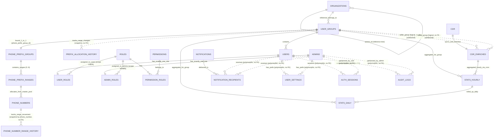

# THIẾT KẾ CƠ SỞ DỮ LIỆU TOÀN CỤC (GLOBAL DATABASE SCHEMA)
## Dự án: EVN CDR Analysis System (EVN CDR AS)
## Hệ quản trị cơ sở dữ liệu: MariaDB 10.6+ (Engine InnoDB, UTF8MB4)

> [!IMPORTANT]
> **Múi giờ**: mọi cột `datetime`/`timestamp` lưu **giờ Việt Nam (`Asia/Ho_Chi_Minh`, UTC+7), không kèm múi giờ**, khớp với dữ liệu PABX ghi vào bảng `cdr`. Cấu hình bắt buộc: MariaDB `default-time-zone = '+07:00'`; kết nối TypeORM `timezone: '+07:00'`; tiến trình Node `TZ=Asia/Ho_Chi_Minh`. `stat_date`/`stat_hour` và mọi mốc "hôm nay / 7 ngày / tháng này" tính theo giờ Việt Nam do backend tự tính rồi truyền làm tham số (không dùng `CURRENT_DATE()`/`NOW()` của DB trong truy vấn thống kê).

---

## 1. Sơ đồ thực thể quan hệ (Entity-Relationship Diagram)

> [!NOTE]
> **Nguyên tắc cốt lõi về phân quyền & phạm vi dữ liệu**:
> Toàn bộ dữ liệu cuộc gọi (CDR), giám sát chất lượng (QoS), thống kê thời lượng và báo cáo lưu lượng trong hệ thống **tập trung 100% vào thực thể Nhóm người dùng (`user_groups`)**.
> Cây tổ chức (`organizations`) trong phiên bản này thuần túy đóng vai trò là **danh mục phân cấp cây tham chiếu** để người dùng và quản trị viên trực quan hóa xem Nhóm người dùng đó thuộc nhánh đơn vị/tổng công ty nào trên cây tổ chức; cây tổ chức **hoàn toàn không tham gia vào việc phân bổ hay tính toán số liệu thống kê báo cáo lưu lượng**.



---

## 2. Bảng CDR nguyên bản từ tổng đài PABX (Call Detail Record)

Bảng `cdr` là bảng trung tâm tiếp nhận thông tin từ tổng đài PABX do hệ thống thu thập chuyên dụng bên ngoài đẩy trực tiếp vào theo thời gian thực cuộc gọi (Real-time Ingestion). Giữ nguyên toàn bộ 87 cột kỹ thuật theo đặc tả nguyên bản của tổng đài StarTrinity PABX (trong đó `Direction` lưu giá trị raw như `'remote'`, `DisconnectionStatus` lưu mã nguyên nhân SIP như `'OK'`, `'RequestTerminated'`), Hệ thống chỉ đọc bảng này (xem ghi chú bên dưới); chỉ mục và partition cho truy vấn nghiệp vụ đặt trên `cdr_enriched`. Quá trình chuẩn hóa hướng gọi nghiệp vụ (`Inbound`, `Outbound`, `Internal`) và trạng thái chuẩn (`call_status`: `ANSWERED`, `BUSY`, `NO_ANSWER`, `FAILED`, ánh xạ từ `DisconnectionCode` theo mục 2.1) sẽ được xử lý tại bảng làm giàu `cdr_enriched`. Không bao giờ lọc hoặc đếm trực tiếp theo `Direction`/`DisconnectionStatus` thô.

```sql
CREATE TABLE IF NOT EXISTS `cdr` (
  `id` bigint(20) unsigned zerofill NOT NULL AUTO_INCREMENT,
  `Created` datetime DEFAULT NULL,
  `Answered` datetime DEFAULT NULL,
  `Destroyed` datetime DEFAULT NULL,
  `Direction` varchar(255) DEFAULT NULL,
  `CallerId` varchar(255) DEFAULT NULL,
  `CallerDisplayName` varchar(255) DEFAULT NULL,
  `CalledId` varchar(255) DEFAULT NULL,
  `CalledDisplayName` varchar(255) DEFAULT NULL,
  `SipCallId` varchar(255) DEFAULT NULL,
  `CallerIp` varchar(255) DEFAULT NULL,
  `CalledIp` varchar(255) DEFAULT NULL,
  `DisconnectionCode` varchar(255) DEFAULT NULL,
  `DisconnectionStatus` varchar(255) DEFAULT NULL,
  `ReleasedBy` varchar(255) DEFAULT NULL,
  `Answer_Delay` int(11) DEFAULT NULL,
  `_100_Delay` int(11) DEFAULT NULL,
  `_180_Delay` int(11) DEFAULT NULL,
  `_183_Delay` int(11) DEFAULT NULL,
  `_180_183_Delay` int(11) DEFAULT NULL,
  `Audio_Signal_Delay` int(11) DEFAULT NULL,
  `Latest_RBT_Delay` int(11) DEFAULT NULL,
  `Early_Media_Peak_Signal_Level` int(11) DEFAULT NULL,
  `Active_Media_Peak_Signal_Level` int(11) DEFAULT NULL,
  `Recorded_RX_FileName` varchar(255) DEFAULT NULL,
  `Recorded_TX_FileName` varchar(255) DEFAULT NULL,
  `Recorded_Mix_FileName` varchar(255) DEFAULT NULL,
  `Answered_Duration` int(11) DEFAULT NULL COMMENT 'Thời lượng đàm thoại thực tế tính bằng MILI-GIÂY (ms), do PABX ghi; nghiệp vụ dùng cdr_enriched.answered_duration_sec',
  `Current_Calls_Count` double DEFAULT NULL,
  `Calls_Per_Second` double DEFAULT NULL,
  `Sip_Pcap_FileName` varchar(255) DEFAULT NULL COMMENT 'PABX có ghi; hệ thống chưa khai thác PCAP trong phiên bản này (không có API)',
  `Sip_And_Rtp_Pcap_FileName` varchar(255) DEFAULT NULL COMMENT 'PABX có ghi; hệ thống chưa khai thác PCAP trong phiên bản này (không có API)',
  `RTP_Codec` varchar(255) DEFAULT NULL,
  `RTP_Caller_Address` varchar(255) DEFAULT NULL,
  `RTP_Caller_Port` int(11) DEFAULT NULL,
  `RTP_Caller_SSRC` varchar(255) DEFAULT NULL,
  `RTP_Caller_G107R` bigint(20) DEFAULT NULL,
  `RTP_Caller_G107MOS` bigint(20) DEFAULT NULL,
  `RTP_Caller_PacketsCount` int(11) DEFAULT NULL,
  `RTP_Caller_LostPackets` int(11) DEFAULT NULL,
  `RTP_Caller_MaxRfc3550Jitter` bigint(20) DEFAULT NULL,
  `RTP_Caller_MeanRfc3550Jitter` bigint(20) DEFAULT NULL,
  `RTP_Caller_MaxDelta` bigint(20) DEFAULT NULL,
  `RTP_Caller_MinDelta` bigint(20) DEFAULT NULL,
  `RTP_Caller_PacketTime` int(11) DEFAULT NULL,
  `RTP_Caller_NonSilentPercentage` bigint(20) DEFAULT NULL,
  `RTP_Caller_Delay` int(11) DEFAULT NULL,
  `RTP_Caller_DSCP` int(11) DEFAULT NULL,
  `SDP_RTP_Caller_Delay` int(11) DEFAULT NULL,
  `RTP_Called_Address` varchar(255) DEFAULT NULL,
  `RTP_Called_Port` int(11) DEFAULT NULL,
  `RTP_Called_SSRC` varchar(255) DEFAULT NULL,
  `RTP_Called_G107R` bigint(20) DEFAULT NULL,
  `RTP_Called_G107MOS` bigint(20) DEFAULT NULL,
  `RTP_Called_PacketsCount` int(11) DEFAULT NULL,
  `RTP_Called_LostPackets` int(11) DEFAULT NULL,
  `RTP_Called_MaxRfc3550Jitter` double DEFAULT NULL,
  `RTP_Called_MeanRfc3550Jitter` double DEFAULT NULL,
  `RTP_Called_MaxDelta` bigint(20) DEFAULT NULL,
  `RTP_Called_MinDelta` bigint(20) DEFAULT NULL,
  `RTP_Called_PacketTime` int(11) DEFAULT NULL,
  `RTP_Called_NonSilentPercentage` bigint(20) DEFAULT NULL,
  `RTP_Called_Delay` int(11) DEFAULT NULL,
  `RTP_Called_DSCP` int(11) DEFAULT NULL,
  `SDP_RTP_Called_Delay` int(11) DEFAULT NULL,
  `RTCP_RTT_Max` int(11) DEFAULT NULL,
  `RTCP_RTT_Mean` int(11) DEFAULT NULL,
  `RTCP_Caller_Jitter_Max` int(11) DEFAULT NULL,
  `RTCP_Caller_Jitter_Mean` int(11) DEFAULT NULL,
  `RTCP_Caller_LostPackets` int(11) DEFAULT NULL,
  `RTCP_Called_Jitter_Max` int(11) DEFAULT NULL,
  `RTCP_Called_Jitter_Mean` int(11) DEFAULT NULL,
  `RTCP_Called_LostPackets` int(11) DEFAULT NULL,
  `Test_ID` int(11) DEFAULT NULL,
  `RTP_Rx_PacketsTotal` int(11) DEFAULT NULL,
  `RTP_Rx_PacketsDiscarded` int(11) DEFAULT NULL,
  `RTP_Rx_PacketsDiscarded_Duplicated` int(11) DEFAULT NULL,
  `RTP_Rx_PacketsDiscarded_Early` int(11) DEFAULT NULL,
  `RTP_Rx_PacketsDiscarded_Late` int(11) DEFAULT NULL,
  `RTP_Rx_PacketsDiscarded_Error` int(11) DEFAULT NULL,
  `RTP_CodecSampleRate` int(11) DEFAULT NULL,
  `from_no` varchar(255) DEFAULT NULL,
  `to_no` varchar(255) DEFAULT NULL,
  `duration` int(11) DEFAULT NULL,
  `time_end` datetime DEFAULT NULL,
  `created_at` timestamp NULL DEFAULT NULL,
  `updated_at` timestamp NULL DEFAULT NULL,
  PRIMARY KEY (`id`)
) ENGINE=InnoDB DEFAULT CHARSET=utf8mb4 COLLATE=utf8mb4_unicode_ci;

```

> [!NOTE]
> **Index khuyến nghị trên bảng `cdr` (KHÔNG thuộc migration của hệ thống)**: bảng `cdr` thuộc PABX; chỉ DBA tạo các index dưới đây khi chủ hệ thống PABX đồng ý. Hệ thống EVN CDR AS không phụ thuộc chúng: tiến trình làm giàu chỉ đọc theo khóa chính (`id > watermark`, và `ORDER BY id DESC LIMIT 1` để phát hiện PABX ngừng ghi, mục 10).
>
> ```sql
> -- CHỈ THAM KHẢO, không đưa vào migration
> CREATE INDEX `idx_cdr_created` ON `cdr` (`Created`);
> ```

> [!NOTE]
> **Bảng `cdr` thuộc quyền sở hữu của PABX**: hệ thống EVN CDR AS **chỉ đọc**, không thay đổi cấu trúc, không partition và không xóa dữ liệu bảng này. Việc dọn dữ liệu cũ của bảng `cdr` (và file ghi âm, nếu PABX tự quản lý) thuộc trách nhiệm phía PABX. Partition và vòng đời dữ liệu nghiệp vụ áp dụng trên `cdr_enriched` (mục 2.1).

---

## 2.1. Bảng CDR Làm Giàu & Cô lập dữ liệu theo nhóm (cdr_enriched)

Bảng `cdr_enriched` là **bảng trung tâm cho toàn bộ nghiệp vụ Backend, API và Phân quyền** của hệ thống EVN CDR AS:
- Tiếp nhận dữ liệu được copy và làm giàu từ bảng `cdr` thông qua tiến trình Near-Realtime Batch Scheduler (chu kỳ 3-5 giây).
- Bổ sung các cột làm giàu: nhóm sở hữu (`caller_group_id`, `called_group_id`), gộp leg, `call_status`, `answered_duration_sec`, `call_type`, MOS thập phân (chi tiết ở các khối quy tắc bên dưới).
- Nếu số điện thoại thuộc dải cấp sở hữu cho nhóm người dùng (`phone_prefix_groups` -> `phone_prefix_ranges` -> `phone_numbers`), trường tương ứng lưu `id` của nhóm (`user_groups.id`).
- Nếu số điện thoại chưa được quy hoạch cấp cho nhóm nào (số nội bộ chưa khai báo), hoặc là **số ngoài kho** (không khớp `analysis_internal_extension_pattern`: `Anonymous`, `0xxxx`, số không đủ 5 chữ số, số di động… xem mục 8), trường tương ứng nhận giá trị `NULL`. Số ngoài kho không làm lỗi tiến trình làm giàu.
- Áp dụng các chỉ mục hợp bộ (`caller_group_id`, `Created`) và (`called_group_id`, `Created`) để tối ưu hóa truy vấn **Group-Based Data Isolation**.

> [!IMPORTANT]
> **Quy tắc gộp leg & chọn leg chính (Call Leg Grouping)**:
> Lõi PABX (B2BUA) ghi **2 bản ghi `cdr` cho một cuộc gọi đi qua lõi**: leg A (máy gọi → lõi) và leg B (lõi → máy nhận). Mỗi leg có `SipCallId`, file ghi âm và chỉ số QoS riêng.
> Trong dữ liệu thật `voip_cdr_20250817.sql`, 5.369 bản ghi ứng với khoảng 3.506 cuộc gọi: 1.863 cuộc có đủ leg A + leg B, phần còn lại chỉ có 1 leg. Nếu đếm theo bản ghi, số cuộc gọi bị thổi lên khoảng 53 %.
> 1. **Xác định vai trò leg (`leg_role`)** theo danh sách IP lõi trong setting `pabx_core_ip_list` (mặc định `10.128.16.252,10.128.16.253`):
>    - `A_LEG`: `CalledIp` thuộc danh sách IP lõi.
>    - `B_LEG`: `CallerIp` thuộc danh sách IP lõi.
>    - `UNKNOWN`: không khớp quy tắc nào ở trên.
> 2. **Khóa gom leg**: một leg A và một leg B cùng `CallerId`, cùng `CalledId`, có `Created` lệch nhau không quá 2 giây thuộc cùng một cuộc gọi.
>    - Mỗi cuộc gọi có **tối đa 1 leg A và 1 leg B**. Khi gọi lại liên tiếp trong vòng 2 giây, có thể có nhiều ứng viên: ghép leg B với leg A chưa có cặp có `Created` gần nhất, nếu bằng nhau thì chọn `id` gần nhất. Leg không tìm được cặp là một cuộc gọi riêng.
>    - Hai leg cùng vai trò (A–A hoặc B–B) **không bao giờ** được ghép với nhau.
> 3. **Leg chính (`is_primary_leg = 1`)**: là leg A nếu cuộc gọi có leg A. Cuộc gọi chỉ có 1 leg thì leg đó là leg chính, bất kể `leg_role`.
> 4. **`call_group_key`** = `id` của leg chính. Mọi leg của cùng một cuộc gọi mang cùng giá trị này.
> 5. **Leg đến muộn**: tiến trình làm giàu xử lý theo watermark `id`, nên leg thứ hai có thể rơi vào batch sau. Khi ghi một leg mới, tiến trình tìm các leg đã có cùng khóa gom trong `cdr_enriched`:
>    - Nếu leg mới là leg chính theo quy tắc 3, hạ leg chính cũ xuống `is_primary_leg = 0`.
>    - Cập nhật lại `call_group_key` cho cả nhóm.
> 6. **Phạm vi sử dụng**:
>    - Mọi số liệu đếm cuộc gọi, thời lượng và ASR/NER (`stats_hourly`, `stats_daily`, API lưu lượng `/traffic/*`) **chỉ tính leg chính**.
>    - Danh sách lịch sử CDR mặc định chỉ hiển thị leg chính.
>    - Trang chi tiết và QoS debug hiển thị đủ cả 2 leg (gom theo `call_group_key`), để xem chất lượng âm thanh từng phía.

> [!IMPORTANT]
> **Quy tắc chuẩn hóa trạng thái cuộc gọi (`call_status`)**:
> `call_status` được ánh xạ từ `DisconnectionCode` (mã SIP cuối cùng) **của từng leg**. Trạng thái của một cuộc gọi là `call_status` của leg chính (`is_primary_leg = 1`), vì leg A và leg B đôi khi kết thúc bằng mã khác nhau (vd. A=480 / B=408).
>
> | `call_status` | `DisconnectionCode` | `DisconnectionStatus` thô (StarTrinity) | Ý nghĩa nghiệp vụ |
> |---|---|---|---|
> | `ANSWERED` | `200` | `OK` | Nhấc máy và đàm thoại (trùng 100 % với `Answered IS NOT NULL` trên dữ liệu thật) |
> | `BUSY` | `486`, `603` | `BusyHere`, `Declined` | Máy bận hoặc người nhận từ chối |
> | `NO_ANSWER` | `487`, `480` | `RequestTerminated`, `TemporarilyUnavailable` | Gọi nhỡ (phía gọi bỏ máy khi đang đổ chuông) hoặc máy nhận không sẵn sàng/không bắt máy |
> | `FAILED` | mọi mã còn lại (`404`, `408`, `503`, các mã 4xx/5xx/6xx khác, hoặc NULL) | `NotFound`, `RequestTimeout`, `ServiceUnavailable`… | Lỗi định tuyến, mạng hoặc hạ tầng |
>
> Bảng ánh xạ là quy tắc nghiệp vụ cố định (hằng số trong code), không cấu hình qua `system_settings`. Bổ sung mã mới phải cập nhật bảng này.

> [!IMPORTANT]
> **Các cột dẫn xuất khác & hướng gọi**:
> - **Thời lượng**: `Answered_Duration` của PABX tính bằng **mili-giây** (đã kiểm chứng 3.347/3.347 cuộc nhấc máy trong dữ liệu thật: `Answered_Duration / 1000 ≈ Destroyed − Answered`). Cột `answered_duration_sec` là nguồn duy nhất cho mọi thời lượng nghiệp vụ: `*_duration_sec` trong stats, ACD/ALOC, và trường `duration` trả về API.
> - **`call_type`**: lưu sẵn trên từng leg, xác định từ `caller_group_id`/`called_group_id` (quy tắc tại mục 9).
> - **Hướng gọi (`Inbound` / `Outbound` / `Internal`) không lưu thành cột**, vì nó phụ thuộc vào nhóm của người xem: cùng một cuộc gọi là `Outbound` với nhóm gọi nhưng là `Inbound` với nhóm nhận. API tính hướng gọi lúc truy vấn theo nhóm đang xem `:g`:
>   - `Outbound`: `caller_group_id = :g AND (called_group_id <> :g OR called_group_id IS NULL)`
>   - `Inbound`: `called_group_id = :g AND (caller_group_id <> :g OR caller_group_id IS NULL)`
>   - `Internal`: `caller_group_id = :g AND called_group_id = :g`
>
>   Ở phạm vi toàn hệ thống (Admin, không chọn nhóm), bộ lọc hướng gọi được thay bằng bộ lọc `call_type`. Cột thô `Direction` (luôn là `'remote'`) không dùng cho nghiệp vụ.
> - **MOS (ITU-T G.107 E-model)**: PABX chỉ lưu MOS đã làm tròn thành số nguyên (`RTP_*_G107MOS` ∈ {1..5}) cùng hệ số R (`RTP_*_G107R`, 0–100). Trên dữ liệu thật, `ROUND(MOS_E-model(R))` khớp 8.334/8.334 giá trị số nguyên của PABX, nên MOS thập phân được tính lại từ R khi làm giàu:
>   - `MOS(R) = 1` nếu `R ≤ 0`; `4.5` nếu `R ≥ 100`; ngược lại `1 + 0.035·R + 7·10⁻⁶·R·(R − 60)·(100 − R)`.
>   - `mos_caller_x100 = ROUND(MOS(RTP_Caller_G107R) × 100)`, tương tự `mos_called_x100`. Bằng NULL nếu R là NULL.
>   - `mos_x100` = trung bình hai chiều (làm tròn), hoặc chiều duy nhất có dữ liệu, hoặc NULL.
>   - Cột số nguyên `RTP_*_G107MOS` chỉ dùng để hiển thị thô ở QoS debug. Mọi lọc, phân dải, trung bình và so sánh ngưỡng (`qos_threshold_configs.metric_name = 'MOS_G107'`, thang thập phân) dùng `mos_*_x100 / 100`. Hiển thị luôn 2 chữ số thập phân.
> - **Dải chất lượng MOS duy nhất toàn hệ thống** (áp dụng cho `mos_x100` của leg chính, mọi module và giao diện tham chiếu bảng này):
>
>   | Dải | Điều kiện | Lớp CSS / màu |
>   |---|---|---|
>   | Xuất sắc | `mos_x100 >= 400` | `.mos-excellent` – success `#10B981` |
>   | Tốt | `350 <= mos_x100 < 400` | `.mos-good` – success `#10B981` |
>   | Trung bình | `300 <= mos_x100 < 350` | `.mos-fair` – warning `#F59E0B` |
>   | Kém | `mos_x100 < 300` | `.mos-poor` – danger `#DC3545` |
>   | Không có dữ liệu | `mos_x100 IS NULL` | `.mos-na` – xám, không tính vào dải nào |
> - Bảng `call_duration_records` của thiết kế cũ **đã bị loại bỏ**: toàn bộ thông tin của nó (nhóm hai phía, `call_type`, thời lượng giây, 1 dòng/cuộc gọi) nằm trên `cdr_enriched` với điều kiện `is_primary_leg = 1`.

```sql
CREATE TABLE IF NOT EXISTS `cdr_enriched` (
  `id` bigint(20) unsigned zerofill NOT NULL COMMENT 'Định danh trùng khớp 1-1 với cdr.id',
  `Created` datetime NOT NULL COMMENT 'Khóa partition. Lấy từ cdr.Created; nếu NULL thì lấy cdr.Destroyed, nếu vẫn NULL thì lấy thời điểm làm giàu',
  `Answered` datetime DEFAULT NULL,
  `Destroyed` datetime DEFAULT NULL,
  `Direction` varchar(255) DEFAULT NULL,
  `CallerId` varchar(255) DEFAULT NULL,
  `CallerDisplayName` varchar(255) DEFAULT NULL,
  `CalledId` varchar(255) DEFAULT NULL,
  `CalledDisplayName` varchar(255) DEFAULT NULL,
  `SipCallId` varchar(255) DEFAULT NULL,
  `CallerIp` varchar(255) DEFAULT NULL,
  `CalledIp` varchar(255) DEFAULT NULL,
  `DisconnectionCode` varchar(255) DEFAULT NULL,
  `DisconnectionStatus` varchar(255) DEFAULT NULL,
  `ReleasedBy` varchar(255) DEFAULT NULL,
  `Answer_Delay` int(11) DEFAULT NULL,
  `_100_Delay` int(11) DEFAULT NULL,
  `_180_Delay` int(11) DEFAULT NULL,
  `_183_Delay` int(11) DEFAULT NULL,
  `_180_183_Delay` int(11) DEFAULT NULL,
  `Audio_Signal_Delay` int(11) DEFAULT NULL,
  `Latest_RBT_Delay` int(11) DEFAULT NULL,
  `Early_Media_Peak_Signal_Level` int(11) DEFAULT NULL,
  `Active_Media_Peak_Signal_Level` int(11) DEFAULT NULL,
  `Recorded_RX_FileName` varchar(255) DEFAULT NULL,
  `Recorded_TX_FileName` varchar(255) DEFAULT NULL,
  `Recorded_Mix_FileName` varchar(255) DEFAULT NULL,
  `Answered_Duration` int(11) DEFAULT NULL COMMENT 'Thời lượng đàm thoại thực tế tính bằng MILI-GIÂY (ms), do PABX ghi; nghiệp vụ dùng cdr_enriched.answered_duration_sec',
  `Current_Calls_Count` double DEFAULT NULL,
  `Calls_Per_Second` double DEFAULT NULL,
  `Sip_Pcap_FileName` varchar(255) DEFAULT NULL COMMENT 'PABX có ghi; hệ thống chưa khai thác PCAP trong phiên bản này (không có API)',
  `Sip_And_Rtp_Pcap_FileName` varchar(255) DEFAULT NULL COMMENT 'PABX có ghi; hệ thống chưa khai thác PCAP trong phiên bản này (không có API)',
  `RTP_Codec` varchar(255) DEFAULT NULL,
  `RTP_Caller_Address` varchar(255) DEFAULT NULL,
  `RTP_Caller_Port` int(11) DEFAULT NULL,
  `RTP_Caller_SSRC` varchar(255) DEFAULT NULL,
  `RTP_Caller_G107R` bigint(20) DEFAULT NULL,
  `RTP_Caller_G107MOS` bigint(20) DEFAULT NULL,
  `RTP_Caller_PacketsCount` int(11) DEFAULT NULL,
  `RTP_Caller_LostPackets` int(11) DEFAULT NULL,
  `RTP_Caller_MaxRfc3550Jitter` bigint(20) DEFAULT NULL,
  `RTP_Caller_MeanRfc3550Jitter` bigint(20) DEFAULT NULL,
  `RTP_Caller_MaxDelta` bigint(20) DEFAULT NULL,
  `RTP_Caller_MinDelta` bigint(20) DEFAULT NULL,
  `RTP_Caller_PacketTime` int(11) DEFAULT NULL,
  `RTP_Caller_NonSilentPercentage` bigint(20) DEFAULT NULL,
  `RTP_Caller_Delay` int(11) DEFAULT NULL,
  `RTP_Caller_DSCP` int(11) DEFAULT NULL,
  `SDP_RTP_Caller_Delay` int(11) DEFAULT NULL,
  `RTP_Called_Address` varchar(255) DEFAULT NULL,
  `RTP_Called_Port` int(11) DEFAULT NULL,
  `RTP_Called_SSRC` varchar(255) DEFAULT NULL,
  `RTP_Called_G107R` bigint(20) DEFAULT NULL,
  `RTP_Called_G107MOS` bigint(20) DEFAULT NULL,
  `RTP_Called_PacketsCount` int(11) DEFAULT NULL,
  `RTP_Called_LostPackets` int(11) DEFAULT NULL,
  `RTP_Called_MaxRfc3550Jitter` double DEFAULT NULL,
  `RTP_Called_MeanRfc3550Jitter` double DEFAULT NULL,
  `RTP_Called_MaxDelta` bigint(20) DEFAULT NULL,
  `RTP_Called_MinDelta` bigint(20) DEFAULT NULL,
  `RTP_Called_PacketTime` int(11) DEFAULT NULL,
  `RTP_Called_NonSilentPercentage` bigint(20) DEFAULT NULL,
  `RTP_Called_Delay` int(11) DEFAULT NULL,
  `RTP_Called_DSCP` int(11) DEFAULT NULL,
  `SDP_RTP_Called_Delay` int(11) DEFAULT NULL,
  `RTCP_RTT_Max` int(11) DEFAULT NULL,
  `RTCP_RTT_Mean` int(11) DEFAULT NULL,
  `RTCP_Caller_Jitter_Max` int(11) DEFAULT NULL,
  `RTCP_Caller_Jitter_Mean` int(11) DEFAULT NULL,
  `RTCP_Caller_LostPackets` int(11) DEFAULT NULL,
  `RTCP_Called_Jitter_Max` int(11) DEFAULT NULL,
  `RTCP_Called_Jitter_Mean` int(11) DEFAULT NULL,
  `RTCP_Called_LostPackets` int(11) DEFAULT NULL,
  `Test_ID` int(11) DEFAULT NULL,
  `RTP_Rx_PacketsTotal` int(11) DEFAULT NULL,
  `RTP_Rx_PacketsDiscarded` int(11) DEFAULT NULL,
  `RTP_Rx_PacketsDiscarded_Duplicated` int(11) DEFAULT NULL,
  `RTP_Rx_PacketsDiscarded_Early` int(11) DEFAULT NULL,
  `RTP_Rx_PacketsDiscarded_Late` int(11) DEFAULT NULL,
  `RTP_Rx_PacketsDiscarded_Error` int(11) DEFAULT NULL,
  `RTP_CodecSampleRate` int(11) DEFAULT NULL,
  `from_no` varchar(255) DEFAULT NULL,
  `to_no` varchar(255) DEFAULT NULL,
  `duration` int(11) DEFAULT NULL,
  `time_end` datetime DEFAULT NULL,
  `caller_group_id` int(11) unsigned DEFAULT NULL COMMENT 'ID nhóm sở hữu số gọi đi (user_groups.id), NULL nếu số chưa gán nhóm',
  `called_group_id` int(11) unsigned DEFAULT NULL COMMENT 'ID nhóm sở hữu số nhận cuộc gọi (user_groups.id), NULL nếu số chưa gán nhóm',
  `leg_role` enum('A_LEG','B_LEG','UNKNOWN') NOT NULL DEFAULT 'UNKNOWN' COMMENT 'A_LEG: máy gọi -> lõi PABX (CalledIp thuộc pabx_core_ip_list); B_LEG: lõi -> máy nhận (CallerIp thuộc pabx_core_ip_list)',
  `call_group_key` bigint(20) unsigned NOT NULL COMMENT 'id của leg chính; các leg cùng một cuộc gọi mang cùng giá trị',
  `is_primary_leg` tinyint(1) NOT NULL DEFAULT 1 COMMENT '1: leg chính (được đếm vào thống kê), 0: leg phụ (chỉ hiển thị ở chi tiết/QoS debug)',
  `call_status` enum('ANSWERED','BUSY','NO_ANSWER','FAILED') NOT NULL COMMENT 'Trạng thái chuẩn hóa từ DisconnectionCode của leg này (bảng ánh xạ mục 2.1)',
  `answered_duration_sec` int(11) unsigned NOT NULL DEFAULT 0 COMMENT 'Thời lượng đàm thoại (giây) = ROUND(Answered_Duration / 1000) nếu call_status = ANSWERED, ngược lại 0',
  `call_type` enum('INTRA_GROUP','INTER_GROUP','UNASSIGNED') NOT NULL COMMENT 'Phân loại lưu lượng theo nhóm (quy tắc mục 9)',
  `mos_caller_x100` smallint(5) unsigned DEFAULT NULL COMMENT 'MOS phía gọi ×100, tính từ RTP_Caller_G107R theo E-model (ví dụ 441 = 4.41); NULL nếu không có RTP',
  `mos_called_x100` smallint(5) unsigned DEFAULT NULL COMMENT 'MOS phía nhận ×100, tính từ RTP_Called_G107R theo E-model; NULL nếu không có RTP',
  `mos_x100` smallint(5) unsigned DEFAULT NULL COMMENT 'MOS của leg ×100 = trung bình hai chiều (hoặc chiều duy nhất có dữ liệu); NULL nếu cả hai chiều NULL',
  `enriched_at` timestamp NOT NULL DEFAULT CURRENT_TIMESTAMP COMMENT 'Thời điểm hoàn tất làm giàu dữ liệu',
  `created_at` timestamp NULL DEFAULT NULL,
  `updated_at` timestamp NULL DEFAULT NULL,
  PRIMARY KEY (`id`, `Created`) COMMENT 'Created bắt buộc có trong PK vì bảng partition theo Created',
  KEY `idx_cdre_caller_group` (`caller_group_id`, `Created`),
  KEY `idx_cdre_called_group` (`called_group_id`, `Created`),
  KEY `idx_cdre_created` (`Created`),
  KEY `idx_cdre_call_group` (`call_group_key`),
  KEY `idx_cdre_primary_created` (`is_primary_leg`, `Created`),
  KEY `idx_cdre_status_created` (`call_status`, `Created`),
  KEY `idx_cdre_type_created` (`call_type`, `Created`),
  KEY `idx_cdre_caller_created` (`CallerId`, `Created`),
  KEY `idx_cdre_called_created` (`CalledId`, `Created`),
  KEY `idx_cdre_sipcallid` (`SipCallId`),
  KEY `idx_cdre_disconnection_code` (`DisconnectionCode`),
  KEY `idx_cdre_mos_created` (`mos_x100`, `Created`)
) ENGINE=InnoDB DEFAULT CHARSET=utf8mb4 COLLATE=utf8mb4_unicode_ci
PARTITION BY RANGE (TO_DAYS(`Created`)) (
  -- Partition theo tháng; job hằng tháng tạo trước partition cho 2 tháng tiếp theo bằng REORGANIZE PARTITION p_future
  PARTITION p_2025_06 VALUES LESS THAN (TO_DAYS('2025-07-01')),
  PARTITION p_2025_07 VALUES LESS THAN (TO_DAYS('2025-08-01')),
  PARTITION p_2025_08 VALUES LESS THAN (TO_DAYS('2025-09-01')),
  PARTITION p_future  VALUES LESS THAN MAXVALUE
);
-- Bảng partition không có khóa ngoại (giới hạn của InnoDB): caller_group_id / called_group_id là tham chiếu logic tới user_groups.id,
-- tính toàn vẹn do tiến trình làm giàu đảm bảo. Nhóm người dùng chỉ bị xóa mềm (mục 14) nên không phát sinh tham chiếu mồ côi.
```

> [!IMPORTANT]
> **Partition & vòng đời dữ liệu `cdr_enriched`**:
> - **Partition theo tháng** trên `Created` (`RANGE` + `TO_DAYS`). Job `apps/worker/partition-maintenance` (tiến trình `backend-worker`) chạy ngày 1 hằng tháng: tách `p_future` để luôn có sẵn partition cho tháng hiện tại và 2 tháng kế tiếp. Job cũng chạy **một lần khi `backend-worker` khởi động**: tách `p_future` (dùng `REORGANIZE PARTITION`, làm được cả khi `p_future` đã có dữ liệu) thành các partition tháng còn thiếu đến hết tháng hiện tại + 2 tháng.
> - **Tra theo `id`** (`GET /cdr/:id`, API audio): dùng phần đầu của PK (`id`) nên quét qua mọi partition theo index, chấp nhận được vì mỗi partition chỉ trả tối đa 1 dòng.
> - **Mọi truy vấn** trên `cdr_enriched` bắt buộc có điều kiện `Created` (khoảng thời gian) để MariaDB chỉ quét các partition liên quan (partition pruning).
> - **Trực tuyến** (`Created >= NOW() - INTERVAL retention_online_months MONTH`, mặc định 6 tháng): mọi API tra cứu CDR, QoS debug, `/traffic/records` mặc định chỉ trong cửa sổ này.
> - **Lưu trữ** (từ `retention_online_months` đến `retention_archive_months`, mặc định 6–60 tháng): dữ liệu **vẫn nằm trong `cdr_enriched`** (các partition cũ). Chỉ Admin truy cập được, qua tham số `includeArchive=true` trên `GET /api/v1/cdr`, bắt buộc kèm `fromDate`/`toDate`, khoảng tối đa 31 ngày. Người dùng nhóm không xem được dữ liệu lưu trữ.
> - **Xóa hẳn**: job hằng tháng `ALTER TABLE cdr_enriched DROP PARTITION` các partition có toàn bộ `Created` cũ hơn `retention_archive_months` (60 tháng), ghi `audit_logs` (`actor_type = 'SYSTEM'`, `action = 'PURGE_CDR_PARTITION'`).
> - **Không bị dọn**: `stats_hourly`, `stats_daily`, `audit_logs`, `prefix_allocation_history`, `phone_number_range_history`. Đây là các bảng nhỏ cần cho báo cáo dài hạn và kiểm toán. Báo cáo theo thống kê vẫn chạy được cho kỳ đã bị xóa CDR.
> - **Phương án không làm**: tách bảng lưu trữ nén riêng qua `EXCHANGE PARTITION`. Cách này không khả thi, vì `EXCHANGE PARTITION` yêu cầu hai bảng cùng định nghĩa, kể cả `ROW_FORMAT`.

---

## 2.2. Bảng Theo dõi trạng thái tiến trình làm giàu CDR (cdr_enrichment_state)

Bảng cấu hình và theo dõi High-Watermark cho tiến trình đồng bộ ngầm:

```sql
CREATE TABLE IF NOT EXISTS `cdr_enrichment_state` (
  `id` tinyint(3) unsigned NOT NULL AUTO_INCREMENT,
  `last_processed_cdr_id` bigint(20) unsigned NOT NULL DEFAULT 0 COMMENT 'Watermark ID cao nhất từ bảng cdr đã hoàn tất làm giàu',
  `batch_size` int(11) NOT NULL DEFAULT 1000 COMMENT 'Số lượng bản ghi tối đa đọc trong 1 chu kỳ polling',
  `last_run_at` datetime DEFAULT NULL COMMENT 'Thời điểm tiến trình chạy gần nhất',
  `last_success_at` datetime DEFAULT NULL COMMENT 'Thời điểm batch gần nhất hoàn tất thành công',
  `records_enriched_total` bigint(20) unsigned NOT NULL DEFAULT 0 COMMENT 'Tổng số bản ghi đã làm giàu tích lũy',
  `status` enum('IDLE','PROCESSING','ERROR') NOT NULL DEFAULT 'IDLE' COMMENT 'Trạng thái chạy hiện tại',
  `error_message` text DEFAULT NULL COMMENT 'Chi tiết lỗi nếu phát sinh sự cố',
  `cache_version` int(10) unsigned NOT NULL DEFAULT 0 COMMENT 'Tăng khi dữ liệu sở hữu số hoặc system_settings thay đổi; worker và API so sánh để nạp lại cache',
  `updated_at` timestamp NOT NULL DEFAULT CURRENT_TIMESTAMP ON UPDATE CURRENT_TIMESTAMP,
  PRIMARY KEY (`id`)
) ENGINE=InnoDB DEFAULT CHARSET=utf8mb4 COLLATE=utf8mb4_unicode_ci;

-- Khởi tạo bản ghi trạng thái ban đầu:
INSERT INTO `cdr_enrichment_state` (`id`, `last_processed_cdr_id`, `batch_size`, `status`)
VALUES (1, 0, 1000, 'IDLE')
ON DUPLICATE KEY UPDATE `id` = 1;
```

---

## 3. Bảng Quản trị viên hệ thống (Admin Portal - Tách biệt hoàn toàn)

```sql
CREATE TABLE IF NOT EXISTS `admins` (
  `id` int(11) unsigned NOT NULL AUTO_INCREMENT,
  `username` varchar(100) NOT NULL,
  `email` varchar(150) NOT NULL,
  `password_hash` varchar(255) NOT NULL,
  `full_name` varchar(150) NOT NULL,
  `phone_number` varchar(30) DEFAULT NULL,
  `avatar_url` varchar(255) DEFAULT NULL,
  `status` enum('ACTIVE','LOCKED','INACTIVE') NOT NULL DEFAULT 'ACTIVE',
  `last_login_at` datetime DEFAULT NULL,
  `password_changed_at` datetime DEFAULT NULL COMMENT 'Lần đổi mật khẩu gần nhất; quá security_password_max_age_days thì bắt đổi khi đăng nhập',
  `must_change_password` tinyint(1) NOT NULL DEFAULT 1 COMMENT '1: bắt đổi mật khẩu ở lần đăng nhập kế tiếp (mật khẩu ban đầu hoặc do quản trị viên đặt lại)',
  `failed_login_count` tinyint(3) unsigned NOT NULL DEFAULT 0 COMMENT 'Số lần đăng nhập sai liên tiếp; đặt lại 0 khi đăng nhập đúng',
  `locked_until` datetime DEFAULT NULL COMMENT 'Khóa tạm do sai mật khẩu quá security_login_max_failed lần; tách biệt với status = LOCKED do quản trị viên đặt',
  `created_by_admin_id` int(11) unsigned DEFAULT NULL,
  `created_at` timestamp NOT NULL DEFAULT CURRENT_TIMESTAMP,
  `updated_at` timestamp NOT NULL DEFAULT CURRENT_TIMESTAMP ON UPDATE CURRENT_TIMESTAMP,
  `username_active` varchar(100) GENERATED ALWAYS AS (IF(`status` <> 'INACTIVE', `username`, NULL)) VIRTUAL COMMENT 'Chỉ có giá trị khi tài khoản chưa INACTIVE; dùng cho UNIQUE',
  `email_active` varchar(150) GENERATED ALWAYS AS (IF(`status` <> 'INACTIVE', `email`, NULL)) VIRTUAL COMMENT 'Chỉ có giá trị khi tài khoản chưa INACTIVE; dùng cho UNIQUE',
  PRIMARY KEY (`id`),
  UNIQUE KEY `uniq_admins_username` (`username_active`) COMMENT 'Username duy nhất trong các tài khoản chưa INACTIVE (cho phép tái sử dụng khi chuyển công tác)',
  UNIQUE KEY `uniq_admins_email` (`email_active`),
  KEY `idx_admins_username` (`username`),
  KEY `idx_admins_email` (`email`),
  CONSTRAINT `fk_admins_created_by` FOREIGN KEY (`created_by_admin_id`) REFERENCES `admins` (`id`) ON DELETE SET NULL
) ENGINE=InnoDB DEFAULT CHARSET=utf8mb4 COLLATE=utf8mb4_unicode_ci;
```


> [!NOTE]
> **Root Admin đầu tiên** không tạo qua API. Lệnh seed của backend `npm run seed:root` đọc `ROOT_ADMIN_USERNAME`, `ROOT_ADMIN_EMAIL`, `ROOT_ADMIN_FULL_NAME`, `ROOT_ADMIN_INITIAL_PASSWORD` từ biến môi trường và tạo một dòng `admins` với `must_change_password = 1` cùng dòng `admin_roles` mang vai trò `ROOT_ADMIN`, trong một transaction. Nếu đã có tài khoản mang vai trò `ROOT_ADMIN` thì lệnh không làm gì. Vai trò của Admin không lưu trên bảng `admins` mà ở `admin_roles` (mục 7). Thứ tự seed khi cài mới: `roles` → `permissions` + `permission_roles` → `system_settings` → `qos_threshold_configs` → `cdr_enrichment_state` → kho số `phone_numbers` (90.000 dòng) → Root Admin.

---

## 4. Bảng Cây tổ chức EVN (Organizations)

Phản ánh cấu trúc phân cấp ngành điện: Tập đoàn -> Tổng công ty (EVNNPC, EVNCPC, EVNSPC, EVNHANOI, EVNHCMC, EVNNPT, EVNGENCO...) -> Công ty / Ban -> Chi nhánh / Điện lực.

```sql
CREATE TABLE IF NOT EXISTS `organizations` (
  `id` int(11) unsigned NOT NULL AUTO_INCREMENT,
  `parent_id` int(11) unsigned DEFAULT NULL,
  `code` varchar(50) NOT NULL COMMENT 'Mã đơn vị (ví dụ: EVN, TC-71, EVNNPC, IT-01)',
  `name` varchar(255) NOT NULL COMMENT 'Tên đơn vị (ví dụ: Tổng công ty 71, Khối CNTT)',
  `description` text DEFAULT NULL,
  `representative_name` varchar(150) DEFAULT NULL COMMENT 'Người đại diện đơn vị',
  `representative_phone` varchar(30) DEFAULT NULL,
  `representative_email` varchar(150) DEFAULT NULL,
  `level` tinyint(2) NOT NULL DEFAULT 1 COMMENT '0: Tập đoàn, 1: Tổng công ty, 2: Khối/Công ty, 3: Phòng ban/Điện lực',
  `sort_order` int(11) NOT NULL DEFAULT 0,
  `status` enum('ACTIVE','INACTIVE') NOT NULL DEFAULT 'ACTIVE',
  `created_at` timestamp NOT NULL DEFAULT CURRENT_TIMESTAMP,
  `updated_at` timestamp NOT NULL DEFAULT CURRENT_TIMESTAMP ON UPDATE CURRENT_TIMESTAMP,
  PRIMARY KEY (`id`),
  UNIQUE KEY `uniq_org_code` (`code`),
  KEY `idx_org_parent` (`parent_id`),
  CONSTRAINT `fk_org_parent` FOREIGN KEY (`parent_id`) REFERENCES `organizations` (`id`) ON DELETE RESTRICT
) ENGINE=InnoDB DEFAULT CHARSET=utf8mb4 COLLATE=utf8mb4_unicode_ci;
```

---

## 4.1. Bảng Nhóm đầu số điện thoại PABX (`phone_prefix_groups`)

Thực thể gom nhóm các dải đầu số viễn thông PABX, dùng để liên kết 1 - 1 với Nhóm người dùng (`user_groups`). Toàn bộ lưu lượng cuộc gọi và file ghi âm phát sinh từ nhóm đầu số này được cô lập thuộc quyền quản lý của nhóm người dùng tương ứng.

```sql
CREATE TABLE IF NOT EXISTS `phone_prefix_groups` (
  `id` int(11) unsigned NOT NULL AUTO_INCREMENT,
  `code` varchar(50) NOT NULL COMMENT 'Mã nhóm đầu số (ví dụ: PG-IT-01, PG-KD-02)',
  `name` varchar(255) NOT NULL COMMENT 'Tên nhóm đầu số (ví dụ: Nhóm dải số Khối CNTT)',
  `description` text DEFAULT NULL,
  `status` enum('ACTIVE','INACTIVE') NOT NULL DEFAULT 'ACTIVE',
  `created_at` timestamp NOT NULL DEFAULT CURRENT_TIMESTAMP,
  `updated_at` timestamp NOT NULL DEFAULT CURRENT_TIMESTAMP ON UPDATE CURRENT_TIMESTAMP,
  PRIMARY KEY (`id`),
  UNIQUE KEY `uniq_ppg_code` (`code`)
) ENGINE=InnoDB DEFAULT CHARSET=utf8mb4 COLLATE=utf8mb4_unicode_ci;
```

---

## 5. Bảng Nhóm người dùng (User Groups - Tổ chức QLND)

Mỗi nhóm người dùng tham chiếu vào một nút trên cây tổ chức (`organizations`) để người dùng định vị trực quan và liên kết 1 - 1 bắt buộc với 1 nhóm đầu số viễn thông (`phone_prefix_groups`).

```sql
CREATE TABLE IF NOT EXISTS `user_groups` (
  `id` int(11) unsigned NOT NULL AUTO_INCREMENT,
  `organization_id` int(11) unsigned DEFAULT NULL COMMENT 'ID đơn vị trên cây tổ chức (tham chiếu trực quan danh mục, NULL nếu là nhóm độc lập)',
  `phone_prefix_group_id` int(11) unsigned NOT NULL COMMENT 'Khóa ngoại liên kết 1-1 với nhóm đầu số điện thoại',
  `code` varchar(50) NOT NULL COMMENT 'Mã nhóm QLND (ví dụ: UMO-IT-01)',
  `name` varchar(255) NOT NULL COMMENT 'Tên nhóm (ví dụ: Nhóm QLND Khối CNTT)',
  `description` text DEFAULT NULL,
  `representative_user_id` int(11) unsigned DEFAULT NULL COMMENT 'ID user đại diện nhóm (phải mang vai trò GROUP_ADMIN)',
  `allow_recording_access` tinyint(1) NOT NULL DEFAULT 0 COMMENT '1: Quản trị viên hệ thống cấp quyền nghe/tải ghi âm cho nhóm, 0: Chưa cấp phép (Chốt chặn Tầng 1; quyền cấp nhóm duy nhất, lưu trực tiếp trên nhóm)',
  `status` enum('ACTIVE','INACTIVE') NOT NULL DEFAULT 'ACTIVE',
  `created_at` timestamp NOT NULL DEFAULT CURRENT_TIMESTAMP,
  `updated_at` timestamp NOT NULL DEFAULT CURRENT_TIMESTAMP ON UPDATE CURRENT_TIMESTAMP,
  PRIMARY KEY (`id`),
  UNIQUE KEY `uniq_ug_code` (`code`),
  UNIQUE KEY `uniq_ug_prefix_group` (`phone_prefix_group_id`),
  KEY `idx_ug_org` (`organization_id`),
  CONSTRAINT `fk_ug_org` FOREIGN KEY (`organization_id`) REFERENCES `organizations` (`id`) ON DELETE RESTRICT,
  CONSTRAINT `fk_ug_prefix_group` FOREIGN KEY (`phone_prefix_group_id`) REFERENCES `phone_prefix_groups` (`id`) ON DELETE RESTRICT
) ENGINE=InnoDB DEFAULT CHARSET=utf8mb4 COLLATE=utf8mb4_unicode_ci;
```

---

## 6. Bảng Người dùng (Users - Thuộc User Group)

Mỗi người dùng thuộc một `user_group`. Vai trò của người dùng (Quản trị viên nhóm, Thành viên nghe ghi âm, Thành viên) không lưu trên bảng này mà ở `user_roles` (mục 7). Mỗi nhóm có ít nhất 1 người dùng `ACTIVE` mang vai trò `GROUP_ADMIN`.

```sql
CREATE TABLE IF NOT EXISTS `users` (
  `id` int(11) unsigned NOT NULL AUTO_INCREMENT,
  `user_group_id` int(11) unsigned NOT NULL,
  `username` varchar(100) NOT NULL,
  `email` varchar(150) NOT NULL,
  `password_hash` varchar(255) NOT NULL,
  `full_name` varchar(150) NOT NULL,
  `job_title` varchar(150) DEFAULT NULL COMMENT 'Chức danh công việc (ví dụ: Trưởng nhóm Kỹ thuật, Kỹ sư Quản trị Hệ thống)',
  `phone_number` varchar(30) DEFAULT NULL COMMENT 'Số điện thoại di động / liên hệ cá nhân',
  `avatar_url` varchar(255) DEFAULT NULL,
  `status` enum('ACTIVE','LOCKED','INACTIVE') NOT NULL DEFAULT 'ACTIVE',
  `last_login_at` datetime DEFAULT NULL,
  `password_changed_at` datetime DEFAULT NULL COMMENT 'Lần đổi mật khẩu gần nhất; quá security_password_max_age_days thì bắt đổi khi đăng nhập',
  `must_change_password` tinyint(1) NOT NULL DEFAULT 1 COMMENT '1: bắt đổi mật khẩu ở lần đăng nhập kế tiếp (mật khẩu ban đầu hoặc do quản trị viên đặt lại)',
  `failed_login_count` tinyint(3) unsigned NOT NULL DEFAULT 0 COMMENT 'Số lần đăng nhập sai liên tiếp; đặt lại 0 khi đăng nhập đúng',
  `locked_until` datetime DEFAULT NULL COMMENT 'Khóa tạm do sai mật khẩu quá security_login_max_failed lần; tách biệt với status = LOCKED do quản trị viên đặt',
  `created_at` timestamp NOT NULL DEFAULT CURRENT_TIMESTAMP,
  `updated_at` timestamp NOT NULL DEFAULT CURRENT_TIMESTAMP ON UPDATE CURRENT_TIMESTAMP,
  `username_active` varchar(100) GENERATED ALWAYS AS (IF(`status` <> 'INACTIVE', `username`, NULL)) VIRTUAL COMMENT 'Chỉ có giá trị khi tài khoản chưa INACTIVE; dùng cho UNIQUE',
  `email_active` varchar(150) GENERATED ALWAYS AS (IF(`status` <> 'INACTIVE', `email`, NULL)) VIRTUAL COMMENT 'Chỉ có giá trị khi tài khoản chưa INACTIVE; dùng cho UNIQUE',
  PRIMARY KEY (`id`),
  UNIQUE KEY `uniq_users_username` (`username_active`) COMMENT 'Username duy nhất trong các tài khoản chưa INACTIVE (cho phép tái sử dụng khi chuyển công tác)',
  UNIQUE KEY `uniq_users_email` (`email_active`),
  KEY `idx_users_username` (`username`),
  KEY `idx_users_email` (`email`),
  KEY `idx_users_group` (`user_group_id`),
  CONSTRAINT `fk_users_group` FOREIGN KEY (`user_group_id`) REFERENCES `user_groups` (`id`) ON DELETE RESTRICT
) ENGINE=InnoDB DEFAULT CHARSET=utf8mb4 COLLATE=utf8mb4_unicode_ci;

-- Bổ sung ràng buộc người đại diện nhóm sau khi tạo bảng users:
ALTER TABLE `user_groups`
  ADD CONSTRAINT `fk_ug_rep_user` FOREIGN KEY (`representative_user_id`) REFERENCES `users` (`id`) ON DELETE SET NULL;
```

---

## 6.1. Bảng Phiên đăng nhập (`auth_sessions`)

Mỗi dòng là một phiên đăng nhập (một Refresh Token) của Admin hoặc User. Phục vụ refresh, logout, màn hình "Phiên đăng nhập đang hoạt động" và thu hồi phiên từ xa.

```sql
CREATE TABLE IF NOT EXISTS `auth_sessions` (
  `id` bigint(20) unsigned NOT NULL AUTO_INCREMENT,
  `actor_type` enum('ADMIN','USER') NOT NULL,
  `actor_id` int(11) unsigned NOT NULL COMMENT 'admins.id hoặc users.id theo actor_type (khóa polymorphic, không FK)',
  `refresh_token_hash` char(64) NOT NULL COMMENT 'SHA-256 hex của Refresh Token; không lưu token gốc',
  `ip_address` varchar(50) DEFAULT NULL,
  `user_agent` varchar(500) DEFAULT NULL,
  `created_at` timestamp NOT NULL DEFAULT CURRENT_TIMESTAMP,
  `last_used_at` datetime DEFAULT NULL COMMENT 'Lần refresh gần nhất',
  `expires_at` datetime NOT NULL COMMENT 'Hạn tuyệt đối = thời điểm đăng nhập + security_refresh_token_days; phiên sinh ra khi xoay vòng giữ nguyên giá trị này',
  `revoked_at` datetime DEFAULT NULL,
  `revoked_reason` enum('LOGOUT','ROTATED','REVOKED_BY_SELF','REVOKED_BY_ADMIN','PASSWORD_CHANGED','ACCOUNT_LOCKED','REUSE_DETECTED') DEFAULT NULL,
  PRIMARY KEY (`id`),
  UNIQUE KEY `uniq_session_token` (`refresh_token_hash`),
  KEY `idx_session_actor` (`actor_type`, `actor_id`, `revoked_at`),
  KEY `idx_session_expires` (`expires_at`)
) ENGINE=InnoDB DEFAULT CHARSET=utf8mb4 COLLATE=utf8mb4_unicode_ci;
```

> [!IMPORTANT]
> **Chính sách xác thực (áp dụng cho cả Admin Portal và User Portal)**. Các ngưỡng là setting nhóm `ADVANCED` trong `system_settings`, giá trị trong ngoặc là mặc định:
> - **Access Token**: JWT sống `security_access_token_minutes` (15) phút, ký bằng secret riêng của từng portal (`JWT_ADMIN_SECRET` / `JWT_USER_SECRET`). Frontend chỉ giữ trong bộ nhớ (Pinia), **không** lưu `localStorage`/`sessionStorage`.
> - **Refresh Token**: chuỗi ngẫu nhiên 256 bit, sống `security_refresh_token_days` (7) ngày. Gửi qua cookie `HttpOnly; Secure; SameSite=Strict`, `Path` giới hạn theo portal (`/api/v1/admin/auth` / `/api/v1/auth`).
> - **Xoay vòng**: mỗi lần refresh tạo phiên mới, phiên cũ có `revoked_reason = 'ROTATED'`. Phiên mới **giữ nguyên `expires_at`** của phiên ban đầu (hạn tuyệt đối 7 ngày kể từ lần đăng nhập, không trượt); hết hạn thì phải đăng nhập lại. Nếu một Refresh Token đã `ROTATED` bị dùng lại, **thu hồi mọi phiên** của tài khoản đó (`REUSE_DETECTED`) và ghi `audit_logs` (`action = TOKEN_REUSE_DETECTED`).
> - **Logout** thu hồi phiên hiện tại (`LOGOUT`). Người dùng tự thu hồi phiên khác (`REVOKED_BY_SELF`); Root Admin thu hồi phiên của admin khác, quản trị viên thu hồi phiên của user (`REVOKED_BY_ADMIN`).
> - **Đổi mật khẩu, đặt lại mật khẩu, khóa hoặc ngừng hoạt động tài khoản** thu hồi toàn bộ phiên (`PASSWORD_CHANGED` / `ACCOUNT_LOCKED`). Access Token đã cấp hết hiệu lực tối đa sau 15 phút.
> - **Khóa tạm khi sai mật khẩu**: sai `security_login_max_failed` (5) lần liên tiếp thì `locked_until = NOW() + security_lockout_minutes` (15 phút). Trong thời gian này API đăng nhập trả `423 LOCKED` cùng thời điểm mở khóa. Đăng nhập đúng thì đặt `failed_login_count = 0`. Khóa tạm tách biệt với `status = 'LOCKED'` do quản trị viên đặt.
> - **Mật khẩu**: tối thiểu `security_password_min_length` (10) ký tự, có ít nhất 3 trong 4 loại (chữ hoa, chữ thường, chữ số, ký tự đặc biệt), băm `bcrypt` cost 10. Mật khẩu hết hạn sau `security_password_max_age_days` (90) ngày tính từ `password_changed_at`. Khi hết hạn hoặc `must_change_password = 1`, đăng nhập chỉ cấp một token giới hạn, chỉ được gọi API đổi mật khẩu.
> - **Token giới hạn**: khi `must_change_password = 1` hoặc mật khẩu quá hạn, đăng nhập chỉ cấp Access Token có claim `scope: "PASSWORD_CHANGE_ONLY"` (không cấp Refresh Token). Token này chỉ được chấp nhận ở `change-password`, `logout` và `auth/me` của portal tương ứng; mọi endpoint khác trả `403` với mã `PASSWORD_CHANGE_REQUIRED`. Đổi mật khẩu thành công thì cấp cặp Access/Refresh Token đầy đủ.
> - **Dọn dẹp**: job `apps/worker/session-cleanup` (tiến trình `backend-worker`, chạy hằng ngày) xóa phiên có `expires_at < NOW() - 30 ngày`.
> - **Ngoài phạm vi phiên bản này**: xác thực hai lớp (2FA).

---

## 7. Bảng Vai trò & Quyền hạn (RBAC)

```sql
CREATE TABLE IF NOT EXISTS `roles` (
  `id` int(11) unsigned NOT NULL AUTO_INCREMENT,
  `code` varchar(50) NOT NULL COMMENT 'Mã vai trò: ROOT_ADMIN, SYSTEM_ADMIN, GROUP_ADMIN, USER_RECORDING, REGULAR_USER',
  `name` varchar(150) NOT NULL,
  `description` text DEFAULT NULL,
  `scope` enum('ADMIN','USER') NOT NULL COMMENT 'ADMIN: gán cho admins (cổng chứng thực Admin); USER: gán cho users (cổng chứng thực User)',
  `is_system` tinyint(1) NOT NULL DEFAULT 1 COMMENT 'Luôn 1: chỉ có 5 vai trò seed cố định, không tạo/sửa/xóa qua API',
  `created_at` timestamp NOT NULL DEFAULT CURRENT_TIMESTAMP,
  `updated_at` timestamp NOT NULL DEFAULT CURRENT_TIMESTAMP ON UPDATE CURRENT_TIMESTAMP,
  PRIMARY KEY (`id`),
  UNIQUE KEY `uniq_roles_code` (`code`),
  UNIQUE KEY `uniq_roles_id_scope` (`id`, `scope`) COMMENT 'Đích của khóa ngoại phạm vi từ admin_roles / user_roles'
) ENGINE=InnoDB DEFAULT CHARSET=utf8mb4 COLLATE=utf8mb4_unicode_ci;

CREATE TABLE IF NOT EXISTS `permissions` (
  `id` int(11) unsigned NOT NULL AUTO_INCREMENT,
  `code` varchar(100) NOT NULL COMMENT 'Mã quyền theo catalog duy nhất tại docs/modules/10_permissions_and_roles.md (25 mã, ví dụ cdr:view, cdr:listen_audio, prefix:manage)',
  `name` varchar(150) NOT NULL,
  `category` varchar(50) NOT NULL COMMENT 'DATA, SPECIAL, QOS, USER_MGMT, ORG, SYSTEM',
  `scope` enum('ADMIN','USER','BOTH') NOT NULL DEFAULT 'BOTH',
  `description` text DEFAULT NULL,
  `created_at` timestamp NOT NULL DEFAULT CURRENT_TIMESTAMP,
  PRIMARY KEY (`id`),
  UNIQUE KEY `uniq_permissions_code` (`code`)
) ENGINE=InnoDB DEFAULT CHARSET=utf8mb4 COLLATE=utf8mb4_unicode_ci;

-- Quyền của từng vai trò (chỉ seed/migration ghi; không có API sửa)
CREATE TABLE IF NOT EXISTS `permission_roles` (
  `permission_id` int(11) unsigned NOT NULL,
  `role_id` int(11) unsigned NOT NULL,
  PRIMARY KEY (`permission_id`, `role_id`),
  KEY `idx_pr_role` (`role_id`),
  CONSTRAINT `fk_pr_permission` FOREIGN KEY (`permission_id`) REFERENCES `permissions` (`id`) ON DELETE CASCADE,
  CONSTRAINT `fk_pr_role` FOREIGN KEY (`role_id`) REFERENCES `roles` (`id`) ON DELETE CASCADE
) ENGINE=InnoDB DEFAULT CHARSET=utf8mb4 COLLATE=utf8mb4_unicode_ci;

-- Vai trò của Admin: mỗi admin đúng 1 vai trò thuộc scope ADMIN
CREATE TABLE IF NOT EXISTS `admin_roles` (
  `admin_id` int(11) unsigned NOT NULL,
  `role_id` int(11) unsigned NOT NULL,
  `role_scope` enum('ADMIN','USER') NOT NULL DEFAULT 'ADMIN' COMMENT 'Luôn ADMIN (chk_ar_scope); cùng role_id tạo khóa ngoại bảo đảm chỉ gán vai trò scope ADMIN. Bắt buộc cùng định nghĩa enum với roles.scope',
  `assigned_at` timestamp NOT NULL DEFAULT CURRENT_TIMESTAMP ON UPDATE CURRENT_TIMESTAMP,
  PRIMARY KEY (`admin_id`) COMMENT 'Mỗi admin đúng 1 vai trò',
  KEY `idx_ar_role` (`role_id`, `role_scope`),
  CONSTRAINT `fk_ar_admin` FOREIGN KEY (`admin_id`) REFERENCES `admins` (`id`) ON DELETE RESTRICT,
  CONSTRAINT `fk_ar_role_scope` FOREIGN KEY (`role_id`, `role_scope`) REFERENCES `roles` (`id`, `scope`) ON DELETE RESTRICT,
  CONSTRAINT `chk_ar_scope` CHECK (`role_scope` = 'ADMIN')
) ENGINE=InnoDB DEFAULT CHARSET=utf8mb4 COLLATE=utf8mb4_unicode_ci;

-- Vai trò của người dùng: mỗi user đúng 1 vai trò thuộc scope USER
CREATE TABLE IF NOT EXISTS `user_roles` (
  `user_id` int(11) unsigned NOT NULL,
  `role_id` int(11) unsigned NOT NULL,
  `role_scope` enum('ADMIN','USER') NOT NULL DEFAULT 'USER' COMMENT 'Luôn USER (chk_ur_scope); cùng role_id tạo khóa ngoại bảo đảm chỉ gán vai trò scope USER. Bắt buộc cùng định nghĩa enum với roles.scope',
  `assigned_at` timestamp NOT NULL DEFAULT CURRENT_TIMESTAMP ON UPDATE CURRENT_TIMESTAMP,
  PRIMARY KEY (`user_id`) COMMENT 'Mỗi user đúng 1 vai trò',
  KEY `idx_ur_role` (`role_id`, `role_scope`),
  CONSTRAINT `fk_ur_user` FOREIGN KEY (`user_id`) REFERENCES `users` (`id`) ON DELETE RESTRICT,
  CONSTRAINT `fk_ur_role_scope` FOREIGN KEY (`role_id`, `role_scope`) REFERENCES `roles` (`id`, `scope`) ON DELETE RESTRICT,
  CONSTRAINT `chk_ur_scope` CHECK (`role_scope` = 'USER')
) ENGINE=InnoDB DEFAULT CHARSET=utf8mb4 COLLATE=utf8mb4_unicode_ci;

-- Seed cố định 5 vai trò hệ thống (không tạo/sửa/xóa qua API):
INSERT INTO `roles` (`id`, `code`, `name`, `description`, `scope`, `is_system`) VALUES
  (1, 'ROOT_ADMIN',     'Quản trị viên tối cao',  'Toàn quyền hệ thống, quản lý tài khoản quản trị viên',               'ADMIN', 1),
  (2, 'SYSTEM_ADMIN',   'Quản trị viên hệ thống', 'Toàn quyền vận hành, không quản lý tài khoản quản trị viên',         'ADMIN', 1),
  (3, 'GROUP_ADMIN',    'Quản trị viên nhóm',     'Quản lý thành viên và vai trò trong nhóm, nghe/tải ghi âm của nhóm', 'USER',  1),
  (4, 'USER_RECORDING', 'Thành viên nghe ghi âm', 'Xem dữ liệu của nhóm, nghe/tải ghi âm khi nhóm được cấp phép',       'USER',  1),
  (5, 'REGULAR_USER',   'Thành viên',             'Xem dữ liệu của nhóm, không nghe/tải ghi âm',                        'USER',  1)
ON DUPLICATE KEY UPDATE `code` = VALUES(`code`), `name` = VALUES(`name`), `description` = VALUES(`description`), `scope` = VALUES(`scope`);
```

Seed `permissions` và `permission_roles`: `docs/modules/10_permissions_and_roles.md` mục 2.1.

> [!IMPORTANT]
> **Mô hình vai trò – quyền**:
> - Hệ thống có **đúng 5 vai trò cố định** (seed ở trên). `roles`, `permissions`, `permission_roles` chỉ đổi bằng migration/seed; không có API hay giao diện chỉnh sửa. Giao diện chỉ có màn hình xem danh sách vai trò kèm quyền.
> - **Gán vai trò**: mỗi Admin có đúng 1 dòng `admin_roles`, mỗi User có đúng 1 dòng `user_roles` (PK là id tài khoản), tạo cùng transaction với tài khoản. Khóa ngoại `(role_id, role_scope) → roles(id, scope)` chặn ở mức CSDL việc gán vai trò User cho Admin và ngược lại. Cột `role_scope` phải khai báo **đúng** `enum('ADMIN','USER')` như `roles.scope` và cố định giá trị bằng `CHECK`: InnoDB so khóa ngoại trên ENUM theo chỉ số nội bộ, nên nếu khai báo `enum('USER')` thì `'USER'` (chỉ số 1) bị so với `'ADMIN'` (chỉ số 1 của `roles.scope`), dẫn tới chặn vai trò hợp lệ và cho qua vai trò Admin.
> - **Không lưu quyền trên tài khoản**: các cột `admins.is_root`, `users.is_group_admin`, `users.can_access_recording` của thiết kế cũ **đã bị loại bỏ**. Quyền cấp nhóm duy nhất là `user_groups.allow_recording_access`, lưu trực tiếp trên nhóm.
> - **Kiểm tra quyền Admin**: chỉ xét vai trò trong `admin_roles` và quyền của vai trò đó trong `permission_roles`.
> - **Kiểm tra quyền User**: xét quyền nhóm trước (nhóm `ACTIVE`; `cdr:listen_audio`/`cdr:download_audio` cần `allow_recording_access = 1`), sau đó xét vai trò trong `user_roles` và quyền của vai trò đó trong `permission_roles`. Thuật toán chi tiết: `docs/modules/10_permissions_and_roles.md` mục 2.3.
> - **Thời điểm có hiệu lực**: Access Token mang `roleCode`. Đổi vai trò có hiệu lực từ lần cấp token kế tiếp (tối đa 15 phút); cờ nhóm có hiệu lực ngay vì đọc từ CSDL ở mỗi request.

---

## 8. Bảng Quản lý Dải số và Kho số tổng thể PABX (Master Phone Inventory & Ranges)

> [!NOTE]
> **Đặc thù nghiệp vụ Kho số điện thoại EVN**:
> 1. **Kho số tổng thể (Master Pool)**: Hệ thống quản lý toàn bộ **90.000 số 5 số** cố định PABX từ `10000` đến `99999` trên toàn quốc (khối 1–9 theo `docs/evn_pabx_prefix_numbers_catalog.md`). Các số này được seed khởi tạo sẵn trong bảng `phone_numbers`. **Khối 0 (`0xxxx`) là đầu số dịch vụ đặc biệt** (PTT, liên tỉnh, di động, quốc tế), không phải máy lẻ, nên **không** có trong kho.
>    - **Ràng buộc dải số**: mỗi dải `phone_prefix_ranges` có `number_length = 5`, nằm trọn trong khoảng `10000`–`99999`, và mọi số trong dải bắt đầu bằng đúng `prefix` của dải. Dải trùng hoặc giao với dải khác bị từ chối.
>    - **Số ngoài kho**: số không khớp setting `analysis_internal_extension_pattern` (mặc định `^[1-9]\d{4}$`), ví dụ `Anonymous`, số `0xxxx`, số 1–4 chữ số (kể cả số 4 chữ số của trạm cũ đi qua bảng dịch số tổng đài), số di động 10–11 chữ số. Trên dữ liệu thật có 241 cuộc gọi `Anonymous` và 214 số bị gọi không phải 5 chữ số. Các số này không bao giờ thuộc nhóm nào.
> 2. **Không cấp phát máy lẻ cho cá nhân**: Trong mạng viễn thông PABX EVN, số máy cố định 5 số không gắn với tài khoản cá nhân người dùng (`users`), mà gắn với bàn trực vận hành, vị trí thiết bị đầu cuối điều độ, phòng ban trạm biến áp, cơ quan trực thuộc.
> 3. **Cơ chế gán dải và chuẩn hóa quan hệ (Strict 3NF)**: Khi dải đầu số (`phone_prefix_ranges`) được phân bổ cho Nhóm đầu số (`phone_prefix_groups`) và gắn với Nhóm người dùng (`user_groups`), các số thuộc khoảng tương ứng trong kho tổng chỉ cần liên kết với dải số (`range_id`). Thông qua chuỗi quan hệ `phone_numbers.range_id -> phone_prefix_ranges.prefix_group_id -> user_groups`, hệ thống tự động suy luận ra nhóm người dùng thụ hưởng mà không gây dư thừa dữ liệu (tránh dị thường dữ liệu).
>    - **Cấp phát**: **mọi** số trong khoảng nhận `range_id`. Số `FREE` chuyển sang `ALLOCATED`; số `RESERVED`/`LOCKED` **giữ nguyên trạng thái**.
>    - **Thu hồi**: mọi số trong dải về `range_id = NULL`. Số `ALLOCATED` chuyển về `FREE`; số `RESERVED`/`LOCKED` giữ nguyên trạng thái.
>    - **Quyền sở hữu số khi làm giàu CDR**: số có `range_id` thuộc nhóm của dải đó, **bất kể trạng thái** (kể cả `RESERVED`/`LOCKED`).
>    - Mỗi số thay đổi `range_id` sinh một dòng `phone_number_range_history`, cùng transaction với thao tác cấp phát/thu hồi.
>    - **Sửa dải** (`PUT /api/v1/admin/prefixes/:id`): phần **mở rộng** chỉ được chứa số chưa thuộc dải nào (`range_id IS NULL`), sai thì `409`; các số đó xử lý như khi cấp phát. Phần **thu hẹp** xử lý như khi thu hồi. Ghi 1 dòng `prefix_allocation_history` (`UPDATE`) và 1 dòng `phone_number_range_history` cho mỗi số thay đổi, cùng transaction.
>    - **Không có thao tác gán/thu hồi từng số lẻ**: `range_id` của một số chỉ thay đổi qua thao tác trên dải. Thao tác trên từng số chỉ sửa `display_name`, `description` và trạng thái `RESERVED`/`LOCKED`.
>    - **Kiểm tra giao nhau**: dải mới hoặc dải sau khi sửa không được giao với **bất kỳ** dải nào khác, kể cả dải của cùng nhóm đầu số.
>    - **Nhóm đầu số của một nhóm người dùng không đổi sau khi tạo**. Muốn chuyển số sang nhóm khác: thu hồi dải ở nhóm cũ rồi cấp dải cho nhóm mới.
> 4. **Lưu vết biến động**: Bảng `phone_number_range_history` ghi nhận lịch sử gán số vào dải số, thu hồi số về kho tự do, hoặc khóa/mở khóa số.

```sql
-- 8.1. Bảng Dải số chi tiết thuộc Nhóm đầu số (phone_prefix_ranges)
CREATE TABLE IF NOT EXISTS `phone_prefix_ranges` (
  `id` int(11) unsigned NOT NULL AUTO_INCREMENT,
  `prefix_group_id` int(11) unsigned NOT NULL COMMENT 'Nhóm đầu số sở hữu dải số (liên kết 1-1 với user_groups)',
  `prefix` varchar(10) NOT NULL COMMENT 'Đầu số, ví dụ 42, 46, 48, 15',
  `number_length` tinyint(2) NOT NULL DEFAULT 5 COMMENT 'Độ dài số: 5 chữ số theo chuẩn PABX EVN [H][C][XXX]',
  `range_from` varchar(10) NOT NULL COMMENT 'Đầu khoảng số (ví dụ: 42000, 15100)',
  `range_to` varchar(10) NOT NULL COMMENT 'Cuối khoảng số (ví dụ: 42499, 15499)',
  `total_numbers` int(11) NOT NULL DEFAULT 0 COMMENT 'Tổng số lượng số trong dải (tính tự động: range_to - range_from + 1)',
  `note` varchar(255) DEFAULT NULL COMMENT 'Ghi chú vị trí lắp đặt / mục đích sử dụng',
  `status` enum('ACTIVE','INACTIVE') NOT NULL DEFAULT 'ACTIVE',
  `allocated_at` datetime NOT NULL DEFAULT CURRENT_TIMESTAMP,
  `created_at` timestamp NOT NULL DEFAULT CURRENT_TIMESTAMP,
  `updated_at` timestamp NOT NULL DEFAULT CURRENT_TIMESTAMP ON UPDATE CURRENT_TIMESTAMP,
  PRIMARY KEY (`id`),
  KEY `idx_ppr_group` (`prefix_group_id`),
  KEY `idx_ppr_prefix` (`prefix`),
  CONSTRAINT `fk_ppr_group` FOREIGN KEY (`prefix_group_id`) REFERENCES `phone_prefix_groups` (`id`) ON DELETE RESTRICT
) ENGINE=InnoDB DEFAULT CHARSET=utf8mb4 COLLATE=utf8mb4_unicode_ci;

-- 8.2. Bảng Kho số tổng thể 90.000 số máy 5 số PABX EVN (phone_numbers)
CREATE TABLE IF NOT EXISTS `phone_numbers` (
  `id` int(11) unsigned NOT NULL AUTO_INCREMENT,
  `phone_number` varchar(10) NOT NULL COMMENT 'Số máy 5 số cố định PABX EVN từ 10000 đến 99999',
  `range_id` int(11) unsigned DEFAULT NULL COMMENT 'Dải đầu số PABX đang chứa số này (NULL nếu thuộc kho tự do)',
  `status` enum('FREE','ALLOCATED','RESERVED','LOCKED') NOT NULL DEFAULT 'FREE' COMMENT 'FREE: Tự do chưa gán dải, ALLOCATED: Đã gán vào dải số của nhóm, RESERVED: Dự phòng quy hoạch, LOCKED: Khóa cách ly',
  `display_name` varchar(150) DEFAULT NULL COMMENT 'Tên định danh bàn trực / vị trí lắp đặt (vd: Bàn trực Điều độ A0, Phòng trực ca Trạm 500kV)',
  `description` text DEFAULT NULL COMMENT 'Mô tả vị trí thiết bị / mục đích sử dụng máy cố định',
  `allocated_at` datetime DEFAULT NULL COMMENT 'Thời điểm gán vào dải đầu số của nhóm',
  `created_at` timestamp NOT NULL DEFAULT CURRENT_TIMESTAMP,
  `updated_at` timestamp NOT NULL DEFAULT CURRENT_TIMESTAMP ON UPDATE CURRENT_TIMESTAMP,
  PRIMARY KEY (`id`),
  UNIQUE KEY `uniq_pn_number` (`phone_number`),
  KEY `idx_pn_range` (`range_id`),
  KEY `idx_pn_status` (`status`),
  CONSTRAINT `fk_pn_range` FOREIGN KEY (`range_id`) REFERENCES `phone_prefix_ranges` (`id`) ON DELETE RESTRICT
) ENGINE=InnoDB DEFAULT CHARSET=utf8mb4 COLLATE=utf8mb4_unicode_ci;

-- 8.3. Khung nhìn tra cứu chi tiết kho số (v_phone_numbers_detail)
CREATE OR REPLACE VIEW `v_phone_numbers_detail` AS
SELECT 
  pn.id,
  pn.phone_number,
  pn.status,
  pn.display_name,
  pn.description,
  pn.allocated_at,
  pn.range_id,
  ppr.prefix,
  ppr.range_from,
  ppr.range_to,
  ppr.prefix_group_id,
  ppg.name AS prefix_group_name,
  ug.id AS user_group_id,
  ug.name AS user_group_name,
  ug.code AS user_group_code
FROM phone_numbers pn
LEFT JOIN phone_prefix_ranges ppr ON pn.range_id = ppr.id
LEFT JOIN phone_prefix_groups ppg ON ppr.prefix_group_id = ppg.id
LEFT JOIN user_groups ug ON ug.phone_prefix_group_id = ppg.id;

-- 8.4. Bảng Lịch sử cấp phát dải số cho Nhóm người dùng (prefix_allocation_history)
CREATE TABLE IF NOT EXISTS `prefix_allocation_history` (
  `id` bigint(20) unsigned NOT NULL AUTO_INCREMENT,
  `prefix_group_id` int(11) unsigned DEFAULT NULL COMMENT 'Nhóm đầu số tác động',
  `user_group_id` int(11) unsigned DEFAULT NULL COMMENT 'Nhóm người dùng thụ hưởng/bị thu hồi',
  `action_type` enum('ALLOCATE','REVOKE','UPDATE') NOT NULL COMMENT 'ALLOCATE: cấp dải mới, REVOKE: thu hồi dải, UPDATE: mở rộng/thu hẹp dải',
  `range_text` varchar(50) NOT NULL COMMENT 'Khoảng số hiển thị (ví dụ: 15100 -> 15499)',
  `numbers_count` int(11) NOT NULL DEFAULT 0 COMMENT 'Số lượng số biến động',
  `status_before` varchar(50) DEFAULT NULL COMMENT 'Tình trạng trước (Đang dùng, Kho tự do...)',
  `status_after` varchar(50) DEFAULT NULL COMMENT 'Tình trạng sau (Đang dùng, Kho tự do...)',
  `decision_number` varchar(100) DEFAULT NULL COMMENT 'Căn cứ pháp lý (QĐ 1444/EVN-VT&CNTT, QĐ 214/QĐ-EVN...)',
  `performed_by_admin_id` int(11) unsigned DEFAULT NULL COMMENT 'Quản trị viên thực hiện',
  `performed_by_name` varchar(150) NOT NULL COMMENT 'Tên người thực hiện',
  `note` text DEFAULT NULL COMMENT 'Lý do / Ghi chú thu hồi hoặc cấp phát',
  `cdr_ownership_note` text DEFAULT NULL COMMENT 'Quy định chốt quyền CDR của nhóm',
  `created_at` timestamp NOT NULL DEFAULT CURRENT_TIMESTAMP,
  PRIMARY KEY (`id`),
  KEY `idx_pah_group` (`prefix_group_id`),
  KEY `idx_pah_user_group` (`user_group_id`),
  CONSTRAINT `fk_pah_admin` FOREIGN KEY (`performed_by_admin_id`) REFERENCES `admins` (`id`) ON DELETE SET NULL
) ENGINE=InnoDB DEFAULT CHARSET=utf8mb4 COLLATE=utf8mb4_unicode_ci;

-- 8.5. Bảng Lịch sử gán số điện thoại vào dải số & điều chuyển (phone_number_range_history)
CREATE TABLE IF NOT EXISTS `phone_number_range_history` (
  `id` bigint(20) unsigned NOT NULL AUTO_INCREMENT,
  `phone_number` varchar(10) NOT NULL COMMENT 'Số máy 5 số PABX (10000 đến 99999)',
  `range_id` int(11) unsigned DEFAULT NULL COMMENT 'Dải đầu số liên quan',
  `prefix_group_id` int(11) unsigned DEFAULT NULL COMMENT 'Nhóm đầu số liên quan',
  `user_group_id` int(11) unsigned DEFAULT NULL COMMENT 'Nhóm người dùng liên quan',
  `action_type` enum('ASSIGN_TO_RANGE','REVOKE_FROM_RANGE','LOCK','UNLOCK','RESERVE','UNRESERVE','UPDATE_INFO') NOT NULL COMMENT 'Gán vào dải, Thu hồi về kho tự do, Khóa, Mở khóa, Đặt dự phòng, Bỏ dự phòng, Sửa display_name/description',
  `previous_range_id` int(11) unsigned DEFAULT NULL COMMENT 'Dải đầu số trước biến động (NULL nếu từ kho tự do)',
  `new_range_id` int(11) unsigned DEFAULT NULL COMMENT 'Dải đầu số sau biến động (NULL nếu thu hồi về kho tự do)',
  `previous_user_group_id` int(11) unsigned DEFAULT NULL COMMENT 'Nhóm người dùng trước biến động',
  `new_user_group_id` int(11) unsigned DEFAULT NULL COMMENT 'Nhóm người dùng sau biến động',
  `decision_number` varchar(100) DEFAULT NULL COMMENT 'Căn cứ quy hoạch/văn bản điều phối',
  `performed_by_admin_id` int(11) unsigned DEFAULT NULL COMMENT 'Admin thực hiện thao tác',
  `performed_by_name` varchar(150) NOT NULL COMMENT 'Tên người thực hiện',
  `note` text DEFAULT NULL COMMENT 'Ghi chú lý do gán/thu hồi/khóa',
  `created_at` timestamp NOT NULL DEFAULT CURRENT_TIMESTAMP,
  PRIMARY KEY (`id`),
  KEY `idx_pnrh_number` (`phone_number`),
  KEY `idx_pnrh_range` (`range_id`),
  KEY `idx_pnrh_group` (`user_group_id`),
  KEY `idx_pnrh_action` (`action_type`),
  CONSTRAINT `fk_pnrh_admin` FOREIGN KEY (`performed_by_admin_id`) REFERENCES `admins` (`id`) ON DELETE SET NULL
) ENGINE=InnoDB DEFAULT CHARSET=utf8mb4 COLLATE=utf8mb4_unicode_ci;
```

---

## 9. Phân loại Lưu lượng theo Nhóm (Traffic Accounting)

> [!NOTE]
> Phần lớn cuộc gọi là mạng thoại nội bộ dùng riêng EVN giữa các máy lẻ 5 số `[H][C][XXX]` (kho 10000–99999). Dữ liệu thật vẫn có số ngoài kho (`Anonymous`, `0xxxx` dịch vụ đặc biệt, số di động, số không đủ 5 chữ số); phía đó có nhóm sở hữu = NULL (mục 8). Phân loại cuộc gọi tập trung vào phạm vi lưu lượng theo Nhóm người dùng (`user_groups`): `INTRA_GROUP` (nội bộ trong cùng nhóm), `INTER_GROUP` (gọi giữa các nhóm người dùng khác nhau trên toàn quốc), và `UNASSIGNED` (chưa xác định nhóm). Cây tổ chức không tham gia phân loại lưu lượng.

Phân loại lưu lượng được lưu trực tiếp tại cột `cdr_enriched.call_type` (mục 2.1). Thời lượng tính từ `cdr_enriched.answered_duration_sec`. Các API lưu lượng (`/api/v1/traffic/*`) và tiến trình tổng hợp `stats_*` đọc `cdr_enriched` với điều kiện `is_primary_leg = 1`, mỗi cuộc gọi đúng 1 dòng. **Không có bảng ghi nhận thời lượng riêng**: bảng `call_duration_records` của thiết kế cũ đã bị loại bỏ để tránh hai nguồn sự thật.

| `call_type` | Điều kiện trên `cdr_enriched` |
|---|---|
| `INTRA_GROUP` | `caller_group_id IS NOT NULL AND caller_group_id = called_group_id` |
| `INTER_GROUP` | `caller_group_id IS NOT NULL AND called_group_id IS NOT NULL AND caller_group_id <> called_group_id` |
| `UNASSIGNED` | Ít nhất một phía `NULL` (số chưa quy hoạch cho nhóm nào, hoặc số ngoài kho). Nhãn hiển thị: "Chưa xác định nhóm" |

---

## 10. Bảng Cấu hình Ngưỡng QoS & Cảnh báo (QoS Alerting)

```sql
CREATE TABLE IF NOT EXISTS `qos_threshold_configs` (
  `id` int(11) unsigned NOT NULL AUTO_INCREMENT,
  `metric_name` varchar(50) NOT NULL COMMENT 'MOS_G107, PACKET_LOSS_PERCENT, JITTER_MS, RTT_DELAY_MS, ASR_PERCENT',
  `warning_threshold` double NOT NULL,
  `critical_threshold` double NOT NULL,
  `operator` enum('LESS_THAN','GREATER_THAN') NOT NULL,
  `description` varchar(255) DEFAULT NULL,
  `is_enabled` tinyint(1) NOT NULL DEFAULT 1,
  `updated_at` timestamp NOT NULL DEFAULT CURRENT_TIMESTAMP ON UPDATE CURRENT_TIMESTAMP,
  PRIMARY KEY (`id`),
  UNIQUE KEY `uniq_qos_metric` (`metric_name`)
) ENGINE=InnoDB DEFAULT CHARSET=utf8mb4 COLLATE=utf8mb4_unicode_ci;

-- Seed ngưỡng mặc định (MOS theo thang thập phân, khớp các dải MOS mục 2.1)
INSERT INTO `qos_threshold_configs` (`metric_name`, `operator`, `warning_threshold`, `critical_threshold`, `is_enabled`, `description`) VALUES
  ('MOS_G107',            'LESS_THAN',    3.5, 3.0, 1, 'MOS trung bình của khung giờ'),
  ('PACKET_LOSS_PERCENT', 'GREATER_THAN', 1.0, 2.0, 1, 'Tỷ lệ mất gói hai chiều của khung giờ (%)'),
  ('JITTER_MS',           'GREATER_THAN', 30,  50,  1, 'Jitter trung bình của khung giờ (ms)'),
  ('ASR_PERCENT',         'LESS_THAN',    70,  50,  1, 'ASR của khung giờ (%)'),
  ('RTT_DELAY_MS',        'GREATER_THAN', 150, 300, 0, 'Tắt: dữ liệu RTCP của PABX luôn NULL')
ON DUPLICATE KEY UPDATE `metric_name` = VALUES(`metric_name`);
```

> [!IMPORTANT]
> **Sinh cảnh báo (Alert Engine)**. Đây là nơi duy nhất định nghĩa ngưỡng; các module không viết cứng ngưỡng.
> - **`QOS_ALERT` theo giờ**: ngay sau mỗi lần job tổng hợp (mục 15.0), đánh giá **khung giờ vừa kết thúc** trên dòng toàn hệ thống và từng dòng nhóm của `stats_hourly`. Chỉ xét khi `total_calls >= qos_alert_min_calls` (mặc định 20). Với mỗi ngưỡng `is_enabled = 1`: vượt `critical_threshold` thì `severity = CRITICAL`, chỉ vượt `warning_threshold` thì `WARNING`. Chỉ số so sánh: MOS = `avg_mos / 100`, mất gói = `rtp_lost_packets_total / rtp_packets_total * 100`, `avg_jitter_ms`, `asr_percentage`.
> - **Chống trùng**: `notifications.dedupe_key = 'QOS:{scope}:{metric}:{stat_date}:{stat_hour}'` (`scope` = `SYSTEM` hoặc `G{group_id}`). Tạo lại cùng khóa thì bỏ qua.
> - **`PABX_OFFLINE`**: tiến trình làm giàu theo dõi thời điểm bản ghi mới nhất của PABX bằng truy vấn theo khóa chính `SELECT Created FROM cdr ORDER BY id DESC LIMIT 1` (không dùng `MAX(cdr.Created)`: bảng `cdr` không bảo đảm có index `Created`, xem ghi chú mục 2, nên `MAX` sẽ quét toàn bảng của PABX). Nếu `Created` của bản ghi đó NULL thì dùng `Destroyed`. Không có bản ghi mới trong `pabx_offline_minutes` (mặc định 60) thì tạo một cảnh báo `CRITICAL` (`dedupe_key = 'PABX_OFFLINE:{thời điểm bản ghi cuối}'`). Khi có bản ghi mới trở lại thì tạo thông báo `type = PABX_OFFLINE`, `severity = INFO`, tiêu đề "Đã nhận lại dữ liệu từ PABX", `dedupe_key = 'PABX_RECOVERED:{thời điểm bản ghi mới đầu tiên}'`.
> - **Người nhận** (luôn tạo **một dòng `notification_recipients` cho mỗi tài khoản**):
>   - Cảnh báo toàn hệ thống và `PABX_OFFLINE`: mọi Admin `ACTIVE`.
>   - Cảnh báo của một nhóm: mọi Admin `ACTIVE` và các Quản trị viên nhóm `ACTIVE` của nhóm đó.
>   - Thông báo do Admin soạn (`POST /api/v1/admin/notifications`): theo `target` = `ALL_ADMINS` | `ALL_USERS` | `GROUP:{id}` | `EVERYONE`.
> - **Email**: chỉ gửi thông báo `CRITICAL`, tới người nhận có `user_settings.email_notification_enabled = 1`, qua SMTP cấu hình ở `system_settings` (`smtp_host`, `smtp_port`, `smtp_user`, `smtp_password` (secret), `smtp_from`). Gửi lỗi thì ghi log và để `is_emailed = 0`, không chặn việc tạo thông báo.
> - **WebSocket**: một sự kiện duy nhất `notification:new`, phát tới room của từng người nhận.

---

## 11. Bảng Thông báo (Notifications: In-App & Email)

```sql
CREATE TABLE IF NOT EXISTS `notifications` (
  `id` bigint(20) unsigned NOT NULL AUTO_INCREMENT,
  `type` enum('QOS_ALERT','PABX_OFFLINE','SYSTEM_MAINTENANCE','GENERAL') NOT NULL,
  `title` varchar(255) NOT NULL,
  `content` text NOT NULL,
  `severity` enum('INFO','WARNING','CRITICAL') NOT NULL DEFAULT 'INFO',
  `metadata` json DEFAULT NULL COMMENT 'Thông tin bổ sung: { user_group_id, metric, value, threshold, stat_date, stat_hour... }',
  `dedupe_key` varchar(150) DEFAULT NULL COMMENT 'Khóa chống trùng cho thông báo tự sinh (quy tắc mục 10); NULL với thông báo do Admin soạn',
  `created_by_admin_id` int(11) unsigned DEFAULT NULL COMMENT 'Admin soạn thông báo; NULL nếu do hệ thống sinh',
  `created_at` timestamp NOT NULL DEFAULT CURRENT_TIMESTAMP,
  PRIMARY KEY (`id`),
  UNIQUE KEY `uniq_notif_dedupe` (`dedupe_key`),
  CONSTRAINT `fk_notif_admin` FOREIGN KEY (`created_by_admin_id`) REFERENCES `admins` (`id`) ON DELETE SET NULL
) ENGINE=InnoDB DEFAULT CHARSET=utf8mb4 COLLATE=utf8mb4_unicode_ci;

CREATE TABLE IF NOT EXISTS `notification_recipients` (
  `id` bigint(20) unsigned NOT NULL AUTO_INCREMENT,
  `notification_id` bigint(20) unsigned NOT NULL,
  `recipient_type` enum('ADMIN','USER') NOT NULL,
  `recipient_id` int(11) unsigned NOT NULL,
  `is_read` tinyint(1) NOT NULL DEFAULT 0,
  `read_at` datetime DEFAULT NULL,
  `is_emailed` tinyint(1) NOT NULL DEFAULT 0,
  `emailed_at` datetime DEFAULT NULL,
  PRIMARY KEY (`id`),
  KEY `idx_notif_recipient` (`recipient_type`, `recipient_id`, `is_read`),
  CONSTRAINT `fk_nr_notif` FOREIGN KEY (`notification_id`) REFERENCES `notifications` (`id`) ON DELETE CASCADE
) ENGINE=InnoDB DEFAULT CHARSET=utf8mb4 COLLATE=utf8mb4_unicode_ci;
```

---

## 12. Bảng Cài đặt & Thiết lập (System Settings & User Preferences)

```sql
CREATE TABLE IF NOT EXISTS `system_settings` (
  `id` int(11) unsigned NOT NULL AUTO_INCREMENT,
  `setting_key` varchar(100) NOT NULL COMMENT 'Danh mục key cố định theo seed bên dưới',
  `setting_value` text NOT NULL,
  `category` enum('ANALYSIS','REPORTING','ADVANCED') NOT NULL COMMENT 'Phân nhóm cài đặt: ANALYSIS (phân tích), REPORTING (báo cáo & lưu trữ), ADVANCED (nâng cao & bảo trì)',
  `description` varchar(255) DEFAULT NULL,
  `is_secret` tinyint(1) NOT NULL DEFAULT 0 COMMENT '1: Mật khẩu/Token (cần che giấu khi trả về API)',
  `updated_at` timestamp NOT NULL DEFAULT CURRENT_TIMESTAMP ON UPDATE CURRENT_TIMESTAMP,
  PRIMARY KEY (`id`),
  UNIQUE KEY `uniq_settings_key` (`setting_key`)
) ENGINE=InnoDB DEFAULT CHARSET=utf8mb4 COLLATE=utf8mb4_unicode_ci;

-- Seed đầy đủ danh mục setting (key nào không có trong danh sách này thì backend không nhận)
INSERT INTO `system_settings` (`setting_key`, `setting_value`, `category`, `is_secret`, `description`) VALUES
  ('analysis_internal_extension_pattern', '^[1-9]\\d{4}$',                'ANALYSIS',  0, 'Regex số máy lẻ 5 số thuộc kho 10000-99999'),
  ('pabx_core_ip_list',                   '10.128.16.252,10.128.16.253', 'ANALYSIS',  0, 'IP lõi PABX để xác định leg A/B'),
  ('retention_online_months',             '6',                           'REPORTING', 0, 'Số tháng CDR tra cứu trực tuyến'),
  ('retention_archive_months',            '60',                          'REPORTING', 0, 'Số tháng giữ CDR trước khi DROP PARTITION'),
  ('system_maintenance_mode',             'false',                       'ADVANCED',  0, 'Chế độ bảo trì User Portal'),
  ('recording_path_map',                  '[{"from": "D:\\\\StarTrinity\\\\recordings\\\\", "to": "/mnt/pabx_recordings/"}]', 'ADVANCED', 0, 'Ánh xạ đường dẫn file ghi âm PABX sang thư mục gắn trên backend'),
  ('qos_alert_min_calls',                 '20',                          'ADVANCED',  0, 'Số cuộc gọi tối thiểu của khung giờ để xét cảnh báo QoS'),
  ('pabx_offline_minutes',                '60',                          'ADVANCED',  0, 'Số phút không có CDR mới thì cảnh báo PABX_OFFLINE'),
  ('smtp_host',                           '',                            'ADVANCED',  0, 'Máy chủ SMTP gửi email cảnh báo CRITICAL'),
  ('smtp_port',                           '587',                         'ADVANCED',  0, 'Cổng SMTP'),
  ('smtp_user',                           '',                            'ADVANCED',  0, 'Tài khoản SMTP'),
  ('smtp_password',                       '',                            'ADVANCED',  1, 'Mật khẩu SMTP'),
  ('smtp_from',                           '',                            'ADVANCED',  0, 'Địa chỉ người gửi'),
  ('security_access_token_minutes',       '15',                          'ADVANCED',  0, 'Thời hạn Access Token (phút)'),
  ('security_refresh_token_days',         '7',                           'ADVANCED',  0, 'Hạn tuyệt đối của phiên đăng nhập (ngày)'),
  ('security_password_min_length',        '10',                          'ADVANCED',  0, 'Độ dài mật khẩu tối thiểu'),
  ('security_password_max_age_days',      '90',                          'ADVANCED',  0, 'Số ngày trước khi bắt đổi mật khẩu'),
  ('security_login_max_failed',           '5',                           'ADVANCED',  0, 'Số lần đăng nhập sai trước khi khóa tạm'),
  ('security_lockout_minutes',            '15',                          'ADVANCED',  0, 'Thời gian khóa tạm (phút)')
ON DUPLICATE KEY UPDATE `category` = VALUES(`category`), `is_secret` = VALUES(`is_secret`), `description` = VALUES(`description`);

CREATE TABLE IF NOT EXISTS `user_settings` (
  `id` int(11) unsigned NOT NULL AUTO_INCREMENT,
  `user_type` enum('ADMIN','USER') NOT NULL,
  `user_id` int(11) unsigned NOT NULL,
  `theme` enum('light','dark','system') NOT NULL DEFAULT 'system',
  `is_sidebar_collapsed` tinyint(1) NOT NULL DEFAULT 0 COMMENT '0: Mở rộng, 1: Thu gọn thanh sidebar',
  `sound_alert_enabled` tinyint(1) NOT NULL DEFAULT 1 COMMENT '0: Tắt chuông, 1: Bật chuông cảnh báo sự cố',
  `email_notification_enabled` tinyint(1) NOT NULL DEFAULT 1,
  `items_per_page` int(11) NOT NULL DEFAULT 10,
  `custom_preferences` json DEFAULT NULL COMMENT 'Lưu các tùy chọn giao diện mở rộng: date_format, language, active_tabs...',
  `updated_at` timestamp NOT NULL DEFAULT CURRENT_TIMESTAMP ON UPDATE CURRENT_TIMESTAMP,
  PRIMARY KEY (`id`),
  UNIQUE KEY `uniq_user_settings` (`user_type`, `user_id`)
) ENGINE=InnoDB DEFAULT CHARSET=utf8mb4 COLLATE=utf8mb4_unicode_ci;
```

---

## 13. Bảng Nhật ký kiểm toán an toàn thông tin (Audit Logs)

Tuân thủ quy định bảo mật của EVN: Mọi thao tác **Nghe file ghi âm**, **Tải file ghi âm**, **Thay đổi quyền hạn**, **Đổi mật khẩu** bắt buộc phải được ghi lại vào bảng này và không được phép cập nhật/xóa.

```sql
CREATE TABLE IF NOT EXISTS `audit_logs` (
  `id` bigint(20) unsigned NOT NULL AUTO_INCREMENT,
  `actor_type` enum('ADMIN','USER','SYSTEM') NOT NULL COMMENT 'SYSTEM: tiến trình nền (job dọn partition, làm giàu CDR...)',
  `actor_id` int(11) unsigned DEFAULT NULL COMMENT 'admins.id / users.id; NULL khi actor_type = SYSTEM hoặc đăng nhập thất bại với username không tồn tại',
  `actor_name` varchar(150) NOT NULL COMMENT 'Tên hiển thị; với đăng nhập thất bại là username đã nhập; với SYSTEM là tên job',
  `action` varchar(100) NOT NULL COMMENT 'Mã hành động theo danh mục cố định ở bảng dưới',
  `resource_name` varchar(100) NOT NULL COMMENT 'AUTH, CDR, AUDIO, REPORT, USER, ADMIN, USER_GROUP, PREFIX, ORGANIZATION, SYSTEM',
  `resource_id` varchar(255) DEFAULT NULL,
  `ip_address` varchar(50) DEFAULT NULL,
  `user_agent` text DEFAULT NULL,
  `action_details` json DEFAULT NULL,
  `created_at` timestamp NOT NULL DEFAULT CURRENT_TIMESTAMP,
  PRIMARY KEY (`id`),
  KEY `idx_audit_actor` (`actor_type`, `actor_id`),
  KEY `idx_audit_action` (`action`),
  KEY `idx_audit_created` (`created_at`)
) ENGINE=InnoDB DEFAULT CHARSET=utf8mb4 COLLATE=utf8mb4_unicode_ci;
```

**Danh mục hành động duy nhất** (mọi module chỉ dùng các mã này; `actor_type` phân biệt Admin/User nên không có mã riêng kiểu `ADMIN_LOGIN`):

| `resource_name` | `action` |
|---|---|
| `AUTH` | `LOGIN`, `LOGIN_FAILED` (`action_details.reason`: `BAD_PASSWORD`/`UNKNOWN_USER`/`LOCKED`/`INACTIVE`), `LOGOUT`, `SESSION_REVOKED`, `TOKEN_REUSE_DETECTED`, `PASSWORD_CHANGED`, `PASSWORD_RESET` |
| `AUDIO` | `LISTEN_AUDIO`, `DOWNLOAD_AUDIO` |
| `CDR` | `EXPORT_CDR`, `PURGE_CDR_PARTITION` (actor `SYSTEM`) |
| `REPORT` | `EXPORT_REPORT` (`action_details.format`: `EXCEL`/`PDF`) |
| `USER` / `ADMIN` | `CREATE`, `UPDATE`, `LOCK`, `UNLOCK`, `DEACTIVATE`, `CHANGE_ROLE` (chỉ `USER`; `action_details = { "from": "<roleCode>", "to": "<roleCode>" }`) |
| `USER_GROUP` | `CREATE`, `UPDATE`, `DEACTIVATE`, `TOGGLE_GROUP_RECORDING` (`allow_recording_access`) |
| `PREFIX` | `CREATE_PREFIX_GROUP`, `UPDATE_PREFIX_GROUP`, `DELETE_PREFIX_GROUP`, `ALLOCATE_RANGE`, `UPDATE_RANGE`, `REVOKE_RANGE`, `UPDATE_NUMBER` |
| `ORGANIZATION` | `CREATE`, `UPDATE`, `DELETE` |
| `SYSTEM` | `UPDATE_SETTINGS` (kể cả nạp lại bộ nhớ đệm, `action_details.op = "RELOAD_CACHE"`) |
| (mọi resource) | `ACCESS_DENIED`: thao tác bị chặn có ý nghĩa an ninh (vd. thử xóa Root Admin, gọi API ngoài phạm vi nhóm) |

---

## 14. Chính sách Xóa Dữ liệu (Deletion Policy)

> [!IMPORTANT]
> **Nguyên tắc**: dữ liệu đã phát sinh lịch sử (CDR, thống kê, nhật ký kiểm toán, lịch sử cấp phát) **không bị xóa cứng**. Khóa ngoại dùng `ON DELETE RESTRICT` để DB chặn mọi xóa cứng vô tình. Service thực hiện "xóa" theo bảng dưới, trong một transaction, và ghi `audit_logs`.

| Thực thể | Thao tác "xóa" của API | Điều kiện / Lỗi | Khóa ngoại liên quan |
|---|---|---|---|
| `user_groups` | **Xóa mềm**: `status = 'INACTIVE'`; thu hồi toàn bộ dải số của nhóm (quy tắc thu hồi mục 8). Giữ liên kết `phone_prefix_group_id`, CDR và stats để báo cáo lịch sử vẫn đúng | Chặn `409` nếu nhóm còn user `ACTIVE`/`LOCKED` | `stats_*.group_id`, `users.user_group_id`: RESTRICT; `cdr_enriched.*_group_id` là tham chiếu logic (bảng partition, không FK) |
| `users` | **Xóa mềm**: `status = 'INACTIVE'`; nếu là `representative_user_id` của nhóm thì set NULL | Chặn `409` nếu là `GROUP_ADMIN` cuối cùng còn hoạt động của nhóm | `user_groups.representative_user_id`: SET NULL; `user_roles.user_id`: RESTRICT (giữ dòng vai trò) |
| `admins` | **Xóa mềm**: `status = 'INACTIVE'` | Chặn nếu admin mang vai trò `ROOT_ADMIN` hoặc tự xóa chính mình | `*.performed_by_admin_id`, `admins.created_by_admin_id`: SET NULL (chỉ áp dụng nếu sau này có xóa cứng bằng tay); `admin_roles.admin_id`: RESTRICT (giữ dòng vai trò) |
| `phone_prefix_groups` | **Xóa cứng** khi không có nhóm người dùng liên kết và không còn dải số. Muốn ngừng dùng mà vẫn giữ: `status = 'INACTIVE'` | `409` nếu còn liên kết hoặc còn dải | `user_groups.phone_prefix_group_id`, `phone_prefix_ranges.prefix_group_id`: RESTRICT |
| `phone_prefix_ranges` | **Thu hồi**: dọn số theo quy tắc mục 8 → ghi `prefix_allocation_history` + `phone_number_range_history` → xóa dòng dải | — | `phone_numbers.range_id`: RESTRICT (bắt buộc dọn số trước) |
| `organizations` | **Xóa cứng** khi không còn đơn vị con và không còn nhóm tham chiếu | `409` nếu còn con hoặc còn nhóm | `organizations.parent_id`, `user_groups.organization_id`: RESTRICT |
| `notifications` | Xóa cứng được (dọn thông báo cũ) | — | `notification_recipients`: CASCADE |
| `roles`, `permissions` | Không xóa (seed cố định) | — | `permission_roles`: CASCADE; `admin_roles`/`user_roles`.`role_id`: RESTRICT |

- Tài khoản `INACTIVE` không đăng nhập được và bị ẩn khỏi danh sách mặc định (có bộ lọc "Đã ngừng hoạt động"). `username`/`email` của tài khoản `INACTIVE` được phép dùng lại cho tài khoản mới (UNIQUE chỉ áp cho tài khoản chưa `INACTIVE`, qua cột ảo `username_active`/`email_active`), phục vụ chuyển công tác.
- Nhóm `INACTIVE` không cho đăng nhập thành viên, không nhận cấp phát dải số mới, nhưng vẫn xuất hiện trong báo cáo lịch sử.

---

## 15. Bảng Lưu Trữ Số Liệu Thống Kê Tổng Hợp Sẵn (Pre-Aggregated Statistics Tables)

> [!IMPORTANT]
> **Nguyên tắc Thiết kế Zero CDR Scan**:
> - **Số liệu tổng hợp** (thẻ KPI, biểu đồ, thống kê QoS/lưu lượng, xem trước và xuất báo cáo Excel/PDF) **chỉ đọc `stats_hourly` / `stats_daily`**, không bao giờ `GROUP BY` trên `cdr` hay `cdr_enriched`.
> - **Danh sách từng cuộc gọi** (lịch sử CDR, chi tiết cuộc gọi, QoS debug, `/traffic/records`, cuộc gọi gần đây, xuất danh sách CDR) **được đọc `cdr_enriched`** với 3 điều kiện bắt buộc: (1) có khoảng `Created` tối đa 31 ngày; (2) truy vấn đi qua index có `Created`; (3) có giới hạn: trang tối đa 100 dòng, xuất file tối đa 100.000 dòng (vượt thì `400` kèm yêu cầu thu hẹp bộ lọc). Bảng `cdr` của PABX không bao giờ được truy vấn bởi API.
>
> **Cơ chế Cô lập Dữ liệu (Data Isolation / Multi-tenancy)**:
> - `group_id IS NULL`: Lưu trữ dữ liệu thống kê tổng hợp của **Toàn hệ thống** (System Scope - dành riêng cho Quản trị viên hệ thống).
> - `group_id = X`: Lưu trữ dữ liệu thống kê tổng hợp của **Nhóm người dùng có `id = X`** (Group Scope - cô lập dữ liệu cho người dùng thuộc nhóm).
> - Cột ảo `group_scope_id` (`COALESCE(group_id, 0)`) kết hợp với `UNIQUE KEY` giải quyết triệt để vấn đề ràng buộc duy nhất trên cột `NULL` của MariaDB/MySQL.
>
> **Đơn vị đếm là cuộc gọi, không phải bản ghi CDR**: mọi bộ đếm và thời lượng chỉ tổng hợp từ các dòng `cdr_enriched` có `is_primary_leg = 1` (quy tắc gộp leg tại mục 2.1).
>
> **Quy tắc cuộn (roll-up) chỉ số**: khi gộp giờ → ngày → kỳ báo cáo, không lấy trung bình của các giá trị trung bình:
> - **Tỷ lệ** (`asr_percentage`, `ner_percentage`): cộng bộ đếm rồi chia, ví dụ `SUM(answered_calls) / NULLIF(SUM(total_calls), 0) * 100`.
> - **Trung bình QoS** (`avg_*_mos`, `avg_r_value`): gia quyền theo `qos_sample_count`, ví dụ `SUM(avg_mos * qos_sample_count) / NULLIF(SUM(qos_sample_count), 0) / 100`. Khi `qos_sample_count = 0`, API trả `null` (không có dữ liệu), không trả 0.
> - **ACD** (`avg_duration_sec`): `SUM(total_duration_sec) / NULLIF(SUM(answered_calls), 0)`.
> - **Cột dạng tổng/số mẫu** (`sum_*_delay_ms`, `cnt_*_delay`, `rtp_packets_total`, `rtp_lost_packets_total`): cộng thẳng khi roll-up; API tính trung bình/tỷ lệ ở bước cuối (`SUM(sum_x) / NULLIF(SUM(cnt_x), 0)`, `SUM(rtp_lost_packets_total) / NULLIF(SUM(rtp_packets_total), 0) * 100`). Mẫu số bằng 0 thì trả `null`.
> - **`avg_jitter_ms`** gia quyền theo `qos_sample_count` như MOS; **`max_*`** lấy `MAX`.
> - **Không có chỉ số RTCP RTT, gói bị loại bỏ (`RTP_Rx_*`) hay `Audio_Signal_Delay`**: các cột PABX tương ứng luôn NULL trên dữ liệu thật. Khi PABX bật các tính năng này sẽ bổ sung bằng migration riêng.
>
> **Quy tắc quy chiếu lưu lượng (Traffic Attribution)** – áp dụng cho số cuộc gọi và cho thời lượng `*_duration_sec` tương ứng:
>
> | Cột | Dòng nhóm (`group_id = g`) | Dòng toàn hệ thống (`group_id IS NULL`) |
> |---|---|---|
> | `calls_outbound` | `caller_group_id = g` và (`called_group_id <> g` hoặc `called_group_id IS NULL`) | luôn `0` |
> | `calls_inbound` | `called_group_id = g` và (`caller_group_id <> g` hoặc `caller_group_id IS NULL`) | luôn `0` |
> | `calls_intra_group` | `caller_group_id = g` và `called_group_id = g` | số cuộc `call_type = INTRA_GROUP` |
> | `calls_inter_group` | luôn `0` | số cuộc `call_type = INTER_GROUP` |
> | `calls_unassigned` | luôn `0` | số cuộc `call_type = UNASSIGNED` |
> | `total_calls` | `calls_outbound + calls_inbound + calls_intra_group` | `calls_intra_group + calls_inter_group + calls_unassigned` (mọi cuộc gọi leg chính, kể cả cuộc mà cả hai phía đều không có nhóm) |
>
> - Dòng nhóm chỉ đếm cuộc gọi mà nhóm `g` tham gia. Cuộc gọi tới hoặc từ số chưa quy hoạch hay số ngoài kho vẫn là cuộc đi/đến của nhóm.
> - **Không bao giờ cộng các dòng nhóm để ra số liệu toàn hệ thống**: một cuộc `INTER_GROUP` xuất hiện ở 2 dòng nhóm (đi của nhóm gọi, đến của nhóm nhận). Số liệu toàn hệ thống chỉ đọc từ dòng `group_id IS NULL`. Báo cáo so sánh nhiều nhóm hiển thị từng dòng nhóm, không có dòng "Tổng cộng" cộng dồn các nhóm.

### 15.0. Thuật toán tổng hợp (Stats Aggregation Job)

> [!IMPORTANT]
> **Tính lại idempotent, không cộng dồn**. Một cuộc gọi chỉ có bản ghi sau khi kết thúc, còn leg A có thể đến muộn và đổi leg chính. Nếu cộng dồn từng phần thì sẽ đếm thiếu hoặc đếm đôi, nên job luôn tính lại toàn bộ khung giờ từ `cdr_enriched`.
> 1. **Khóa thời gian**: `stat_date = DATE(Created)`, `stat_hour = HOUR(Created)` của leg chính (`is_primary_leg = 1`), tức thời điểm **bắt đầu** cuộc gọi.
> 2. **Job giờ** (`*/10 * * * *`): với mỗi khung giờ trong **3 giờ gần nhất**, cộng các khung giờ có trong `stats_recompute_queue`, chạy một câu `INSERT INTO stats_hourly (...) SELECT ... FROM cdr_enriched WHERE is_primary_leg = 1 AND Created >= :hourStart AND Created < :hourEnd GROUP BY ...` kèm `ON DUPLICATE KEY UPDATE` (ghi đè mọi cột). Mỗi khung giờ sinh **1 dòng toàn hệ thống** (`group_id IS NULL`) và **1 dòng cho mỗi nhóm** có tham gia cuộc gọi trong khung đó, theo quy tắc quy chiếu lưu lượng bên dưới. Dòng nhóm của khung giờ đã từng có nhưng nay không còn cuộc gọi nào thì bị xóa trong cùng transaction.
> 3. **Job ngày**: ngay sau job giờ, tính lại dòng `stats_daily` của các ngày vừa bị tác động, từ các dòng `stats_hourly` cùng ngày theo quy tắc roll-up (cộng bộ đếm; tỷ lệ và trung bình tính lại, không lấy trung bình của trung bình).
> 4. **Chốt sổ** lúc 00:05: tính lại cả 24 giờ của ngày hôm trước lần cuối, rồi đặt `is_finalized = 1`. Dòng đã chốt chỉ đổi khi có yêu cầu trong `stats_recompute_queue`.
> 5. **Dữ liệu đến trễ**: khi tiến trình làm giàu ghi hoặc đổi leg chính của một bản ghi có `Created` cũ hơn 3 giờ, nó thêm (`stat_date`, `stat_hour`) vào `stats_recompute_queue`. Job giờ xử lý hàng đợi ở lần chạy kế tiếp, kể cả ngày đã chốt sổ, rồi xóa dòng hàng đợi đã xử lý.
> 6. **Không chạy chồng**: job giữ khóa `GET_LOCK('stats_aggregation_job', 0)`; không lấy được khóa thì bỏ qua lần chạy đó. Job độc lập với tiến trình làm giàu.

```sql
CREATE TABLE IF NOT EXISTS `stats_recompute_queue` (
  `stat_date` date NOT NULL,
  `stat_hour` tinyint(2) unsigned NOT NULL,
  `queued_at` timestamp NOT NULL DEFAULT CURRENT_TIMESTAMP,
  PRIMARY KEY (`stat_date`, `stat_hour`)
) ENGINE=InnoDB DEFAULT CHARSET=utf8mb4 COLLATE=utf8mb4_unicode_ci COMMENT='Khung giờ cần tính lại do dữ liệu đến trễ hơn cửa sổ 3 giờ';
```

### 15.1. Bảng Thống kê Tổng hợp Theo Giờ (`stats_hourly`)

Phục vụ hiển thị biểu đồ phân bố 24 giờ và các thẻ KPI trong ngày trên Dashboard. Được **tính lại** (không cộng dồn) mỗi 10 phút theo thuật toán tổng hợp ở mục 15.0.

```sql
CREATE TABLE IF NOT EXISTS `stats_hourly` (
  `id` bigint(20) unsigned NOT NULL AUTO_INCREMENT,
  `stat_date` date NOT NULL COMMENT 'Ngày phát sinh dữ liệu (YYYY-MM-DD)',
  `stat_hour` tinyint(2) unsigned NOT NULL COMMENT 'Khung giờ thống kê (0 - 23)',
  `group_id` int(11) unsigned DEFAULT NULL COMMENT 'ID nhóm sở hữu (user_groups.id). NULL = Toàn hệ thống',
  `group_scope_id` int(11) unsigned GENERATED ALWAYS AS (COALESCE(`group_id`, 0)) VIRTUAL COMMENT 'Cột ảo chuẩn hóa NULL thành 0 để thiết lập ràng buộc UNIQUE',

  -- 1. Sản lượng cuộc gọi (Call Volume)
  `total_calls` int(11) unsigned NOT NULL DEFAULT 0 COMMENT 'Tổng số cuộc gọi phát sinh liên quan (chỉ đếm leg chính is_primary_leg = 1)',
  `calls_outbound` int(11) unsigned NOT NULL DEFAULT 0 COMMENT 'Chỉ dòng nhóm: cuộc gọi đi từ nhóm tới nhóm khác hoặc số không thuộc nhóm (dòng toàn hệ thống luôn 0)',
  `calls_inbound` int(11) unsigned NOT NULL DEFAULT 0 COMMENT 'Chỉ dòng nhóm: cuộc gọi đến nhóm từ nhóm khác hoặc số không thuộc nhóm (dòng toàn hệ thống luôn 0)',
  `calls_intra_group` int(11) unsigned NOT NULL DEFAULT 0 COMMENT 'Số cuộc gọi nội bộ giữa các máy 5 số cùng nhóm',
  `calls_inter_group` int(11) unsigned NOT NULL DEFAULT 0 COMMENT 'Chỉ dòng toàn hệ thống: số cuộc call_type = INTER_GROUP (dòng nhóm luôn 0)',
  `calls_unassigned` int(11) unsigned NOT NULL DEFAULT 0 COMMENT 'Chỉ dòng toàn hệ thống: số cuộc call_type = UNASSIGNED (dòng nhóm luôn 0)',
  `answered_calls` int(11) unsigned NOT NULL DEFAULT 0 COMMENT 'Số cuộc gọi call_status = ANSWERED (SIP 200)',
  `busy_calls` int(11) unsigned NOT NULL DEFAULT 0 COMMENT 'Số cuộc gọi call_status = BUSY (SIP 486, 603)',
  `no_answer_calls` int(11) unsigned NOT NULL DEFAULT 0 COMMENT 'Số cuộc gọi call_status = NO_ANSWER (SIP 487, 480)',
  `failed_calls` int(11) unsigned NOT NULL DEFAULT 0 COMMENT 'Số cuộc gọi call_status = FAILED (các mã còn lại: 404, 408, 503...)',

  -- 2. Thời lượng đàm thoại thực tế (Duration in Seconds)
  `total_duration_sec` bigint(20) unsigned NOT NULL DEFAULT 0 COMMENT 'Tổng thời lượng đàm thoại (giây) = SUM(answered_duration_sec)',
  `outbound_duration_sec` bigint(20) unsigned NOT NULL DEFAULT 0 COMMENT 'Thời lượng đàm thoại cuộc gọi đi (giây)',
  `inbound_duration_sec` bigint(20) unsigned NOT NULL DEFAULT 0 COMMENT 'Thời lượng đàm thoại cuộc gọi đến (giây)',
  `intra_duration_sec` bigint(20) unsigned NOT NULL DEFAULT 0 COMMENT 'Thời lượng đàm thoại nội bộ nhóm (giây)',
  `inter_duration_sec` bigint(20) unsigned NOT NULL DEFAULT 0 COMMENT 'Chỉ dòng toàn hệ thống: thời lượng cuộc INTER_GROUP (giây)',
  `unassigned_duration_sec` bigint(20) unsigned NOT NULL DEFAULT 0 COMMENT 'Chỉ dòng toàn hệ thống: thời lượng cuộc UNASSIGNED (giây)',
  `avg_duration_sec` int(11) unsigned NOT NULL DEFAULT 0 COMMENT 'Thời lượng đàm thoại trung bình của cuộc gọi thành công ACD/ALOC (giây)',

  -- 3. Chỉ số Vận hành & Hiệu suất Mạng
  `asr_percentage` decimal(5,2) NOT NULL DEFAULT 0.00 COMMENT 'Tỷ lệ trả lời thành công ASR (% = answered_calls / total_calls * 100; 0 nếu total_calls = 0)',
  `ner_percentage` decimal(5,2) NOT NULL DEFAULT 0.00 COMMENT 'Tỷ lệ hiệu quả mạng NER (% = (answered_calls + busy_calls + no_answer_calls) / total_calls * 100; 0 nếu total_calls = 0)',

  -- 4. Chất lượng Âm thanh & QoS Thoại (ITU-T G.107)
  `qos_sample_count` int(11) unsigned NOT NULL DEFAULT 0 COMMENT 'Số cuộc gọi (leg chính) có mos_x100 IS NOT NULL; trọng số cho mọi trung bình QoS khi cuộn giờ -> ngày -> kỳ',
  `avg_caller_mos` int(11) unsigned NOT NULL DEFAULT 0 COMMENT 'MOS trung bình phía gọi = AVG(mos_caller_x100) trên các cuộc có dữ liệu (×100, ví dụ 425 = 4.25)',
  `avg_called_mos` int(11) unsigned NOT NULL DEFAULT 0 COMMENT 'MOS trung bình phía nhận = AVG(mos_called_x100) (×100)',
  `avg_mos` int(11) unsigned NOT NULL DEFAULT 0 COMMENT 'MOS trung bình của cuộc gọi = AVG(mos_x100) (×100)',
  `avg_r_value` int(11) unsigned NOT NULL DEFAULT 0 COMMENT 'Hệ số R ITU-T G.107 trung bình (0 - 100) trên các cuộc có dữ liệu, gia quyền theo qos_sample_count',
  `mos_excellent_count` int(11) unsigned NOT NULL DEFAULT 0 COMMENT 'Số cuộc gọi chất lượng Xuất sắc (mos_x100 >= 400)',
  `mos_good_count` int(11) unsigned NOT NULL DEFAULT 0 COMMENT 'Số cuộc gọi chất lượng Tốt (350 <= mos_x100 < 400)',
  `mos_fair_count` int(11) unsigned NOT NULL DEFAULT 0 COMMENT 'Số cuộc gọi chất lượng Trung bình (300 <= mos_x100 < 350)',
  `mos_poor_count` int(11) unsigned NOT NULL DEFAULT 0 COMMENT 'Số cuộc gọi chất lượng Kém (mos_x100 < 300)',

  -- 5. Hiệu suất Truyền dẫn Mạng IP
  `rtp_packets_total` bigint(20) unsigned NOT NULL DEFAULT 0 COMMENT 'Tổng gói RTP hai chiều (Caller + Called PacketsCount) của leg chính có RTP',
  `rtp_lost_packets_total` bigint(20) unsigned NOT NULL DEFAULT 0 COMMENT 'Tổng gói RTP mất hai chiều (Caller + Called LostPackets); tỷ lệ mất gói = rtp_lost_packets_total / rtp_packets_total * 100',
  `high_packet_loss_calls_count` int(11) unsigned NOT NULL DEFAULT 0 COMMENT 'Số cuộc có tỷ lệ mất gói hai chiều > criticalThreshold của PACKET_LOSS_PERCENT (qos_threshold_configs, mặc định 2%)',
  `avg_jitter_ms` decimal(8,3) unsigned NOT NULL DEFAULT 0.000 COMMENT 'Jitter RFC 3550 trung bình = AVG((RTP_Caller_MeanRfc3550Jitter + RTP_Called_MeanRfc3550Jitter) / 2) trên leg có RTP; gia quyền theo qos_sample_count khi roll-up',
  `max_jitter_ms` decimal(8,3) unsigned NOT NULL DEFAULT 0.000 COMMENT 'MAX của RTP_Caller_MaxRfc3550Jitter / RTP_Called_MaxRfc3550Jitter (ms)',

  -- 6. Độ trễ Thiết lập Cuộc gọi SIP (Call Setup Latency)
  `sum_sip_100_delay_ms` bigint(20) unsigned NOT NULL DEFAULT 0 COMMENT 'Tổng độ trễ SIP 100 Trying (_100_Delay) (ms) của các leg chính có giá trị',
  `cnt_sip_100_delay` int(11) unsigned NOT NULL DEFAULT 0 COMMENT 'Số leg chính có giá trị SIP 100 Trying (_100_Delay); trung bình = sum_sip_100_delay_ms / cnt_sip_100_delay',
  `sum_sip_180_delay_ms` bigint(20) unsigned NOT NULL DEFAULT 0 COMMENT 'Tổng độ trễ SIP 180 Ringing (_180_Delay) (ms) của các leg chính có giá trị',
  `cnt_sip_180_delay` int(11) unsigned NOT NULL DEFAULT 0 COMMENT 'Số leg chính có giá trị SIP 180 Ringing (_180_Delay); trung bình = sum_sip_180_delay_ms / cnt_sip_180_delay',
  `sum_sip_183_delay_ms` bigint(20) unsigned NOT NULL DEFAULT 0 COMMENT 'Tổng độ trễ SIP 183 Session Progress (_183_Delay) (ms) của các leg chính có giá trị',
  `cnt_sip_183_delay` int(11) unsigned NOT NULL DEFAULT 0 COMMENT 'Số leg chính có giá trị SIP 183 Session Progress (_183_Delay); trung bình = sum_sip_183_delay_ms / cnt_sip_183_delay',
  `sum_answer_delay_ms` bigint(20) unsigned NOT NULL DEFAULT 0 COMMENT 'Tổng độ trễ chờ nhấc máy (Answer_Delay) (ms) của các leg chính có giá trị',
  `cnt_answer_delay` int(11) unsigned NOT NULL DEFAULT 0 COMMENT 'Số leg chính có giá trị chờ nhấc máy (Answer_Delay); trung bình = sum_answer_delay_ms / cnt_answer_delay',

  -- 7. Phân tích Ngắt kết nối & Bên cúp máy
  `sip_200_count` int(11) unsigned NOT NULL DEFAULT 0 COMMENT 'Số cuộc ngắt bình thường (SIP 200 OK)',
  `sip_486_count` int(11) unsigned NOT NULL DEFAULT 0 COMMENT 'Số cuộc bận máy (SIP 486 Busy)',
  `sip_487_count` int(11) unsigned NOT NULL DEFAULT 0 COMMENT 'Số cuộc hủy (SIP 487 Cancel / Request Terminated)',
  `sip_503_count` int(11) unsigned NOT NULL DEFAULT 0 COMMENT 'Số cuộc nghẽn dịch vụ hạ tầng (SIP 503 Service Unavailable)',
  `sip_408_count` int(11) unsigned NOT NULL DEFAULT 0 COMMENT 'Số cuộc hết thời gian phản hồi (SIP 408 Request Timeout)',
  `sip_480_count` int(11) unsigned NOT NULL DEFAULT 0 COMMENT 'Số cuộc máy nhận không sẵn sàng (SIP 480 Temporarily Unavailable)',
  `sip_other_count` int(11) unsigned NOT NULL DEFAULT 0 COMMENT 'Số cuộc ngắt với các mã khác (404, 603, ...)',
  `released_by_caller_count` int(11) unsigned NOT NULL DEFAULT 0 COMMENT 'Số cuộc do phía gọi chủ động cúp máy (LOWER(ReleasedBy) = "caller")',
  `released_by_called_count` int(11) unsigned NOT NULL DEFAULT 0 COMMENT 'Số cuộc do phía nhận chủ động cúp máy (LOWER(ReleasedBy) = "called")',

  `updated_at` timestamp NOT NULL DEFAULT CURRENT_TIMESTAMP ON UPDATE CURRENT_TIMESTAMP COMMENT 'Thời điểm cập nhật thống kê gần nhất',
  PRIMARY KEY (`id`),
  UNIQUE KEY `uniq_stat_hourly_scope` (`stat_date`, `stat_hour`, `group_scope_id`),
  KEY `idx_stat_hourly_lookup` (`group_id`, `stat_date`, `stat_hour`),
  CONSTRAINT `fk_stat_hourly_group` FOREIGN KEY (`group_id`) REFERENCES `user_groups` (`id`) ON DELETE RESTRICT
) ENGINE=InnoDB DEFAULT CHARSET=utf8mb4 COLLATE=utf8mb4_unicode_ci;
```

---

### 15.2. Bảng Thống kê Tổng hợp Theo Ngày (`stats_daily`)

Lưu trữ số liệu thống kê tích lũy theo từng ngày. Phục vụ hiển thị Dashboard theo tuần/tháng/năm và tra cứu, xuất báo cáo Excel/PDF cho bất kỳ khoảng thời gian tùy chọn nào (`stat_date BETWEEN :from AND :to`).

```sql
CREATE TABLE IF NOT EXISTS `stats_daily` (
  `id` bigint(20) unsigned NOT NULL AUTO_INCREMENT,
  `stat_date` date NOT NULL COMMENT 'Ngày thống kê (YYYY-MM-DD)',
  `group_id` int(11) unsigned DEFAULT NULL COMMENT 'ID nhóm sở hữu (user_groups.id). NULL = Toàn hệ thống',
  `group_scope_id` int(11) unsigned GENERATED ALWAYS AS (COALESCE(`group_id`, 0)) VIRTUAL COMMENT 'Cột ảo chuẩn hóa NULL thành 0 để thiết lập ràng buộc UNIQUE',
  `is_finalized` tinyint(1) NOT NULL DEFAULT 0 COMMENT '0: ngày đang được job tính lại; 1: đã chốt sổ lúc 00:05 ngày hôm sau (chỉ đổi khi có yêu cầu trong stats_recompute_queue)',

  -- 1. Sản lượng cuộc gọi (Call Volume)
  `total_calls` int(11) unsigned NOT NULL DEFAULT 0 COMMENT 'Tổng số cuộc gọi phát sinh trong ngày (chỉ đếm leg chính is_primary_leg = 1)',
  `calls_outbound` int(11) unsigned NOT NULL DEFAULT 0 COMMENT 'Chỉ dòng nhóm: cuộc gọi đi trong ngày (dòng toàn hệ thống luôn 0)',
  `calls_inbound` int(11) unsigned NOT NULL DEFAULT 0 COMMENT 'Chỉ dòng nhóm: cuộc gọi đến trong ngày (dòng toàn hệ thống luôn 0)',
  `calls_intra_group` int(11) unsigned NOT NULL DEFAULT 0 COMMENT 'Số cuộc gọi nội bộ trong nhóm trong ngày',
  `calls_inter_group` int(11) unsigned NOT NULL DEFAULT 0 COMMENT 'Chỉ dòng toàn hệ thống: số cuộc call_type = INTER_GROUP (dòng nhóm luôn 0)',
  `calls_unassigned` int(11) unsigned NOT NULL DEFAULT 0 COMMENT 'Chỉ dòng toàn hệ thống: số cuộc call_type = UNASSIGNED (dòng nhóm luôn 0)',
  `answered_calls` int(11) unsigned NOT NULL DEFAULT 0 COMMENT 'Số cuộc gọi call_status = ANSWERED trong ngày',
  `busy_calls` int(11) unsigned NOT NULL DEFAULT 0 COMMENT 'Số cuộc gọi call_status = BUSY trong ngày (SIP 486, 603)',
  `no_answer_calls` int(11) unsigned NOT NULL DEFAULT 0 COMMENT 'Số cuộc gọi call_status = NO_ANSWER trong ngày (SIP 487, 480)',
  `failed_calls` int(11) unsigned NOT NULL DEFAULT 0 COMMENT 'Số cuộc gọi call_status = FAILED trong ngày',

  -- 2. Thời lượng đàm thoại thực tế (Duration in Seconds)
  `total_duration_sec` bigint(20) unsigned NOT NULL DEFAULT 0 COMMENT 'Tổng thời lượng đàm thoại trong ngày (giây) = SUM(answered_duration_sec)',
  `outbound_duration_sec` bigint(20) unsigned NOT NULL DEFAULT 0 COMMENT 'Thời lượng cuộc gọi đi trong ngày (giây)',
  `inbound_duration_sec` bigint(20) unsigned NOT NULL DEFAULT 0 COMMENT 'Thời lượng cuộc gọi đến trong ngày (giây)',
  `intra_duration_sec` bigint(20) unsigned NOT NULL DEFAULT 0 COMMENT 'Thời lượng cuộc gọi nội bộ nhóm trong ngày (giây)',
  `inter_duration_sec` bigint(20) unsigned NOT NULL DEFAULT 0 COMMENT 'Chỉ dòng toàn hệ thống: thời lượng cuộc INTER_GROUP (giây)',
  `unassigned_duration_sec` bigint(20) unsigned NOT NULL DEFAULT 0 COMMENT 'Chỉ dòng toàn hệ thống: thời lượng cuộc UNASSIGNED (giây)',
  `avg_duration_sec` int(11) unsigned NOT NULL DEFAULT 0 COMMENT 'Thời lượng đàm thoại trung bình ACD trong ngày (giây)',

  -- 3. Chỉ số Vận hành & Hiệu suất Mạng
  `asr_percentage` decimal(5,2) NOT NULL DEFAULT 0.00 COMMENT 'Tỷ lệ trả lời thành công ASR trong ngày (%), tính lại từ các bộ đếm ngày, không lấy trung bình asr_percentage theo giờ',
  `ner_percentage` decimal(5,2) NOT NULL DEFAULT 0.00 COMMENT 'Tỷ lệ hiệu quả mạng NER trong ngày (%), tính lại từ các bộ đếm ngày',

  -- 4. Chất lượng Âm thanh & QoS Thoại (ITU-T G.107)
  `qos_sample_count` int(11) unsigned NOT NULL DEFAULT 0 COMMENT 'Số cuộc gọi (leg chính) có mos_x100 IS NOT NULL; trọng số cho mọi trung bình QoS khi cuộn giờ -> ngày -> kỳ',
  `avg_caller_mos` int(11) unsigned NOT NULL DEFAULT 0 COMMENT 'MOS trung bình phía gọi = AVG(mos_caller_x100) (×100)',
  `avg_called_mos` int(11) unsigned NOT NULL DEFAULT 0 COMMENT 'MOS trung bình phía nhận = AVG(mos_called_x100) (×100)',
  `avg_mos` int(11) unsigned NOT NULL DEFAULT 0 COMMENT 'MOS trung bình của cuộc gọi = AVG(mos_x100) (×100)',
  `avg_r_value` int(11) unsigned NOT NULL DEFAULT 0 COMMENT 'Điểm hệ số R-Value trung bình trong ngày (0 - 100)',
  `mos_excellent_count` int(11) unsigned NOT NULL DEFAULT 0 COMMENT 'Số cuộc gọi Xuất sắc (mos_x100 >= 400)',
  `mos_good_count` int(11) unsigned NOT NULL DEFAULT 0 COMMENT 'Số cuộc gọi Tốt (350 <= mos_x100 < 400)',
  `mos_fair_count` int(11) unsigned NOT NULL DEFAULT 0 COMMENT 'Số cuộc gọi Trung bình (300 <= mos_x100 < 350)',
  `mos_poor_count` int(11) unsigned NOT NULL DEFAULT 0 COMMENT 'Số cuộc gọi Kém (mos_x100 < 300)',

  -- 5. Hiệu suất Truyền dẫn Mạng IP
  `rtp_packets_total` bigint(20) unsigned NOT NULL DEFAULT 0 COMMENT 'Tổng gói RTP hai chiều (Caller + Called PacketsCount) của leg chính có RTP',
  `rtp_lost_packets_total` bigint(20) unsigned NOT NULL DEFAULT 0 COMMENT 'Tổng gói RTP mất hai chiều (Caller + Called LostPackets); tỷ lệ mất gói = rtp_lost_packets_total / rtp_packets_total * 100',
  `high_packet_loss_calls_count` int(11) unsigned NOT NULL DEFAULT 0 COMMENT 'Số cuộc có tỷ lệ mất gói hai chiều > criticalThreshold của PACKET_LOSS_PERCENT (qos_threshold_configs, mặc định 2%)',
  `avg_jitter_ms` decimal(8,3) unsigned NOT NULL DEFAULT 0.000 COMMENT 'Jitter RFC 3550 trung bình = AVG((RTP_Caller_MeanRfc3550Jitter + RTP_Called_MeanRfc3550Jitter) / 2) trên leg có RTP; gia quyền theo qos_sample_count khi roll-up',
  `max_jitter_ms` decimal(8,3) unsigned NOT NULL DEFAULT 0.000 COMMENT 'MAX của RTP_Caller_MaxRfc3550Jitter / RTP_Called_MaxRfc3550Jitter (ms)',

  -- 6. Độ trễ Thiết lập Cuộc gọi SIP (Call Setup Latency)
  `sum_sip_100_delay_ms` bigint(20) unsigned NOT NULL DEFAULT 0 COMMENT 'Tổng độ trễ SIP 100 Trying (_100_Delay) (ms) của các leg chính có giá trị',
  `cnt_sip_100_delay` int(11) unsigned NOT NULL DEFAULT 0 COMMENT 'Số leg chính có giá trị SIP 100 Trying (_100_Delay); trung bình = sum_sip_100_delay_ms / cnt_sip_100_delay',
  `sum_sip_180_delay_ms` bigint(20) unsigned NOT NULL DEFAULT 0 COMMENT 'Tổng độ trễ SIP 180 Ringing (_180_Delay) (ms) của các leg chính có giá trị',
  `cnt_sip_180_delay` int(11) unsigned NOT NULL DEFAULT 0 COMMENT 'Số leg chính có giá trị SIP 180 Ringing (_180_Delay); trung bình = sum_sip_180_delay_ms / cnt_sip_180_delay',
  `sum_sip_183_delay_ms` bigint(20) unsigned NOT NULL DEFAULT 0 COMMENT 'Tổng độ trễ SIP 183 Session Progress (_183_Delay) (ms) của các leg chính có giá trị',
  `cnt_sip_183_delay` int(11) unsigned NOT NULL DEFAULT 0 COMMENT 'Số leg chính có giá trị SIP 183 Session Progress (_183_Delay); trung bình = sum_sip_183_delay_ms / cnt_sip_183_delay',
  `sum_answer_delay_ms` bigint(20) unsigned NOT NULL DEFAULT 0 COMMENT 'Tổng độ trễ chờ nhấc máy (Answer_Delay) (ms) của các leg chính có giá trị',
  `cnt_answer_delay` int(11) unsigned NOT NULL DEFAULT 0 COMMENT 'Số leg chính có giá trị chờ nhấc máy (Answer_Delay); trung bình = sum_answer_delay_ms / cnt_answer_delay',

  -- 7. Phân tích Ngắt kết nối & Bên cúp máy
  `sip_200_count` int(11) unsigned NOT NULL DEFAULT 0 COMMENT 'Số cuộc ngắt bình thường (SIP 200 OK)',
  `sip_486_count` int(11) unsigned NOT NULL DEFAULT 0 COMMENT 'Số cuộc bận máy (SIP 486 Busy)',
  `sip_487_count` int(11) unsigned NOT NULL DEFAULT 0 COMMENT 'Số cuộc hủy (SIP 487 Cancel)',
  `sip_503_count` int(11) unsigned NOT NULL DEFAULT 0 COMMENT 'Số cuộc nghẽn dịch vụ hạ tầng (SIP 503)',
  `sip_408_count` int(11) unsigned NOT NULL DEFAULT 0 COMMENT 'Số cuộc hết thời gian phản hồi (SIP 408)',
  `sip_480_count` int(11) unsigned NOT NULL DEFAULT 0 COMMENT 'Số cuộc máy nhận không sẵn sàng (SIP 480)',
  `sip_other_count` int(11) unsigned NOT NULL DEFAULT 0 COMMENT 'Số cuộc ngắt với các mã khác (404, 603, ...)',
  `released_by_caller_count` int(11) unsigned NOT NULL DEFAULT 0 COMMENT 'Số cuộc do phía gọi cúp máy',
  `released_by_called_count` int(11) unsigned NOT NULL DEFAULT 0 COMMENT 'Số cuộc do phía nhận cúp máy',

  `updated_at` timestamp NOT NULL DEFAULT CURRENT_TIMESTAMP ON UPDATE CURRENT_TIMESTAMP COMMENT 'Thời điểm cập nhật thống kê gần nhất',
  PRIMARY KEY (`id`),
  UNIQUE KEY `uniq_stat_daily_scope` (`stat_date`, `group_scope_id`),
  KEY `idx_stat_daily_lookup` (`group_id`, `stat_date`),
  CONSTRAINT `fk_stat_daily_group` FOREIGN KEY (`group_id`) REFERENCES `user_groups` (`id`) ON DELETE RESTRICT
) ENGINE=InnoDB DEFAULT CHARSET=utf8mb4 COLLATE=utf8mb4_unicode_ci;
```

