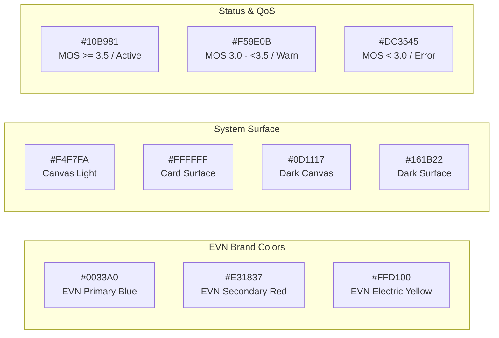

# TÀI LIỆU QUY CHUẨN THIẾT KẾ GIAO DIỆN (DESIGN.MD)

## Hệ Thống EVN CDR Analysis System (EVN CDR AS)

> **Cập nhật:** Phiên bản 1.0.0  
> **Phạm vi tài liệu:** Toàn bộ thành phần UI, thiết kế mỹ thuật, hệ thống biến CSS (Design Tokens), quy chuẩn kiến trúc giao diện đa cổng (Tenant User & Admin Portal) và hướng dẫn triển khai từ thư mục mã nguồn giao diện `templates/`.

---

## 1. Tổng quan & Triết lý Thiết kế (Overview & Design Philosophy)

### 1.1. Bối cảnh & Định vị Sản phẩm

**EVN CDR AS** (Call Detail Record Analysis System) là giải pháp chuyên sâu phục vụ Tập đoàn Điện lực Việt Nam (EVN) và Công ty Viễn thông Điện lực & Công nghệ Thông tin (EVNICT). Hệ thống đảm nhiệm nhiệm vụ giám sát, phân tích nhật ký cuộc gọi quy mô hàng triệu bản ghi, đánh giá chất lượng thoại IP theo chuẩn QoS viễn thông quốc tế (MOS, Jitter, Packet Loss, độ trễ thiết lập SIP), quản lý dải đầu số PABX đa cấp và phát/tải bản ghi âm đối soát nghiệp vụ viễn thông.

### 1.2. Triết lý Thiết kế Chủ đạo

1. **Tinh thần Kỷ luật & Chuẩn xác của Ngành Điện (Authoritative & Trustworthy):**  
   Giao diện kết hợp tính nghiêm túc của hệ thống điều hành chỉ huy năng lượng với phong cách hiện đại của ứng dụng phân tích dữ liệu SaaS thế hệ mới.
2. **Ưu tiên Hiệu suất Hiển thị Dữ liệu Lớn (Data-Dense & Frictionless):**  
   Mọi bảng dữ liệu (Data Grid), cây danh mục (Tree Structure), biểu đồ (Chart.js) và bộ lọc (Search Filters) được tối ưu khoảng cách đệm (spacing), kiểu chữ rõ ràng, thanh cuộn mượt mà và thao tác tức thì.
3. **Kiến trúc Giao diện Đa Cổng (Dual-Portal Experience):**  
   - **Cổng Thành viên Đơn vị (Tenant Portal):** Thân thiện, trang nhã, sử dụng màu Xanh EVN truyền thống (`#0033A0`) làm nền tảng.  
   - **Cổng Quản trị Hệ thống (Admin Portal):** Quyền uy, công nghệ, kết hợp Xanh Navy đậm (`#002B7F`) và dải Huy hiệu Vàng Hoàng Kim (`#D97706` / `#F59E0B`).
4. **Song hành Giao diện Sáng/Tối (Native Dark Mode Ready):**  
   Hỗ trợ chuyển đổi chủ đề (Theme Toggle) tức thì thông qua thuộc tính `[data-theme="dark"]`, chống hiện tượng nhấp nháy sáng (Flash of Unstyled Content - FOUC) nhờ script đầu trang đọc `theme` đã cache ở `localStorage` (khóa `adminTheme` / `memberTheme`, ghi sau khi nạp `GET .../profile/preferences`; chỉ lưu giá trị `theme`) & `prefers-color-scheme`. Nguồn chuẩn của `theme` là `user_settings` qua API, không phải storage (`docs/modules/09_admin_profile.md` mục 3.6, `docs/modules/08_user_profile.md` mục 3.5.1).

---

## 2. Hệ thống Màu sắc & Vai trò (Colors & Palette Roles)



### 2.1. Màu sắc Nhận diện Cốt lõi (EVN Brand Identity)

- **EVN Primary Blue (`#0033A0` / RGB `0, 51, 160`):**  
  Màu chủ đạo cho Sidebar, Button chính, Tiêu đề thương hiệu, Tab đang hoạt động và liên kết chính. Mang lại cảm giác tin cậy, vững chắc.
- **EVN Secondary Red (`#E31837` / RGB `227, 24, 55`):**  
  Màu bổ trợ đại diện cho năng lượng nhiệt huyết, dùng cho Badge cảnh báo số lượng chưa đọc, nút hành động nguy hiểm (Xóa, Hủy, Đăng xuất) và cuộc gọi bị lỗi/rớt mạng.
- **EVN Electric Yellow (`#FFD100` / RGB `255, 209, 0`):**  
  Màu tia chớp điện năng, dùng cho các điểm nhấn icon cảnh báo, huy hiệu bảo trì và trạng thái chú ý kỹ thuật.

### 2.2. Màu sắc Cổng Quản trị (Admin Specific Tokens)

- **Admin Navy Blue (`#002B7F`):** Gam màu xanh biển sâu sẫm hơn, nhấn mạnh tính quyền hạn cao cấp.
- **Admin Royal Gold (`#D97706` / `#F59E0B`):** Huy hiệu quyền hạn tối cao, thẻ cảnh báo đặc quyền hệ thống, viền nổi bật.

### 2.3. Bảng Ánh xạ Light / Dark Theme

| Tên biến CSS | Light Mode (`:root`) | Dark Mode (`[data-theme="dark"]`) | Ứng dụng thực tế |
| :--- | :--- | :--- | :--- |
| `--primary` | `#0033A0` | `#58a6ff` | Màu nút nhấn chính, tab active, brand text |
| `--primary-light` | `rgba(0, 51, 160, 0.1)` | `rgba(0, 51, 160, 0.3)` | Nền menu item active, nền icon stat card |
| `--primary-dark` | `#002277` | `#002277` | Gradient điểm kết thúc của nút chính |
| `--secondary` | `#E31837` | `#f87171` | Nút xóa, số lượng badge chưa đọc, alert đỏ |
| `--bg-color` | `#f4f7fa` | `#0d1117` | Toàn bộ màu nền body/canvas nền tảng |
| `--surface` | `#ffffff` | `#161b22` | Bề mặt thẻ Card, Modal, Dropdown, Sidebar |
| `--text-main` | `#1a1f36` | `#c9d1d9` | Tiêu đề H1-H3, nội dung văn bản chính |
| `--text-muted` | `#697386` | `#8b949e` | Tiêu đề phụ, icon thụ động, placeholder |
| `--border` / `--border-color` | `#e3e8ee` | `#30363d` | Đường kẻ ngăn cách bảng, viền card |
| `--table-header-bg` | `#fafbfc` | `#21262d` | Dòng tiêu đề cột `<thead>` cố định (sticky) |
| `--row-hover-bg` | `#f8fafc` | `#1c2128` | Hiệu ứng rê chuột trên các dòng bảng `<tbody>` |
| `--input-bg` | `#ffffff` | `#0d1117` | Nền ô nhập liệu input, select, textarea |

### 2.4. Thang màu Đánh giá Chất lượng Thoại (QoS / MOS Metric Scale)

Hệ thống hiển thị trạng thái chất lượng cuộc gọi theo **bộ dải MOS duy nhất** định nghĩa tại `docs/01_database_schema.md` mục 2.1 (xét trên `mos_x100 / 100`, hiển thị 2 chữ số thập phân):

- **Xuất sắc (MOS ≥ 4.0)** – `.mos-excellent`: `#10B981` (Xanh lục ngọc).
- **Tốt (3.5 ≤ MOS < 4.0)** – `.mos-good`: `#10B981` (Xanh lục ngọc).
- **Trung bình (3.0 ≤ MOS < 3.5)** – `.mos-fair`: `#F59E0B` (Vàng hổ phách). Suy giảm nhẹ nhưng nghe rõ.
- **Kém (MOS < 3.0)** – `.mos-poor`: `#DC3545` (Đỏ cảnh báo). Cần can thiệp.
- **Không có dữ liệu (không có RTP)** – `.mos-na`: xám, hiển thị `--`.

---

## 3. Quy chuẩn Typography (Typography System)

### 3.1. Phông chữ (Font Family)

- **Primary Interface Font:** `'Inter', -apple-system, BlinkMacSystemFont, "Segoe UI", Roboto, sans-serif`  
  Phông chữ sans-serif hình học hiện đại, có tỷ lệ x-height tối ưu cho khả năng đọc chữ số và ký tự trên màn hình máy tính bảng và màn hình giám sát trung tâm.
- **Monospace Font (Kỹ thuật):** `'SFMono-Regular', Consolas, 'Liberation Mono', Menlo, monospace`  
  Áp dụng cho Dải số điện thoại (Prefix), Mã cuộc gọi Call ID, Địa chỉ IP tổng đài và Giao thức SIP Code.

### 3.2. Cấu trúc Phân cấp Kiểu chữ

| Cấp bậc | Font Size | Line Height | Weight | Letter Spacing | Áp dụng trong hệ thống |
| :--- | :--- | :--- | :--- | :--- | :--- |
| **Display H1** | `24px` (`1.5rem`) | `1.3` | `700 (Bold)` | `-0.01em` | Tiêu đề chính màn hình (`.page-header h1`) |
| **Section H2** | `20px` (`1.25rem`) | `1.35` | `600 (Semi-bold)` | `0` | Tiêu đề Modal, Thẻ lớn, Tên thương hiệu |
| **Card H3 / Sub** | `16px` (`1.0rem`) | `1.4` | `600 (Semi-bold)` | `0` | Tiêu đề nhóm card (`.card-header h3`), Filter title |
| **Body Standard** | `14px` (`0.875rem`) | `1.5` | `400 / 500` | `0` | Dữ liệu bảng, nhãn trường nhập, văn bản mô tả |
| **Caption / Meta** | `12px` (`0.75rem`) | `1.4` | `400 / 500` | `0.02em` | Ngày giờ, subtitle, chú thích chân trang |
| **Micro Badge** | `11px` (`0.65-0.75rem`) | `1.2` | `600 / 700` | `0.04em` | Nhãn trạng thái cuộc gọi, dải số prefix badge |

---

## 4. Bố cục Khung & Hệ thống Lưới (Layout & Grid System)

### 4.1. Cấu trúc Khung Giao diện Tổng thể (App Shell)

Giao diện ứng dụng tổ chức theo mô hình **Khung điều hành hai cột (Sidebar + Main Viewport)** cố định chiều cao màn hình (`100vh`) để triệt tiêu hiện tượng cuộn trang không đồng bộ:

```
+-------------------------------------------------------------------------+
| [Top Header / Mobile Header]  - Chiều cao: 70px (Mobile: 60px)           |
+-------------------+-----------------------------------------------------+
| [Sidebar]         | [Main Content Scroll Area]                          |
| - Desktop: 270px  | - Page Header: Title + Action Buttons               |
| - Collapsed: 80px | - Filter Wrapper: Search parameters & Time range    |
| - Mobile: Drawer  | - Workspace / Data Grid / Cards / Tree View         |
|   (-100% -> 0)    | - Pagination Bar: Total info + Page list controls   |
|                   | - App Footer: Bản quyền EVN & Version tag           |
+-------------------+-----------------------------------------------------+
```

### 4.2. Ma trận Trạng thái Sidebar Navigation

1. **Desktop Mở rộng (`.sidebar` - 270px):**  
   Hiển thị logo đầy đủ, tên thương hiệu `EVN CDRAS`, nhóm danh mục phân cấp (`.menu-group`) có mũi tên mở rộng (`.chevron`), nhãn chữ và số lượng badge.
2. **Desktop Thu gọn (`.sidebar.collapsed` - 80px):**  
   Chuyển đổi tức thì qua nút nổi tròn (`.collapse-btn-floating`). Ẩn toàn bộ nhãn chữ (`.brand-name`, `.menu-text`), căn giữa các icon trực quan, menu badge chuyển thành chấm tròn nổi bên góc biểu tượng.
3. **Mobile Drawer Responsive (`max-width: 768px`):**  
   Sidebar chuyển thành thanh trượt ngang cố định (`position: fixed; left: -100%`). Khi người dùng nhấn nút hamburger (`#mobileMenuToggle`), thanh trượt tiến vào màn hình (`left: 0`) đồng thời kích hoạt lớp phủ làm mờ nền (`.mobile-overlay.show`).

### 4.3. Các Kiểu Lưới Bố cục Nội dung (Content Grids)

- **Lưới Chỉ số Thống kê (`.stats-grid`):**  
  `display: grid; grid-template-columns: repeat(auto-fit, minmax(250px, 1fr)); gap: 1.5rem;`  
  Tự động thích ứng co giãn từ 1 cột (Mobile) lên 2, 3 hoặc 4 cột tùy độ phân giải màn hình.
- **Lưới Nội dung Phân đôi (`.content-grid`):**  
  Chia tỉ lệ cân xứng `1fr 1fr` cho biểu đồ so sánh hoặc cấu hình đối xứng.
- **Lưới Báo cáo Chuyên sâu (`.reports-grid`):**  
  Chia tỉ lệ bất đối xứng `2fr 1fr` (2 phần dành cho Biểu đồ chính, 1 phần cho danh sách phân bổ hoặc thông tin tổng kết).
- **Lưới Bộ lọc Tìm kiếm (`.filter-grid`):**  
  Tổ chức thông minh 5 cột trên màn hình rộng: `grid-template-columns: 2fr 1fr 1fr 1fr auto;`. Trên màn hình Tablet co lại 3 cột, và tự động dồn thành 1 cột đơn trên Mobile.

---

## 5. Độ sâu, Bóng đổ & Hình khối (Elevation, Depth & Shapes)

```
        Layer 0: Canvas Background (#f4f7fa)
            │
            ▼
        Layer 1: Cards, Panels, Tree Nodes (Shadow SM: 0 1px 2px rgba(0,0,0,0.05))
            │
            ▼
        Layer 2: Hovered Elements, Action Menus (Shadow MD: 0 4px 6px rgba(0,0,0,0.1))
            │
            ▼
        Layer 3: Dropdowns, Filter Popovers (Shadow LG: 0 10px 15px rgba(0,0,0,0.1))
            │
            ▼
        Layer 4: Modal Dialogs, Floating Toasts (Shadow XL + Backdrop Filter: blur(4px))
```

### 5.1. Thang Bóng đổ (Shadow Elevations)

- **`--shadow-sm`:** `0 1px 2px rgba(0,0,0,0.05)` (Dành cho card tĩnh, viền nhẹ).
- **`--shadow-md`:** `0 4px 6px -1px rgba(0,0,0,0.1), 0 2px 4px -1px rgba(0,0,0,0.06)` (Khi hover nút, card tương tác).
- **`--shadow-lg`:** `0 10px 15px -3px rgba(0,0,0,0.1), 0 4px 6px -2px rgba(0,0,0,0.05)` (Dành cho User Profile Dropdown, Submenu trôi).
- **`--shadow-xl`:** `0 20px 25px -5px rgba(0,0,0,0.1), 0 10px 10px -5px rgba(0,0,0,0.04)` (Hộp thoại Modal, Confirm Dialog).
- **`--shadow-toast`:** `0 10px 25px -5px rgba(0, 0, 0, 0.12), 0 4px 6px -2px rgba(0, 0, 0, 0.05)` (Thẻ thông báo nổi góc màn hình).

### 5.2. Quy chuẩn Bo góc (Border Radius Hierarchy)

- **`4px` (`rounded.xs`):** Nút hành động siêu nhỏ trên từng dòng (`.action-btn`), scrollbar thumb.
- **`6px` (`rounded.sm`):** Ô phân trang (`.page-link`), nút chuyển chế độ biểu đồ (`.chart-toggle-fit-btn`), node cây cấp dưới.
- **`8px` (`rounded.md`):** Nút bấm tiêu chuẩn (`.btn`), ô nhập form (`.form-control`), thẻ nhóm cài đặt (`.settings-group`).
- **`12px` (`rounded.lg`):** Thẻ thông tin (`.card`), hộp lọc (`.search-filter-wrapper`), thẻ Toast thông báo.
- **`16px` (`rounded.xl`):** Hộp thoại xác nhận quan trọng (`.confirm-modal-dialog`).
- **`9999px` (`rounded.full`):** Avatar người dùng, Badge đếm số lượng, thanh trượt chuyển mạch Switch toggle (`.toggle-slider`).

---

## 6. Quy chuẩn Chi tiết các Thành phần Giao diện (Component Specifications)

### 6.1. Thanh Tiêu đề & Điều hướng (Headers & Navigation)

- **Top Header:** Cố định độ cao `70px`. Chứa ô tìm kiếm toàn cục bo tròn (`width: 300px; border-radius: 20px`), khu vực người dùng bên phải hiển thị ảnh đại diện tròn `36px`, tên tài khoản in đậm và vai trò hệ thống.
- **Submenu Accordion:** Hỗ trợ nhiều cấp với biểu tượng chevron xoay mượt mà từ `-90deg` sang `0deg` khi mở rộng (`.menu-group.expanded`).

### 6.2. Hệ thống Nút bấm (Buttons System)

```
[ Primary Button ]      [ Outline Button ]      [ Danger Button ]      [ Action Icon ]
+-----------------+     +-----------------+     +-----------------+     +----+
|  [+] Thêm mới   |     |   Xuất Excel    |     |   [x] Xóa bỏ    |     | ✎  |
+-----------------+     +-----------------+     +-----------------+     +----+
  Gradient Blue           Bordered White          Gradient Red            Transparent
```

- **Primary Button (`.btn.btn-primary`):**  
  `background: linear-gradient(135deg, var(--primary) 0%, #0044cc 100%);`  
  Độ bóng nổi `0 4px 12px rgba(0, 51, 160, 0.2)`. Khi hover: dịch chuyển nhẹ lên trên `translateY(-2px)` và phóng to biểu tượng SVG bên trong `scale(1.1)`.
- **Outline Button (`.btn.btn-outline`):**  
  Nền trong suốt, viền mỏng `1px solid var(--border)`, chuyển màu sang viền đậm khi rê chuột.
- **Danger Button (`.btn.btn-danger`):**  
  Dải gradient đỏ cảnh báo `linear-gradient(135deg, var(--secondary) 0%, #ff3355 100%)`.
- **Hàng nút Thao tác nhỏ trên bảng (`.action-btn`):**  
  Icon kích cỡ `18x18px`, trạng thái mặc định màu xám dịu. Rê chuột: Sửa (`.edit-btn` đổi sang xanh primary), Xóa (`.delete-btn` đổi sang đỏ secondary).

### 6.3. Bảng Dữ liệu & Bảng Cây Tổ chức (Data Tables & Tree View)

- **Bảng Cây Tổ chức (`.tree-table`):**  
  Hỗ trợ hiển thị cấu trúc đa phân cấp Tổng công ty $\rightarrow$ Đơn vị $\rightarrow$ Phòng ban. Cột tên đơn vị có bước thụt lề linh động thông qua thẻ `<span class="indent"></span>` (`width: 24px` trên Desktop, `12px` trên Mobile). Biểu tượng mũi tên mở rộng (`.toggle-icon`) xoay `90deg` khi dòng mang trạng thái `tr.expanded`.
- **Sticky Header:** Hàng tiêu đề `th` luôn cố định trên cùng (`position: sticky; top: 0; z-index: 10`) kèm màu nền chuyên dụng `--table-header-bg` để khi cuộn dữ liệu hàng nghìn bản ghi người dùng không bị mất ngữ cảnh cột.

### 6.4. Bộ lọc Tìm kiếm & Thời gian (`.search-filter-wrapper`)

- Cấu trúc tích hợp: Thanh tiêu đề màu xám nhẹ mang biểu tượng bộ lọc và nút xóa nhanh tiêu chí tìm kiếm.
- Khung chọn thời gian (`datetime-local`): Tích hợp icon lịch trực quan, phân tách bằng nhãn `đến` tinh tế giữa hai mốc bắt đầu và kết thúc.
- Ô chọn thả xuống (`select.form-control`): Tùy biến hoàn toàn bằng CSS (`appearance: none;`), nhúng trực tiếp mũi tên SVG dưới dạng Data URI, loại bỏ hoàn toàn viền thô kệch mặc định của trình duyệt.

### 6.5. Thẻ Chỉ số Thống kê (`.stat-card`)

Gồm 3 phần bố cục chuẩn:

1. **Icon Container:** Hình vuông bo tròn `48x48px`, nền trong suốt 10% mang màu tương ứng (Xanh dương, Đỏ, Vàng điện lực).
2. **Chi tiết Số liệu:** Nhãn mô tả (`0.875rem`), con số giá trị lớn in đậm nổi bật (`font-size: 1.5rem; font-weight: 700`).
3. **Chỉ số Biến động (Trend Indicator):** Xu hướng tích cực màu xanh lục (`.positive: #10b981`), xu hướng tiêu cực màu đỏ (`.negative: var(--secondary)`).

### 6.6. Hộp thoại Xác nhận & Cảnh báo (`.confirm-modal-dialog`)

- **Lớp nền (Backdrop):** Phủ kín toàn màn hình `background: rgba(15, 23, 42, 0.65)` kết hợp hiệu ứng kính mờ thời thượng `backdrop-filter: blur(4px)`.
- **Hộp thoại trung tâm:** Chiều rộng tối đa `420px`, bo góc lớn `16px`. Biểu tượng tròn lớn `56x56px` ở đỉnh đầu với màu sắc ngữ nghĩa rõ ràng:
  - Nguy hiểm (`.confirm-modal-icon--danger`): Nền đỏ nhạt, icon xóa/cảnh báo.
  - Cảnh báo (`.confirm-modal-icon--warning`): Nền vàng cam nhạt.
  - Thông tin (`.confirm-modal-icon--primary`): Nền xanh dương nhạt.

### 6.7. Thông báo Nổi & Biểu ngữ Bảo trì (Toasts & Banners)

- **Toast Notifications (`.toast-card`):**  
  Cố định góc trên bên phải màn hình (`top: 24px; right: 24px; z-index: 10000`). Có thanh viền cạnh trái dày `4px` hiển thị mã màu trạng thái (Xanh lục cho Success, Đỏ cho Error, Vàng cho Warning, Xanh dương cho Info). Hiệu ứng xuất hiện trượt từ phải sang trái bằng chuyển động cubic-bezier `animation: slideInToast 0.35s cubic-bezier(0.16, 1, 0.3, 1)`.
- **Biểu ngữ Bảo trì Hệ thống (`.maintenance-alert-banner`):**  
  Hiển thị dải băng rôn màu vàng hổ phách nổi bật trên đầu khu vực làm việc khi quản trị viên bật cờ bảo trì (`Maintenance Mode`). Bản cổng Admin có nút điều hướng nhanh đến cấu hình hệ thống. Bản cổng Member (`MemberLayout`) không có nút, chỉ có thông điệp; hiện khi API client nhận `503 MAINTENANCE` từ một API nghiệp vụ và ẩn khi một API nghiệp vụ trả thành công (`docs/modules/03_auth_user.md` mục 3.2), không đọc cờ từ `localStorage`/`sessionStorage`.

### 6.8. Quản lý Dải Đầu số PABX (`.prefix-tags` & `.prefix-badge`)

- Thẻ dải số PABX hiển thị dạng Tag viền mỏng (`border: 1px solid rgba(0, 51, 160, 0.2)`), nền xanh nhạt, tự động ngắt dòng thông minh khi danh sách có hàng chục đầu số phụ trách.
- Hàng khai báo đầu số động (`.prefix-row`): Cho phép thêm/bớt từng hàng đầu số với nút xóa đỏ tiện dụng.

### 6.9. Trình phát Ghi âm Cuộc gọi (CDR Audio Player / Streaming Modal)

- Tích hợp trực tiếp trên trang Tra cứu Lịch sử Cuộc gọi (`cdr-history.html`).
- Cho phép nghe trực tiếp luồng âm thanh hai chiều (kênh trộn Mix của leg đang chọn).
- Hiển thị thanh tiến trình thời gian thực, nút tua 10 giây, điều chỉnh tốc độ đọc ($0.75x, 1.0x, 1.25x, 1.5x$) và nút tải tệp `.wav` an toàn.

---

## 7. Quy tắc Thiết kế Bắt buộc (Do's and Don'ts)

### 7.1. Bảng Quy tắc Thực hành Thiết kế

| Thành phần | NÊN LÀM (DO) ✅ | TUYỆT ĐỐI KHÔNG ĐƯỢC LÀM (DON'T) ❌ |
| :--- | :--- | :--- |
| **Màu sắc & Nhận diện** | Sử dụng đúng mã màu chuẩn EVN (`#0033A0`, `#E31837`, `#FFD100`). Đảm bảo độ tương phản chữ trên nền đạt chuẩn WCAG AA. | Không tự ý đưa các màu sắc ngoại lai như tím gradient, hồng neon làm màu thương hiệu (Vi phạm Purple Ban). |
| **Bảng Dữ liệu CDR** | Sử dụng phông Monospace cho các trường số điện thoại, IP, Duration. Giữ thanh tiêu đề `th` luôn `sticky` khi cuộn. | Không để bảng bị tràn vỡ khung hình trên màn hình nhỏ; không bỏ bớt thanh cuộn ngang `.table-responsive`. |
| **Giao diện Tối** | Luôn khai báo đầy đủ các biến màu tương ứng trong khối `[data-theme="dark"]`. Kiểm tra độ tương phản viền bảng. | Không hardcode mã màu hex trực tiếp trong các file CSS mới mà không thông qua biến CSS (CSS Variables). |
| **Biểu mẫu & Input** | Cung cấp trạng thái `:focus` rõ ràng với hiệu ứng hào quang mỏng (`box-shadow: 0 0 0 3px rgba(0, 51, 160, 0.1)`). | Không xóa bỏ đường viền focus của trình duyệt (`outline: none`) mà không có viền thay thế cho người khuyết tật. |
| **Nút bấm & Hành động** | Sử dụng nút đỏ (`.btn-danger`) riêng cho các hành động không thể đảo ngược (Xóa vĩnh viễn, Khởi động lại PABX). | Không sử dụng nút đỏ cho các thao tác hủy bỏ hộp thoại thông thường (hãy dùng `.btn-outline` hoặc nút Hủy trung tính). |
| **Chuyển động (Motion)** | Thời gian hiệu ứng chuyển tiếp từ `0.2s` đến `0.35s` với đường cong gia tốc mềm mại `cubic-bezier`. | Không sử dụng hiệu ứng rung giật, xoay tròn quá đà làm chậm thao tác tra cứu của nhân viên điều hành. |

---

## 8. Danh mục Màn hình & Bản đồ Mẫu Giao diện (Screen Inventory)

Hệ thống mẫu giao diện trong thư mục `templates/` được phân nhóm theo 5 phân hệ nghiệp vụ chính:

```
templates/
 ├── Nhóm 1: Xác thực & Quản trị Hệ thống
 │    ├── member/login.html & .css           # Đăng nhập Cổng Người dùng đơn vị
 │    ├── admin/login.html & .css            # Đăng nhập Cổng Quản trị hệ thống
 │    ├── system-settings.html & .css        # Cài đặt hệ thống theo các key seed system_settings (phân tích PABX, lưu trữ, bảo trì, SMTP, bảo mật)
 │    └── notifications.html & .css          # Trung tâm thông báo hệ thống toàn cục
 ├── Nhóm 2: Bảng Điều khiển & Báo cáo
 │    ├── dashboard.html & dashboard.css     # Trung tâm giám sát trực quan & tổng quan
 │    └── reports.html & reports.css         # Báo cáo sản lượng thoại & thống kê chi tiết
 ├── Nhóm 3: Giám sát Thoại & Dịch vụ Kỹ thuật
 │    ├── cdr-history.html & cdr-history.css # Tra cứu lịch sử CDR & nghe file ghi âm
 │    └── qos-debug.html & qos-debug.css     # Phân tích kỹ thuật chuyên sâu MOS/QoS
 ├── Nhóm 4: Tổ chức & Dải Đầu số PABX
 │    ├── organization.html & .css           # Quản lý Cây sơ đồ tổ chức đa cấp EVN
 │    ├── prefix-management.html & .css      # Quản lý cấp phát & thu hồi dải số PABX
 │    ├── prefix-history.html & .css         # Nhật ký kiểm toán lịch sử thay đổi đầu số
 │    └── org-prefix.html & .css             # Tra cứu đầu số dành cho đơn vị thành viên
 └── Nhóm 5: Quản trị Người dùng & Phân quyền
      ├── users.html & users.css             # Danh mục tài khoản người dùng
      ├── user_group.html & user_group.css   # Nhóm người dùng (thành viên cố định từ lúc tạo, không chuyển nhóm)
      ├── roles.html & roles.css             # Danh sách 5 vai trò kèm quyền (chỉ xem)
      ├── permissions.html (không triển khai) # Mẫu cũ: ma trận chỉnh quyền, đã bỏ khỏi phạm vi
      ├── data-permissions.html (không triển khai) # Mẫu cũ: ma trận quyền theo màn hình, đã bỏ khỏi phạm vi
      ├── profile.html & .css                # Hồ sơ cá nhân người dùng
      ├── change-password.html & .css        # Đổi mật khẩu & đo độ an toàn bảo mật
      └── user-settings.html & .css          # Tùy biến cài đặt tài khoản cá nhân
```

### 8.1. Chi tiết Bảng Ánh xạ Toàn bộ Mẫu Giao diện

| STT | Tệp Giao diện HTML | Tệp Phong cách CSS | Phân hệ Chức năng | Các Thành phần UI Tiêu biểu |
| :---: | :--- | :--- | :--- | :--- |
| **01** | `member/login.html` | `member/login.css` | Xác thực Đơn vị | Layout 2 cột chia đôi, Showcase logo EVN, Giao diện tối, Hộp tài khoản mẫu *(rà ở U01)* |
| **02** | `admin/login.html` | `admin/login.css` | Xác thực Quản trị | Huy hiệu vàng "Cổng Quản trị Hệ thống", nhãn cảnh báo đỏ, nút chuyển Cổng Người dùng, hộp lỗi theo `errorCode`; không điền sẵn tài khoản, không có liên kết "Quên mật khẩu" (`docs/modules/04_auth_admin.md` mục 5.1) |
| **03** | `dashboard.html` | `dashboard.css`, `style.css` | Bảng Điều khiển | 4 Thẻ Stat Card chỉ số, Biểu đồ Chart.js lượng gọi theo giờ, Trạng thái tổng đài |
| **04** | `cdr-history.html` | `cdr-history.css` | Giám sát Cuộc gọi | Lưới lọc thời gian đa tham số, Bảng CDR, Nghe/Tải ghi âm, Phân trang |
| **05** | `qos-debug.html` | `qos-debug.css` | Đánh giá QoS | Thẻ điểm MOS, Biểu đồ Jitter/Packet Loss, Bộ giải mã Codec, Phân tích lỗi SIP |
| **06** | `reports.html` | `reports.css` | Báo cáo Thống kê | Lưới báo cáo tỷ lệ 2:1, Biểu đồ cột phân loại cuộc gọi, Xuất dữ liệu Excel/PDF |
| **07** | `organization.html` | `organization.css` | Cây Tổ chức EVN | Bảng cây phân cấp (`.tree-table`), Nút mở rộng/thu gọn, Thao tác thêm/sửa/xóa đơn vị |
| **08** | `prefix-management.html` | `prefix-management.css` | Quản lý Dải số | Thẻ Tag đầu số PABX, Khung thêm hàng loạt đầu số, Modal gán đơn vị |
| **09** | `prefix-history.html` | `prefix-history.css` | Kiểm toán Đầu số | Bảng truy vết lịch sử gán dải số, Thời điểm thay đổi, Người thực hiện |
| **10** | `org-prefix.html` | `org-prefix.css` | Tra cứu Đơn vị | Danh bạ dải số PABX nội bộ EVN, Tìm kiếm nhanh theo đơn vị và mã tỉnh |
| **11** | `users.html` | `users.css` | Quản trị Người dùng | Bảng tài khoản, Avatar đại diện, Nhãn chức vụ, Modal khóa/kích hoạt tài khoản |
| **12** | `user_group.html` | `user_group.css` | Nhóm Người dùng | Danh sách nhóm nghiệp vụ, Phân bổ quyền hạn tập trung |
| **13** | `users4group.html` | `users4group.css` | *(Không triển khai)* | Mẫu cũ chọn người dùng vào nhóm: không có trong `templates/` và trái quy tắc `users.user_group_id` bất biến (`docs/modules/10_permissions_and_roles.md`) |
| **14** | `roles.html` | `roles.css` | Vai trò | Danh sách chỉ xem 5 vai trò: Nhóm Quản trị (Quản trị viên tối cao, Quản trị viên hệ thống) & Nhóm Người dùng (Quản trị viên nhóm, Thành viên nghe ghi âm, Thành viên), mỗi vai trò kèm danh sách quyền rút gọn và số tài khoản; không có nút thêm/sửa/xóa (`docs/modules/10_permissions_and_roles.md` mục 5.1) |
| **15** | `permissions.html` | `permissions.css` | *(Không triển khai)* | Mẫu cũ ma trận chỉnh quyền; quyền của vai trò nay là seed cố định, không có giao diện chỉnh |
| **16** | `data-permissions.html` | `data-permissions.css` | *(Không triển khai)* | Mẫu cũ ma trận quyền theo màn hình; thông tin quyền nay hiển thị ngay trong `roles.html` |
| **17** | `notifications.html` | `notifications.css` | Trung tâm Thông báo | Danh sách thông báo phân loại theo icon theo `notifications.type` (`QOS_ALERT`, `PABX_OFFLINE`, `SYSTEM_JOB`, `SYSTEM_MAINTENANCE`, `GENERAL`) và màu theo `severity` |
| **18** | `system-settings.html` | `system-settings.css` | Cài đặt Hệ thống | Các tab theo `system_settings.category` (`ANALYSIS`: IP lõi PABX, mẫu số máy lẻ; `REPORTING`: thời hạn lưu trữ; `ADVANCED`: bật/tắt chế độ bảo trì, ánh xạ ghi âm, cảnh báo, SMTP, bảo mật). Không có cấu hình MariaDB/sao lưu (cấu hình CSDL nằm ở biến môi trường, `docs/00_overview_and_architecture.md`) |
| **19** | `user-settings.html` | `user-settings.css` | Cài đặt Cá nhân | Bố cục Settings Sidebar hai cột, Tùy chọn thông báo email/âm thanh |
| **20** | `profile.html` | `profile.css` | Hồ sơ Cá nhân | Thẻ tóm tắt thông tin tài khoản, Huy hiệu vai trò, Form cập nhật thông tin |
| **21** | `change-password.html` | `change-password.css` | Đổi Mật khẩu | Thước đo độ mạnh mật khẩu (Password Strength Meter), Hướng dẫn an toàn |

---

## 9. Hướng dẫn Kế thừa & Mở rộng cho Frontend Framework (Vue 3 / React)

> **Ánh xạ sang mã nguồn:** frontend là **một ứng dụng Vue** chia 2 khu vực: `templates/admin/` → `frontend/src/apps/admin` (phục vụ tại `/admin/*`), `templates/member/` → `frontend/src/apps/member` (phục vụ tại `/*`). Design token, `style.css`, `dark-mode.css`, logo và component dùng chung đặt ở `frontend/src/shared`; bảng màu riêng của Admin Portal (Navy `#002B7F`, Vàng `#D97706`) khai báo trong `frontend/src/apps/admin/styles/admin.css`, scope dưới class `.portal-admin` của `AdminLayout` để không ảnh hưởng khu vực Member. Bảng route từng cổng: `docs/00_overview_and_architecture.md` mục 5.3.

Hệ thống thiết kế trong `templates/` được xây dựng bằng HTML5 chuẩn mực, CSS biến hệ thống (`var(--...)`) và JavaScript vanilla tương thích tối đa để có thể dễ dàng chuyển đổi sang các framework hiện đại như **Vue.js 3** hoặc **React**:

1. **Tích hợp Token vào Tailwind CSS / SCSS:**  
   Toàn bộ cấu trúc YAML Front Matter ở đầu tài liệu này có thể được chuyển thể trực tiếp thành `tailwind.config.js` hoặc file SCSS variables:

   ```javascript
   // tailwind.config.js
   module.exports = {
     theme: {
       extend: {
         colors: {
           primary: {
             DEFAULT: '#0033A0',
             light: 'rgba(0, 51, 160, 0.1)',
             dark: '#002277',
           },
           secondary: {
             DEFAULT: '#E31837',
             light: 'rgba(227, 24, 55, 0.1)',
           },
           accent: '#FFD100',
           admin: {
             DEFAULT: '#002B7F',
             gold: '#D97706',
           }
         }
       }
     }
   }
   ```

2. **Kế thừa Component trong Vue 3:**  
   - Bảng cây tổ chức chuyển đổi thành component đệ quy `OrgTreeTable.vue`.
   - Trình phát âm thanh chuyển đổi thành component `CdrAudioStreamPlayer.vue` kết hợp thẻ HTML5 Audio API.
   - Hộp thoại xác nhận chuyển đổi thành `ConfirmModal.vue` quản lý tập trung qua Pinia Store.

---
*Tài liệu này là nguồn chuẩn cho **thiết kế trực quan** (màu, typography, component, bố cục) của hệ thống EVN CDR AS. Về dữ liệu, enum, mã quyền và nghiệp vụ, chuẩn là `docs/01_database_schema.md`, `docs/02_api_contracts.md` và các module docs; mock data trong `templates/` không phải chuẩn.*
