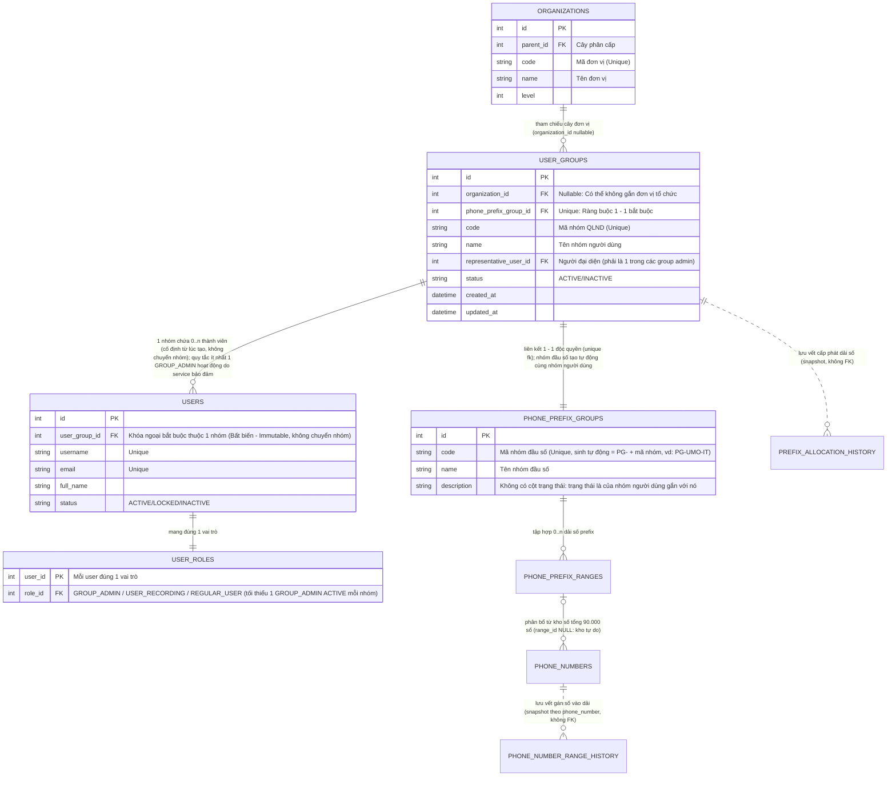

# MODULE 02: QUẢN LÝ NHÓM NGƯỜI DÙNG (USER GROUP / TỔ CHỨC QLND)

## Đường dẫn tài liệu: `docs/modules/02_user_group.md`

## Ánh xạ giao diện mẫu
- **Khu vực Admin**: `templates/admin/user_group.html` → `UserGroupView.vue` (route `admin.user-groups`, mục 5.1–5.2).
- **Khu vực Member**: `templates/member/group-admin.html` → `GroupAdminView.vue` (route `member.group-admin`), `templates/member/group-members.html` → `GroupMembersView.vue` (route `member.group-members`) (mục 5.3–5.4).

---

## 1. Mục tiêu & Nghiệp vụ (Business Overview)

### 1.1. Bối cảnh nghiệp vụ

Trong kiến trúc quản trị người dùng phân tán và phân định phạm vi dữ liệu (Data Scoping / Multi-tenancy) của hệ thống EVN CDR AS:

- **Cây tổ chức (`organizations`)**: Phản ánh cơ cấu hành chính - điều hành chung của EVN (Tập đoàn -> Tổng công ty -> Khối/Ban/Công ty -> Điện lực/Phòng ban).
- **Nhóm người dùng (User Group / Tổ chức Quản lý Người dùng - QLND)**: Là thực thể trung tâm quản lý tài khoản người dùng và là đơn vị sở hữu không gian dữ liệu cuộc gọi (Tenant Unit).
- **3 vai trò người dùng trong Nhóm (User Scope)**: mỗi người dùng mang đúng 1 vai trò, lưu ở `user_roles`; quyền của vai trò lấy từ `permission_roles` (`docs/modules/10_permissions_and_roles.md`). Quyền cấp nhóm duy nhất là `user_groups.allow_recording_access`, lưu trực tiếp trên nhóm.
  1. `GROUP_ADMIN` (Quản trị viên nhóm):
     - Bản chất là thành viên của nhóm được trao quyền quản trị nội bộ đơn vị.
     - Toàn quyền CRUD đối với thành viên nội bộ nhóm (`user:create`, `user:view`, `user:edit`, `user:delete`), không được chuyển nhóm thành viên.
     - Bổ nhiệm / hạ quyền Quản trị nhóm cho thành viên khác trong nhóm (đổi vai trò sang/khỏi `GROUP_ADMIN`, cần `group:manage_admin`), bảo toàn tối thiểu 1 Group Admin đang hoạt động.
     - Phân quyền nghe ghi âm Tầng 2: đổi vai trò thành viên giữa `REGULAR_USER` và `USER_RECORDING` (cần `group:toggle_recording`) khi Tầng 1 mở.
     - Mặc định tự động có quyền nghe trực tuyến & tải ghi âm thoại của nhóm khi nhóm được mở Tầng 1 (`allow_recording_access = 1`).
     - Toàn quyền xem log CDR (chi tiết 87 trường, bộ lọc nâng cao, xuất Excel), phân tích QoS và xem/xuất báo cáo thống kê trong phạm vi nhóm (`Group-Based Data Isolation`).
  2. `USER_RECORDING` (Thành viên nghe ghi âm):
     - Thành viên được Quản trị viên nhóm gán vai trò `USER_RECORDING` khi nhóm đã được cấp phép Tầng 1.
     - Được quyền nghe trực tuyến (`cdr:listen_audio`) và tải file ghi âm (`cdr:download_audio`) của nhóm mình.
     - Có toàn bộ các quyền đối với dữ liệu CDR, phân tích QoS và xem/xuất báo cáo thống kê theo nhóm tương tự Quản trị viên nhóm.
     - Không có thẩm quyền quản trị thành viên (không CRUD người dùng, không đổi vai trò người khác).
     - Nếu nhóm bị tắt Tầng 1, vai trò được giữ nguyên nhưng mất quyền nghe/tải cho tới khi Tầng 1 bật lại.
  3. `REGULAR_USER` (Thành viên):
     - Vai trò mặc định khi tạo thành viên.
     - **Điểm khác biệt DUY NHẤT so với `USER_RECORDING`**: Bị khóa hoàn toàn quyền nghe và tải file ghi âm cuộc gọi (ẩn trên giao diện, chặn `403 FORBIDDEN_PERMISSION` tại API).
     - **Còn lại GIỐNG HỆT 100% `USER_RECORDING` và CÓ QUYỀN TƯƠNG TỰ Quản trị viên nhóm** đối với việc xem nhật ký CDR, xem chi tiết 87 trường, lọc nâng cao, xuất Excel, xem phân tích QoS và xem/xuất báo cáo thống kê trong phạm vi nhóm.
     - Không có thẩm quyền quản trị thành viên.
- **4 Ràng buộc nghiệp vụ cốt lõi của Nhóm người dùng**:
  1. **Chứa nhiều người dùng thành viên (Quan hệ 1 - N) & Tính cố định nhóm**: Mỗi nhóm người dùng quản lý một tập hợp nhiều tài khoản người dùng thành viên (`users`). **Người dùng luôn luôn thuộc về một nhóm người dùng cố định ngay từ lúc tạo ra** (bản chất là người dùng thuộc đơn vị tổ chức), do đó **hoàn toàn không có khái niệm chuyển người dùng giữa các nhóm**. Thuộc tính `user_group_id` là bất biến (immutable) sau khi khởi tạo.
  2. **Có ít nhất một người dùng Quản trị viên nhóm & Thẩm quyền tạo người dùng (Group Admin Rule)**: Mỗi nhóm người dùng bắt buộc phải có **tối thiểu một người dùng đóng vai trò Quản trị viên nhóm** (vai trò `GROUP_ADMIN` trong `user_roles`). Quản trị viên nhóm **cũng là một thành viên trong nhóm nhưng được trao quyền quản trị**. Tài khoản người dùng có thể được tạo ra bởi:
     - **Quản trị viên hệ thống (System Admin)**: Có toàn quyền tạo người dùng cho bất kỳ Nhóm người dùng nào trong toàn hệ thống.
     - **Quản trị viên nhóm (Group Admin)**: Có quyền tạo mới tài khoản thành viên nhưng **chỉ được phép tạo trong phạm vi nhóm của chính mình**.
  3. **Liên kết với một Nhóm đầu số điện thoại theo ràng buộc 1 - 1 (1-to-1 Phone Prefix Group Binding)**: Mỗi nhóm người dùng liên kết độc quyền với **duy nhất một nhóm đầu số điện thoại** (`phone_prefix_groups`). Toàn bộ dữ liệu cuộc gọi CDR, file ghi âm và lưu lượng cuộc gọi phát sinh từ các đầu số này thuộc quyền quản lý của nhóm. Ngược lại, một nhóm đầu số chỉ thuộc duy nhất một nhóm người dùng (không chia sẻ giữa các nhóm). Nhóm đầu số **được tạo tự động** khi tạo nhóm người dùng (`code = 'PG-' + code nhóm`, `name = 'Nhóm đầu số ' + tên nhóm`), không chọn và không đổi được (`docs/01_database_schema.md` mục 4.1).
  4. **Tham chiếu Cây tổ chức linh hoạt (0..1 - N Organization Reference)**:
     - **Một đơn vị có nhiều nhóm người dùng**: Một đơn vị trên cây tổ chức có thể có nhiều nhóm người dùng trực thuộc (ví dụ: Khối CNTT có thể có nhóm "Vận hành Hệ thống", nhóm "An toàn thông tin"...).
     - **Có thể không tham chiếu đến đơn vị nào**: Nhóm người dùng có thể độc lập, không tham chiếu đến bất kỳ đơn vị tổ chức nào (`organization_id = NULL`), phục vụ cho các tổ công tác kiểm toán liên đơn vị, nhóm chuyên gia ngoài hoặc các tổ dự án đặc thù toàn hệ thống.

---

### 1.2. Sơ đồ Thực thể Quan hệ Nghiệp vụ (Business ERD)



---

### 1.3. Bốn Quy tắc Nghiệp vụ Chi tiết (Core Business Rules)

| Mã quy tắc | Tên quy tắc | Mô tả chi tiết & Ràng buộc xử lý |
| :--- | :--- | :--- |
| **BR-UG-01** | **Nhóm chứa nhiều thành viên (1 - N) & Không chuyển nhóm** | - Một nhóm người dùng (`user_groups`) chứa một danh sách từ $1$ đến $N$ tài khoản người dùng (`users`).<br>- **Người dùng luôn thuộc cố định 1 nhóm người dùng ngay từ lúc tạo ra** (`users.user_group_id NOT NULL`, bản chất là thuộc đơn vị tổ chức). Hệ thống **không có khái niệm chuyển người dùng giữa các nhóm**; thuộc tính `user_group_id` là bất biến (immutable).<br>- **Thẩm quyền tạo người dùng**: Tài khoản có thể được tạo ra bởi **Quản trị viên hệ thống** (toàn quyền chọn nhóm bất kỳ) hoặc **Quản trị viên nhóm** (cũng là một thành viên trong nhóm có quyền quản trị, chỉ được tạo trong nhóm của mình).<br>- **Phân quyền thành viên thường**: Cả hai loại thành viên thường (`USER_RECORDING` và `REGULAR_USER`) đều không có quyền quản trị (không thể thêm/sửa/xóa thành viên hoặc chuyển quyền admin).<br>- **Ngừng hoạt động nhóm kéo theo thành viên**: Ngừng hoạt động (xóa mềm) nhóm chuyển mọi thành viên chưa `INACTIVE` (kể cả Quản trị viên nhóm cuối cùng) sang `INACTIVE` trong cùng transaction, sau khi Quản trị viên hệ thống xác nhận. Nhóm không bao giờ bị xóa cứng (`docs/01_database_schema.md` mục 14). |
| **BR-UG-02** | **Tối thiểu 1 Quản trị viên nhóm (Group Admin Rule) & Thẩm quyền quản trị** | - Trong danh sách thành viên của nhóm, bắt buộc phải có **ít nhất 1 người dùng `ACTIVE` mang vai trò `GROUP_ADMIN`**.<br>- Nhóm được phép có nhiều quản trị viên nhóm (Multi-admin).<br>- Người đại diện chính (`representative_user_id`) phải là một trong các Quản trị viên nhóm.<br>- **Thẩm quyền của Quản trị viên nhóm**: Toàn quyền CRUD thành viên nội bộ nhóm (`user:create`, `user:view`, `user:edit`, `user:delete`), quyền bổ nhiệm hoặc hạ quyền Quản trị nhóm cho thành viên khác trong nhóm (`group:manage_admin`), và quyền đổi vai trò thành viên giữa `REGULAR_USER` và `USER_RECORDING` (`group:toggle_recording`). Mọi thay đổi vai trò qua `PUT /api/v1/users/:id/role`.<br>- **Bảo toàn Quản trị viên (Safeguard)**: Khi một nhóm chỉ còn đúng 1 Quản trị viên nhóm, hệ thống chặn tuyệt đối (`409`) các thao tác: hạ quyền admin về user thường, khóa (`LOCKED`) hoặc xóa tài khoản user đó (do người dùng cố định vào nhóm, không chuyển nhóm; `docs/01_database_schema.md` mục 14). Phải bổ nhiệm một thành viên khác lên làm Quản trị viên nhóm trước khi chuyển giao. |
| **BR-UG-03** | **Liên kết 1 - 1 với Nhóm đầu số điện thoại & Cô lập dữ liệu CDR** | - Mỗi nhóm người dùng liên kết với duy nhất một nhóm đầu số điện thoại (`phone_prefix_groups`) theo quan hệ **1 - 1** (`phone_prefix_group_id` có ràng buộc `UNIQUE`).<br>- Một nhóm đầu số điện thoại không được phép gán cho nhiều hơn 1 nhóm người dùng.<br>- **Phạm vi phân quyền dữ liệu (Group-Based Data Isolation)**: Bảng `cdr_enriched` được tiến trình Batch Scheduler tự động làm giàu thông tin `caller_group_id` và `called_group_id` dựa trên dải số và máy lẻ của nhóm này.<br>- **Quyền bình đẳng về dữ liệu trong nhóm**: Quản trị viên nhóm (`GROUP_ADMIN`), Thành viên nghe ghi âm (`USER_RECORDING`) và Thành viên (`REGULAR_USER`) đều có **quyền hạn tương tự và bình đẳng** đối với việc xem nhật ký cuộc gọi CDR (danh sách, chi tiết 87 trường, lọc nâng cao theo IP/mã ngắt kết nối, xuất file Excel), phân tích chỉ số QoS cuộc gọi và xem/xuất báo cáo thống kê trong phạm vi nhóm mình (`caller_group_id = user_group_id OR called_group_id = user_group_id`).<br>- Nhóm đầu số được tạo tự động lúc tạo nhóm, **không đổi được** sau đó (body có `phonePrefixGroupId` thì `400`, mục 3.2, 3.3). |
| **BR-UG-04** | **Tham chiếu Cây tổ chức tùy chọn (0..1 - N)** | - **1 đơn vị có nhiều nhóm (1 - N)**: Một đơn vị trong cây tổ chức (`organizations`) có thể quản lý 0, 1 hoặc nhiều nhóm người dùng trực thuộc.<br>- **Cho phép không thuộc đơn vị nào (Nullable)**: Thuộc tính `organization_id` trong `user_groups` cho phép nhận giá trị `NULL`. Các nhóm này hoạt động như các nhóm độc lập (Standalone Groups) cấp toàn hệ thống hoặc nhóm dự án đặc thù.<br>- **Hierarchy Path**: Nếu `organization_id` có giá trị, hệ thống tính toán chuỗi cấp bậc từ gốc tới đơn vị (ví dụ: `["Tổng công ty 71", "Khối CNTT"]`). Nếu `organization_id = NULL`, `hierarchyPath` trả về mảng rỗng `[]` và hiển thị trên giao diện là "Nhóm độc lập". |
| **BR-UG-05** | **Mô hình Phân quyền Ghi âm Kiểm soát 2 Tầng (2-Tier Recording Access Gate)** | - **Tầng 1 (Cấp nhóm - System Admin kiểm soát)**: Quản trị viên hệ thống (Admin Portal) có thẩm quyền tối cao cấp hoặc thu hồi quyền truy cập ghi âm cho từng Nhóm người dùng thông qua cờ `allow_recording_access` (cấu hình trong form Thêm/Sửa nhóm `PUT /api/v1/admin/user-groups/:id`).<br>  + **Nếu nhóm chưa được cấp phép (`allow_recording_access = 0`)**: Mọi tính năng liên quan đến ghi âm bị triệt tiêu khỏi giao diện người dùng của nhóm đó: Cột "File ghi âm" bị loại bỏ hoàn toàn khỏi bảng lịch sử cuộc gọi (bảng co về 6 cột); trong Modal chi tiết cuộc gọi, khối Audio Player được thay thế bằng thông báo *"Tính năng ghi âm chưa được kích hoạt cho đơn vị của bạn"*; trên giao diện Quản trị nhóm (`group-admin.html`), các cột và nút bấm/switch phân quyền ghi âm cho thành viên bị ẩn triệt để; Backend chặn toàn bộ API stream và download ghi âm với mã lỗi `403 GROUP_RECORDING_DISABLED`.<br>  + **Nếu nhóm được cấp phép (`allow_recording_access = 1`)**: Kích hoạt Tầng 2.<br>- **Tầng 2 (Vai trò - Group Admin kiểm soát khi Tầng 1 đã mở)**: quyền nghe/tải là quyền của vai trò (`permission_roles`), không lưu cờ trên người dùng.<br>  + **Quản trị viên nhóm (`GROUP_ADMIN`)**: Vai trò có sẵn `cdr:listen_audio`, `cdr:download_audio`, nên mặc định nghe/tải được ghi âm của nhóm.<br>  + **Người dùng thành viên**: Quản trị viên nhóm bật/tắt quyền nghe/tải bằng cách đổi vai trò thành viên (`PUT /api/v1/users/:id/role`).<br>    * **Thành viên nghe ghi âm (`USER_RECORDING`)**: được nghe trực tuyến (`cdr:listen_audio`) và tải file ghi âm (.wav) (`cdr:download_audio`) của nhóm mình.<br>    * **Thành viên (`REGULAR_USER`)**: bị khóa hoàn toàn tính năng nghe/tải (hiển thị trạng thái khóa và bị chặn API). Đây là điểm khác biệt duy nhất giữa hai vai trò thành viên.<br>- **Thứ tự kiểm tra**: quyền nhóm (Tầng 1) trước, quyền vai trò (Tầng 2) sau (`docs/modules/10_permissions_and_roles.md` mục 2.3). |

---

### 1.4. Chức năng chính của Module

1. **Hiển thị danh sách nhóm người dùng**:
   - Mã nhóm (`code`), Tên nhóm (`name`).
   - Người đại diện nhóm (Avatar, Họ tên, Email).
   - Số lượng Quản trị viên nhóm (`adminCount`, bảo đảm $\ge 1$).
   - Số lượng người dùng trực thuộc (`userCount` / `badge-count`).
   - Nhóm đầu số điện thoại liên kết 1-1 (Mã nhóm, Tên nhóm đầu số, các dải số: `42xxx, 46xxx`).
   - Đơn vị tổ chức tham chiếu & Chuỗi cấp bậc (`hierarchyPath`), hoặc nhãn "Nhóm độc lập" nếu `organization_id = NULL`.
   - Ngày thiết lập, trạng thái hoạt động (`ACTIVE`/`INACTIVE`).
   - Thao tác: Xem chi tiết thành viên & admin, Chỉnh sửa, Quản lý phân quyền, Xóa nhóm.
2. **Thiết lập mới & Chỉnh sửa Nhóm người dùng (`#userGroupModal`)**:
   - Chọn vị trí đơn vị trên Cây tổ chức (Tùy chọn: có thể chọn một đơn vị hoặc để trống "Không gắn đơn vị / Nhóm độc lập").
   - Nhập Mã nhóm và Tên nhóm.
   - Không chọn Nhóm đầu số: hệ thống tự tạo nhóm đầu số 1-1 cho nhóm mới (mã `PG-<mã nhóm>`). Dải số cấp sau qua màn hình Quản lý đầu số.
   - Khai báo **Quản trị viên nhóm đầu tiên** (tên đăng nhập, email, họ tên, số điện thoại, chức danh). Tài khoản này được tạo cùng lúc với nhóm, trong một transaction, vì người dùng không thể tồn tại ngoài nhóm.
   - **Cấu hình Quyền Ghi âm Nhóm (`allowRecordingAccess`)**: Trường chuyển đổi Switch/Checkbox "Cho phép nhóm nghe và tải ghi âm thoại IP" do Quản trị viên hệ thống thiết lập (Chốt chặn Tầng 1 - BR-UG-05).
   - Ghi chú / Mô tả.
3. **Quản lý danh sách thành viên & Quản trị viên**:
   - Thêm thành viên vào nhóm.
   - Bổ nhiệm Quản trị viên nhóm (`Promote to Admin`).
   - Hạ quyền Quản trị viên (Chặn nếu chỉ còn 1 Quản trị viên duy nhất).
4. **Ràng buộc an toàn khi xóa**:
   - "Xóa" nhóm là **ngừng hoạt động** (`status = INACTIVE`, xóa mềm). Hộp xác nhận hiển thị số thành viên chưa `INACTIVE` sẽ bị ngừng hoạt động cùng nhóm; xem API 3.4 và `docs/01_database_schema.md` mục 14.
   - Hộp xác nhận có ô chọn "Thu hồi toàn bộ dải số" (mặc định **không** chọn). Chọn thì dải số của nhóm được thu hồi về kho; không chọn thì dải vẫn thuộc nhóm `INACTIVE` (thu hồi sau từng dải). Liên kết với Nhóm đầu số **luôn được giữ nguyên** (nhóm đầu số có thể rỗng) để báo cáo lịch sử vẫn đúng.

---

## 2. Thiết kế Dữ liệu (Database Schema)

### 2.1. Bảng Nhóm đầu số điện thoại (`phone_prefix_groups`)

Thực thể gom nhóm các dải đầu số viễn thông PABX, dùng để liên kết 1 - 1 với Nhóm người dùng.

> DDL chuẩn của `phone_prefix_groups` (mục 4.1) chỉ định nghĩa tại `docs/01_database_schema.md`. Module này không chép lại DDL để tránh lệch; khi sinh code, entity và migration lấy từ `01`.

---

### 2.2. Bảng Nhóm người dùng (`user_groups`)

- Cột `organization_id`: Cho phép `NULL` (Quan hệ 0..1 - N với `organizations`).
- Cột `phone_prefix_group_id`: Bắt buộc và có `UNIQUE KEY` (Quan hệ 1 - 1 với `phone_prefix_groups`).
- Khóa ngoại `representative_user_id`: Tham chiếu đến 1 user đại diện (đồng thời là 1 trong các group admin). Ràng buộc `fk_ug_rep_user` được bổ sung bằng `ALTER TABLE` sau khi tạo bảng `users` (mục 2.3) để tránh phụ thuộc vòng.

> DDL chuẩn của `user_groups` (mục 5) chỉ định nghĩa tại `docs/01_database_schema.md`. Module này không chép lại DDL để tránh lệch; khi sinh code, entity và migration lấy từ `01`.

---

### 2.3. Bảng Người dùng (`users`) & Quản trị viên nhóm

- Cột `user_group_id`: Tham chiếu bắt buộc tới nhóm người dùng (Quan hệ 1 - N: 1 nhóm chứa nhiều thành viên).
- Vai trò người dùng lưu ở `user_roles` (`docs/01_database_schema.md` mục 7), không phải cột của `users`. Mỗi nhóm có ít nhất 1 người dùng `ACTIVE` mang vai trò `GROUP_ADMIN`.

> DDL chuẩn của `users` (mục 6) chỉ định nghĩa tại `docs/01_database_schema.md`. Module này không chép lại DDL để tránh lệch; khi sinh code, entity và migration lấy từ `01`.

---

## 3. Đặc tả API Contracts

### 3.1. `GET /api/v1/user-groups`

- **Mục đích**: danh sách **phẳng** các nhóm người dùng, có tìm kiếm, lọc và phân trang. Dùng cho: bảng nhóm của màn hình Nhóm người dùng (`admin.user-groups`, mục 5.1; màn hình chỉ có danh sách phẳng, không có chế độ xem cây — chủ dự án chốt bỏ `GET /user-groups/tree` ở G02) và ô chọn nhóm nhận thông báo `GROUP:{id}` (`docs/modules/06_notifications.md` mục 5). Phần tử là bản **thu gọn** (chủ dự án chốt ở G01, theo quy ước danh sách của O02): không trả `description`, danh sách Quản trị viên nhóm, chi tiết từng dải số — lấy ở `GET /user-groups/:id` (mục 3.1.2).
- **Hai route**, chung service `UserGroupsService.list(filter, scope)` và DTO phần tử:
  - Bản Admin `GET /api/v1/admin/user-groups`: `AdminAuthGuard` → `PermissionsGuard` `user_group:view` (seed: `ROOT_ADMIN`, `SYSTEM_ADMIN`). Token `PASSWORD_CHANGE_ONLY` `403 PASSWORD_CHANGE_REQUIRED`; tài khoản không còn `ACTIVE` hoặc token đầy đủ mà `must_change_password = 1` `401 UNAUTHORIZED` (`docs/modules/04_auth_admin.md` mục 3.1.1). Không bị chế độ bảo trì chặn. Trả mọi nhóm (cả `ACTIVE` lẫn `INACTIVE`).
  - Bản User `GET /api/v1/user-groups`: `UserAuthGuard` → bảo trì (`503 MAINTENANCE`) → `PermissionsGuard` `user_group:view` theo claim `roleCode` (seed: cả 3 vai trò User); kiểm tra tài khoản ở mỗi request (`docs/modules/03_auth_user.md` mục 3.2). **Cô lập nhóm**: thêm điều kiện `ug.id = <user_group_id của người gọi đọc từ CSDL>`, nên kết quả có tối đa 1 phần tử (nhóm của người gọi); các bộ lọc khác vẫn áp dụng (không khớp thì `data = []`). Cùng query, cùng DTO như bản Admin. **Chưa màn hình Member nào gọi route này** (Danh bạ nhóm dùng mục 3.1.2 và 3.6); giữ theo R23-01 như O01, khi thêm màn hình dùng nó phải ghi vào `docs/00_overview_and_architecture.md` mục 5.3.4.
  - Thứ tự kiểm tra: guard xác thực (`401`/`403 PASSWORD_CHANGE_REQUIRED`) → bảo trì (`503`, chỉ bản User) → quyền (`403 FORBIDDEN_PERMISSION`) → query (`400`) → kiểm tra tài khoản (`401`).
- **Query** (quy tắc chung `docs/02_api_contracts.md` mục 2.2; không có body):

| Tham số | Kiểu | Mặc định | Ràng buộc | Điều kiện SQL |
|---|---|---|---|---|
| `page` | số nguyên | 1 | ≥ 1 | |
| `limit` | số nguyên | 20 | 1–100 | |
| `search` | chuỗi | — | Cắt khoảng trắng hai đầu, rỗng = không lọc, ≤ 100 ký tự; khớp **chứa** trên `code`, `name` của nhóm (`OR`) | `ug.code LIKE :pattern OR ug.name LIKE :pattern` |
| `status` | enum | — (cả hai) | `ACTIVE` \| `INACTIVE` | `ug.status = :status` |
| `organizationId` | số nguyên | — | Rỗng = không lọc; `^[1-9][0-9]{0,9}$` và ≤ 4294967295. Nhóm gắn vào đơn vị đó **hoặc bất kỳ đơn vị con cháu nào** của nó (chủ dự án chốt ở G01). Id không tồn tại không phải lỗi: `200`, `data = []`. Không nhận chuỗi `null` (`400`) | `ug.organization_id IN (:orgIds)` |
| `standalone` | `true` | — | Chỉ nhận đúng `true` (giá trị khác `400`): chỉ nhóm độc lập. Gửi cùng `organizationId` → `400` (`errors.standalone`) | `ug.organization_id IS NULL` |

  Các bộ lọc kết hợp bằng `AND`. Sai định dạng, ngoài khoảng, enum lạ, tham số lặp lại hoặc tham số khác (`sort`, `order`, `keyword`, `isStandalone`, `parentId`…) trả `400 VALIDATION_ERROR` với `errors` theo tên tham số.
- **Xử lý** (chỉ đọc, không transaction, không ghi `audit_logs`):
  1. Kiểm tra tài khoản theo khóa chính (`admins`, hoặc `users` + `user_groups` ở bản User; bản User lấy `user_group_id` từ dòng `users` vừa đọc để cô lập).
  2. Đọc toàn bảng đơn vị một lần: `SELECT id, parent_id, name FROM organizations` (vài chục tới vài trăm dòng), dựng bản đồ `id → { parentId, name }` dùng cho hai việc: (a) có `organizationId` thì tính `:orgIds` = đơn vị đó + mọi con cháu (duyệt theo `parent_id`; id không có trong bản đồ thì trả ngay `200` rỗng, không chạy câu bước 3); (b) tính `organizationName`, `hierarchyPath` của từng phần tử ở bước 5 (mục 4.1), không truy vấn thêm theo từng dòng.
  3. Đếm và lấy trang trong cùng một điều kiện:

```sql
SELECT ug.id, ug.code, ug.name, ug.status, ug.allow_recording_access, ug.organization_id, ug.created_at,
       ug.phone_prefix_group_id, ppg.code AS ppg_code,
       ru.id AS rep_id, ru.full_name AS rep_full_name, ru.email AS rep_email, ru.avatar_url AS rep_avatar_url,
       (SELECT COUNT(*) FROM users u
         WHERE u.user_group_id = ug.id AND u.status <> 'INACTIVE') AS user_count,
       (SELECT COUNT(*) FROM users u
          JOIN user_roles ur ON ur.user_id = u.id
          JOIN roles r ON r.id = ur.role_id AND r.code = 'GROUP_ADMIN'
         WHERE u.user_group_id = ug.id AND u.status = 'ACTIVE') AS admin_count
FROM user_groups ug
JOIN phone_prefix_groups ppg ON ppg.id = ug.phone_prefix_group_id
LEFT JOIN users ru ON ru.id = ug.representative_user_id
WHERE (:scopeGroupId IS NULL OR ug.id = :scopeGroupId)            -- chỉ bản User
  AND (:status IS NULL OR ug.status = :status)
  AND (:orgIds IS NULL OR ug.organization_id IN (:orgIds))
  AND (:standalone IS NULL OR ug.organization_id IS NULL)
  AND (:search IS NULL OR ug.code LIKE :pattern ESCAPE '\' OR ug.name LIKE :pattern ESCAPE '\')
ORDER BY ug.code, ug.id
LIMIT :limit OFFSET (:page - 1) * :limit;
-- :pattern = CONCAT('%', <search đã thoát \ % _>, '%'); total: SELECT COUNT(*) FROM user_groups ug cùng WHERE (không JOIN)
```

  4. Dải số của các nhóm trên trang, một câu: `SELECT prefix_group_id, prefix, SUM(total_numbers) AS total FROM phone_prefix_ranges WHERE prefix_group_id IN (:ppgIds) GROUP BY prefix_group_id, prefix ORDER BY prefix_group_id, prefix`. Nhóm không có dải: `prefixes = []`, `totalNumbers = 0`.
  5. Ghép phần tử. Thứ tự cố định (không có tham số sắp xếp, chủ dự án chốt ở G01): `code` (collation `utf8mb4_unicode_ci`), `id` tăng dần. `page` vượt `totalPages` trả `200`, `data = []`.
- **Ý nghĩa số đếm**: `userCount` = thành viên chưa `INACTIVE` (`ACTIVE` + `LOCKED`); `adminCount` = người dùng `ACTIVE` mang vai trò `GROUP_ADMIN`, cùng điều kiện với quy tắc tối thiểu 1 Quản trị viên nhóm (BR-UG-02, mục 4.2). Nhóm `INACTIVE` luôn có `userCount = 0`, `adminCount = 0`, `representative = null` (mục 3.4).
- **Response** `200` (khung `docs/02_api_contracts.md` mục 2.2, không có khóa cấp cao khác; không có số liệu thống kê tổng hợp). Mỗi phần tử đúng các trường sau:

| Trường | Kiểu | Nguồn | Ghi chú |
|---|---|---|---|
| `id` | số | `user_groups.id` | |
| `code` | chuỗi ≤ 50 | `code` | |
| `name` | chuỗi ≤ 255 | `name` | |
| `status` | `ACTIVE` \| `INACTIVE` | `status` | |
| `allowRecordingAccess` | boolean | `allow_recording_access` | Tầng 1 ghi âm (BR-UG-05) |
| `organizationId` | số \| `null` | `organization_id` | `null`: nhóm độc lập |
| `organizationName` | chuỗi ≤ 255 \| `null` | `organizations.name` | `null` khi `organizationId = null` |
| `hierarchyPath` | mảng chuỗi | bước 2 | Tên các đơn vị từ gốc tới **chính** đơn vị của nhóm (phần tử cuối = `organizationName`); `[]` ở nhóm độc lập (BR-UG-04) |
| `phonePrefixGroup` | đối tượng | `phone_prefix_groups` + bước 4 | `{ id, code, prefixes, totalNumbers }`: `prefixes` là các `prefix` khác nhau của dải số (chuỗi, tăng dần, vd. `["42", "46"]`), `totalNumbers` = tổng `total_numbers` của mọi dải (`0` khi chưa cấp dải). Không trả `name` (xem ở mục 3.1.2) |
| `userCount` | số | đếm | Xem trên |
| `adminCount` | số | đếm | Xem trên |
| `representative` | đối tượng \| `null` | `users` theo `representative_user_id` | `{ id, fullName, email, avatarUrl }`; `null` khi cột NULL. Không trả `roleCode` (người đại diện luôn là `GROUP_ADMIN` khi được đặt, mục 3.3) |
| `createdAt` | chuỗi ISO 8601 `+07:00` | `created_at` | Ngày thiết lập nhóm |

```json
{
  "success": true,
  "statusCode": 200,
  "message": "Lấy danh sách nhóm người dùng thành công",
  "data": [
    {
      "id": 1,
      "code": "UMO-IT-01",
      "name": "Khối Công nghệ Thông tin - Nhóm Vận hành",
      "status": "ACTIVE",
      "allowRecordingAccess": true,
      "organizationId": 2,
      "organizationName": "Khối Công nghệ Thông tin",
      "hierarchyPath": ["Tổng công ty 71", "Khối Công nghệ Thông tin"],
      "phonePrefixGroup": { "id": 10, "code": "PG-UMO-IT-01", "prefixes": ["42", "46"], "totalNumbers": 2000 },
      "userCount": 45,
      "adminCount": 2,
      "representative": { "id": 10, "fullName": "Trần Thị B", "email": "tran.b@71portal.vn", "avatarUrl": "/media/avatars/8a1d2c3e-5b6f-4a7d-9e0f-1b2c3d4e5f60.jpg" },
      "createdAt": "2026-03-15T08:30:00+07:00"
    },
    {
      "id": 6,
      "code": "UMO-TBA-500",
      "name": "Nhóm Thử nghiệm Trạm Biến áp 500kV",
      "status": "INACTIVE",
      "allowRecordingAccess": false,
      "organizationId": 4,
      "organizationName": "Phòng Phát triển Phần mềm",
      "hierarchyPath": ["Tổng công ty 71", "Khối Công nghệ Thông tin", "Phòng Phát triển Phần mềm"],
      "phonePrefixGroup": { "id": 15, "code": "PG-UMO-TBA-500", "prefixes": [], "totalNumbers": 0 },
      "userCount": 0,
      "adminCount": 0,
      "representative": null,
      "createdAt": "2026-07-20T14:05:00+07:00"
    }
  ],
  "pagination": { "page": 1, "limit": 20, "total": 2, "totalPages": 1, "hasNext": false, "hasPrev": false },
  "timestamp": "2026-11-05T09:00:00+07:00"
}
```

Ví dụ trên là bản Admin với `?organizationId=2` (nhóm 6 gắn đơn vị 4 là con của 2 nên cũng khớp). Nhóm độc lập có `organizationId = null`, `organizationName = null`, `hierarchyPath = []`.

- **Lỗi**:

| HTTP | `errorCode` | Khi nào |
|---|---|---|
| `400` | `VALIDATION_ERROR` | Query sai định dạng/ngoài khoảng, enum lạ, `standalone` khác `true` hoặc gửi cùng `organizationId`, tham số lặp lại hoặc không có trong bảng trên (`errors.<tên tham số>`) |
| `401` | `UNAUTHORIZED` | Thiếu/sai/hết hạn Access Token; tài khoản không còn `ACTIVE` (bản User: cả nhóm `INACTIVE`) hoặc token đầy đủ mà `must_change_password = 1` |
| `403` | `PASSWORD_CHANGE_REQUIRED` | Gọi bằng token `PASSWORD_CHANGE_ONLY` |
| `403` | `FORBIDDEN_PERMISSION` | Vai trò thiếu `user_group:view` (chốt phòng vệ, seed cấp cho mọi vai trò) |
| `503` | `MAINTENANCE` | Chỉ bản User, chế độ bảo trì đang bật |

Không có `404` (kể cả `organizationId` không tồn tại), `409`.

- **Frontend** (`admin.user-groups`; mẫu `templates/admin/user_group.js`: `mockGetUserGroups`, `loadUserGroups`, `renderUserGroupsTable`, `renderUgPagination`, `loadOrgFilterOptions`):
  - Gọi qua `adminSession.request`; quy ước danh sách `docs/modules/04_auth_admin.md` mục 5.2: tìm kiếm 300 ms/Enter, đổi bộ lọc về trang 1, chỉ hiển thị response của request sau cùng, trang rỗng mà `page > 1` thì lùi về trang cuối, rỗng có lọc/không lọc khác thông điệp, trạng thái tải/lỗi + "Thử lại". `limit` = `itemsPerPage` của store `preferencesAdmin` (10/20/50, mặc định 10).
  - Ô lọc đơn vị: "Tất cả đơn vị", "Nhóm độc lập" (`standalone=true`), rồi các đơn vị từ `GET /api/v1/admin/organizations/tree` (`docs/modules/01_organization.md` mục 3.1) thụt lề theo `level`; chọn đơn vị thì gửi `organizationId` (gồm cả nhóm của đơn vị con). Cây lỗi thì ô lọc chỉ còn hai lựa chọn đầu, danh sách vẫn tải. Ô trạng thái: "Tất cả", `ACTIVE` "Hoạt động", `INACTIVE` "Ngừng hoạt động".
  - Cột: Nhóm (`code`, nhãn trạng thái, nhãn "Ghi âm" khi `allowRecordingAccess`, `name` bấm mở chi tiết), Đơn vị (`hierarchyPath` dạng `A › B › C`, nhãn "Nhóm độc lập" khi rỗng), Nhóm đầu số (`phonePrefixGroup.code`, `prefixes` hiển thị `42xxx, 46xxx` hoặc "Chưa cấp dải số", `totalNumbers`), Quản trị viên (người đại diện: ảnh hoặc chữ cái đầu, họ tên, email; "Chưa có người đại diện" khi `null`; số `adminCount`), Thành viên (`userCount`), Ngày thiết lập (`createdAt` dạng `dd/MM/yyyy`), Thao tác. Tổng số nhóm theo bộ lọc lấy từ `pagination.total`; màn hình **không** có thẻ thống kê tổng hợp (chủ dự án chốt ở G01: API không trả).
  - Nút "Thêm nhóm mới", "Sửa", "Quản trị viên nhóm", "Ngừng hoạt động" chỉ hiện khi store có `user_group:manage`; nút ghi trên dòng chỉ hiện ở dòng `ACTIVE` (nhóm `INACTIVE` là trạng thái cuối, mục 3.3–3.4). Không có nút tạm dừng/kích hoạt lại (không có API).
- **Index phục vụ**: khóa chính `admins`/`users` (kiểm tra tài khoản); `user_groups` vài chục tới vài trăm dòng nên lọc `status`/`search` quét bảng, sắp xếp đọc theo `uniq_ug_code`; `idx_ug_org` cho lọc `organization_id IN (...)`/`IS NULL`; `idx_users_group` + khóa chính `user_roles` cho `userCount`/`adminCount`; `idx_ppr_group` cho bước 4; khóa chính `phone_prefix_groups`, `users` cho JOIN.

### 3.1.2. `GET /api/v1/user-groups/:id`

- **Response**: `data` gồm mọi trường của một phần tử mục 3.1 (`phonePrefixGroup`, `representative`, `userCount`, `adminCount`, `hierarchyPath`…) và thêm `description`, `updatedAt`, `admins` (Quản trị viên nhóm `{ id, fullName, email }`), `phonePrefixGroup.name`, `phonePrefixGroup.ranges` (mỗi dải `id`, `prefix`, `rangeFrom`, `rangeTo`, `totalNumbers`) để mở chi tiết dải (`GET /prefixes/:id`, `docs/modules/11_core_business_phone_numbers.md` mục 4.1.1). Không trả danh sách thành viên: bản Admin dùng `GET /admin/users?groupId=`, bản User dùng `GET /users` hoặc mục 3.6.
- **Phạm vi**: bản Admin xem mọi nhóm, kể cả `INACTIVE` (`representative = null`, `admins = []`). Bản User chỉ xem nhóm của người gọi; `:id` là nhóm khác trả `403 FORBIDDEN_SCOPE_ACCESS` (`docs/02_api_contracts.md` mục 2.3).
- `:id` không tồn tại trả `404`.

### 3.2. `POST /api/v1/admin/user-groups`

- **Mục đích**: Thiết lập nhóm người dùng mới.
- **Ràng buộc kiểm tra (Validation Rules)**:
  - Không nhận `phonePrefixGroupId` (gửi thì `400`): nhóm đầu số được tạo tự động ở bước 1.
  - `organizationId`: Không bắt buộc (cho phép `null` hoặc bỏ trống nếu là nhóm độc lập). Nếu có truyền, kiểm tra ID đơn vị phải tồn tại trên Cây tổ chức và đang `ACTIVE` (đơn vị `INACTIVE` trả `409 ORGANIZATION_INACTIVE`, `docs/01_database_schema.md` mục 4).
  - `initialAdmin`: Bắt buộc. Thông tin tài khoản Quản trị viên nhóm đầu tiên; `username`/`email` không được trùng với tài khoản **chưa `INACTIVE`** nào (kiểm tra `username_active`/`email_active`, `docs/01_database_schema.md` mục 6, kể cả trùng chéo username ↔ email); trùng thì `409 ACCOUNT_DUPLICATE`. Định dạng `username`/`email` theo quy tắc chung `docs/02_api_contracts.md` mục 2.
- **Xử lý Backend (một transaction)**:
  1. Tạo dòng `phone_prefix_groups` (`code = 'PG-' + code`, `name = 'Nhóm đầu số ' + name`), rồi tạo dòng `user_groups` với `phone_prefix_group_id` trỏ tới nó.
  2. Tạo dòng `users` thuộc nhóm vừa tạo với `must_change_password = 1`, dòng `user_roles` mang vai trò `GROUP_ADMIN` và dòng `user_settings` (`user_type = USER`, giá trị mặc định, `docs/01_database_schema.md` mục 12), mật khẩu tạm ngẫu nhiên 16 ký tự đạt chính sách mật khẩu (`docs/01_database_schema.md` mục 6.1).
  3. Đặt `user_groups.representative_user_id` = id user vừa tạo.
  4. Ghi `audit_logs`: `USER_GROUP / CREATE` và `USER / CREATE`.
  5. Lỗi ở bất kỳ bước nào thì rollback toàn bộ.
- **Mật khẩu tạm** chỉ trả về **một lần** trong response (`initialAdmin.temporaryPassword`) để Quản trị viên hệ thống chuyển cho người phụ trách. Hệ thống chỉ lưu bản băm, không có API xem lại; quên thì dùng đặt lại mật khẩu.
- **Request Body**:

```json
{
  "code": "UMO-KD",
  "name": "Khối Kinh doanh & Dịch vụ Khách hàng",
  "description": "Nhóm quản lý người dùng khối kinh doanh",
  "organizationId": 2,
  "allowRecordingAccess": false,
  "initialAdmin": {
    "username": "admin.kd",
    "email": "admin.kd@evn.com.vn",
    "fullName": "Nguyễn Văn Quản",
    "phoneNumber": "0912345678",
    "jobTitle": "Trưởng phòng Kinh doanh"
  }
}
```

- **Response** (`201 Created`):

```json
{
  "success": true,
  "statusCode": 201,
  "data": {
    "id": 7,
    "code": "UMO-KD",
    "representativeUserId": 42,
    "initialAdmin": {
      "id": 42,
      "username": "admin.kd",
      "temporaryPassword": "q7Vt#2mPz9Lw!4Rk",
      "mustChangePassword": true
    }
  }
}
```

---

### 3.3. `PUT /api/v1/admin/user-groups/:id`

- **Mục đích**: Cập nhật thông tin nhóm người dùng.
- **Quy tắc**:
  - Nhóm đã `INACTIVE`: `409 GROUP_INACTIVE`; nhóm ngừng hoạt động chỉ còn đọc, không kích hoạt lại được (`docs/01_database_schema.md` mục 14).
  - **Không nhận `status`**: body có `status` thì trả `400`. Ngừng hoạt động chỉ qua `DELETE` (mục 3.4).
  - Cho phép cập nhật `organizationId` (gán sang đơn vị khác hoặc gán về `null` để chuyển thành nhóm độc lập). Đơn vị mới phải `ACTIVE` (`409 ORGANIZATION_INACTIVE`); giữ nguyên `organizationId` đang trỏ tới đơn vị `INACTIVE` thì không bị chặn.
  - **Không nhận `code`**: mã nhóm bất biến sau khi tạo (`phone_prefix_groups.code = 'PG-' + code`, mã không được dùng lại, `docs/01_database_schema.md` mục 5, 14); body có trường này thì trả `400`.
  - **Không nhận `phonePrefixGroupId`**: nhóm đầu số gắn cố định từ lúc tạo nhóm; body có trường này thì trả `400`. Muốn chuyển số sang nhóm khác thì thu hồi dải ở nhóm cũ và cấp dải cho nhóm mới (`docs/01_database_schema.md` mục 8).
  - Cập nhật tên, mô tả, người đại diện. `representativeUserId`: không gửi thì giữ nguyên; `null` thì bỏ người đại diện (`representative_user_id = NULL`); giá trị số thì người đó bắt buộc phải mang vai trò `GROUP_ADMIN` và `ACTIVE` trong nhóm, sai trả `400` (kiểm tra sau khi đã khóa dòng nhóm `SELECT ... FOR UPDATE`, quy tắc khóa tại `docs/01_database_schema.md` mục 14).
  - **Cập nhật quyền ghi âm nhóm (`allowRecordingAccess`)**: Chỉ Quản trị viên hệ thống (Admin Portal) mới có quyền sửa trường này. Tắt cờ không đổi vai trò của thành viên; quyền nghe/tải của cả nhóm bị chặn ngay ở request kế tiếp. Ghi `audit_logs` `TOGGLE_GROUP_RECORDING`.

```json
{
  "name": "Khối Kinh doanh - Chi nhánh 1",
  "description": "Cập nhật tên nhóm",
  "organizationId": null,
  "representativeUserId": 15,
  "allowRecordingAccess": true
}
```

---

### 3.4. `DELETE /api/v1/admin/user-groups/:id`

- **Mục đích**: Ngừng hoạt động nhóm người dùng (**xóa mềm**, chính sách tại `docs/01_database_schema.md` mục 14).
- **Quy tắc kiểm tra**:
  - Nhóm đã `INACTIVE`: `409 GROUP_INACTIVE`.
  - Không chặn theo số thành viên. Giao diện lấy số thành viên chưa `INACTIVE` (`SELECT COUNT(*) FROM users WHERE user_group_id = :id AND status <> 'INACTIVE'`) để hiển thị trong hộp xác nhận.
- **Khi thành công** (một transaction):
  - Mọi `users` của nhóm có `status <> 'INACTIVE'` chuyển sang `INACTIVE`, kể cả Quản trị viên nhóm cuối cùng (ngoại lệ duy nhất của quy tắc "tối thiểu 1 Quản trị viên nhóm", vì nhóm cũng ngừng hoạt động). Thu hồi mọi phiên còn hiệu lực của họ (`auth_sessions.revoked_reason = 'ACCOUNT_LOCKED'`). Ghi `audit_logs` `DEACTIVATE` (`resource_name = USER`) cho từng tài khoản, `action_details.reason = "GROUP_DEACTIVATED"`.
  - `user_groups.representative_user_id = NULL`, `user_groups.status = 'INACTIVE'`.
  - Chỉ khi `revokeRanges=true` (query, mặc định `false`): thu hồi toàn bộ dải số của nhóm đầu số liên kết theo quy tắc thu hồi (`docs/01_database_schema.md` mục 8), ghi `prefix_allocation_history` (`action_type = 'REVOKE'`, `decision_number = NULL`, `note` nêu lý do ngừng hoạt động nhóm, `docs/01_database_schema.md` mục 8 điểm 5), `phone_number_range_history` và tăng `cache_version`. Không thu hồi thì các số vẫn thuộc nhóm, CDR mới của chúng vẫn gán cho nhóm `INACTIVE`; Admin thu hồi sau bằng `DELETE /api/v1/admin/prefixes/:id`.
  - **Giữ nguyên** `phone_prefix_group_id`, CDR và stats của nhóm để báo cáo lịch sử vẫn đúng. Muốn dùng dải số cho nhóm khác thì thu hồi dải rồi cấp phát cho nhóm đó.
  - Ghi `audit_logs`.

---

### 3.5. Đổi vai trò thành viên (Bổ nhiệm Quản trị viên nhóm & Ủy quyền Nghe/Tải ghi âm)

- Dùng **một endpoint duy nhất** `PUT /api/v1/users/:id/role` với body `{ "roleCode": "GROUP_ADMIN" | "USER_RECORDING" | "REGULAR_USER" }` (có bản `/api/v1/admin/...`), đặc tả tại `docs/modules/10_permissions_and_roles.md` mục 1.3 và 3.2. Không có endpoint `/user-groups/:id/admins`, `/users/:id/group-admin` hay `/user-groups/:id/members/:userId/recording-access`.
- **Bổ nhiệm / Hạ quyền Quản trị viên nhóm** (sang/khỏi `GROUP_ADMIN`, cần `group:manage_admin`): hạ quyền bị chặn `409` nếu người đó là Quản trị viên nhóm đang hoạt động cuối cùng.
- **Ủy quyền nghe & tải ghi âm** (`REGULAR_USER` ↔ `USER_RECORDING`, cần `group:toggle_recording`, BR-UG-05): chuyển sang `USER_RECORDING` khi nhóm có `allow_recording_access = 0` bị từ chối `409 GROUP_RECORDING_DISABLED` ("Nhóm người dùng chưa được Quản trị viên hệ thống kích hoạt tính năng ghi âm").
- **Phạm vi**: Quản trị viên nhóm chỉ đổi vai trò thành viên cùng nhóm; Quản trị viên hệ thống đổi ở mọi nhóm. Thành viên thường (`USER_RECORDING`, `REGULAR_USER`) không có hai quyền trên nên bị `403 FORBIDDEN_PERMISSION`.
- **Audit Log**: ghi `CHANGE_ROLE` (`resource_name = USER`) kèm người thực hiện, thành viên mục tiêu, vai trò cũ và mới.

### 3.6. `GET /api/v1/user-groups/me/members` (Danh bạ nhóm – chỉ khu vực Member)

- **Mục đích**: cho **mọi** thành viên nhóm tra cứu liên hệ của đồng nghiệp cùng nhóm. Tách khỏi `GET /api/v1/users` (cần `user:view`, chỉ Quản trị viên nhóm có) để thành viên thường không nhận được dữ liệu quản trị tài khoản.
- **Guard / Quyền**: `UserAuthGuard` + `user_group:view` (cả 3 vai trò User đều có, `docs/modules/10_permissions_and_roles.md` mục 2.2). Không có bản `/api/v1/admin/...`: Admin xem thành viên nhóm qua `GET /api/v1/admin/users?groupId=`.
- **Phạm vi**: luôn là `req.user.userGroupId`; endpoint không nhận tham số nhóm. Chỉ trả tài khoản `status = 'ACTIVE'`.
- **Query params**: `page=1`, `limit=20` (tối đa 100), `search` (khớp `full_name`, `email`, `job_title`, `phone_number`), `roleCode` (`GROUP_ADMIN` \| `USER_RECORDING` \| `REGULAR_USER`). Sắp xếp: Quản trị viên nhóm trước, sau đó `full_name` tăng dần.
- **Response** `200`:

```json
{
  "success": true,
  "statusCode": 200,
  "message": "Lấy danh bạ nhóm thành công",
  "data": [
    {
      "id": 10,
      "fullName": "Trần Thị B",
      "jobTitle": "Trưởng nhóm Kỹ thuật",
      "email": "tran.b@71portal.vn",
      "phoneNumber": "0905123456",
      "avatarUrl": "/media/avatars/8a1d2c3e-5b6f-4a7d-9e0f-1b2c3d4e5f60.jpg",
      "roleCode": "GROUP_ADMIN"
    }
  ],
  "pagination": { "page": 1, "limit": 20, "total": 45, "totalPages": 3, "hasNext": true, "hasPrev": false }
}
```

- **Không trả**: `username`, `status`, `lastLoginAt`, `mustChangePassword`, `failedLoginCount`, `lockedUntil`, phiên đăng nhập.
- **Thông tin tóm tắt nhóm** (người đại diện, danh sách Quản trị viên nhóm, nhóm đầu số và dải số) lấy từ `GET /api/v1/user-groups/:id` với `id` là nhóm của người gọi.
- **Khai báo route NestJS**: đặt `@Get('me/members')` **trước** `@Get(':id')` trong `UserGroupsController` và dùng `ParseIntPipe` cho `:id`, để `me` không bị bắt nhầm là id.

---

## 4. Kiến trúc Backend NestJS (`backend/src/core`, `apps/*`)

Theo quy tắc `docs/00_overview_and_architecture.md` mục 5.1: nghiệp vụ và entity ở `core`, controller ở `apps/admin` / `apps/member`, job nền ở `apps/worker`; các phần `apps/*` không import lẫn nhau.

```
backend/src/
├── core/user-groups/
│   ├── user-groups.module.ts
│   ├── user-groups.service.ts          <-- CRUD nhóm, danh bạ thành viên; nhận scope SYSTEM | GROUP
│   ├── dto/
│   │   ├── create-user-group.dto.ts
│   │   ├── update-user-group.dto.ts
│   │   ├── user-group-query.dto.ts
│   │   └── group-member-query.dto.ts
│   └── entities/
│       └── user-group.entity.ts
├── apps/admin/user-groups/
│   ├── admin-user-groups.module.ts
│   └── user-groups.controller.ts       <-- /api/v1/admin/user-groups* (đọc + POST, PUT, DELETE)
└── apps/member/user-groups/
    ├── member-user-groups.module.ts
    └── user-groups.controller.ts       <-- /api/v1/user-groups (GET list, :id trong phạm vi nhóm), GET /user-groups/me/members
```

### 4.1. Hàm tính toán Hierarchy Path xử lý `organizationId` Nullable trong `user-groups.service.ts`

Bảng `organizations` nhỏ (vài chục tới vài trăm dòng) nên đọc **một lần** cho cả request (`SELECT id, parent_id, name FROM organizations`), rồi tính đường đi trong bộ nhớ cho mọi nhóm của trang; không truy vấn theo từng nhóm, từng cấp (mục 3.1 bước 2). Cây tối đa 4 cấp (`level` 0–3) nên vòng lặp tối đa 4 bước; giới hạn bước để không lặp vô hạn nếu dữ liệu hỏng.

```typescript
type OrgMap = Map<number, { parentId: number | null; name: string }>;

async loadOrgMap(): Promise<OrgMap> {
  const rows = await this.orgRepo.find({ select: { id: true, parentId: true, name: true } });
  return new Map(rows.map(o => [o.id, { parentId: o.parentId, name: o.name }]));
}

// Nhóm độc lập (organizationId NULL) → []; phần tử cuối là chính đơn vị của nhóm (= organizationName)
getHierarchyPath(orgs: OrgMap, organizationId: number | null): string[] {
  const path: string[] = [];
  let currentId = organizationId;
  for (let step = 0; currentId && step < 4; step++) {
    const org = orgs.get(currentId);
    if (!org) break;
    path.unshift(org.name);
    currentId = org.parentId;
  }
  return path;
}

// Lọc organizationId của mục 3.1: đơn vị đó + mọi con cháu; id không có → [] (trả 200 rỗng)
getSubtreeIds(orgs: OrgMap, rootId: number): number[] {
  if (!orgs.has(rootId)) return [];
  const ids = [rootId];
  for (let i = 0; i < ids.length; i++) {
    orgs.forEach((o, id) => { if (o.parentId === ids[i]) ids.push(id); });
  }
  return ids;
}
```

### 4.2. Logic kiểm tra Tối thiểu 1 Quản trị viên

Ràng buộc 1 - 1 với nhóm đầu số không cần kiểm tra ở service: nhóm đầu số được tạo mới trong cùng transaction tạo nhóm (mục 3.2) và `uniq_ug_prefix_group` bảo đảm ở mức CSDL.

```typescript
async validateGroupAdminSafeguard(groupId: number, targetAdminUserId: number): Promise<void> {
  // Đếm Quản trị viên nhóm đang hoạt động, KHÔNG tính người sắp bị hạ quyền / ngừng hoạt động
  const remaining = await this.userRepo
    .createQueryBuilder('u')
    .innerJoin('u.userRole', 'ur')
    .innerJoin('ur.role', 'r')
    .where('u.userGroupId = :groupId', { groupId })
    .andWhere("r.code = 'GROUP_ADMIN'")
    .andWhere("u.status = 'ACTIVE'")
    .andWhere('u.id <> :id', { id: targetAdminUserId })
    .getCount();

  if (remaining < 1) {
    throw new ConflictException(
      'Nhóm người dùng bắt buộc phải có ít nhất một Quản trị viên nhóm. Không thể xóa hoặc hạ quyền quản trị viên duy nhất.',
    );
  }
}
```

---

## 5. Kiến trúc Frontend Vue 3

Module có màn hình ở cả 2 khu vực frontend (`docs/00_overview_and_architecture.md` mục 5.3):

| App | Route | View | Template nguồn | Quyền route | API chính |
| :--- | :--- | :--- | :--- | :--- | :--- |
| Admin | `/admin/user-groups` (`admin.user-groups`) | `src/apps/admin/views/organization/UserGroupView.vue` | `templates/admin/user_group.html` | `user_group:view` | `/api/v1/admin/user-groups*` |
| Member | `/group-admin` (`member.group-admin`) | `src/apps/member/views/group/GroupAdminView.vue` | `templates/member/group-admin.html` | `user:view` (chỉ `GROUP_ADMIN`) | `/api/v1/users*`, `PUT /api/v1/users/:id/role` |
| Member | `/group-members` (`member.group-members`) | `src/apps/member/views/group/GroupMembersView.vue` | `templates/member/group-members.html` | `user_group:view` (mọi vai trò User) | `GET /api/v1/user-groups/me/members`, `GET /api/v1/user-groups/:id` |

### 5.1. Khu vực Admin – `UserGroupView.vue`: Cấu trúc Component & Giao diện người dùng

- **Page Header**: Tiêu đề "Quản lý Nhóm người dùng (User Groups)", nút "Thiết lập mới" mở modal `#userGroupModal`.
- **Không có tab/chế độ xem cây**: màn hình chỉ có bảng nhóm phẳng; xem nhóm theo đơn vị bằng ô lọc đơn vị (gồm cả đơn vị con) hoặc "Nhóm độc lập" (mục 3.1). Chủ dự án chốt bỏ tab `tree-view` và `GET /user-groups/tree` ở G02.
- **Table Data Grid** (dữ liệu `GET /api/v1/admin/user-groups`, bộ lọc/cột/nút theo mục 3.1 "Frontend"; không có thẻ thống kê tổng hợp):
  - Cột "Nhóm": Mã nhóm, nhãn trạng thái, nhãn "Ghi âm" (Tầng 1), Tên nhóm (bấm mở chi tiết).
  - Cột "Đơn vị": chuỗi cấp bậc `hierarchyPath` (nếu có) hoặc badge trung tính `.badge-standalone` "Nhóm độc lập".
  - Cột "Nhóm đầu số (1-1)": mã nhóm đầu số, các prefix (`42xxx, 46xxx`, hoặc "Chưa cấp dải số") và tổng số số.
  - Cột "Quản trị viên nhóm": người đại diện (ảnh, họ tên, email) và số Quản trị viên nhóm `adminCount`; danh sách đầy đủ ở hộp chi tiết (mục 3.1.2).
  - Cột "Thành viên": `userCount` (thành viên chưa `INACTIVE`). Cột "Ngày thiết lập": `createdAt`.
- **Modal Thiết lập mới / Chỉnh sửa (`#userGroupModal`)**:
  - Dropdown chọn đơn vị trên Cây tổ chức: Tùy chọn (Optional), cho phép chọn nút tổ chức hoặc chọn tùy chọn "Không gắn đơn vị (Nhóm độc lập)".
  - Khối "Quản trị viên nhóm đầu tiên" (chỉ khi tạo mới): nhập tên đăng nhập, email, họ tên, số điện thoại, chức danh. Sau khi lưu, hiển thị mật khẩu tạm **một lần** trong hộp thoại có nút sao chép và cảnh báo "Mật khẩu chỉ hiển thị một lần".

### 5.2. Khu vực Admin – Pinia Store (`useUserGroupStore`)

- State: `userGroups: UserGroupItem[]` (phần tử mục 3.1), `query: { page, limit, search, status, organizationId, standalone }`, `loading: boolean`, `error: string | null`, `pagination: PaginationInfo` (không có danh sách nhóm đầu số để chọn: nhóm đầu số tạo tự động, mục 3.2).
- Actions:
  - `fetchUserGroups()`: gọi `GET /admin/user-groups` với `query` hiện tại (chỉ gửi tham số có giá trị; `organizationId` và `standalone` loại trừ nhau), chỉ nhận response của request sau cùng (mục 3.1).
  - `createUserGroup(payload)`: Kiểm tra ràng buộc 1-1 và admin tối thiểu $\ge 1$.
  - `updateUserGroup(id, payload)`: Cập nhật thông tin nhóm.
  - `changeMemberRole(userId, roleCode)`: Gọi `PUT /users/:id/role`; bắt lỗi `409` khi vi phạm tối thiểu 1 admin hoặc nhóm chưa mở Tầng 1.
  - `deleteUserGroup(id)`: Ngừng hoạt động nhóm (xóa mềm) kèm toàn bộ thành viên chưa `INACTIVE`; gọi sau khi người dùng xác nhận số thành viên bị ảnh hưởng.

### 5.3. Khu vực Member – `GroupAdminView.vue` (Quản trị nhóm)

- **Đối tượng**: chỉ vai trò `GROUP_ADMIN` (route yêu cầu `user:view`; menu ẩn mục này với thành viên thường).
- **Phạm vi**: chỉ thành viên nhóm mình; backend tự gán `userGroupId = req.user.userGroupId` (`docs/modules/03_auth_user.md`). Không có bộ chọn nhóm, không đổi được nhóm của thành viên (BR-UG-01).
- **Bảng thành viên**: `GET /api/v1/users` (lọc `search`, `status`, phân trang); thao tác Thêm (`POST /users`, hiển thị `temporaryPassword` một lần), Sửa (`PUT /users/:id`), Khóa/Mở khóa (`PUT /users/:id/status`), Đặt lại mật khẩu (`PUT /users/:id/reset-password`), Ngừng hoạt động (`DELETE /users/:id`).
- **Đổi vai trò**: `PUT /api/v1/users/:id/role` (mục 3.5); bắt `409` khi hạ Quản trị viên nhóm cuối cùng (BR-UG-02) hoặc nhóm chưa mở Tầng 1.
- **Ghi âm Tầng 1**: khi `GET /api/v1/auth/me` trả `userGroup.allowRecordingAccess = false`, ẩn hẳn cột, nút và lựa chọn vai trò `USER_RECORDING` (`docs/00_overview_and_architecture.md` mục 2.4).
- **Store**: `useGroupAdminStore` – state `members`, `pagination`, `loading`; actions `fetchMembers`, `createMember`, `updateMember`, `setMemberStatus`, `resetMemberPassword`, `changeMemberRole`, `deactivateMember`.

### 5.4. Khu vực Member – `GroupMembersView.vue` (Danh bạ nhóm)

- **Đối tượng**: mọi vai trò User (`GROUP_ADMIN`, `USER_RECORDING`, `REGULAR_USER`). **Chỉ đọc**: không có nút hay modal thêm/sửa/khóa/xóa.
- **Thẻ tóm tắt nhóm**: `GET /api/v1/user-groups/:id` với `id = userGroup.id` từ `GET /api/v1/auth/me` – tên nhóm, người đại diện, danh sách Quản trị viên nhóm, nhóm đầu số và dải số.
- **Danh bạ**: `GET /api/v1/user-groups/me/members` (mục 3.6); 2 chế độ xem Thẻ / Bảng; tìm kiếm theo họ tên, email, chức danh, số điện thoại; lọc theo vai trò; thao tác sao chép số điện thoại/email và `mailto:`.
- **Không hiển thị**: trạng thái tài khoản, lần đăng nhập cuối, nhãn quyền ghi âm của từng người. Trường `extension` (máy lẻ) trong mock của template không có trong bảng `users` nên không triển khai.
- **Store**: `useGroupDirectoryStore` – state `group`, `members`, `pagination`, `viewMode` (`card` \| `table`, trạng thái giao diện cục bộ); actions `fetchGroupSummary`, `fetchMembers`.

---

## 6. Kịch bản kiểm thử (Test Plan for Agent)

1. **TC-UG-01a (Danh sách nhóm, mục 3.1)**: dữ liệu có cây `1 → 2 → 4`, nhóm A gắn đơn vị 2, nhóm B gắn 4, nhóm C độc lập, nhóm D `INACTIVE`.
   - `GET /admin/user-groups?organizationId=2` → A, B (cả nhánh), sắp `code`, `id`; `?organizationId=4` → chỉ B; `?organizationId=999` → `200`, `data = []`; `?standalone=true` → C; `?standalone=true&organizationId=2`, `?standalone=false`, `?organizationId=null`, `?keyword=x`, `?sort=name` → `400`.
   - `?search=it` khớp chứa trên `code`/`name` không phân biệt hoa thường; `search` chứa `%`/`_` được thoát; `limit=101` → `400`; `page` vượt `totalPages` → `200` rỗng.
   - Phần tử đúng 13 trường; B có `hierarchyPath` 3 phần tử, phần tử cuối = `organizationName`; C có `hierarchyPath = []`; nhóm chưa cấp dải có `prefixes = []`, `totalNumbers = 0`; D có `userCount = 0`, `adminCount = 0`, `representative = null`; thành viên `LOCKED` tính vào `userCount`, Quản trị viên nhóm `LOCKED` không tính vào `adminCount`.
   - Bản User `GET /user-groups` bằng tài khoản nhóm A → chỉ A; cùng tài khoản `?status=INACTIVE` → `data = []`; bật bảo trì → `503`.
   - Không có API cây nhóm (bỏ ở G02): `GET /admin/user-groups/tree` và `GET /user-groups/tree` khớp route chi tiết `/:id` (mục 3.1.2) với `id = "tree"` sai định dạng → `400 VALIDATION_ERROR` (`errors.id`), không trả cây; controller không khai báo route `tree`.
2. **TC-UG-01 (Nhiều thành viên)**: Tạo nhóm và gán 10 người dùng thành viên. Xác nhận API trả về `userCount = 10` và danh sách thành viên thuộc đúng nhóm.
3. **TC-UG-02 (Tối thiểu 1 Quản trị viên nhóm)**:
   - Thử tạo nhóm không có `initialAdmin` -> `400 Bad Request`. Tạo nhóm với `initialAdmin.email` đã tồn tại -> `409 ACCOUNT_DUPLICATE` và **không** có dòng `user_groups` nào được tạo (rollback). Tạo nhóm hợp lệ -> nhóm có đúng 1 Quản trị viên, `representative_user_id` trỏ tới người đó, response có `temporaryPassword`, đăng nhập lần đầu bị yêu cầu đổi mật khẩu.
   - Một nhóm có 1 Quản trị viên duy nhất, gọi API hạ quyền hoặc xóa user đó -> Xác nhận hệ thống chặn với thông báo lỗi yêu cầu duy trì ít nhất 1 Quản trị viên.
   - Thêm Quản trị viên thứ 2 vào nhóm -> Xác nhận hạ quyền 1 trong 2 người thành công.
4. **TC-UG-03 (Nhóm đầu số tạo tự động 1 - 1)**:
   - Tạo Nhóm người dùng `UMO-IT` -> có đúng 1 dòng `phone_prefix_groups` mới với `code = 'PG-UMO-IT'`, `user_groups.phone_prefix_group_id` trỏ tới nó, chưa có dải số.
   - Gửi `phonePrefixGroupId` trong body `POST` hoặc `PUT` -> `400`.
   - `POST /api/v1/admin/prefixes` cho nhóm đầu số của một nhóm `INACTIVE` -> `409 GROUP_INACTIVE`.
5. **TC-UG-04 (Tham chiếu Đơn vị Cây tổ chức tùy chọn & Nhóm độc lập)**:
   - Tạo Nhóm người dùng với `organizationId = null` -> Xác nhận tạo thành công, `hierarchyPath` trả về `[]`, giao diện hiển thị nhãn "Nhóm độc lập".
6. **TC-UG-05 (Một đơn vị tổ chức có nhiều nhóm người dùng)**:
   - Tạo 2 nhóm người dùng khác nhau (`UMO-IT-01` và `UMO-IT-02`) cùng trỏ về đơn vị `organizationId = 2` -> Xác nhận cả 2 nhóm đều lưu thành công, cùng hiển thị đúng `hierarchyPath` của đơn vị đó trên cây tổ chức.
7. **TC-UG-06 (Ràng buộc toàn vẹn khi ngừng hoạt động nhóm)**:
   - Nhóm có 1 Quản trị viên nhóm và 2 thành viên `ACTIVE`, gọi API DELETE không có `revokeRanges` -> Xác nhận nhóm có `status = 'INACTIVE'`, `representative_user_id = NULL`, cả 3 tài khoản có `status = 'INACTIVE'` và mọi phiên của họ bị thu hồi (`ACCOUNT_LOCKED`), dải số của nhóm vẫn còn (`range_id` không đổi), CDR và `stats_*` của nhóm vẫn còn nguyên. Sau đó `DELETE /api/v1/admin/prefixes/:id` trên dải của nhóm `INACTIVE` -> thành công.
   - Lặp lại với nhóm khác, gọi `DELETE ...?revokeRanges=true` -> mọi số trong dải của nhóm có `range_id = NULL` (số `ALLOCATED` về `FREE`, số `LOCKED` giữ nguyên), nhóm đầu số còn liên kết nhưng rỗng.
   - Gọi lại API DELETE trên nhóm đã `INACTIVE` -> `409 GROUP_INACTIVE`.
   - Trước khi ngừng hoạt động nhóm, gọi `DELETE /api/v1/users/:id` với Quản trị viên nhóm duy nhất -> `409` (quy tắc tối thiểu 1 Quản trị viên nhóm vẫn áp dụng khi nhóm còn `ACTIVE`).
8. **TC-UG-07 (Danh bạ nhóm cho thành viên thường)**:
   - Đăng nhập khu vực Member bằng `REGULAR_USER` -> mở `/group-members` thành công; `GET /api/v1/user-groups/me/members` trả `200`, chỉ thành viên `ACTIVE` cùng nhóm, không có trường `username`, `status`, `lastLoginAt`.
   - Cùng tài khoản gọi `GET /api/v1/users` -> `403 FORBIDDEN_PERMISSION`; menu không có mục "Quản trị nhóm", truy cập thẳng `/group-admin` -> trang 403 của khu vực Member.
