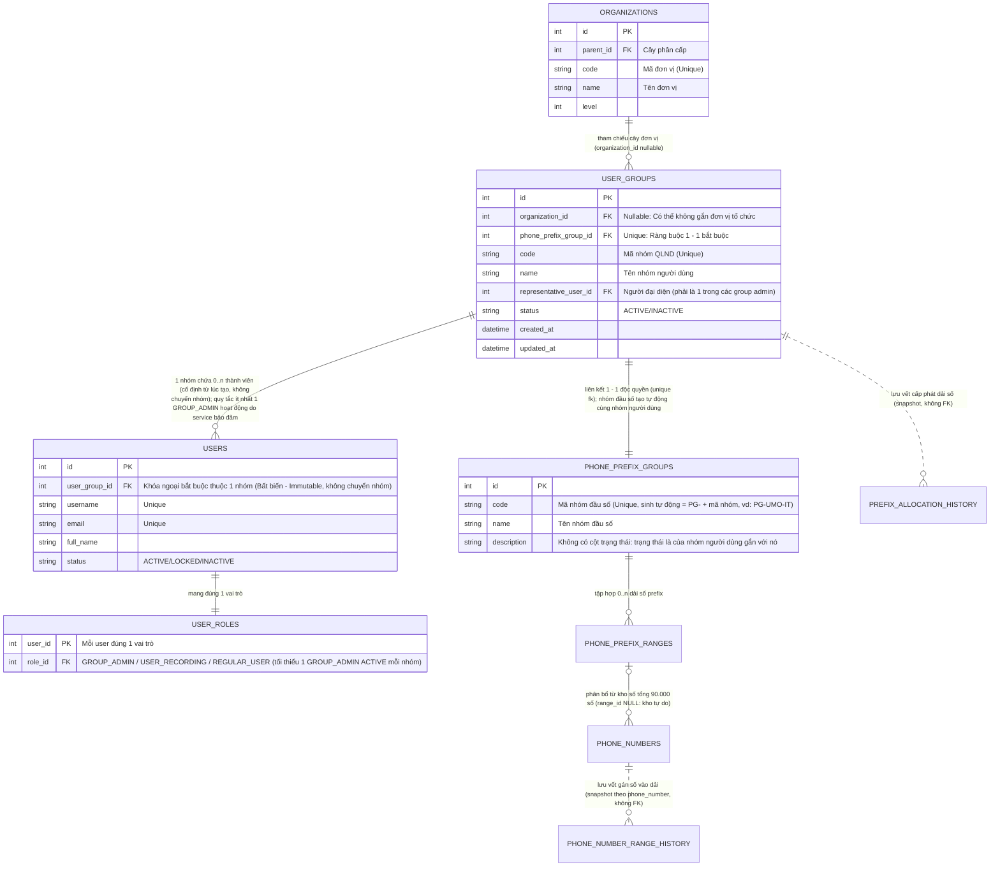

# MODULE 02: QUẢN LÝ NHÓM NGƯỜI DÙNG (USER GROUP / TỔ CHỨC QLND)

## Đường dẫn tài liệu: `docs/modules/02_user_group.md`

## Ánh xạ giao diện mẫu
- **Khu vực Admin**: `templates/admin/user_group.html` → `UserGroupView.vue` (route `admin.user-groups`, mục 5.1–5.2).
- **Khu vực Member**: `templates/member/group-admin.html` → `GroupAdminView.vue` (route `member.group-admin`), `templates/member/group-members.html` → `GroupMembersView.vue` (route `member.group-members`) (mục 5.3–5.4).

---

## 1. Mục tiêu & Nghiệp vụ (Business Overview)

### 1.1. Bối cảnh nghiệp vụ

Trong kiến trúc quản trị người dùng phân tán và phân định phạm vi dữ liệu (Data Scoping / Multi-tenancy) của hệ thống EVN CDR AS:

- **Cây tổ chức (`organizations`)**: Phản ánh cơ cấu hành chính - điều hành chung của EVN (Tập đoàn -> Tổng công ty -> Khối/Ban/Công ty -> Điện lực/Phòng ban).
- **Nhóm người dùng (User Group / Tổ chức Quản lý Người dùng - QLND)**: Là thực thể trung tâm quản lý tài khoản người dùng và là đơn vị sở hữu không gian dữ liệu cuộc gọi (Tenant Unit).
- **3 vai trò người dùng trong Nhóm (User Scope)**: mỗi người dùng mang đúng 1 vai trò, lưu ở `user_roles`; quyền của vai trò lấy từ `permission_roles` (`docs/modules/10_permissions_and_roles.md`). Quyền cấp nhóm duy nhất là `user_groups.allow_recording_access`, lưu trực tiếp trên nhóm.
  1. `GROUP_ADMIN` (Quản trị viên nhóm):
     - Bản chất là thành viên của nhóm được trao quyền quản trị nội bộ đơn vị.
     - Toàn quyền CRUD đối với thành viên nội bộ nhóm (`user:create`, `user:view`, `user:edit`, `user:delete`), không được chuyển nhóm thành viên.
     - Bổ nhiệm / hạ quyền Quản trị nhóm cho thành viên khác trong nhóm (đổi vai trò sang/khỏi `GROUP_ADMIN`, cần `group:manage_admin`), bảo toàn tối thiểu 1 Group Admin đang hoạt động.
     - Phân quyền nghe ghi âm Tầng 2: đổi vai trò thành viên giữa `REGULAR_USER` và `USER_RECORDING` (cần `group:toggle_recording`) khi Tầng 1 mở.
     - Mặc định tự động có quyền nghe trực tuyến & tải ghi âm thoại của nhóm khi nhóm được mở Tầng 1 (`allow_recording_access = 1`).
     - Toàn quyền xem log CDR (chi tiết 87 trường, bộ lọc nâng cao, xuất Excel), phân tích QoS và xem/xuất báo cáo thống kê trong phạm vi nhóm (`Group-Based Data Isolation`).
  2. `USER_RECORDING` (Thành viên nghe ghi âm):
     - Thành viên được Quản trị viên nhóm gán vai trò `USER_RECORDING` khi nhóm đã được cấp phép Tầng 1.
     - Được quyền nghe trực tuyến (`cdr:listen_audio`) và tải file ghi âm (`cdr:download_audio`) của nhóm mình.
     - Có toàn bộ các quyền đối với dữ liệu CDR, phân tích QoS và xem/xuất báo cáo thống kê theo nhóm tương tự Quản trị viên nhóm.
     - Không có thẩm quyền quản trị thành viên (không CRUD người dùng, không đổi vai trò người khác).
     - Nếu nhóm bị tắt Tầng 1, vai trò được giữ nguyên nhưng mất quyền nghe/tải cho tới khi Tầng 1 bật lại.
  3. `REGULAR_USER` (Thành viên):
     - Vai trò mặc định khi tạo thành viên.
     - **Điểm khác biệt DUY NHẤT so với `USER_RECORDING`**: Bị khóa hoàn toàn quyền nghe và tải file ghi âm cuộc gọi (ẩn trên giao diện, chặn `403 FORBIDDEN_PERMISSION` tại API).
     - **Còn lại GIỐNG HỆT 100% `USER_RECORDING` và CÓ QUYỀN TƯƠNG TỰ Quản trị viên nhóm** đối với việc xem nhật ký CDR, xem chi tiết 87 trường, lọc nâng cao, xuất Excel, xem phân tích QoS và xem/xuất báo cáo thống kê trong phạm vi nhóm.
     - Không có thẩm quyền quản trị thành viên.
- **4 Ràng buộc nghiệp vụ cốt lõi của Nhóm người dùng**:
  1. **Chứa nhiều người dùng thành viên (Quan hệ 1 - N) & Tính cố định nhóm**: Mỗi nhóm người dùng quản lý một tập hợp nhiều tài khoản người dùng thành viên (`users`). **Người dùng luôn luôn thuộc về một nhóm người dùng cố định ngay từ lúc tạo ra** (bản chất là người dùng thuộc đơn vị tổ chức), do đó **hoàn toàn không có khái niệm chuyển người dùng giữa các nhóm**. Thuộc tính `user_group_id` là bất biến (immutable) sau khi khởi tạo.
  2. **Có ít nhất một người dùng Quản trị viên nhóm & Thẩm quyền tạo người dùng (Group Admin Rule)**: Mỗi nhóm người dùng bắt buộc phải có **tối thiểu một người dùng đóng vai trò Quản trị viên nhóm** (vai trò `GROUP_ADMIN` trong `user_roles`). Quản trị viên nhóm **cũng là một thành viên trong nhóm nhưng được trao quyền quản trị**. Tài khoản người dùng có thể được tạo ra bởi:
     - **Quản trị viên hệ thống (System Admin)**: Có toàn quyền tạo người dùng cho bất kỳ Nhóm người dùng nào trong toàn hệ thống.
     - **Quản trị viên nhóm (Group Admin)**: Có quyền tạo mới tài khoản thành viên nhưng **chỉ được phép tạo trong phạm vi nhóm của chính mình**.
  3. **Liên kết với một Nhóm đầu số điện thoại theo ràng buộc 1 - 1 (1-to-1 Phone Prefix Group Binding)**: Mỗi nhóm người dùng liên kết độc quyền với **duy nhất một nhóm đầu số điện thoại** (`phone_prefix_groups`). Toàn bộ dữ liệu cuộc gọi CDR, file ghi âm và lưu lượng cuộc gọi phát sinh từ các đầu số này thuộc quyền quản lý của nhóm. Ngược lại, một nhóm đầu số chỉ thuộc duy nhất một nhóm người dùng (không chia sẻ giữa các nhóm). Nhóm đầu số **được tạo tự động** khi tạo nhóm người dùng (`code = 'PG-' + code nhóm`, `name = 'Nhóm đầu số ' + tên nhóm`), không chọn và không đổi được (`docs/01_database_schema.md` mục 4.1).
  4. **Tham chiếu Cây tổ chức linh hoạt (0..1 - N Organization Reference)**:
     - **Một đơn vị có nhiều nhóm người dùng**: Một đơn vị trên cây tổ chức có thể có nhiều nhóm người dùng trực thuộc (ví dụ: Khối CNTT có thể có nhóm "Vận hành Hệ thống", nhóm "An toàn thông tin"...).
     - **Có thể không tham chiếu đến đơn vị nào**: Nhóm người dùng có thể độc lập, không tham chiếu đến bất kỳ đơn vị tổ chức nào (`organization_id = NULL`), phục vụ cho các tổ công tác kiểm toán liên đơn vị, nhóm chuyên gia ngoài hoặc các tổ dự án đặc thù toàn hệ thống.

---

### 1.2. Sơ đồ Thực thể Quan hệ Nghiệp vụ (Business ERD)



---

### 1.3. Bốn Quy tắc Nghiệp vụ Chi tiết (Core Business Rules)

| Mã quy tắc | Tên quy tắc | Mô tả chi tiết & Ràng buộc xử lý |
| :--- | :--- | :--- |
| **BR-UG-01** | **Nhóm chứa nhiều thành viên (1 - N) & Không chuyển nhóm** | - Một nhóm người dùng (`user_groups`) chứa một danh sách từ $1$ đến $N$ tài khoản người dùng (`users`).<br>- **Người dùng luôn thuộc cố định 1 nhóm người dùng ngay từ lúc tạo ra** (`users.user_group_id NOT NULL`, bản chất là thuộc đơn vị tổ chức). Hệ thống **không có khái niệm chuyển người dùng giữa các nhóm**; thuộc tính `user_group_id` là bất biến (immutable).<br>- **Thẩm quyền tạo người dùng**: Tài khoản có thể được tạo ra bởi **Quản trị viên hệ thống** (toàn quyền chọn nhóm bất kỳ) hoặc **Quản trị viên nhóm** (cũng là một thành viên trong nhóm có quyền quản trị, chỉ được tạo trong nhóm của mình).<br>- **Phân quyền thành viên thường**: Cả hai loại thành viên thường (`USER_RECORDING` và `REGULAR_USER`) đều không có quyền quản trị (không thể thêm/sửa/xóa thành viên hoặc chuyển quyền admin).<br>- **Ngừng hoạt động nhóm kéo theo thành viên**: Ngừng hoạt động (xóa mềm) nhóm chuyển mọi thành viên chưa `INACTIVE` (kể cả Quản trị viên nhóm cuối cùng) sang `INACTIVE` trong cùng transaction, sau khi Quản trị viên hệ thống xác nhận. Nhóm không bao giờ bị xóa cứng (`docs/01_database_schema.md` mục 14). |
| **BR-UG-02** | **Tối thiểu 1 Quản trị viên nhóm (Group Admin Rule) & Thẩm quyền quản trị** | - Trong danh sách thành viên của nhóm, bắt buộc phải có **ít nhất 1 người dùng `ACTIVE` mang vai trò `GROUP_ADMIN`**.<br>- Nhóm được phép có nhiều quản trị viên nhóm (Multi-admin).<br>- Người đại diện chính (`representative_user_id`) phải là một trong các Quản trị viên nhóm.<br>- **Thẩm quyền của Quản trị viên nhóm**: Toàn quyền CRUD thành viên nội bộ nhóm (`user:create`, `user:view`, `user:edit`, `user:delete`), quyền bổ nhiệm hoặc hạ quyền Quản trị nhóm cho thành viên khác trong nhóm (`group:manage_admin`), và quyền đổi vai trò thành viên giữa `REGULAR_USER` và `USER_RECORDING` (`group:toggle_recording`). Mọi thay đổi vai trò qua `PUT /api/v1/users/:id/role`.<br>- **Bảo toàn Quản trị viên (Safeguard)**: Khi một nhóm chỉ còn đúng 1 Quản trị viên nhóm, hệ thống chặn tuyệt đối (`409`) các thao tác: hạ quyền admin về user thường, khóa (`LOCKED`) hoặc xóa tài khoản user đó (do người dùng cố định vào nhóm, không chuyển nhóm; `docs/01_database_schema.md` mục 14). Phải bổ nhiệm một thành viên khác lên làm Quản trị viên nhóm trước khi chuyển giao. |
| **BR-UG-03** | **Liên kết 1 - 1 với Nhóm đầu số điện thoại & Cô lập dữ liệu CDR** | - Mỗi nhóm người dùng liên kết với duy nhất một nhóm đầu số điện thoại (`phone_prefix_groups`) theo quan hệ **1 - 1** (`phone_prefix_group_id` có ràng buộc `UNIQUE`).<br>- Một nhóm đầu số điện thoại không được phép gán cho nhiều hơn 1 nhóm người dùng.<br>- **Phạm vi phân quyền dữ liệu (Group-Based Data Isolation)**: Bảng `cdr_enriched` được tiến trình Batch Scheduler tự động làm giàu thông tin `caller_group_id` và `called_group_id` dựa trên dải số và máy lẻ của nhóm này.<br>- **Quyền bình đẳng về dữ liệu trong nhóm**: Quản trị viên nhóm (`GROUP_ADMIN`), Thành viên nghe ghi âm (`USER_RECORDING`) và Thành viên (`REGULAR_USER`) đều có **quyền hạn tương tự và bình đẳng** đối với việc xem nhật ký cuộc gọi CDR (danh sách, chi tiết 87 trường, lọc nâng cao theo IP/mã ngắt kết nối, xuất file Excel), phân tích chỉ số QoS cuộc gọi và xem/xuất báo cáo thống kê trong phạm vi nhóm mình (`caller_group_id = user_group_id OR called_group_id = user_group_id`).<br>- Nhóm đầu số được tạo tự động lúc tạo nhóm, **không đổi được** sau đó (body có `phonePrefixGroupId` thì `400`, mục 3.2, 3.3). |
| **BR-UG-04** | **Tham chiếu Cây tổ chức tùy chọn (0..1 - N)** | - **1 đơn vị có nhiều nhóm (1 - N)**: Một đơn vị trong cây tổ chức (`organizations`) có thể quản lý 0, 1 hoặc nhiều nhóm người dùng trực thuộc.<br>- **Cho phép không thuộc đơn vị nào (Nullable)**: Thuộc tính `organization_id` trong `user_groups` cho phép nhận giá trị `NULL`. Các nhóm này hoạt động như các nhóm độc lập (Standalone Groups) cấp toàn hệ thống hoặc nhóm dự án đặc thù.<br>- **Hierarchy Path**: Nếu `organization_id` có giá trị, hệ thống tính toán chuỗi cấp bậc từ gốc tới đơn vị (ví dụ: `["Tổng công ty 71", "Khối CNTT"]`). Nếu `organization_id = NULL`, `hierarchyPath` trả về mảng rỗng `[]` và hiển thị trên giao diện là "Nhóm độc lập". |
| **BR-UG-05** | **Mô hình Phân quyền Ghi âm Kiểm soát 2 Tầng (2-Tier Recording Access Gate)** | - **Tầng 1 (Cấp nhóm - System Admin kiểm soát)**: Quản trị viên hệ thống (Admin Portal) có thẩm quyền tối cao cấp hoặc thu hồi quyền truy cập ghi âm cho từng Nhóm người dùng thông qua cờ `allow_recording_access` (cấu hình trong form Thêm/Sửa nhóm `PUT /api/v1/admin/user-groups/:id`).<br>  + **Nếu nhóm chưa được cấp phép (`allow_recording_access = 0`)**: Mọi tính năng liên quan đến ghi âm bị triệt tiêu khỏi giao diện người dùng của nhóm đó: Cột "File ghi âm" bị loại bỏ hoàn toàn khỏi bảng lịch sử cuộc gọi (bảng co về 6 cột); trong Modal chi tiết cuộc gọi, khối Audio Player được thay thế bằng thông báo *"Tính năng ghi âm chưa được kích hoạt cho đơn vị của bạn"*; trên giao diện Quản trị nhóm (`group-admin.html`), các cột và nút bấm/switch phân quyền ghi âm cho thành viên bị ẩn triệt để; Backend chặn toàn bộ API stream và download ghi âm với mã lỗi `403 GROUP_RECORDING_DISABLED`.<br>  + **Nếu nhóm được cấp phép (`allow_recording_access = 1`)**: Kích hoạt Tầng 2.<br>- **Tầng 2 (Vai trò - Group Admin kiểm soát khi Tầng 1 đã mở)**: quyền nghe/tải là quyền của vai trò (`permission_roles`), không lưu cờ trên người dùng.<br>  + **Quản trị viên nhóm (`GROUP_ADMIN`)**: Vai trò có sẵn `cdr:listen_audio`, `cdr:download_audio`, nên mặc định nghe/tải được ghi âm của nhóm.<br>  + **Người dùng thành viên**: Quản trị viên nhóm bật/tắt quyền nghe/tải bằng cách đổi vai trò thành viên (`PUT /api/v1/users/:id/role`).<br>    * **Thành viên nghe ghi âm (`USER_RECORDING`)**: được nghe trực tuyến (`cdr:listen_audio`) và tải file ghi âm (.wav) (`cdr:download_audio`) của nhóm mình.<br>    * **Thành viên (`REGULAR_USER`)**: bị khóa hoàn toàn tính năng nghe/tải (hiển thị trạng thái khóa và bị chặn API). Đây là điểm khác biệt duy nhất giữa hai vai trò thành viên.<br>- **Thứ tự kiểm tra**: quyền nhóm (Tầng 1) trước, quyền vai trò (Tầng 2) sau (`docs/modules/10_permissions_and_roles.md` mục 2.3). |

---

### 1.4. Chức năng chính của Module

1. **Hiển thị danh sách nhóm người dùng**:
   - Mã nhóm (`code`), Tên nhóm (`name`).
   - Người đại diện nhóm (Avatar, Họ tên, Email).
   - Số lượng Quản trị viên nhóm (`adminCount`, bảo đảm $\ge 1$).
   - Số lượng người dùng trực thuộc (`userCount` / `badge-count`).
   - Nhóm đầu số điện thoại liên kết 1-1 (Mã nhóm, Tên nhóm đầu số, các dải số: `42xxx, 46xxx`).
   - Đơn vị tổ chức tham chiếu & Chuỗi cấp bậc (`hierarchyPath`), hoặc nhãn "Nhóm độc lập" nếu `organization_id = NULL`.
   - Ngày thiết lập, trạng thái hoạt động (`ACTIVE`/`INACTIVE`).
   - Thao tác: Xem chi tiết thành viên & admin, Chỉnh sửa, Quản lý phân quyền, Xóa nhóm.
2. **Thiết lập mới & Chỉnh sửa Nhóm người dùng (`#userGroupModal`)**:
   - Chọn vị trí đơn vị trên Cây tổ chức (Tùy chọn: có thể chọn một đơn vị hoặc để trống "Không gắn đơn vị / Nhóm độc lập").
   - Nhập Mã nhóm và Tên nhóm.
   - Không chọn Nhóm đầu số: hệ thống tự tạo nhóm đầu số 1-1 cho nhóm mới (mã `PG-<mã nhóm>`). Dải số cấp sau qua màn hình Quản lý đầu số.
   - Khai báo **Quản trị viên nhóm đầu tiên** (tên đăng nhập, email, họ tên, số điện thoại, chức danh). Tài khoản này được tạo cùng lúc với nhóm, trong một transaction, vì người dùng không thể tồn tại ngoài nhóm.
   - **Cấu hình Quyền Ghi âm Nhóm (`allowRecordingAccess`)**: Trường chuyển đổi Switch/Checkbox "Cho phép nhóm nghe và tải ghi âm thoại IP" do Quản trị viên hệ thống thiết lập (Chốt chặn Tầng 1 - BR-UG-05).
   - Ghi chú / Mô tả.
   - Chế độ sửa (mục 3.3): mã nhóm chỉ đọc, không có khối Quản trị viên nhóm đầu tiên; thêm ô **Người đại diện** chọn trong các Quản trị viên nhóm `ACTIVE` (hoặc bỏ người đại diện); đổi được đơn vị (kể cả về nhóm độc lập), tên, mô tả, Tầng 1.
3. **Quản lý danh sách thành viên & Quản trị viên**:
   - Thêm thành viên vào nhóm.
   - Bổ nhiệm Quản trị viên nhóm (`Promote to Admin`).
   - Hạ quyền Quản trị viên (Chặn nếu chỉ còn 1 Quản trị viên duy nhất).
4. **Ràng buộc an toàn khi xóa**:
   - "Xóa" nhóm là **ngừng hoạt động** (`status = INACTIVE`, xóa mềm, không hoàn tác). Hộp xác nhận tải `GET .../:id` mỗi lần mở để hiển thị số thành viên chưa `INACTIVE` sẽ bị ngừng hoạt động cùng nhóm và số dải đang có; nút xác nhận chỉ bật khi gõ đúng mã nhóm; xem API 3.4 và `docs/01_database_schema.md` mục 14.
   - Hộp xác nhận có ô chọn "Thu hồi toàn bộ dải số" (mặc định **không** chọn). Chọn thì dải số của nhóm được thu hồi về kho; không chọn thì dải vẫn thuộc nhóm `INACTIVE` (thu hồi sau từng dải). Liên kết với Nhóm đầu số **luôn được giữ nguyên** (nhóm đầu số có thể rỗng) để báo cáo lịch sử vẫn đúng.

---

## 2. Thiết kế Dữ liệu (Database Schema)

### 2.1. Bảng Nhóm đầu số điện thoại (`phone_prefix_groups`)

Thực thể gom nhóm các dải đầu số viễn thông PABX, dùng để liên kết 1 - 1 với Nhóm người dùng.

> DDL chuẩn của `phone_prefix_groups` (mục 4.1) chỉ định nghĩa tại `docs/01_database_schema.md`. Module này không chép lại DDL để tránh lệch; khi sinh code, entity và migration lấy từ `01`.

---

### 2.2. Bảng Nhóm người dùng (`user_groups`)

- Cột `organization_id`: Cho phép `NULL` (Quan hệ 0..1 - N với `organizations`).
- Cột `phone_prefix_group_id`: Bắt buộc và có `UNIQUE KEY` (Quan hệ 1 - 1 với `phone_prefix_groups`).
- Khóa ngoại `representative_user_id`: Tham chiếu đến 1 user đại diện (đồng thời là 1 trong các group admin). Ràng buộc `fk_ug_rep_user` được bổ sung bằng `ALTER TABLE` sau khi tạo bảng `users` (mục 2.3) để tránh phụ thuộc vòng.

> DDL chuẩn của `user_groups` (mục 5) chỉ định nghĩa tại `docs/01_database_schema.md`. Module này không chép lại DDL để tránh lệch; khi sinh code, entity và migration lấy từ `01`.

---

### 2.3. Bảng Người dùng (`users`) & Quản trị viên nhóm

- Cột `user_group_id`: Tham chiếu bắt buộc tới nhóm người dùng (Quan hệ 1 - N: 1 nhóm chứa nhiều thành viên).
- Vai trò người dùng lưu ở `user_roles` (`docs/01_database_schema.md` mục 7), không phải cột của `users`. Mỗi nhóm có ít nhất 1 người dùng `ACTIVE` mang vai trò `GROUP_ADMIN`.

> DDL chuẩn của `users` (mục 6) chỉ định nghĩa tại `docs/01_database_schema.md`. Module này không chép lại DDL để tránh lệch; khi sinh code, entity và migration lấy từ `01`.

---

## 3. Đặc tả API Contracts

### 3.1. `GET /api/v1/user-groups`

- **Mục đích**: danh sách **phẳng** các nhóm người dùng, có tìm kiếm, lọc và phân trang. Dùng cho: bảng nhóm của màn hình Nhóm người dùng (`admin.user-groups`, mục 5.1; màn hình chỉ có danh sách phẳng, không có chế độ xem cây — chủ dự án chốt bỏ `GET /user-groups/tree` ở G02), danh mục nhóm bên trái màn hình Người dùng (`admin.users`, `limit=100`, `docs/modules/03_auth_user.md` mục 5.1) và ô chọn nhóm nhận thông báo `GROUP:{id}` (`docs/modules/06_notifications.md` mục 5). Phần tử là bản **thu gọn** (chủ dự án chốt ở G01, theo quy ước danh sách của O02): không trả `description`, danh sách Quản trị viên nhóm, chi tiết từng dải số — lấy ở `GET /user-groups/:id` (mục 3.1.2).
- **Hai route**, chung service `UserGroupsService.list(filter, scope)` và DTO phần tử:
  - Bản Admin `GET /api/v1/admin/user-groups`: `AdminAuthGuard` → `PermissionsGuard` `user_group:view` (seed: `ROOT_ADMIN`, `SYSTEM_ADMIN`). Token `PASSWORD_CHANGE_ONLY` `403 PASSWORD_CHANGE_REQUIRED`; tài khoản không còn `ACTIVE` hoặc token đầy đủ mà `must_change_password = 1` `401 UNAUTHORIZED` (`docs/modules/04_auth_admin.md` mục 3.1.1). Không bị chế độ bảo trì chặn. Trả mọi nhóm (cả `ACTIVE` lẫn `INACTIVE`).
  - Bản User `GET /api/v1/user-groups`: `UserAuthGuard` → bảo trì (`503 MAINTENANCE`) → `PermissionsGuard` `user_group:view` theo claim `roleCode` (seed: cả 3 vai trò User); kiểm tra tài khoản ở mỗi request (`docs/modules/03_auth_user.md` mục 3.2). **Cô lập nhóm**: thêm điều kiện `ug.id = <user_group_id của người gọi đọc từ CSDL>`, nên kết quả có tối đa 1 phần tử (nhóm của người gọi); các bộ lọc khác vẫn áp dụng (không khớp thì `data = []`). Cùng query, cùng DTO như bản Admin. **Chưa màn hình Member nào gọi route này** (Danh bạ nhóm dùng mục 3.1.2 và 3.6); giữ theo R23-01 như O01, khi thêm màn hình dùng nó phải ghi vào `docs/00_overview_and_architecture.md` mục 5.3.4.
  - Thứ tự kiểm tra: guard xác thực (`401`/`403 PASSWORD_CHANGE_REQUIRED`) → bảo trì (`503`, chỉ bản User) → quyền (`403 FORBIDDEN_PERMISSION`) → query (`400`) → kiểm tra tài khoản (`401`).
- **Query** (quy tắc chung `docs/02_api_contracts.md` mục 2.2; không có body):

| Tham số | Kiểu | Mặc định | Ràng buộc | Điều kiện SQL |
|---|---|---|---|---|
| `page` | số nguyên | 1 | ≥ 1 | |
| `limit` | số nguyên | 20 | 1–100 | |
| `search` | chuỗi | — | Cắt khoảng trắng hai đầu, rỗng = không lọc, ≤ 100 ký tự; khớp **chứa** trên `code`, `name` của nhóm (`OR`) | `ug.code LIKE :pattern OR ug.name LIKE :pattern` |
| `status` | enum | — (cả hai) | `ACTIVE` \| `INACTIVE` | `ug.status = :status` |
| `organizationId` | số nguyên | — | Rỗng = không lọc; `^[1-9][0-9]{0,9}$` và ≤ 4294967295. Nhóm gắn vào đơn vị đó **hoặc bất kỳ đơn vị con cháu nào** của nó (chủ dự án chốt ở G01). Id không tồn tại không phải lỗi: `200`, `data = []`. Không nhận chuỗi `null` (`400`) | `ug.organization_id IN (:orgIds)` |
| `standalone` | `true` | — | Chỉ nhận đúng `true` (giá trị khác `400`): chỉ nhóm độc lập. Gửi cùng `organizationId` → `400` (`errors.standalone`) | `ug.organization_id IS NULL` |

  Các bộ lọc kết hợp bằng `AND`. Sai định dạng, ngoài khoảng, enum lạ, tham số lặp lại hoặc tham số khác (`sort`, `order`, `keyword`, `isStandalone`, `parentId`…) trả `400 VALIDATION_ERROR` với `errors` theo tên tham số.
- **Xử lý** (chỉ đọc, không transaction, không ghi `audit_logs`):
  1. Kiểm tra tài khoản theo khóa chính (`admins`, hoặc `users` + `user_groups` ở bản User; bản User lấy `user_group_id` từ dòng `users` vừa đọc để cô lập).
  2. Đọc toàn bảng đơn vị một lần: `SELECT id, parent_id, name FROM organizations` (vài chục tới vài trăm dòng), dựng bản đồ `id → { parentId, name }` dùng cho hai việc: (a) có `organizationId` thì tính `:orgIds` = đơn vị đó + mọi con cháu (duyệt theo `parent_id`; id không có trong bản đồ thì trả ngay `200` rỗng, không chạy câu bước 3); (b) tính `organizationName`, `hierarchyPath` của từng phần tử ở bước 5 (mục 4.1), không truy vấn thêm theo từng dòng.
  3. Đếm và lấy trang trong cùng một điều kiện:

```sql
SELECT ug.id, ug.code, ug.name, ug.status, ug.allow_recording_access, ug.organization_id, ug.created_at,
       ug.phone_prefix_group_id, ppg.code AS ppg_code,
       ru.id AS rep_id, ru.full_name AS rep_full_name, ru.email AS rep_email, ru.avatar_url AS rep_avatar_url,
       (SELECT COUNT(*) FROM users u
         WHERE u.user_group_id = ug.id AND u.status <> 'INACTIVE') AS user_count,
       (SELECT COUNT(*) FROM users u
          JOIN user_roles ur ON ur.user_id = u.id
          JOIN roles r ON r.id = ur.role_id AND r.code = 'GROUP_ADMIN'
         WHERE u.user_group_id = ug.id AND u.status = 'ACTIVE') AS admin_count
FROM user_groups ug
JOIN phone_prefix_groups ppg ON ppg.id = ug.phone_prefix_group_id
LEFT JOIN users ru ON ru.id = ug.representative_user_id
WHERE (:scopeGroupId IS NULL OR ug.id = :scopeGroupId)            -- chỉ bản User
  AND (:status IS NULL OR ug.status = :status)
  AND (:orgIds IS NULL OR ug.organization_id IN (:orgIds))
  AND (:standalone IS NULL OR ug.organization_id IS NULL)
  AND (:search IS NULL OR ug.code LIKE :pattern ESCAPE '\' OR ug.name LIKE :pattern ESCAPE '\')
ORDER BY ug.code, ug.id
LIMIT :limit OFFSET (:page - 1) * :limit;
-- :pattern = CONCAT('%', <search đã thoát \ % _>, '%'); total: SELECT COUNT(*) FROM user_groups ug cùng WHERE (không JOIN)
```

  4. Dải số của các nhóm trên trang, một câu: `SELECT prefix_group_id, prefix, SUM(total_numbers) AS total FROM phone_prefix_ranges WHERE prefix_group_id IN (:ppgIds) GROUP BY prefix_group_id, prefix ORDER BY prefix_group_id, prefix`. Nhóm không có dải: `prefixes = []`, `totalNumbers = 0`.
  5. Ghép phần tử. Thứ tự cố định (không có tham số sắp xếp, chủ dự án chốt ở G01): `code` (collation `utf8mb4_unicode_ci`), `id` tăng dần. `page` vượt `totalPages` trả `200`, `data = []`.
- **Ý nghĩa số đếm**: `userCount` = thành viên chưa `INACTIVE` (`ACTIVE` + `LOCKED`); `adminCount` = người dùng `ACTIVE` mang vai trò `GROUP_ADMIN`, cùng điều kiện với quy tắc tối thiểu 1 Quản trị viên nhóm (BR-UG-02, mục 4.2). Nhóm `INACTIVE` luôn có `userCount = 0`, `adminCount = 0`, `representative = null` (mục 3.4).
- **Response** `200` (khung `docs/02_api_contracts.md` mục 2.2, không có khóa cấp cao khác; không có số liệu thống kê tổng hợp). Mỗi phần tử đúng các trường sau:

| Trường | Kiểu | Nguồn | Ghi chú |
|---|---|---|---|
| `id` | số | `user_groups.id` | |
| `code` | chuỗi ≤ 50 | `code` | |
| `name` | chuỗi ≤ 255 | `name` | |
| `status` | `ACTIVE` \| `INACTIVE` | `status` | |
| `allowRecordingAccess` | boolean | `allow_recording_access` | Tầng 1 ghi âm (BR-UG-05) |
| `organizationId` | số \| `null` | `organization_id` | `null`: nhóm độc lập |
| `organizationName` | chuỗi ≤ 255 \| `null` | `organizations.name` | `null` khi `organizationId = null` |
| `hierarchyPath` | mảng chuỗi | bước 2 | Tên các đơn vị từ gốc tới **chính** đơn vị của nhóm (phần tử cuối = `organizationName`); `[]` ở nhóm độc lập (BR-UG-04) |
| `phonePrefixGroup` | đối tượng | `phone_prefix_groups` + bước 4 | `{ id, code, prefixes, totalNumbers }`: `prefixes` là các `prefix` khác nhau của dải số (chuỗi, tăng dần, vd. `["42", "46"]`), `totalNumbers` = tổng `total_numbers` của mọi dải (`0` khi chưa cấp dải). Không trả `name` (xem ở mục 3.1.2) |
| `userCount` | số | đếm | Xem trên |
| `adminCount` | số | đếm | Xem trên |
| `representative` | đối tượng \| `null` | `users` theo `representative_user_id` | `{ id, fullName, email, avatarUrl }`; `null` khi cột NULL. Không trả `roleCode` (người đại diện luôn là `GROUP_ADMIN` khi được đặt, mục 3.3) |
| `createdAt` | chuỗi ISO 8601 `+07:00` | `created_at` | Ngày thiết lập nhóm |

```json
{
  "success": true,
  "statusCode": 200,
  "message": "Lấy danh sách nhóm người dùng thành công",
  "data": [
    {
      "id": 1,
      "code": "UMO-IT-01",
      "name": "Khối Công nghệ Thông tin - Nhóm Vận hành",
      "status": "ACTIVE",
      "allowRecordingAccess": true,
      "organizationId": 2,
      "organizationName": "Khối Công nghệ Thông tin",
      "hierarchyPath": ["Tổng công ty 71", "Khối Công nghệ Thông tin"],
      "phonePrefixGroup": { "id": 10, "code": "PG-UMO-IT-01", "prefixes": ["42", "46"], "totalNumbers": 2000 },
      "userCount": 45,
      "adminCount": 2,
      "representative": { "id": 10, "fullName": "Trần Thị B", "email": "tran.b@71portal.vn", "avatarUrl": "/media/avatars/8a1d2c3e-5b6f-4a7d-9e0f-1b2c3d4e5f60.jpg" },
      "createdAt": "2026-03-15T08:30:00+07:00"
    },
    {
      "id": 6,
      "code": "UMO-TBA-500",
      "name": "Nhóm Thử nghiệm Trạm Biến áp 500kV",
      "status": "INACTIVE",
      "allowRecordingAccess": false,
      "organizationId": 4,
      "organizationName": "Phòng Phát triển Phần mềm",
      "hierarchyPath": ["Tổng công ty 71", "Khối Công nghệ Thông tin", "Phòng Phát triển Phần mềm"],
      "phonePrefixGroup": { "id": 15, "code": "PG-UMO-TBA-500", "prefixes": [], "totalNumbers": 0 },
      "userCount": 0,
      "adminCount": 0,
      "representative": null,
      "createdAt": "2026-07-20T14:05:00+07:00"
    }
  ],
  "pagination": { "page": 1, "limit": 20, "total": 2, "totalPages": 1, "hasNext": false, "hasPrev": false },
  "timestamp": "2026-11-05T09:00:00+07:00"
}
```

Ví dụ trên là bản Admin với `?organizationId=2` (nhóm 6 gắn đơn vị 4 là con của 2 nên cũng khớp). Nhóm độc lập có `organizationId = null`, `organizationName = null`, `hierarchyPath = []`.

- **Lỗi**:

| HTTP | `errorCode` | Khi nào |
|---|---|---|
| `400` | `VALIDATION_ERROR` | Query sai định dạng/ngoài khoảng, enum lạ, `standalone` khác `true` hoặc gửi cùng `organizationId`, tham số lặp lại hoặc không có trong bảng trên (`errors.<tên tham số>`) |
| `401` | `UNAUTHORIZED` | Thiếu/sai/hết hạn Access Token; tài khoản không còn `ACTIVE` (bản User: cả nhóm `INACTIVE`) hoặc token đầy đủ mà `must_change_password = 1` |
| `403` | `PASSWORD_CHANGE_REQUIRED` | Gọi bằng token `PASSWORD_CHANGE_ONLY` |
| `403` | `FORBIDDEN_PERMISSION` | Vai trò thiếu `user_group:view` (chốt phòng vệ, seed cấp cho mọi vai trò) |
| `503` | `MAINTENANCE` | Chỉ bản User, chế độ bảo trì đang bật |

Không có `404` (kể cả `organizationId` không tồn tại), `409`.

- **Frontend** (`admin.user-groups`; mẫu `templates/admin/user_group.js`: `mockGetUserGroups`, `loadUserGroups`, `renderUserGroupsTable`, `renderUgPagination`, `loadOrgFilterOptions`):
  - Gọi qua `adminSession.request`; quy ước danh sách `docs/modules/04_auth_admin.md` mục 5.2: tìm kiếm 300 ms/Enter, đổi bộ lọc về trang 1, chỉ hiển thị response của request sau cùng, trang rỗng mà `page > 1` thì lùi về trang cuối, rỗng có lọc/không lọc khác thông điệp, trạng thái tải/lỗi + "Thử lại". `limit` = `itemsPerPage` của store `preferencesAdmin` (10/20/50, mặc định 10).
  - Ô lọc đơn vị: "Tất cả đơn vị", "Nhóm độc lập" (`standalone=true`), rồi các đơn vị từ `GET /api/v1/admin/organizations/tree` (`docs/modules/01_organization.md` mục 3.1) thụt lề theo `level`; chọn đơn vị thì gửi `organizationId` (gồm cả nhóm của đơn vị con). Cây lỗi thì ô lọc chỉ còn hai lựa chọn đầu, danh sách vẫn tải. Ô trạng thái: "Tất cả", `ACTIVE` "Hoạt động", `INACTIVE` "Ngừng hoạt động".
  - Cột: Nhóm (`code`, nhãn trạng thái, nhãn "Ghi âm" khi `allowRecordingAccess`, `name` bấm mở chi tiết), Đơn vị (`hierarchyPath` dạng `A › B › C`, nhãn "Nhóm độc lập" khi rỗng), Nhóm đầu số (`phonePrefixGroup.code`, `prefixes` hiển thị `42xxx, 46xxx` hoặc "Chưa cấp dải số", `totalNumbers`), Quản trị viên (người đại diện: ảnh hoặc chữ cái đầu, họ tên, email; "Chưa có người đại diện" khi `null`; số `adminCount`), Thành viên (`userCount`), Ngày thiết lập (`createdAt` dạng `dd/MM/yyyy`), Thao tác. Tổng số nhóm theo bộ lọc lấy từ `pagination.total`; màn hình **không** có thẻ thống kê tổng hợp (chủ dự án chốt ở G01: API không trả).
  - Nút "Thêm nhóm mới", "Sửa", "Quản trị viên nhóm", "Ngừng hoạt động" chỉ hiện khi store có `user_group:manage`; nút ghi trên dòng chỉ hiện ở dòng `ACTIVE` (nhóm `INACTIVE` là trạng thái cuối, mục 3.3–3.4). Không có nút tạm dừng/kích hoạt lại (không có API).
- **Index phục vụ**: khóa chính `admins`/`users` (kiểm tra tài khoản); `user_groups` vài chục tới vài trăm dòng nên lọc `status`/`search` quét bảng, sắp xếp đọc theo `uniq_ug_code`; `idx_ug_org` cho lọc `organization_id IN (...)`/`IS NULL`; `idx_users_group` + khóa chính `user_roles` cho `userCount`/`adminCount`; `idx_ppr_group` cho bước 4; khóa chính `phone_prefix_groups`, `users` cho JOIN.

### 3.1.2. `GET /api/v1/user-groups/:id`

- **Mục đích**: thông tin **đầy đủ** của một nhóm: mô tả, danh sách Quản trị viên nhóm, nhóm đầu số kèm từng dải số. Dùng cho: hộp "Xem chi tiết" `#groupDetailModal` của `admin.user-groups` (bản Admin, gọi mỗi lần mở hộp, mục 5.1) và thẻ tóm tắt nhóm của `member.group-members`, `member.group-admin` (bản User, `id` = nhóm của người gọi, mục 5.3–5.4). Không trả danh sách thành viên: bản Admin dùng `GET /admin/users?userGroupId=`, bản User dùng `GET /users` (Quản trị nhóm) hoặc mục 3.6 (Danh bạ nhóm).
- **Hai route**, chung service `UserGroupsService.getDetail(id, scope)` và DTO (hai bản trả cùng trường):
  - Bản Admin `GET /api/v1/admin/user-groups/:id`: guard, quyền `user_group:view`, `401`/`403` như mục 3.1; không bị chế độ bảo trì chặn. Xem mọi nhóm, kể cả `INACTIVE`.
  - Bản User `GET /api/v1/user-groups/:id`: guard, bảo trì, quyền, kiểm tra tài khoản như mục 3.1. **Cô lập nhóm**: `:id` khác `user_group_id` của người gọi (đọc từ dòng `users` ở bước 1, không dùng claim) trả `403 FORBIDDEN_SCOPE_ACCESS` (`docs/02_api_contracts.md` mục 2.3), kể cả khi `:id` không tồn tại (không đọc `user_groups` theo `:id` lạ, không lộ id nào tồn tại); vì vậy bản User không trả `404`.
  - Thứ tự kiểm tra: guard xác thực (`401`/`403 PASSWORD_CHANGE_REQUIRED`) → bảo trì (`503`, chỉ bản User) → quyền (`403 FORBIDDEN_PERMISSION`) → `:id` và query (`400`) → kiểm tra tài khoản (`401`) → phạm vi (`403 FORBIDDEN_SCOPE_ACCESS`, chỉ bản User) → tìm nhóm (`404`, chỉ bản Admin).
- **Request**: `:id` là `user_groups.id` (`^[1-9][0-9]{0,9}$` và ≤ 4294967295, sai thì `400` với `errors.id`; gồm cả `tree`, `me` ở route không khai báo, mục 3.6, TC-UG-01a). Không có query, không có body; gửi query param trả `400 VALIDATION_ERROR` với `errors.<tên tham số>`.
- **Xử lý** (chỉ đọc, không transaction, không ghi `audit_logs`; dữ liệu chỉ để hiển thị, thao tác ghi mục 3.3–3.4 tự kiểm tra lại khi chạy):
  1. Kiểm tra tài khoản theo khóa chính như mục 3.1 bước 1; bản User so `:id` với `users.user_group_id` vừa đọc (khác → `403`).
  2. Đọc nhóm; không có dòng → `404 NOT_FOUND`. Nhóm `INACTIVE` vẫn trả `200`.

```sql
SELECT ug.id, ug.code, ug.name, ug.description, ug.status, ug.allow_recording_access, ug.organization_id,
       ug.created_at, ug.updated_at,
       ug.phone_prefix_group_id, ppg.code AS ppg_code, ppg.name AS ppg_name,
       ru.id AS rep_id, ru.full_name AS rep_full_name, ru.email AS rep_email, ru.avatar_url AS rep_avatar_url,
       (SELECT COUNT(*) FROM users u
         WHERE u.user_group_id = ug.id AND u.status <> 'INACTIVE') AS user_count
FROM user_groups ug
JOIN phone_prefix_groups ppg ON ppg.id = ug.phone_prefix_group_id
LEFT JOIN users ru ON ru.id = ug.representative_user_id
WHERE ug.id = :id;
```

  3. `organizationName`, `hierarchyPath`: nhóm có `organization_id` thì đọc bản đồ đơn vị và tính đường đi như mục 3.1 bước 2 (mục 4.1 `loadOrgMap`, `getHierarchyPath`); nhóm độc lập không đọc `organizations`.
  4. Dải số của nhóm đầu số, mọi dải (không giới hạn; vài dải mỗi nhóm):

```sql
SELECT id, prefix, range_from, range_to, total_numbers, note FROM phone_prefix_ranges
WHERE prefix_group_id = :ppgId
ORDER BY range_from, id;   -- range_from luôn 5 chữ số nên so chuỗi = so số
```

  `prefixes`, `totalNumbers` tính từ các dòng này, cùng nghĩa mục 3.1 bước 4.
  5. Quản trị viên nhóm: người dùng `ACTIVE` mang vai trò `GROUP_ADMIN` (cùng điều kiện `adminCount` của mục 3.1 và quy tắc tối thiểu 1 Quản trị viên, BR-UG-02), người đại diện đứng đầu, rồi `full_name` (collation `utf8mb4_unicode_ci`), `id`:

```sql
SELECT u.id, u.full_name, u.email, u.phone_number, u.avatar_url
FROM users u
JOIN user_roles ur ON ur.user_id = u.id
JOIN roles r ON r.id = ur.role_id AND r.code = 'GROUP_ADMIN'
WHERE u.user_group_id = :id AND u.status = 'ACTIVE'
ORDER BY (u.id <=> :repId) DESC, u.full_name, u.id;
```

- **Response** `200`: `data` là một đối tượng đúng 15 trường sau. Khác phần tử mục 3.1 (chủ dự án chốt ở G03): **không** có `adminCount` (dùng `admins.length`, quy ước chi tiết của O03); thêm `description`, `updatedAt`, `admins`; `phonePrefixGroup` thêm `name`, `ranges`.

| Trường | Kiểu | Nguồn | Ghi chú |
|---|---|---|---|
| `id`, `code`, `name`, `status`, `allowRecordingAccess`, `organizationId`, `organizationName`, `hierarchyPath`, `userCount`, `representative`, `createdAt` | như mục 3.1 | bước 2, 3 | Cùng kiểu, cùng nghĩa với phần tử mục 3.1 |
| `description` | chuỗi \| `null` | `description` (`text`) | `NULL` → `null`, trả nguyên văn (không cắt) |
| `updatedAt` | chuỗi ISO 8601 `+07:00` | `updated_at` | |
| `phonePrefixGroup` | đối tượng | `phone_prefix_groups` + bước 4 | `{ id, code, name, prefixes, totalNumbers, ranges }`; `name` ≤ 255 (`phone_prefix_groups.name`, Admin sửa được ở `PUT /admin/prefix-groups/:id`); `prefixes`, `totalNumbers` như mục 3.1 |
| `phonePrefixGroup.ranges` | mảng `{ id, prefix, rangeFrom, rangeTo, totalNumbers, note }` | bước 4 | Luôn có, `[]` khi chưa cấp dải; `prefix`, `rangeFrom`, `rangeTo` là chuỗi (`varchar`), `note` chuỗi ≤ 255 \| `null`. `id` để mở chi tiết dải (`GET /prefixes/:id`, `docs/modules/11_core_business_phone_numbers.md` mục 4.1.1) |
| `admins` | mảng `{ id, fullName, email, phoneNumber, avatarUrl }` | bước 5 | Luôn có, `[]` ở nhóm `INACTIVE`; `phoneNumber`, `avatarUrl` có thể `null`. Người đại diện nằm trong mảng khi còn `ACTIVE` (so `representative.id`); Quản trị viên nhóm `LOCKED` không có trong mảng |

```json
{
  "success": true,
  "statusCode": 200,
  "message": "Lấy chi tiết nhóm người dùng thành công",
  "data": {
    "id": 1,
    "code": "UMO-IT-01",
    "name": "Khối Công nghệ Thông tin - Nhóm Vận hành",
    "description": "Quản trị vận hành hạ tầng máy chủ, hệ thống mạng và giám sát tổng đài",
    "status": "ACTIVE",
    "allowRecordingAccess": true,
    "organizationId": 2,
    "organizationName": "Khối Công nghệ Thông tin",
    "hierarchyPath": ["Tổng công ty 71", "Khối Công nghệ Thông tin"],
    "phonePrefixGroup": {
      "id": 10,
      "code": "PG-UMO-IT-01",
      "name": "Nhóm đầu số Khối Công nghệ Thông tin - Nhóm Vận hành",
      "prefixes": ["42", "46"],
      "totalNumbers": 2000,
      "ranges": [
        { "id": 21, "prefix": "42", "rangeFrom": "42000", "rangeTo": "42499", "totalNumbers": 500, "note": "Hạ tầng máy chủ & NOC" },
        { "id": 22, "prefix": "42", "rangeFrom": "42500", "rangeTo": "42999", "totalNumbers": 500, "note": null },
        { "id": 23, "prefix": "46", "rangeFrom": "46000", "rangeTo": "46999", "totalNumbers": 1000, "note": "Cơ quan EVN Tháp A" }
      ]
    },
    "userCount": 45,
    "representative": { "id": 10, "fullName": "Trần Thị B", "email": "tran.b@71portal.vn", "avatarUrl": "/media/avatars/8a1d2c3e-5b6f-4a7d-9e0f-1b2c3d4e5f60.jpg" },
    "admins": [
      { "id": 10, "fullName": "Trần Thị B", "email": "tran.b@71portal.vn", "phoneNumber": "0905123456", "avatarUrl": "/media/avatars/8a1d2c3e-5b6f-4a7d-9e0f-1b2c3d4e5f60.jpg" },
      { "id": 11, "fullName": "Lê Văn C", "email": "le.c@71portal.vn", "phoneNumber": null, "avatarUrl": null }
    ],
    "createdAt": "2026-03-15T08:30:00+07:00",
    "updatedAt": "2026-10-02T16:20:00+07:00"
  },
  "timestamp": "2026-11-06T09:00:00+07:00"
}
```

Nhóm `INACTIVE` (mục 3.4): `userCount = 0`, `representative = null`, `admins = []`; `ranges` còn hoặc `[]` tùy lúc ngừng hoạt động có chọn thu hồi dải.

- **Lỗi**:

| HTTP | `errorCode` | Khi nào |
|---|---|---|
| `400` | `VALIDATION_ERROR` | `:id` sai định dạng (`errors.id`), có query param (`errors.<tên tham số>`) |
| `401` | `UNAUTHORIZED` | Như mục 3.1 |
| `403` | `PASSWORD_CHANGE_REQUIRED` | Gọi bằng token `PASSWORD_CHANGE_ONLY` |
| `403` | `FORBIDDEN_PERMISSION` | Vai trò thiếu `user_group:view` (chốt phòng vệ) |
| `403` | `FORBIDDEN_SCOPE_ACCESS` | Chỉ bản User: `:id` không phải nhóm của người gọi (kể cả id không tồn tại) |
| `404` | `NOT_FOUND` | Chỉ bản Admin: không có nhóm `:id` |
| `503` | `MAINTENANCE` | Chỉ bản User, chế độ bảo trì đang bật |

- **Frontend**:
  - Admin (`#groupDetailModal`; mẫu `templates/admin/user_group.js`: `mockGetUserGroupDetail`, `openGroupDetailModal`, `loadGroupDetail`, `renderGroupDetail`): theo quy ước hộp chi tiết của `docs/modules/01_organization.md` mục 3.1.2 (gọi API **mỗi lần mở**, không dùng dữ liệu dòng danh sách; tiêu đề lấy mã nhóm từ dòng đã bấm; thân hộp tải/lỗi + "Thử lại" riêng; chỉ hiển thị response của lần mở sau cùng; `404` đóng hộp + toast cảnh báo + tải lại danh sách). Hiển thị: tên, trạng thái ("Hoạt động"/"Ngừng hoạt động"), đơn vị (`hierarchyPath` hoặc "Nhóm độc lập"), mô tả ("Chưa có mô tả" khi `null`), quyền ghi âm Tầng 1, nhóm đầu số (`code`, `name`, tổng số, bảng dải `rangeFrom`–`rangeTo`, `totalNumbers`, `note`; "Chưa cấp dải số" khi `ranges = []`), số thành viên `userCount`, Quản trị viên nhóm (ảnh hoặc chữ cái đầu, họ tên, email, nhãn "Đại diện" khi `id = representative.id`; "Không có Quản trị viên đang hoạt động" khi rỗng), ngày thiết lập/cập nhật. Nút "Sửa", "Quản trị viên nhóm", "Ngừng hoạt động" chỉ hiện khi store có `user_group:manage` và nhóm `ACTIVE` (ẩn khi đang tải/lỗi); không có nút tạm ngưng/kích hoạt lại (không có API, mục 3.1).
  - Member (thẻ tóm tắt của `member.group-members`, `member.group-admin`; Vue: component dùng chung `GroupSummaryCard`; mẫu `templates/member/group-summary.js` – `window.memberGroupSummary`: `mockGetMyGroupDetail`, `load`, `render`, dùng chung cho hai trang): `id` = `userGroup.id` của `memberSession.getAccount()`; gọi qua `memberSession.request`; thẻ có trạng thái tải/lỗi + "Thử lại" riêng, độc lập với danh sách thành viên (quy ước A11); `503` hiện thông điệp bảo trì trong thẻ (U09), `403` hiện thông điệp lỗi. Không có ô chọn/chuyển nhóm (route User chỉ xem nhóm mình). Hiển thị tên, mã, mô tả ("Chưa có mô tả" khi `null`), đơn vị (`hierarchyPath` hoặc "Nhóm độc lập"), nhóm đầu số (`code`, tổng số) và từng dải (`rangeFrom`–`rangeTo`, `totalNumbers`; "Chưa cấp dải số" khi rỗng), Quản trị viên nhóm (họ tên, nhãn "Đại diện", email `mailto:`, số điện thoại `tel:` khi có), số thành viên `userCount` và số Quản trị viên `admins.length`. Phần danh sách thành viên dùng `representative.id` của response này cho nhãn "Đại diện" (sự kiện `member-group-summary`), tên nhóm và cờ Tầng 1 lấy từ store `authUser.user.userGroup`.
- **Index phục vụ**: khóa chính `admins`/`users` (kiểm tra tài khoản); khóa chính `user_groups`, `phone_prefix_groups`, `users` (bước 2); `idx_users_group` cho `user_count` và bước 5, khóa chính `user_roles`, `roles` cho JOIN; `idx_ppr_group` cho bước 4 (sắp xếp vài dòng trong bộ nhớ).

### 3.2. `POST /api/v1/admin/user-groups`

- **Mục đích**: thiết lập một nhóm người dùng mới cùng **nhóm đầu số** 1 - 1 (tạo tự động) và **Quản trị viên nhóm đầu tiên** (người dùng không tồn tại ngoài nhóm, nhóm `ACTIVE` phải có ít nhất 1 Quản trị viên nhóm, BR-UG-02), trong một transaction. Gọi từ `#userGroupModal` ở chế độ tạo (nút "Thêm nhóm mới" của `admin.user-groups`, mục 5.1). Chỉ có bản Admin (cổng Member không tạo nhóm).
- **Guard**: `AdminAuthGuard` → `PermissionsGuard` `user_group:manage` (seed: `ROOT_ADMIN`, `SYSTEM_ADMIN`). Token `PASSWORD_CHANGE_ONLY` `403 PASSWORD_CHANGE_REQUIRED`; tài khoản người gọi không còn `ACTIVE` hoặc token đầy đủ mà `must_change_password = 1` `401 UNAUTHORIZED` (`docs/modules/04_auth_admin.md` mục 3.1.1). Không bị chế độ bảo trì chặn (cổng Admin).
- **Thứ tự kiểm tra**: guard xác thực (`401`/`403 PASSWORD_CHANGE_REQUIRED`) → quyền (`403 FORBIDDEN_PERMISSION`) → query và body (`400`) → kiểm tra tài khoản người gọi (`401`) → đơn vị tổ chức (`400`/`409 ORGANIZATION_INACTIVE`) → trùng `code` (`409 CODE_DUPLICATE`) → trùng `username`/`email` (`409 ACCOUNT_DUPLICATE`). Mỗi lần chỉ trả một `errorCode`; lỗi không ghi `audit_logs`.
- **Request**: không có query (gửi thì `400` với `errors.<tên tham số>`). Body JSON chỉ nhận đúng các trường dưới đây; trường khác (kể cả `id`, `status`, `phonePrefixGroupId`, `representativeUserId`, `createdAt`) và trường khác trong `initialAdmin` (kể cả `password`, `roleCode`, `status`, `avatarUrl`, `userGroupId`) trả `400 VALIDATION_ERROR`. Không ép kiểu. Lỗi của trường trong `initialAdmin` dùng khóa có tiền tố `initialAdmin.` (vd. `errors["initialAdmin.username"]`, `docs/02_api_contracts.md` mục 2.3), kể cả ở `409 ACCOUNT_DUPLICATE`; `initialAdmin` thiếu hoặc không phải đối tượng → `errors.initialAdmin`. Chủ dự án chốt ở G05: `name` 3–255 như đơn vị tổ chức; nhóm mới luôn `ACTIVE`.

| Trường | Kiểu | Bắt buộc | Quy tắc | Cột |
|---|---|---|---|---|
| `code` | chuỗi | ✓ | Như `POST /admin/organizations` (`docs/modules/01_organization.md` mục 3.2, quy ước O04): cắt khoảng trắng hai đầu; 2–50 ký tự, khớp `^[A-Z0-9]+(-[A-Z0-9]+)*$`; backend không tự viết hoa. Trùng mã của nhóm khác (kể cả `INACTIVE`, mã không được dùng lại, `docs/01_database_schema.md` mục 14) → `409 CODE_DUPLICATE` | `user_groups.code`; `phone_prefix_groups.code = 'PG-' + code` (≤ 53) |
| `name` | chuỗi | ✓ | Cắt khoảng trắng hai đầu; 3–255 ký tự; không kiểm tra trùng tên | `user_groups.name` |
| `description` | chuỗi \| `null` | | Cắt khoảng trắng hai đầu; rỗng hoặc `null` → `NULL`; ≤ 65 535 byte UTF-8 (`text`); giữ nguyên xuống dòng | `user_groups.description` |
| `organizationId` | số \| `null` | | Bỏ trống hoặc `null` = nhóm độc lập. Có giá trị: số nguyên 1…4294967295; không có đơn vị → `400` (`errors.organizationId`); đơn vị `INACTIVE` → `409 ORGANIZATION_INACTIVE` (`errors.organizationId`) | `user_groups.organization_id` |
| `allowRecordingAccess` | boolean | | Bỏ trống = `false` (mặc định DDL); `null` → `400` | `user_groups.allow_recording_access` |
| `initialAdmin` | đối tượng | ✓ | Đúng các trường dưới | — |
| `initialAdmin.username` | chuỗi | ✓ | Quy tắc chung `docs/02_api_contracts.md` mục 2: cắt khoảng trắng, `^[A-Za-z0-9._@-]{3,100}$` | `users.username` |
| `initialAdmin.email` | chuỗi | ✓ | Quy tắc chung `docs/02_api_contracts.md` mục 2: cắt khoảng trắng, ≤ 150, `^[^\s@]+@[^\s@]+\.[^\s@]+$` | `users.email` |
| `initialAdmin.fullName` | chuỗi | ✓ | Cắt khoảng trắng hai đầu; 1–150 ký tự | `users.full_name` |
| `initialAdmin.phoneNumber` | chuỗi \| `null` | | Quy tắc số điện thoại chung `docs/02_api_contracts.md` mục 2 (rỗng/`null`/không gửi → `NULL`) | `users.phone_number` |
| `initialAdmin.jobTitle` | chuỗi \| `null` | | Cắt khoảng trắng hai đầu; rỗng hoặc `null` → `NULL`; ≤ 150 ký tự | `users.job_title` |

```json
{
  "code": "UMO-KD",
  "name": "Khối Kinh doanh & Dịch vụ Khách hàng",
  "description": "Nhóm quản lý người dùng khối kinh doanh",
  "organizationId": 3,
  "allowRecordingAccess": false,
  "initialAdmin": {
    "username": "admin.kd",
    "email": "admin.kd@evn.com.vn",
    "fullName": "Nguyễn Văn Quản",
    "phoneNumber": "0912345678",
    "jobTitle": "Trưởng phòng Kinh doanh"
  }
}
```

- **Mật khẩu tạm** của Quản trị viên nhóm đầu tiên: sinh và băm (`bcrypt` cost 10) **trước** khi mở transaction, cùng cách sinh 16 ký tự của `POST /admin/admins` (`docs/modules/04_auth_admin.md` mục 3.3). Chỉ lưu bản băm; mật khẩu gốc chỉ có trong response (`initialAdmin.temporaryPassword`), **không** ghi vào `audit_logs`, log ứng dụng hay log request/response (logger bỏ `data.initialAdmin.temporaryPassword`); không có API xem lại, quên thì đặt lại (`PUT /users/:id/reset-password`).
- **Xử lý** (một transaction, sau khi kiểm tra query/body và sinh mật khẩu tạm):
  1. Kiểm tra tài khoản người gọi theo khóa chính `admins` (`401`).
  2. `BEGIN`. Có `organizationId`: đọc khóa chia sẻ dòng đơn vị `SELECT id, status FROM organizations WHERE id = :organizationId LOCK IN SHARE MODE` (chạy tuần tự với `PUT`/`DELETE /admin/organizations/:id` đang khóa dòng đó `FOR UPDATE`, quy ước O06). Không có dòng → `ROLLBACK`, `400` (`errors.organizationId`); `status = 'INACTIVE'` → `ROLLBACK`, `409 ORGANIZATION_INACTIVE`.
  3. `INSERT INTO phone_prefix_groups (code, name) VALUES (CONCAT('PG-', :code), LEFT(CONCAT('Nhóm đầu số ', :name), 255))` (tên mặc định cắt còn 255 ký tự vì `name` của nhóm tối đa 255, chủ dự án chốt ở G05; Admin sửa tên sau ở `PUT /admin/prefix-groups/:id`), rồi `INSERT INTO user_groups (organization_id, phone_prefix_group_id, code, name, description, representative_user_id, allow_recording_access, status) VALUES (..., NULL, ..., 'ACTIVE')`. `ER_DUP_ENTRY` trên `uniq_ppg_code` hoặc `uniq_ug_code` → `ROLLBACK`, `409 CODE_DUPLICATE` (`errors.code`); `UNIQUE` là chốt duy nhất, không cần câu kiểm tra trước (mã nhóm đầu số luôn là `PG-` + mã nhóm nên chỉ trùng khi mã nhóm trùng).
  4. Kiểm tra trùng `initialAdmin.username`/`email` trên `users` bằng đọc khóa như `POST /admin/admins` bước 2 (`docs/modules/04_auth_admin.md` mục 3.3), thay `admins` bằng `users` (`uniq_users_username`, `uniq_users_email`), gồm trùng chéo; có lỗi → `ROLLBACK`, `409 ACCOUNT_DUPLICATE` (`errors["initialAdmin.username"]` và/hoặc `errors["initialAdmin.email"]`). Deadlock `1213` thì chạy lại cả transaction tối đa 2 lần; `ER_DUP_ENTRY` trên `uniq_users_username`/`uniq_users_email` ở bước 5 cũng trả `409 ACCOUNT_DUPLICATE`, không `500`.
  5. `INSERT INTO users` với `user_group_id` = nhóm mới, `username`, `email`, `full_name`, `job_title`, `phone_number` đã chuẩn hóa, `password_hash`, `status = 'ACTIVE'`, `must_change_password = 1`, `password_changed_at = NULL`, `failed_login_count = 0`, `locked_until = NULL`, `avatar_url = NULL`; `INSERT INTO user_roles (user_id, role_id, role_scope)` với `role_id = (SELECT id FROM roles WHERE code = 'GROUP_ADMIN')`, `role_scope = 'USER'`; `INSERT INTO user_settings (user_type, user_id)` với `user_type = 'USER'`, cột khác mặc định DDL (`docs/01_database_schema.md` mục 12).
  6. `UPDATE user_groups SET representative_user_id = :newUserId WHERE id = :newGroupId` (khóa ngoại `fk_ug_rep_user` cần dòng `users` có trước).
  7. Ghi hai dòng `audit_logs` (chủ dự án chốt ở G05), cùng `actor_type = 'ADMIN'`, `actor_id = sub`, `actor_name` = `admins.full_name` của người gọi, `ip_address`, `user_agent` của request:
     - `USER_GROUP / CREATE`: `resource_id` = id nhóm mới, `action_details = { "code", "name", "organizationId": <số> | null, "allowRecordingAccess": true|false, "initialAdminId": <id> }`.
     - `USER / CREATE`: `resource_id` = id người dùng mới, `action_details = { "username", "email", "roleCode": "GROUP_ADMIN", "userGroupId": <id nhóm> }` (không có mật khẩu).
  8. `COMMIT`, rồi đọc lại nhóm như mục 3.1.2 bước 2–5 (`created_at`, `updated_at` do CSDL gán) để dựng response.

  Không tạo `auth_sessions`, không gửi thông báo hay email: Quản trị viên hệ thống tự chuyển mật khẩu tạm cho người phụ trách. Lần đăng nhập đầu tiên nhận token `PASSWORD_CHANGE_ONLY` (`docs/modules/03_auth_user.md` mục 3.1). Không tăng `cache_version` (nhóm mới chưa có dải số).
- **Response** `201`, header `Cache-Control: no-store` (response chứa mật khẩu; chủ dự án chốt ở G05): `data` = đúng 15 trường của `GET /api/v1/admin/user-groups/:id` (mục 3.1.2) **thêm** `initialAdmin`. Nhóm mới: `status = "ACTIVE"`, `userCount = 1`, `representative` và `admins` (một phần tử) là Quản trị viên vừa tạo, `phonePrefixGroup.prefixes = []`, `totalNumbers = 0`, `ranges = []`.

| Trường thêm | Kiểu | Ghi chú |
|---|---|---|
| `initialAdmin` | đối tượng `{ id, username, fullName, email, temporaryPassword }` | `id` = `representative.id`; `temporaryPassword` chuỗi 16 ký tự, chỉ có ở response này (`GET` không bao giờ trả) |

```json
{
  "success": true,
  "statusCode": 201,
  "message": "Tạo nhóm người dùng thành công",
  "data": {
    "id": 7,
    "code": "UMO-KD",
    "name": "Khối Kinh doanh & Dịch vụ Khách hàng",
    "description": "Nhóm quản lý người dùng khối kinh doanh",
    "status": "ACTIVE",
    "allowRecordingAccess": false,
    "organizationId": 3,
    "organizationName": "Khối Kinh doanh",
    "hierarchyPath": ["Tổng công ty 71", "Khối Kinh doanh"],
    "phonePrefixGroup": {
      "id": 16,
      "code": "PG-UMO-KD",
      "name": "Nhóm đầu số Khối Kinh doanh & Dịch vụ Khách hàng",
      "prefixes": [],
      "totalNumbers": 0,
      "ranges": []
    },
    "userCount": 1,
    "representative": { "id": 42, "fullName": "Nguyễn Văn Quản", "email": "admin.kd@evn.com.vn", "avatarUrl": null },
    "admins": [
      { "id": 42, "fullName": "Nguyễn Văn Quản", "email": "admin.kd@evn.com.vn", "phoneNumber": "0912345678", "avatarUrl": null }
    ],
    "createdAt": "2026-11-06T10:00:00+07:00",
    "updatedAt": "2026-11-06T10:00:00+07:00",
    "initialAdmin": {
      "id": 42,
      "username": "admin.kd",
      "fullName": "Nguyễn Văn Quản",
      "email": "admin.kd@evn.com.vn",
      "temporaryPassword": "q7Vt#2mPz9Lw!4Rk"
    }
  },
  "timestamp": "2026-11-06T10:00:00+07:00"
}
```

- **Lỗi**:

| HTTP | `errorCode` | Khi nào |
|---|---|---|
| `400` | `VALIDATION_ERROR` | Có query param; body sai (thiếu trường bắt buộc, sai kiểu, sai định dạng, vượt độ dài, trường không được nhận như `status`, `phonePrefixGroupId`, `initialAdmin.roleCode`); `organizationId` không tồn tại (`errors.organizationId`) |
| `401` | `UNAUTHORIZED` | Như mục 3.1 (bản Admin) |
| `403` | `PASSWORD_CHANGE_REQUIRED` | Gọi bằng token `PASSWORD_CHANGE_ONLY` |
| `403` | `FORBIDDEN_PERMISSION` | Vai trò thiếu `user_group:manage` |
| `409` | `ORGANIZATION_INACTIVE` | Đơn vị `INACTIVE`; `errors = { "organizationId": ["..."] }` |
| `409` | `CODE_DUPLICATE` | `code` đã có ở nhóm khác (kể cả `INACTIVE`); `errors = { "code": ["..."] }` |
| `409` | `ACCOUNT_DUPLICATE` | `initialAdmin.username`/`email` trùng (kể cả trùng chéo) với người dùng chưa `INACTIVE`; `errors` có `initialAdmin.username` và/hoặc `initialAdmin.email` |

Không có `404` (không có tham số đường dẫn; đơn vị không tồn tại là lỗi trường của body, quy ước A13). Mọi lỗi sau `BEGIN` rollback toàn bộ: không còn nhóm đầu số, nhóm hay tài khoản nào được tạo.

- **Frontend** (`#userGroupModal` ở chế độ tạo; mẫu `templates/admin/user_group.js`: `mockCreateUserGroup`, `openCreateGroupModal`, `fillGroupOrgOptions`, `validateGroupCreateBody`, `submitCreateGroup`, `showGroupFormErrors`, `showGroupTempPassword`):
  - Form có đúng các ô của body, `name` của ô = tên trường API (`initialAdmin.*` cho khối Quản trị viên): Mã nhóm (bắt buộc, tự viết hoa khi gõ, `maxlength` 50), Tên nhóm (bắt buộc, `maxlength` 255), Đơn vị tổ chức (ô chọn dựng từ `GET /admin/organizations/tree`: lựa chọn đầu "Không gắn đơn vị (nhóm độc lập)" = `null`, rồi các đơn vị `ACTIVE` thụt lề theo `level`; đơn vị `INACTIVE` không có trong ô), Mô tả, ô chọn "Cho phép nhóm nghe và tải ghi âm" (Tầng 1); khối "Quản trị viên nhóm đầu tiên": Tên đăng nhập (`maxlength` 100), Email (`maxlength` 150), Họ tên (`maxlength` 150) bắt buộc, Số điện thoại (`maxlength` 30), Chức danh (`maxlength` 150). Không có ô trạng thái, nhóm đầu số (ghi chú: hệ thống tự tạo nhóm đầu số `PG-<mã nhóm>`, dải số cấp sau ở Quản lý đầu số), mật khẩu hay vai trò.
  - Kiểm tra trước khi gửi bằng cùng quy tắc (bắt buộc, định dạng `code`/`username`/`email`/số điện thoại, độ dài), lỗi hiện dưới ô và không gọi API. Ô trống của trường tùy chọn gửi `null`; `allowRecordingAccess` luôn gửi boolean.
  - Khi gửi: khóa form và nút ("Đang lưu..."), nút đóng/Hủy, bấm nền và `Esc` không đóng hộp. `400`/`409 CODE_DUPLICATE`/`409 ACCOUNT_DUPLICATE`: hiện `errors[field]` dưới ô (khóa không có ô hiện ở toast), giữ giá trị đang nhập. `409 ORGANIZATION_INACTIVE`: lỗi dưới ô đơn vị, tải lại cây và dựng lại ô chọn. `403` toast cảnh báo; lỗi khác toast lỗi, giữ giá trị.
  - `201`: đóng hộp, xóa form, mở hộp mật khẩu tạm `#groupTempPasswordModal` (cùng cách của `#adminTempPasswordModal`, `docs/modules/04_auth_admin.md` mục 3.3: tên nhóm, họ tên, tên đăng nhập, `temporaryPassword` phông đơn cách + nút "Sao chép", cảnh báo chỉ hiển thị một lần; bấm nền không đóng; đóng thì xóa khỏi DOM; không lưu store/`localStorage`/URL), toast "Đã tạo nhóm <name>", tải lại danh sách (giữ bộ lọc và trang).
- **Index phục vụ**: khóa chính `admins` (bước 1), khóa chính `organizations` (bước 2), `uniq_ppg_code`, `uniq_ug_code` (bước 3), `uniq_users_username`, `uniq_users_email` (bước 4, 5), `uniq_roles_code`, `uniq_user_settings` (bước 5), khóa chính `user_groups` (bước 6). Không thêm index.

---

### 3.3. `PUT /api/v1/admin/user-groups/:id`

- **Mục đích**: sửa thông tin một nhóm người dùng: tên, mô tả, đơn vị tổ chức tham chiếu (gồm chuyển thành nhóm độc lập), người đại diện và quyền ghi âm cấp nhóm (Tầng 1, BR-UG-05). Gọi từ `#userGroupModal` ở chế độ sửa (nút "Sửa" ở dòng danh sách hoặc trong `#groupDetailModal`, mục 5.1). Chỉ có bản Admin (cổng Member không sửa nhóm; Quản trị viên nhóm không đổi được Tầng 1).
- **Guard**: như mục 3.2: `AdminAuthGuard` → `PermissionsGuard` `user_group:manage` (seed: `ROOT_ADMIN`, `SYSTEM_ADMIN`). Token `PASSWORD_CHANGE_ONLY` `403 PASSWORD_CHANGE_REQUIRED`; tài khoản người gọi không còn `ACTIVE` hoặc token đầy đủ mà `must_change_password = 1` `401 UNAUTHORIZED`. Không bị chế độ bảo trì chặn.
- **Thứ tự kiểm tra**: guard xác thực (`401`/`403 PASSWORD_CHANGE_REQUIRED`) → quyền (`403 FORBIDDEN_PERMISSION`) → `:id`, query, body (`400`) → kiểm tra tài khoản người gọi (`401`) → khóa và tìm nhóm (`404`) → nhóm `INACTIVE` (`409 GROUP_INACTIVE`, kể cả khi body không đổi gì) → đơn vị mới (`400`/`409 ORGANIZATION_INACTIVE`, chỉ khi `organizationId` đổi) → người đại diện mới (`400`, chỉ khi `representativeUserId` đổi). Mỗi lần chỉ trả một `errorCode`; lỗi không ghi `audit_logs`.
- **Request**: `:id` là `user_groups.id` (`^[1-9][0-9]{0,9}$` và ≤ 4294967295, sai thì `400` với `errors.id`). Không có query (gửi thì `400` với `errors.<tên tham số>`). Body JSON, **cập nhật một phần** (quy ước A18, O05), ít nhất một trường; body `{}` trả `400` (`errors.body`: "Cần gửi ít nhất một trường"). Không ép kiểu. Trường khác trả `400 VALIDATION_ERROR` với `errors.<tên trường>`, gồm: **`code`** (mã bất biến, `phone_prefix_groups.code = 'PG-' + code`, `docs/01_database_schema.md` mục 5, R14-11), **`status`** (ngừng hoạt động chỉ qua `DELETE`, mục 3.4; `INACTIVE` là trạng thái cuối, `docs/01_database_schema.md` mục 14), **`phonePrefixGroupId`** (nhóm đầu số gắn cố định; chuyển số sang nhóm khác bằng thu hồi rồi cấp dải, `docs/01_database_schema.md` mục 8), `initialAdmin`, `id`, `createdAt`, `userCount`, `admins`…

| Trường | Kiểu | Quy tắc | Cột |
|---|---|---|---|
| `name` | chuỗi | Như mục 3.2: cắt khoảng trắng hai đầu, 3–255 ký tự; `null`/rỗng → `400` (trường bắt buộc khi tạo). Không đổi tên nhóm đầu số (`phone_prefix_groups.name` chỉ tự sinh lúc tạo; Admin sửa ở `PUT /admin/prefix-groups/:id`) | `name` |
| `description` | chuỗi \| `null` | Như mục 3.2: cắt khoảng trắng, rỗng/`null` → `NULL`, ≤ 65 535 byte UTF-8, giữ xuống dòng | `description` |
| `organizationId` | số \| `null` | `null` = chuyển thành nhóm độc lập; số nguyên 1…4294967295. Chỉ khi **khác** giá trị hiện tại mới kiểm tra đơn vị mới (bước 4); gửi đúng đơn vị hiện tại (kể cả đơn vị đang `INACTIVE`) không bị chặn | `organization_id` |
| `representativeUserId` | số \| `null` | Không gửi = giữ; `null` = bỏ người đại diện (`representative_user_id = NULL`, R24-06); số nguyên 1…4294967295. Chỉ khi **khác** giá trị hiện tại mới kiểm tra (bước 5); giữ người đại diện hiện tại (kể cả đang `LOCKED`, R15-07) không bị chặn | `representative_user_id` |
| `allowRecordingAccess` | boolean | `null` → `400`. Bật/tắt Tầng 1 của nhóm | `allow_recording_access` |

```json
{ "name": "Khối Kinh doanh - Chi nhánh 1", "organizationId": null, "representativeUserId": 25, "allowRecordingAccess": false }
```

- **Xử lý** (một transaction; theo thứ tự, dừng ở lỗi đầu tiên, lỗi thì `ROLLBACK`; deadlock `1213` thì chạy lại cả transaction tối đa 2 lần):
  1. Kiểm tra `:id`, query, body như bảng trên (`400`, gom mọi lỗi trường), rồi kiểm tra tài khoản người gọi theo khóa chính `admins` (`401`).
  2. `BEGIN`; câu đầu tiên khóa dòng nhóm (thứ tự khóa nhóm trước, `docs/01_database_schema.md` mục 14), chạy tuần tự với `DELETE` nhóm (mục 3.4), đổi vai trò/trạng thái/ngừng hoạt động thành viên và cấp/sửa/thu hồi dải số của nhóm:

```sql
SELECT id, status, name, description, organization_id, representative_user_id, allow_recording_access
FROM user_groups WHERE id = :id FOR UPDATE;
```

     Không có dòng → `404 NOT_FOUND`; `status = 'INACTIVE'` → `409 GROUP_INACTIVE` (nhóm ngừng hoạt động chỉ còn đọc).
  3. So từng trường đã gửi (sau chuẩn hóa) với giá trị hiện tại bằng so sánh **chính xác** (phân biệt hoa thường; `organizationId`, `representativeUserId`, `description` so cả `null`; `allowRecordingAccess` so với `allow_recording_access = 1`); `changedFields` = các trường khác giá trị, theo thứ tự `name`, `description`, `organizationId`, `representativeUserId`, `allowRecordingAccess`. Rỗng: không `UPDATE`, không ghi `audit_logs`, sang bước 7 (thông điệp "Không có thay đổi nào").
  4. `organizationId` thuộc `changedFields` và khác `null`: đọc khóa chia sẻ dòng đơn vị (như mục 3.2 bước 2, quy ước O06: chạy tuần tự với `PUT`/`DELETE /admin/organizations/:id` đang khóa dòng đó `FOR UPDATE`):

```sql
SELECT id, status FROM organizations WHERE id = :organizationId LOCK IN SHARE MODE;
```

     Không có dòng (kể cả đơn vị vừa bị xóa cứng, mục 3.4 của `docs/modules/01_organization.md`) → `400` (`errors.organizationId`: "Đơn vị tổ chức không tồn tại"); `status = 'INACTIVE'` → `409 ORGANIZATION_INACTIVE` (`errors.organizationId`).
  5. `representativeUserId` thuộc `changedFields` và khác `null`: người đó phải là Quản trị viên nhóm `ACTIVE` của chính nhóm này (BR-UG-02). Đọc thường (không khóa) vì mọi thao tác đổi vai trò/trạng thái người dùng của nhóm đều khóa dòng nhóm trước (bước 2), nên đã chạy tuần tự:

```sql
SELECT u.id FROM users u
JOIN user_roles ur ON ur.user_id = u.id
JOIN roles r ON r.id = ur.role_id AND r.code = 'GROUP_ADMIN'
WHERE u.id = :representativeUserId AND u.user_group_id = :id AND u.status = 'ACTIVE';
```

     Không có dòng (không tồn tại, nhóm khác, không phải `GROUP_ADMIN`, `LOCKED`/`INACTIVE`) → `400` (`errors.representativeUserId`: "Người đại diện phải là Quản trị viên nhóm đang hoạt động của nhóm"; cùng một thông điệp, không phân biệt lý do).
  6. `UPDATE user_groups SET <cột trong changedFields> WHERE id = :id` (`updated_at` do CSDL gán). Ghi `audit_logs` cùng transaction (chủ dự án chốt ở G06), các dòng cùng `actor_type = 'ADMIN'`, `actor_id = sub`, `actor_name` = `admins.full_name` của người gọi, `resource_name = 'USER_GROUP'`, `resource_id` = `:id`, `ip_address`, `user_agent`:
     - `changedFields` có trường khác `allowRecordingAccess`: một dòng `UPDATE`, `action_details = { "changedFields": [...] }` **không** gồm `allowRecordingAccess` (như A18/O05: không ghi giá trị cũ/mới).
     - `allowRecordingAccess` đổi: một dòng `TOGGLE_GROUP_RECORDING`, `action_details = { "allowRecordingAccess": true|false }` (giá trị mới).
     Một request đổi cả hai loại ghi hai dòng.
  7. Đọc lại nhóm như mục 3.1.2 bước 2–5 rồi `COMMIT`.

  **Hiệu ứng** (không có bước riêng): tắt Tầng 1 không đổi vai trò thành viên (`USER_RECORDING` giữ nguyên); từ request kế tiếp, API nghe/tải ghi âm của nhóm trả `403 GROUP_RECORDING_DISABLED` vì `PermissionsGuard` đọc cờ nhóm từ CSDL ở mỗi request (`docs/modules/10_permissions_and_roles.md` mục 2.3); bật lại thì `GROUP_ADMIN`, `USER_RECORDING` dùng được ngay. Cổng Member cập nhật `authUser.user.userGroup.allowRecordingAccess` ở lần nạp `/auth/me` sau (vào lại cổng hoặc tải lại trang). Không thu hồi phiên, không gửi thông báo, không tăng `cache_version` (làm giàu CDR gán theo `user_groups.id`, không theo đơn vị hay cờ ghi âm). Đổi đơn vị chỉ đổi cách hiển thị và bộ lọc theo cây (mục 3.1), không đổi dữ liệu CDR/thống kê của nhóm.
- **Response** `200`: `data` đúng 15 trường như `GET /api/v1/admin/user-groups/:id` (mục 3.1.2), kể cả khi không có thay đổi (thông điệp "Không có thay đổi nào"). Bỏ người đại diện thì `representative = null`, `admins` vẫn đủ Quản trị viên nhóm `ACTIVE`.

```json
{
  "success": true,
  "statusCode": 200,
  "message": "Cập nhật nhóm người dùng thành công",
  "data": {
    "id": 3,
    "code": "UMO-KD-01",
    "name": "Khối Kinh doanh - Chi nhánh 1",
    "description": "Tiếp nhận cuộc gọi phản ánh điện lực, quản lý chất lượng chăm sóc khách hàng",
    "status": "ACTIVE",
    "allowRecordingAccess": false,
    "organizationId": null,
    "organizationName": null,
    "hierarchyPath": [],
    "phonePrefixGroup": {
      "id": 12,
      "code": "PG-UMO-KD-01",
      "name": "Nhóm đầu số Call Center CSKH",
      "prefixes": ["48", "49"],
      "totalNumbers": 2000,
      "ranges": [
        { "id": 41, "prefix": "48", "rangeFrom": "48000", "rangeTo": "48999", "totalNumbers": 1000, "note": "Tổng đài viên CSKH" },
        { "id": 42, "prefix": "49", "rangeFrom": "49000", "rangeTo": "49999", "totalNumbers": 1000, "note": "Dịch vụ điện & hợp đồng" }
      ]
    },
    "userCount": 68,
    "representative": { "id": 25, "fullName": "Đỗ Minh Khang", "email": "khang.dm@71portal.vn", "avatarUrl": null },
    "admins": [
      { "id": 25, "fullName": "Đỗ Minh Khang", "email": "khang.dm@71portal.vn", "phoneNumber": null, "avatarUrl": null },
      { "id": 22, "fullName": "Phạm Thu Hương", "email": "huong.pt@71portal.vn", "phoneNumber": "0983 111 222", "avatarUrl": null }
    ],
    "createdAt": "2026-04-18T09:15:00+07:00",
    "updatedAt": "2026-11-06T14:00:00+07:00"
  },
  "timestamp": "2026-11-06T14:00:00+07:00"
}
```

- **Lỗi**:

| HTTP | `errorCode` | Khi nào |
|---|---|---|
| `400` | `VALIDATION_ERROR` | `:id` sai định dạng (`errors.id`); có query; body `{}` (`errors.body`), sai kiểu/định dạng/độ dài, `name`/`allowRecordingAccess` `null`, trường không nhận (`code`, `status`, `phonePrefixGroupId`…); đơn vị mới không tồn tại (`errors.organizationId`); người đại diện mới không phải Quản trị viên nhóm `ACTIVE` của nhóm (`errors.representativeUserId`) |
| `401` | `UNAUTHORIZED` | Như mục 3.1 (bản Admin) |
| `403` | `PASSWORD_CHANGE_REQUIRED` | Gọi bằng token `PASSWORD_CHANGE_ONLY` |
| `403` | `FORBIDDEN_PERMISSION` | Vai trò thiếu `user_group:manage` |
| `404` | `NOT_FOUND` | Không có nhóm `:id` |
| `409` | `GROUP_INACTIVE` | Nhóm đã `INACTIVE` (mọi body hợp lệ, kể cả không đổi gì); `errors = null` |
| `409` | `ORGANIZATION_INACTIVE` | Chuyển sang đơn vị mới đang `INACTIVE`; `errors = { "organizationId": ["..."] }` |

Không có `CODE_DUPLICATE` (không nhận `code`), không có `LAST_GROUP_ADMIN` (không đổi vai trò; bỏ người đại diện không bỏ quyền Quản trị viên nhóm).

- **Frontend** (`#userGroupModal` ở chế độ sửa; mẫu `templates/admin/user_group.js`: `mockUpdateUserGroup`, `validateGroupUpdateBody`, `openEditGroupModal`, `loadGroupEdit`, `fillGroupRepOptions`, `buildGroupUpdateBody`, `submitUpdateGroup`, `fillGroupOrgOptions(current)`), theo quy ước form sửa O05:
  - Mở hộp với tiêu đề "Chỉnh sửa – <mã nhóm từ dòng đã bấm>", form khóa và hiện "Đang tải...", gọi `GET /api/v1/admin/user-groups/:id` (mục 3.1.2) **mỗi lần mở** (không dùng dữ liệu dòng danh sách hay hộp chi tiết; chỉ nhận response của lần mở sau cùng). Lỗi tải: thông điệp + "Thử lại" trong hộp, nút Lưu khóa. `404`: đóng hộp, toast cảnh báo "Nhóm người dùng không còn tồn tại", tải lại danh sách. Response có `status = INACTIVE` (vừa bị ngừng hoạt động): đóng hộp, toast cảnh báo "Nhóm đã ngừng hoạt động, không sửa được", tải lại danh sách.
  - Ô: Mã nhóm (**chỉ đọc**, không gửi), Tên, Đơn vị tổ chức, **Người đại diện** (chỉ ở chế độ sửa, `[data-edit-only]`), Mô tả, ô chọn "Cho phép nhóm nghe và tải ghi âm" (Tầng 1, gợi ý khi đang bật: "Tắt sẽ chặn ngay việc nghe/tải ghi âm của cả nhóm; vai trò thành viên giữ nguyên"). Khối "Quản trị viên nhóm đầu tiên" và ghi chú nhóm đầu số ẩn (`[data-create-only]`). Không có ô trạng thái, nhóm đầu số.
  - Ô Đơn vị tổ chức: như mục 3.2 (nhóm độc lập + đơn vị `ACTIVE` của cây), **luôn** có đơn vị hiện tại kể cả `INACTIVE` (nhãn thêm "(ngừng hoạt động)") để giữ đúng giá trị. Cây lỗi: chỉ còn "nhóm độc lập" và đơn vị hiện tại (tên lấy từ `organizationName`).
  - Ô Người đại diện: dựng từ `admins` của response (Quản trị viên nhóm `ACTIVE`, "họ tên – email"), thêm lựa chọn "Không có người đại diện" (`null`); người đại diện hiện tại không có trong `admins` (đang `LOCKED`) vẫn có trong ô với nhãn "(không hoạt động)" để giữ đúng giá trị. Bổ nhiệm Quản trị viên nhóm mới làm ở hộp "Quản trị viên nhóm" (`PUT /users/:id/role`, mục 3.5), không ở form này.
  - Kiểm tra trước khi gửi bằng cùng quy tắc với backend; chỉ gửi trường **khác** dữ liệu đã tải (chuẩn hóa: cắt khoảng trắng, ô trống của trường tùy chọn → `null`, `allowRecordingAccess` boolean); không đổi gì thì không gọi API, đóng hộp + toast "Không có thay đổi nào" (quy ước A18).
  - Khi gửi: khóa form và nút ("Đang lưu..."), nút đóng/Hủy, bấm nền và `Esc` không đóng hộp. `400`: lỗi dưới ô (`errors.representativeUserId` thì tải lại `GET .../:id` để dựng lại ô Người đại diện, giữ các ô khác đang nhập). `409 ORGANIZATION_INACTIVE`: lỗi dưới ô đơn vị, tải lại cây và dựng lại ô chọn. `409 GROUP_INACTIVE` / `404`: đóng hộp, toast cảnh báo, tải lại danh sách. `403`: toast cảnh báo. Lỗi khác: toast lỗi, giữ giá trị.
  - `200`: đóng hộp, toast "Đã lưu nhóm <name>", tải lại danh sách (giữ bộ lọc và trang; không sửa dòng tại chỗ).
- **Index phục vụ**: khóa chính `admins` (kiểm tra tài khoản), khóa chính `user_groups` (bước 2, 6), khóa chính `organizations` (bước 4), khóa chính `users`, `user_roles`, `uniq_roles_code` (bước 5); đọc lại như mục 3.1.2. Không thêm index.

---

### 3.4. `DELETE /api/v1/admin/user-groups/:id`

- **Mục đích**: ngừng hoạt động một nhóm người dùng (**xóa mềm**, `docs/01_database_schema.md` mục 14) cùng mọi thành viên chưa `INACTIVE` và phiên của họ; tùy chọn thu hồi luôn toàn bộ dải số của nhóm về kho. Không hoàn tác: `INACTIVE` là trạng thái cuối của nhóm và tài khoản, mã nhóm không dùng lại được. Gọi từ hộp `#deleteGroupModal` (nút "Ngừng hoạt động" ở dòng danh sách hoặc trong `#groupDetailModal`, mục 5.1). Chỉ có bản Admin.
- **Guard**: như mục 3.2: `AdminAuthGuard` → `PermissionsGuard` `user_group:manage` (seed: `ROOT_ADMIN`, `SYSTEM_ADMIN`). Token `PASSWORD_CHANGE_ONLY` `403 PASSWORD_CHANGE_REQUIRED`; tài khoản người gọi không còn `ACTIVE` hoặc token đầy đủ mà `must_change_password = 1` `401 UNAUTHORIZED`. Không bị chế độ bảo trì chặn.
- **Thứ tự kiểm tra**: guard xác thực (`401`/`403 PASSWORD_CHANGE_REQUIRED`) → quyền (`403 FORBIDDEN_PERMISSION`) → `:id`, query, body (`400`) → kiểm tra tài khoản người gọi (`401`) → khóa và tìm nhóm (`404`) → nhóm `INACTIVE` (`409 GROUP_INACTIVE`, gọi lại lần hai cũng nhận mã này). Không chặn theo số thành viên (kể cả Quản trị viên nhóm cuối cùng, ngoại lệ duy nhất của BR-UG-02) hay số dải. Lỗi không ghi `audit_logs`.
- **Request**: `:id` là `user_groups.id` (`^[1-9][0-9]{0,9}$` và ≤ 4294967295, sai thì `400` với `errors.id`). Không có body (body có trường → `400`, `errors.body`).

| Query | Kiểu | Quy tắc |
|---|---|---|
| `revokeRanges` | `true` \| `false` | Tùy chọn, mặc định `false`. Đúng chuỗi `true`/`false` (chữ thường); giá trị khác, rỗng hoặc lặp lại → `400` (`errors.revokeRanges`). `true`: thu hồi toàn bộ dải số của nhóm đầu số liên kết trong cùng transaction (bước 6) |

  Tham số khác → `400` với `errors.<tên tham số>`.
- **Xử lý** (một transaction; theo thứ tự, dừng ở lỗi đầu tiên, lỗi thì `ROLLBACK`; deadlock `1213` thì chạy lại cả transaction tối đa 2 lần). Các dòng `audit_logs` cùng `actor_type = 'ADMIN'`, `actor_id = sub`, `actor_name` = `admins.full_name` của người gọi, `ip_address`, `user_agent` của request:
  1. Kiểm tra `:id`, query, body (`400`, gom mọi lỗi), rồi kiểm tra tài khoản người gọi theo khóa chính `admins` (`401`).
  2. `BEGIN`; câu đầu tiên khóa dòng nhóm (thứ tự khóa nhóm trước, `docs/01_database_schema.md` mục 14), chạy tuần tự với `PUT` nhóm (mục 3.3), đổi vai trò/trạng thái/ngừng hoạt động/tạo thành viên và cấp/sửa/thu hồi dải số của nhóm:

```sql
SELECT id, code, status, phone_prefix_group_id FROM user_groups WHERE id = :id FOR UPDATE;
```

     Không có dòng → `404 NOT_FOUND`; `status = 'INACTIVE'` → `409 GROUP_INACTIVE`.
  3. Khóa thành viên chưa `INACTIVE` (qua `idx_users_group`) rồi chuyển sang `INACTIVE`; `U` = danh sách id, `m` = số phần tử (có thể `0` nếu dữ liệu lệch):

```sql
SELECT id FROM users WHERE user_group_id = :id AND status <> 'INACTIVE' ORDER BY id FOR UPDATE;
UPDATE users SET status = 'INACTIVE' WHERE user_group_id = :id AND status <> 'INACTIVE';
```

     Như ngừng hoạt động từng người (`docs/modules/03_auth_user.md` mục 3.9): cột ảo `username_active`/`email_active` thành `NULL` nên `username`/`email` dùng lại được ngay; không đổi `password_hash`, `must_change_password`, `failed_login_count`, `locked_until`; giữ dòng `user_roles`, `user_settings`.
  4. Thu hồi mọi phiên còn hiệu lực của `U` (như `docs/modules/04_auth_admin.md` mục 3.9 bước 7; `ACCOUNT_LOCKED` dùng chung cho khóa và ngừng hoạt động), đếm theo từng người: `SELECT id, actor_id FROM auth_sessions WHERE actor_type = 'USER' AND actor_id IN (:U) AND revoked_at IS NULL AND expires_at > NOW() FOR UPDATE` (qua `idx_session_actor`; `U` dài thì chia lô 1 000 id), rồi `UPDATE auth_sessions SET revoked_at = NOW(), revoked_reason = 'ACCOUNT_LOCKED' WHERE id IN (...)`. `n(u)` = số phiên của người `u`, `s` = tổng.
  5. `UPDATE user_groups SET status = 'INACTIVE', representative_user_id = NULL WHERE id = :id` (`updated_at` do CSDL gán). Giữ `phone_prefix_group_id`, `organization_id`, `allow_recording_access`, CDR và `stats_*` để báo cáo lịch sử vẫn đúng.
  6. Chỉ khi `revokeRanges=true`: khóa các dải của nhóm đầu số `SELECT id, prefix, range_from, range_to, total_numbers FROM phone_prefix_ranges WHERE prefix_group_id = :phone_prefix_group_id ORDER BY range_from, id FOR UPDATE` (qua `idx_ppr_group`; `r` = số dải, có thể `0`). Mỗi dải thu hồi theo `docs/modules/11_core_business_phone_numbers.md` mục 3.2 và `docs/01_database_schema.md` mục 8, với `note` = `Thu hồi do ngừng hoạt động nhóm <code>`, `decision_number = NULL`, `performed_by_admin_id = sub`, `performed_by_name` = `admins.full_name`:
     - `INSERT INTO phone_number_range_history (...) SELECT ... FROM phone_numbers WHERE range_id = :rangeId` (trước câu `UPDATE` dưới để còn chọn được số theo `range_id`; qua `idx_pn_range`): mỗi số một dòng `REVOKE_FROM_RANGE`, `range_id` = `previous_range_id` = `:rangeId`, `new_range_id = NULL`, `prefix_group_id`, `user_group_id` = `previous_user_group_id` = `:id`, `new_user_group_id = NULL`.
     - `UPDATE phone_numbers SET range_id = NULL, status = IF(status = 'ALLOCATED', 'FREE', status), allocated_at = NULL WHERE range_id = :rangeId`, rồi `DELETE FROM phone_prefix_ranges WHERE id = :rangeId`.
     - Một dòng `prefix_allocation_history` `REVOKE` (`prefix_group_id`, `user_group_id = :id`, `range_id`, `range_from`/`range_to`, `range_text` `từ -> đến`, `numbers_count = total_numbers`, `ALLOCATED` → `FREE`, `cdr_ownership_note = NULL`; mục 8 điểm 5).
     - Một dòng `audit_logs` `PREFIX / REVOKE_RANGE`: `resource_id` = id dải, `action_details = { "rangeFrom", "rangeTo", "numbersCount", "reason": "GROUP_DEACTIVATED" }`.

     `revokeRanges=false`: không đụng dải; `r = 0`. Các số vẫn thuộc nhóm, CDR mới của chúng vẫn gán cho nhóm `INACTIVE`; Admin thu hồi sau bằng `DELETE /api/v1/admin/prefixes/:id`.
  7. Ghi `audit_logs` (chủ dự án chốt ở G07): mỗi người trong `U` một dòng `USER / DEACTIVATE`, `resource_id` = id người đó, `action_details = { "revokedCount": n(u), "reason": "GROUP_DEACTIVATED" }` (một câu `INSERT` nhiều dòng); rồi một dòng `USER_GROUP / DEACTIVATE`, `resource_id` = `:id`, `action_details = { "revokeRanges": true|false, "deactivatedUserCount": m, "revokedSessionCount": s, "revokedRangeCount": r }`.
  8. `r > 0`: `UPDATE cdr_enrichment_state SET cache_version = cache_version + 1 WHERE id = 1` là **câu ghi cuối cùng** trước commit (`docs/00_overview_and_architecture.md` mục 5.1). `COMMIT`.

  **Hiệu ứng** (không có bước riêng): Access Token còn hạn của thành viên bị từ chối ở request kế tiếp (kiểm tra tài khoản mỗi request, `401 UNAUTHORIZED`, `docs/modules/03_auth_user.md` mục 3.2), `refresh` trả `401` và xóa cookie; đăng nhập bằng `username`/`email` cũ trả `401 INVALID_CREDENTIALS` (`LOGIN_FAILED` `UNKNOWN_USER`). Không gửi thông báo, không có sự kiện Socket.IO; thành viên không còn nhận thông báo mới (người nhận chỉ gồm tài khoản `ACTIVE`). Nhóm `INACTIVE` không nhận cấp phát hay sửa dải, không sửa được (mục 3.3), vẫn có ở danh sách (mục 3.1, lọc `status`) và báo cáo lịch sử; nếu không thu hồi dải, nhóm vẫn có dòng `stats_*` mới và cảnh báo QoS cấp nhóm chỉ gửi Admin (`docs/01_database_schema.md` mục 14). Không thu hồi dải thì không tăng `cache_version` (quyền sở hữu số không đổi).
- **Response** `200`: `data = { id, status, deactivatedUserCount, revokedSessionCount, revokedRangeCount }` (chủ dự án chốt ở G07; `status` luôn `INACTIVE`, các số đếm là `m`, `s`, `r`).

```json
{
  "success": true,
  "statusCode": 200,
  "message": "Đã ngừng hoạt động nhóm người dùng",
  "data": { "id": 3, "status": "INACTIVE", "deactivatedUserCount": 68, "revokedSessionCount": 51, "revokedRangeCount": 2 },
  "timestamp": "2026-11-06T15:00:00+07:00"
}
```

- **Lỗi**:

| HTTP | `errorCode` | Khi nào |
|---|---|---|
| `400` | `VALIDATION_ERROR` | `:id` sai định dạng (`errors.id`); `revokeRanges` khác `true`/`false`, rỗng hoặc lặp lại (`errors.revokeRanges`); tham số khác (`errors.<tên>`); body có trường (`errors.body`) |
| `401` | `UNAUTHORIZED` | Như mục 3.1 (bản Admin) |
| `403` | `PASSWORD_CHANGE_REQUIRED` | Gọi bằng token `PASSWORD_CHANGE_ONLY` |
| `403` | `FORBIDDEN_PERMISSION` | Vai trò thiếu `user_group:manage` |
| `404` | `NOT_FOUND` | Không có nhóm `:id` |
| `409` | `GROUP_INACTIVE` | Nhóm đã `INACTIVE` (kể cả gọi lại lần hai); `errors = null` |

Không có `LAST_GROUP_ADMIN` (ngừng hoạt động cả nhóm là ngoại lệ của BR-UG-02).

- **Frontend** (`#deleteGroupModal`; mẫu `templates/admin/user_group.js`: `mockDeactivateUserGroup`, `openDeleteGroupModal`, `loadGroupDeactivate`, `updateDeactivateConfirm`, `confirmDeleteGroup`):
  - Nút "Ngừng hoạt động" (`delete-btn` ở dòng, `#detailDeleteGroupBtn` trong hộp chi tiết) chỉ có khi store có `user_group:manage` và nhóm `ACTIVE` (như nút Sửa). Bấm từ hộp chi tiết thì đóng hộp chi tiết trước.
  - Mở hộp với tiêu đề "Ngừng hoạt động nhóm – <mã từ dòng đã bấm>", thân hộp hiện "Đang tải..." rồi gọi `GET /api/v1/admin/user-groups/:id` (mục 3.1.2) **mỗi lần mở** để có số liệu mới (chỉ nhận response của lần mở sau cùng). Lỗi tải: thông điệp + "Thử lại" trong hộp, nút xác nhận khóa. `404`: đóng hộp, toast cảnh báo "Nhóm người dùng không còn tồn tại", tải lại danh sách. Response `status = INACTIVE`: đóng hộp, toast cảnh báo "Nhóm đã ngừng hoạt động", tải lại danh sách.
  - Nội dung (loại nguy hiểm như `ConfirmModal`, `docs/03_ui_design.md` mục 6.6): tên + mã nhóm; hậu quả lấy từ response: `userCount` thành viên (gồm `admins.length` Quản trị viên nhóm) chuyển sang ngừng hoạt động và bị đăng xuất khỏi mọi thiết bị; **không hoàn tác** (không kích hoạt lại nhóm hay tài khoản), mã nhóm không dùng lại được; tên đăng nhập/email của thành viên được giải phóng; CDR, thống kê, nhật ký giữ nguyên.
  - Ô chọn "Thu hồi toàn bộ dải số về kho" (mặc định **không** chọn) kèm số dải và tổng số (`phonePrefixGroup.ranges.length`, `totalNumbers`); nhóm chưa có dải thì ô bị khóa với nhãn "Nhóm chưa được cấp dải số". Không chọn: gợi ý "Dải số vẫn thuộc nhóm đã ngừng hoạt động; CDR mới của các số vẫn gán cho nhóm. Thu hồi sau ở màn hình Quản lý đầu số".
  - Ô "Gõ mã nhóm để xác nhận" (chủ dự án chốt ở G07): nút "Ngừng hoạt động nhóm" (`btn-danger`) chỉ bật khi giá trị đã cắt khoảng trắng **bằng đúng** `code` (phân biệt hoa thường). Không điền sẵn mã.
  - Xác nhận: gọi `DELETE /api/v1/admin/user-groups/:id?revokeRanges=true|false` (luôn gửi giá trị tường minh) qua API client của cổng. Khi gửi: khóa ô nhập, ô chọn và hai nút ("Đang xử lý..."), nút đóng, bấm nền và `Esc` không đóng hộp.
  - Kết quả: `200` đóng hộp, toast thành công "Đã ngừng hoạt động nhóm <mã>: <deactivatedUserCount> thành viên, <revokedRangeCount> dải số đã thu hồi" (bỏ phần dải khi không chọn thu hồi), **tải lại** danh sách (giữ bộ lọc và trang; trang rỗng thì lùi về trang cuối, mục 3.1). `403`, `404`, `409` đóng hộp, toast cảnh báo theo `message`, tải lại danh sách. Lỗi khác: toast lỗi, mở khóa hộp, giữ lựa chọn để gửi lại.
- **Index phục vụ**: khóa chính `admins` (bước 1), khóa chính `user_groups` (bước 2, 5), `idx_users_group` (bước 3), `idx_session_actor` + khóa chính `auth_sessions` (bước 4), `idx_ppr_group`, `idx_pn_range`, khóa chính `phone_prefix_ranges` (bước 6), khóa chính `cdr_enrichment_state` (bước 8). Không thêm index.

---

### 3.5. Đổi vai trò thành viên (Bổ nhiệm Quản trị viên nhóm & Ủy quyền Nghe/Tải ghi âm)

- Dùng **một endpoint duy nhất** `PUT /api/v1/users/:id/role` với body `{ "roleCode": "GROUP_ADMIN" | "USER_RECORDING" | "REGULAR_USER" }` (có bản `/api/v1/admin/...`), đặc tả tại `docs/modules/10_permissions_and_roles.md` mục 1.3 và 3.2. Không có endpoint `/user-groups/:id/admins`, `/users/:id/group-admin` hay `/user-groups/:id/members/:userId/recording-access`.
- **Bổ nhiệm / Hạ quyền Quản trị viên nhóm** (sang/khỏi `GROUP_ADMIN`, cần `group:manage_admin`): hạ quyền bị chặn `409` nếu người đó là Quản trị viên nhóm đang hoạt động cuối cùng.
- **Ủy quyền nghe & tải ghi âm** (`REGULAR_USER` ↔ `USER_RECORDING`, cần `group:toggle_recording`, BR-UG-05): chuyển sang `USER_RECORDING` khi nhóm có `allow_recording_access = 0` bị từ chối `409 GROUP_RECORDING_DISABLED` ("Nhóm người dùng chưa được Quản trị viên hệ thống kích hoạt tính năng ghi âm").
- **Phạm vi**: Quản trị viên nhóm chỉ đổi vai trò thành viên cùng nhóm; Quản trị viên hệ thống đổi ở mọi nhóm. Thành viên thường (`USER_RECORDING`, `REGULAR_USER`) không có hai quyền trên nên bị `403 FORBIDDEN_PERMISSION`.
- **Audit Log**: ghi `CHANGE_ROLE` (`resource_name = USER`) kèm người thực hiện, thành viên mục tiêu, vai trò cũ và mới.

### 3.6. `GET /api/v1/user-groups/me/members` (Danh bạ nhóm – chỉ khu vực Member)

- **Mục đích**: cho **mọi** thành viên nhóm tra cứu liên hệ của đồng nghiệp cùng nhóm (màn hình `member.group-members`, mục 5.4). Tách khỏi `GET /api/v1/users` (cần `user:view`, chỉ Quản trị viên nhóm có) để thành viên thường không nhận được dữ liệu quản trị tài khoản. Phần tử chỉ cho biết người đó có phải Quản trị viên nhóm hay không (`isGroupAdmin`), **không** trả `roleCode` (chủ dự án chốt ở G04): thành viên thường không được biết ai mang vai trò `USER_RECORDING` (quyền nghe/tải ghi âm).
- **Một route** (chỉ cổng User): `UserAuthGuard` → bảo trì (`503 MAINTENANCE`) → `PermissionsGuard` `user_group:view` theo claim `roleCode` (seed: cả 3 vai trò User, `docs/modules/10_permissions_and_roles.md` mục 2.2) → query (`400`) → kiểm tra tài khoản ở mỗi request (`docs/modules/03_auth_user.md` mục 3.2, `401`). Token `PASSWORD_CHANGE_ONLY` `403 PASSWORD_CHANGE_REQUIRED`. Không có bản `/api/v1/admin/...`: Admin xem thành viên nhóm qua `GET /api/v1/admin/users?userGroupId=` (`docs/modules/03_auth_user.md` mục 3.3); `GET /api/v1/admin/user-groups/me/members` không khớp route nào → `404 NOT_FOUND`.
- **Phạm vi**: luôn là nhóm của người gọi, lấy `users.user_group_id` của dòng đọc ở bước kiểm tra tài khoản (không dùng claim). Endpoint không nhận tham số nhóm (`groupId`, `userGroupId` → `400`), nên không có `403 FORBIDDEN_SCOPE_ACCESS`. Chỉ trả tài khoản `status = 'ACTIVE'` (gồm cả người gọi); `LOCKED`, `INACTIVE` không có trong danh bạ.
- **Query** (quy tắc chung `docs/02_api_contracts.md` mục 2.2; không có body):

| Tham số | Kiểu | Mặc định | Ràng buộc | Điều kiện SQL |
|---|---|---|---|---|
| `page` | số nguyên | 1 | ≥ 1 | |
| `limit` | số nguyên | 20 | 1–100 | |
| `search` | chuỗi | — | Cắt khoảng trắng hai đầu, rỗng = không lọc, ≤ 100 ký tự; khớp **chứa** trên `full_name`, `email`, `job_title`, `phone_number` (`OR`), so theo collation `utf8mb4_unicode_ci` (không phân biệt hoa thường và dấu); số điện thoại so nguyên chuỗi đã lưu (có thể có `.`, khoảng trắng: `02` mục 2) | `u.full_name LIKE :pattern OR u.email LIKE :pattern OR u.job_title LIKE :pattern OR u.phone_number LIKE :pattern` |
| `isGroupAdmin` | `true` \| `false` | — (cả hai) | Chỉ nhận đúng `true`/`false` (giá trị khác `400`): `true` chỉ Quản trị viên nhóm, `false` chỉ thành viên khác (`USER_RECORDING` và `REGULAR_USER` không phân biệt) | `(r.code = 'GROUP_ADMIN') = :isGroupAdmin` |

  Sai định dạng, ngoài khoảng, tham số lặp lại hoặc tham số khác (`roleCode`, `groupId`, `userGroupId`, `status`, `sort`, `order`, `keyword`…) trả `400 VALIDATION_ERROR` với `errors` theo tên tham số.
- **Xử lý** (chỉ đọc, không transaction, không ghi `audit_logs`):
  1. Kiểm tra tài khoản theo khóa chính (`users` + `user_groups`), lấy `user_group_id` của người gọi và `user_groups.representative_user_id` (`:repId`) từ cùng lần đọc.
  2. Đếm và lấy trang trong cùng một điều kiện:

```sql
SELECT u.id, u.full_name, u.job_title, u.email, u.phone_number, u.avatar_url,
       (r.code = 'GROUP_ADMIN') AS is_group_admin
FROM users u
JOIN user_roles ur ON ur.user_id = u.id
JOIN roles r ON r.id = ur.role_id
WHERE u.user_group_id = :groupId AND u.status = 'ACTIVE'
  AND (:isGroupAdmin IS NULL OR (r.code = 'GROUP_ADMIN') = :isGroupAdmin)
  AND (:search IS NULL OR u.full_name LIKE :pattern ESCAPE '\' OR u.email LIKE :pattern ESCAPE '\'
       OR u.job_title LIKE :pattern ESCAPE '\' OR u.phone_number LIKE :pattern ESCAPE '\')
ORDER BY (u.id <=> :repId) DESC, is_group_admin DESC, u.full_name, u.id
LIMIT :limit OFFSET (:page - 1) * :limit;
-- :pattern = CONCAT('%', <search đã thoát \ % _>, '%'); total: SELECT COUNT(*) cùng FROM/JOIN/WHERE
```

  3. Thứ tự cố định (không có tham số sắp xếp, chủ dự án chốt ở G04, cùng cách sắp `admins` của mục 3.1.2): người đại diện nhóm đứng đầu (khi còn `ACTIVE` và khớp bộ lọc), rồi các Quản trị viên nhóm khác, rồi thành viên còn lại; trong mỗi khối `full_name` (collation `utf8mb4_unicode_ci`), `id` tăng dần. `page` vượt `totalPages` trả `200`, `data = []`.
- **Response** `200` (khung `docs/02_api_contracts.md` mục 2.2, không có khóa cấp cao khác). Mỗi phần tử đúng 7 trường:

| Trường | Kiểu | Nguồn | Ghi chú |
|---|---|---|---|
| `id` | số | `users.id` | |
| `fullName` | chuỗi ≤ 150 | `full_name` | |
| `jobTitle` | chuỗi ≤ 150 \| `null` | `job_title` | |
| `email` | chuỗi ≤ 150 | `email` | |
| `phoneNumber` | chuỗi ≤ 30 \| `null` | `phone_number` | Trả nguyên chuỗi đã lưu |
| `avatarUrl` | chuỗi ≤ 255 \| `null` | `avatar_url` | Đường dẫn tương đối `/media/avatars/...` |
| `isGroupAdmin` | boolean | `roles.code = 'GROUP_ADMIN'` | `false` cho cả `USER_RECORDING` lẫn `REGULAR_USER` |

```json
{
  "success": true,
  "statusCode": 200,
  "message": "Lấy danh bạ nhóm thành công",
  "data": [
    {
      "id": 10,
      "fullName": "Trần Thị B",
      "jobTitle": "Trưởng nhóm Kỹ thuật",
      "email": "tran.b@71portal.vn",
      "phoneNumber": "0905123456",
      "avatarUrl": "/media/avatars/8a1d2c3e-5b6f-4a7d-9e0f-1b2c3d4e5f60.jpg",
      "isGroupAdmin": true
    },
    {
      "id": 101,
      "fullName": "Phạm Văn D",
      "jobTitle": null,
      "email": "pham.d@71portal.vn",
      "phoneNumber": null,
      "avatarUrl": null,
      "isGroupAdmin": false
    }
  ],
  "pagination": { "page": 1, "limit": 20, "total": 45, "totalPages": 3, "hasNext": true, "hasPrev": false },
  "timestamp": "2026-11-06T09:00:00+07:00"
}
```

- **Không trả**: `username`, `status`, `roleCode`/`roleName`, `userGroupId`, `lastLoginAt`, `mustChangePassword`, `failedLoginCount`, `lockedUntil`, `createdAt`, phiên đăng nhập. Không có trường người đại diện: frontend so `id` với `representative.id` của mục 3.1.2.
- **Lỗi**:

| HTTP | `errorCode` | Khi nào |
|---|---|---|
| `400` | `VALIDATION_ERROR` | Query sai định dạng/ngoài khoảng, `isGroupAdmin` khác `true`/`false`, tham số lặp lại hoặc không có trong bảng trên (`errors.<tên tham số>`) |
| `401` | `UNAUTHORIZED` | Thiếu/sai/hết hạn Access Token; tài khoản không còn `ACTIVE`, nhóm `INACTIVE` hoặc token đầy đủ mà `must_change_password = 1` |
| `403` | `PASSWORD_CHANGE_REQUIRED` | Gọi bằng token `PASSWORD_CHANGE_ONLY` |
| `403` | `FORBIDDEN_PERMISSION` | Vai trò thiếu `user_group:view` (chốt phòng vệ, seed cấp cho mọi vai trò User) |
| `503` | `MAINTENANCE` | Chế độ bảo trì đang bật |

Không có `403 FORBIDDEN_SCOPE_ACCESS`, `404`, `409`.

- **Frontend** (`member.group-members`, mục 5.4; mẫu `templates/member/group-members.js`: `mockGetGroupMembers`, `loadMembers`, `setDirectoryState`, `renderCardGrid`, `renderTableView`, `renderPagination`, `openViewMemberModal`, `copyText`):
  - Gọi qua `memberSession.request`; quy ước danh sách `docs/modules/04_auth_admin.md` mục 5.2: tìm kiếm 300 ms/Enter, đổi bộ lọc về trang 1, chỉ hiển thị response của request sau cùng, trang rỗng mà `page > 1` thì lùi về trang cuối, rỗng có lọc ("Không có thành viên phù hợp với bộ lọc") / không lọc khác thông điệp, trạng thái tải/lỗi + "Thử lại" riêng của khối danh bạ, độc lập với thẻ tóm tắt nhóm (quy ước A11); `503` hiện thông điệp bảo trì trong khối (U09). `limit` = `itemsPerPage` của store `preferencesUser` (10/20/50), đọc lại mỗi lần gửi.
  - Thanh công cụ: ô tìm kiếm (`maxlength = 100`), ô lọc vai trò "Tất cả vai trò" (không gửi) / "Quản trị viên nhóm" (`isGroupAdmin=true`) / "Thành viên" (`false`), nút chuyển Thẻ/Bảng (trạng thái giao diện cục bộ, không gọi lại API). Số đếm cạnh tiêu đề = `pagination.total` theo bộ lọc.
  - Thẻ / dòng bảng: ảnh (`avatarUrl`, `null` thì chữ cái đầu của họ tên), `fullName`, nhãn "★ Đại diện" khi `id = representative.id` của mục 3.1.2 (sự kiện `member-group-summary`; thẻ tóm tắt lỗi thì không có nhãn), `jobTitle` ("Chưa cập nhật chức danh" khi `null`), nhãn vai trò "Quản trị viên nhóm" / "Thành viên" theo `isGroupAdmin`, `phoneNumber` (`tel:`, "—" khi `null`), `email` (`mailto:`), nút "Gửi email", "Chi tiết".
  - Hộp "Chi tiết liên hệ" dùng dữ liệu của dòng đã tải (không gọi API, không có API chi tiết thành viên cho mọi vai trò): ảnh, họ tên, nhãn vai trò, tên nhóm (`userGroup.name` của store), chức danh, số điện thoại và email kèm nút "Sao chép" (Clipboard API, toast kết quả; ẩn nút sao chép số khi `null`), nút "Gửi email".
  - Không hiển thị `username`, trạng thái tài khoản, nhãn quyền ghi âm; không có nút thêm/sửa/khóa/xóa, không xuất file (không có API xuất danh bạ).
- **Index phục vụ**: khóa chính `users`, `user_groups` (kiểm tra tài khoản); `idx_users_group` cho `u.user_group_id = :groupId` (một nhóm vài chục tới vài trăm người, lọc `status`/`search` và sắp xếp trên tập này trong bộ nhớ); khóa chính `user_roles`, `roles` cho JOIN. Không đổi DDL.
- **Khai báo route NestJS**: đặt `@Get('me/members')` **trước** `@Get(':id')` trong `UserGroupsController` (`apps/member`) và dùng pipe kiểm tra định dạng cho `:id`, để `me` không bị bắt nhầm là id; `GET /api/v1/user-groups/me` (không có `/members`) khớp `/:id` → `400` (`errors.id`, mục 3.1.2).

---

## 4. Kiến trúc Backend NestJS (`backend/src/core`, `apps/*`)

Theo quy tắc `docs/00_overview_and_architecture.md` mục 5.1: nghiệp vụ và entity ở `core`, controller ở `apps/admin` / `apps/member`, job nền ở `apps/worker`; các phần `apps/*` không import lẫn nhau.

```
backend/src/
├── core/user-groups/
│   ├── user-groups.module.ts
│   ├── user-groups.service.ts          <-- CRUD nhóm, danh bạ thành viên; nhận scope SYSTEM | GROUP
│   ├── dto/
│   │   ├── create-user-group.dto.ts
│   │   ├── update-user-group.dto.ts
│   │   ├── user-group-query.dto.ts
│   │   └── group-member-query.dto.ts
│   └── entities/
│       └── user-group.entity.ts
├── apps/admin/user-groups/
│   ├── admin-user-groups.module.ts
│   └── user-groups.controller.ts       <-- /api/v1/admin/user-groups* (đọc + POST, PUT, DELETE)
└── apps/member/user-groups/
    ├── member-user-groups.module.ts
    └── user-groups.controller.ts       <-- /api/v1/user-groups (GET list, :id trong phạm vi nhóm), GET /user-groups/me/members
```

### 4.1. Hàm tính toán Hierarchy Path xử lý `organizationId` Nullable trong `user-groups.service.ts`

Bảng `organizations` nhỏ (vài chục tới vài trăm dòng) nên đọc **một lần** cho cả request (`SELECT id, parent_id, name FROM organizations`), rồi tính đường đi trong bộ nhớ cho mọi nhóm của trang; không truy vấn theo từng nhóm, từng cấp (mục 3.1 bước 2). Cây tối đa 4 cấp (`level` 0–3) nên vòng lặp tối đa 4 bước; giới hạn bước để không lặp vô hạn nếu dữ liệu hỏng.

```typescript
type OrgMap = Map<number, { parentId: number | null; name: string }>;

async loadOrgMap(): Promise<OrgMap> {
  const rows = await this.orgRepo.find({ select: { id: true, parentId: true, name: true } });
  return new Map(rows.map(o => [o.id, { parentId: o.parentId, name: o.name }]));
}

// Nhóm độc lập (organizationId NULL) → []; phần tử cuối là chính đơn vị của nhóm (= organizationName)
getHierarchyPath(orgs: OrgMap, organizationId: number | null): string[] {
  const path: string[] = [];
  let currentId = organizationId;
  for (let step = 0; currentId && step < 4; step++) {
    const org = orgs.get(currentId);
    if (!org) break;
    path.unshift(org.name);
    currentId = org.parentId;
  }
  return path;
}

// Lọc organizationId của mục 3.1: đơn vị đó + mọi con cháu; id không có → [] (trả 200 rỗng)
getSubtreeIds(orgs: OrgMap, rootId: number): number[] {
  if (!orgs.has(rootId)) return [];
  const ids = [rootId];
  for (let i = 0; i < ids.length; i++) {
    orgs.forEach((o, id) => { if (o.parentId === ids[i]) ids.push(id); });
  }
  return ids;
}
```

### 4.2. Logic kiểm tra Tối thiểu 1 Quản trị viên

Ràng buộc 1 - 1 với nhóm đầu số không cần kiểm tra ở service: nhóm đầu số được tạo mới trong cùng transaction tạo nhóm (mục 3.2) và `uniq_ug_prefix_group` bảo đảm ở mức CSDL.

```typescript
async validateGroupAdminSafeguard(groupId: number, targetAdminUserId: number): Promise<void> {
  // Đếm Quản trị viên nhóm đang hoạt động, KHÔNG tính người sắp bị hạ quyền / ngừng hoạt động
  const remaining = await this.userRepo
    .createQueryBuilder('u')
    .innerJoin('u.userRole', 'ur')
    .innerJoin('ur.role', 'r')
    .where('u.userGroupId = :groupId', { groupId })
    .andWhere("r.code = 'GROUP_ADMIN'")
    .andWhere("u.status = 'ACTIVE'")
    .andWhere('u.id <> :id', { id: targetAdminUserId })
    .getCount();

  if (remaining < 1) {
    throw new ConflictException(
      'Nhóm người dùng bắt buộc phải có ít nhất một Quản trị viên nhóm. Không thể xóa hoặc hạ quyền quản trị viên duy nhất.',
    );
  }
}
```

---

## 5. Kiến trúc Frontend Vue 3

Module có màn hình ở cả 2 khu vực frontend (`docs/00_overview_and_architecture.md` mục 5.3):

| App | Route | View | Template nguồn | Quyền route | API chính |
| :--- | :--- | :--- | :--- | :--- | :--- |
| Admin | `/admin/user-groups` (`admin.user-groups`) | `src/apps/admin/views/organization/UserGroupView.vue` | `templates/admin/user_group.html` | `user_group:view` | `/api/v1/admin/user-groups*` |
| Member | `/group-admin` (`member.group-admin`) | `src/apps/member/views/group/GroupAdminView.vue` | `templates/member/group-admin.html` | `user:view` (chỉ `GROUP_ADMIN`) | `/api/v1/users*`, `PUT /api/v1/users/:id/role`, `GET /api/v1/user-groups/:id` (thẻ tóm tắt) |
| Member | `/group-members` (`member.group-members`) | `src/apps/member/views/group/GroupMembersView.vue` | `templates/member/group-members.html` | `user_group:view` (mọi vai trò User) | `GET /api/v1/user-groups/me/members`, `GET /api/v1/user-groups/:id` |

### 5.1. Khu vực Admin – `UserGroupView.vue`: Cấu trúc Component & Giao diện người dùng

- **Page Header**: Tiêu đề "Quản lý Nhóm người dùng (User Groups)", nút "Thiết lập mới" mở modal `#userGroupModal`.
- **Không có tab/chế độ xem cây**: màn hình chỉ có bảng nhóm phẳng; xem nhóm theo đơn vị bằng ô lọc đơn vị (gồm cả đơn vị con) hoặc "Nhóm độc lập" (mục 3.1). Chủ dự án chốt bỏ tab `tree-view` và `GET /user-groups/tree` ở G02.
- **Table Data Grid** (dữ liệu `GET /api/v1/admin/user-groups`, bộ lọc/cột/nút theo mục 3.1 "Frontend"; không có thẻ thống kê tổng hợp):
  - Cột "Nhóm": Mã nhóm, nhãn trạng thái, nhãn "Ghi âm" (Tầng 1), Tên nhóm (bấm mở chi tiết).
  - Cột "Đơn vị": chuỗi cấp bậc `hierarchyPath` (nếu có) hoặc badge trung tính `.badge-standalone` "Nhóm độc lập".
  - Cột "Nhóm đầu số (1-1)": mã nhóm đầu số, các prefix (`42xxx, 46xxx`, hoặc "Chưa cấp dải số") và tổng số số.
  - Cột "Quản trị viên nhóm": người đại diện (ảnh, họ tên, email) và số Quản trị viên nhóm `adminCount`; danh sách đầy đủ ở hộp chi tiết (mục 3.1.2).
- **Hộp chi tiết (`#groupDetailModal`)**: mở khi bấm tên nhóm hoặc nút "Xem chi tiết", gọi `GET /api/v1/admin/user-groups/:id` mỗi lần mở; nội dung, nút và trạng thái theo mục 3.1.2 "Frontend".
  - Cột "Thành viên": `userCount` (thành viên chưa `INACTIVE`). Cột "Ngày thiết lập": `createdAt`.
- **Modal Thiết lập mới / Chỉnh sửa (`#userGroupModal`)**:
  - Chế độ tạo (`POST /api/v1/admin/user-groups`): ô, kiểm tra trước khi gửi, khóa khi gửi, lỗi dưới ô và hộp mật khẩu tạm `#groupTempPasswordModal` theo mục 3.2 "Frontend". Ô đơn vị: "Không gắn đơn vị (nhóm độc lập)" hoặc đơn vị `ACTIVE` của cây tổ chức. Khối "Quản trị viên nhóm đầu tiên" (tên đăng nhập, email, họ tên, số điện thoại, chức danh) chỉ có ở chế độ tạo. Không có ô trạng thái hay ô chọn nhóm đầu số ở cả hai chế độ.
  - Chế độ sửa (`PUT /api/v1/admin/user-groups/:id`): tải `GET .../:id` mỗi lần mở, mã nhóm chỉ đọc, thêm ô Người đại diện (Quản trị viên nhóm `ACTIVE` hoặc "Không có người đại diện"), chỉ gửi trường đã đổi; theo mục 3.3 "Frontend".
- **Hộp ngừng hoạt động (`#deleteGroupModal`)** (`DELETE /api/v1/admin/user-groups/:id`): tải `GET .../:id` mỗi lần mở, nêu số thành viên/Quản trị viên nhóm bị ngừng hoạt động và hậu quả không hoàn tác, ô chọn "Thu hồi toàn bộ dải số về kho" (mặc định không chọn), ô gõ mã nhóm để bật nút xác nhận; theo mục 3.4 "Frontend".

### 5.2. Khu vực Admin – Pinia Store (`useUserGroupStore`)

- State: `userGroups: UserGroupItem[]` (phần tử mục 3.1), `query: { page, limit, search, status, organizationId, standalone }`, `loading: boolean`, `error: string | null`, `pagination: PaginationInfo` (không có danh sách nhóm đầu số để chọn: nhóm đầu số tạo tự động, mục 3.2).
- Actions:
  - `fetchUserGroups()`: gọi `GET /admin/user-groups` với `query` hiện tại (chỉ gửi tham số có giá trị; `organizationId` và `standalone` loại trừ nhau), chỉ nhận response của request sau cùng (mục 3.1).
  - `createUserGroup(payload)`: gọi `POST /admin/user-groups` (mục 3.2) rồi `fetchUserGroups()`; trả `data` cho view để mở hộp mật khẩu tạm, **không** giữ `initialAdmin.temporaryPassword` trong state.
  - `updateUserGroup(id, payload)`: gọi `PUT /admin/user-groups/:id` (mục 3.3) với chỉ các trường đã đổi, rồi `fetchUserGroups()`; dữ liệu form sửa tải bằng `GET /admin/user-groups/:id` mỗi lần mở (không giữ trong state).
  - `changeMemberRole(userId, roleCode)`: Gọi `PUT /users/:id/role`; bắt lỗi `409` khi vi phạm tối thiểu 1 admin hoặc nhóm chưa mở Tầng 1.
  - `deactivateUserGroup(id, revokeRanges)`: gọi `DELETE /admin/user-groups/:id?revokeRanges=true|false` (mục 3.4) sau khi người dùng gõ đúng mã nhóm, rồi `fetchUserGroups()`; trả `data` (`deactivatedUserCount`, `revokedSessionCount`, `revokedRangeCount`) cho view để báo kết quả. Số liệu của hộp xác nhận tải bằng `GET /admin/user-groups/:id` mỗi lần mở (không giữ trong state).

### 5.3. Khu vực Member – `GroupAdminView.vue` (Quản trị nhóm)

- **Đối tượng**: chỉ vai trò `GROUP_ADMIN` (route yêu cầu `user:view`; menu ẩn mục này với thành viên thường).
- **Phạm vi**: chỉ thành viên nhóm mình; backend tự gán `userGroupId = req.user.userGroupId` (`docs/modules/03_auth_user.md`). Không có bộ chọn nhóm, không đổi được nhóm của thành viên (BR-UG-01).
- **Thẻ tóm tắt nhóm**: `GET /api/v1/user-groups/:id` với `id = userGroup.id` của tài khoản trong store (mục 3.1.2 "Frontend"), tải độc lập với bảng thành viên (chủ dự án chốt ở G03).
- **Bảng thành viên**: `GET /api/v1/users` (`docs/modules/03_auth_user.md` mục 3.3: lọc `search`, `roleCode`, `status` – mặc định "Đang sử dụng" bỏ `INACTIVE` –, phân trang theo `preferencesUser.itemsPerPage`, nhãn/trạng thái tải/lỗi/`503` theo "Frontend" của mục đó); 2 chế độ xem Thẻ / Bảng; hiện `@username`, số điện thoại, vai trò, nhãn "Ghi âm" (`roleCode` `GROUP_ADMIN`/`USER_RECORDING` khi nhóm `allowRecordingAccess`), trạng thái; số "thành viên"/"Quản trị viên" ở thẻ tóm tắt lấy từ mục 3.1.2, **không** có ô đếm "Đang hoạt động"/"Đã khóa" và **không** xuất danh sách ra file (không có API). Dòng `INACTIVE` chỉ có nút xem; dòng của chính người gọi không có nút khóa, đặt lại mật khẩu (`403 SELF_ACTION_FORBIDDEN`). Hộp "Xem chi tiết" tải `GET /api/v1/users/:id` **mỗi lần mở** (`docs/modules/03_auth_user.md` mục 3.3.1 "Frontend": 17 trường, tải/lỗi/`503` + "Thử lại" trong hộp, `404`/`403` đóng hộp + tải lại danh sách). Thao tác Thêm (`POST /users`, hộp `#addMemberModal` theo `docs/modules/03_auth_user.md` mục 3.4 "Frontend": ô vai trò 3 lựa chọn – `USER_RECORDING` ẩn khi nhóm chưa cấp Tầng 1 –, nhóm chỉ đọc, không có ô mật khẩu; `201` mở hộp mật khẩu tạm `#memberTempPasswordModal` hiển thị `temporaryPassword` một lần; chủ dự án chốt ở N03), Sửa (`PUT /users/:id`, hộp `#editMemberModal` theo `docs/modules/03_auth_user.md` mục 3.5 "Frontend": tải `GET /users/:id` mỗi lần mở, đúng 3 ô họ tên, chức danh, số điện thoại, không có ô trạng thái hay quyền ghi âm; sửa được dòng của chính mình), Khóa/Mở khóa (`PUT /users/:id/status`), Đặt lại mật khẩu (`PUT /users/:id/reset-password`), Ngừng hoạt động (`DELETE /users/:id`).
- **Đổi vai trò**: `PUT /api/v1/users/:id/role` (mục 3.5); bắt `409` khi hạ Quản trị viên nhóm cuối cùng (BR-UG-02) hoặc nhóm chưa mở Tầng 1.
- **Ghi âm Tầng 1**: khi `GET /api/v1/auth/me` trả `userGroup.allowRecordingAccess = false`, ẩn hẳn cột, nút và lựa chọn vai trò `USER_RECORDING` (`docs/00_overview_and_architecture.md` mục 2.4).
- **Store**: `useGroupAdminStore` – state `members`, `pagination`, `query` (`page`, `search`, `roleCode`, `status`), `loading`, `error`, `viewMode` (trạng thái giao diện cục bộ); actions `fetchMembers`, `createMember`, `updateMember`, `setMemberStatus`, `resetMemberPassword`, `changeMemberRole`, `deactivateMember`.

### 5.4. Khu vực Member – `GroupMembersView.vue` (Danh bạ nhóm)

- **Đối tượng**: mọi vai trò User (`GROUP_ADMIN`, `USER_RECORDING`, `REGULAR_USER`). **Chỉ đọc**: không có nút hay modal thêm/sửa/khóa/xóa.
- **Thẻ tóm tắt nhóm**: `GET /api/v1/user-groups/:id` với `id = userGroup.id` của tài khoản trong store (`GET /api/v1/auth/me` hoặc đăng nhập) – tên nhóm, mã, mô tả, đơn vị, nhóm đầu số và dải số, Quản trị viên nhóm (`admins`, nhãn đại diện); tải độc lập với danh bạ, không có ô chuyển nhóm (mục 3.1.2 "Frontend").
- **Danh bạ**: `GET /api/v1/user-groups/me/members` (mục 3.6, bộ lọc/thẻ/bảng/hộp chi tiết theo "Frontend" của mục đó); 2 chế độ xem Thẻ / Bảng; tìm kiếm theo họ tên, email, chức danh, số điện thoại; lọc "Quản trị viên nhóm" / "Thành viên" (`isGroupAdmin`); hộp "Chi tiết liên hệ" từ dữ liệu dòng, có nút sao chép số điện thoại/email và `mailto:`.
- **Không hiển thị**: `username`, trạng thái tài khoản, lần đăng nhập cuối, nhãn quyền ghi âm của từng người (API không trả `roleCode`, chủ dự án chốt ở G04). Không có máy lẻ `extension` (không có cột trong `users`), không xuất danh bạ ra file (không có API).
- **Store**: `useGroupDirectoryStore` – state `group` (`data` của mục 3.1.2), `members`, `pagination`, `query` (`page`, `search`, `isGroupAdmin`), `loading`, `error`, `viewMode` (`card` \| `table`, trạng thái giao diện cục bộ); actions `fetchGroupSummary`, `fetchMembers` (chỉ nhận response của request sau cùng).

---

## 6. Kịch bản kiểm thử (Test Plan for Agent)

1. **TC-UG-01a (Danh sách nhóm, mục 3.1)**: dữ liệu có cây `1 → 2 → 4`, nhóm A gắn đơn vị 2, nhóm B gắn 4, nhóm C độc lập, nhóm D `INACTIVE`.
   - `GET /admin/user-groups?organizationId=2` → A, B (cả nhánh), sắp `code`, `id`; `?organizationId=4` → chỉ B; `?organizationId=999` → `200`, `data = []`; `?standalone=true` → C; `?standalone=true&organizationId=2`, `?standalone=false`, `?organizationId=null`, `?keyword=x`, `?sort=name` → `400`.
   - `?search=it` khớp chứa trên `code`/`name` không phân biệt hoa thường; `search` chứa `%`/`_` được thoát; `limit=101` → `400`; `page` vượt `totalPages` → `200` rỗng.
   - Phần tử đúng 13 trường; B có `hierarchyPath` 3 phần tử, phần tử cuối = `organizationName`; C có `hierarchyPath = []`; nhóm chưa cấp dải có `prefixes = []`, `totalNumbers = 0`; D có `userCount = 0`, `adminCount = 0`, `representative = null`; thành viên `LOCKED` tính vào `userCount`, Quản trị viên nhóm `LOCKED` không tính vào `adminCount`.
   - Bản User `GET /user-groups` bằng tài khoản nhóm A → chỉ A; cùng tài khoản `?status=INACTIVE` → `data = []`; bật bảo trì → `503`.
   - Không có API cây nhóm (bỏ ở G02): `GET /admin/user-groups/tree` và `GET /user-groups/tree` khớp route chi tiết `/:id` (mục 3.1.2) với `id = "tree"` sai định dạng → `400 VALIDATION_ERROR` (`errors.id`), không trả cây; controller không khai báo route `tree`.
2. **TC-UG-01b (Chi tiết nhóm, mục 3.1.2)**:
   - `GET /admin/user-groups/1` → đúng 15 trường (không có `adminCount`); `admins` chỉ Quản trị viên nhóm `ACTIVE`, người đại diện đứng đầu rồi `fullName`, `id`; Quản trị viên nhóm `LOCKED` không có trong `admins` nhưng thành viên `LOCKED` vẫn tính vào `userCount`; `ranges` sắp `rangeFrom`, `prefixes`/`totalNumbers` khớp `ranges`; nhóm chưa cấp dải `ranges = []`, `prefixes = []`, `totalNumbers = 0`.
   - Nhóm `INACTIVE` → `200`, `admins = []`, `representative = null`; `/admin/user-groups/999` → `404 NOT_FOUND`; `/admin/user-groups/abc`, `/admin/user-groups/0`, `/admin/user-groups/1?x=1` → `400`.
   - Bản User bằng tài khoản nhóm 1: `/user-groups/1` → `200` cùng trường; `/user-groups/2` và `/user-groups/999` → `403 FORBIDDEN_SCOPE_ACCESS`; bật bảo trì → `503` (bản Admin vẫn `200`).
3. **TC-UG-01 (Nhiều thành viên)**: Tạo nhóm và gán 10 người dùng thành viên. Xác nhận API trả về `userCount = 10` và danh sách thành viên thuộc đúng nhóm.
4. **TC-UG-02 (Tối thiểu 1 Quản trị viên nhóm)**:
   - **Tạo nhóm (mục 3.2)**: thiếu `initialAdmin` → `400` (`errors.initialAdmin`); `initialAdmin.roleCode`, `initialAdmin.password`, `status`, `phonePrefixGroupId`, `representativeUserId`, query `?x=1` → `400`; `code` chữ thường `umo-kd`, `code` 1 ký tự, `name` 2 ký tự, `allowRecordingAccess: null`, `organizationId: "3"`, `initialAdmin.username` có dấu cách ở giữa, `initialAdmin.phoneNumber = "abc"` → `400` với khóa đúng (`errors["initialAdmin.phoneNumber"]`…). `organizationId = 999` → `400` (`errors.organizationId`); đơn vị `INACTIVE` → `409 ORGANIZATION_INACTIVE`. `code` trùng nhóm `INACTIVE` → `409 CODE_DUPLICATE`. `initialAdmin.email` trùng `email` (hoặc trùng `username`, trùng chéo) của người dùng chưa `INACTIVE` → `409 ACCOUNT_DUPLICATE` (`errors["initialAdmin.email"]`); trùng của người dùng `INACTIVE` → `201`. Mọi lỗi: **không** có dòng `phone_prefix_groups`, `user_groups`, `users`, `audit_logs` mới (rollback).
   - Tạo nhóm hợp lệ → `201`, `Cache-Control: no-store`, `data` đúng 15 trường như `GET /admin/user-groups/:id` + `initialAdmin { id, username, fullName, email, temporaryPassword }`; `userCount = 1`, `admins` một phần tử = `representative`, `ranges = []`; CSDL có `phone_prefix_groups.code = 'PG-' + code`, `representative_user_id` = người vừa tạo mang `GROUP_ADMIN`, `must_change_password = 1`, dòng `user_settings` `USER`; hai dòng audit `USER_GROUP / CREATE`, `USER / CREATE` không chứa mật khẩu; `name` 255 ký tự → tên nhóm đầu số cắt còn 255; đăng nhập lần đầu bằng mật khẩu tạm nhận token `PASSWORD_CHANGE_ONLY`.
   - Một nhóm có 1 Quản trị viên duy nhất, gọi API hạ quyền hoặc xóa user đó -> Xác nhận hệ thống chặn với thông báo lỗi yêu cầu duy trì ít nhất 1 Quản trị viên.
   - Thêm Quản trị viên thứ 2 vào nhóm -> Xác nhận hạ quyền 1 trong 2 người thành công.
5. **TC-UG-03 (Nhóm đầu số tạo tự động 1 - 1)**:
   - Tạo Nhóm người dùng `UMO-IT` -> có đúng 1 dòng `phone_prefix_groups` mới với `code = 'PG-UMO-IT'`, `user_groups.phone_prefix_group_id` trỏ tới nó, chưa có dải số.
   - Gửi `phonePrefixGroupId` trong body `POST` hoặc `PUT` -> `400`.
   - `POST /api/v1/admin/prefixes` cho nhóm đầu số của một nhóm `INACTIVE` -> `409 GROUP_INACTIVE`.
6. **TC-UG-04 (Tham chiếu Đơn vị Cây tổ chức tùy chọn & Nhóm độc lập)**:
   - Tạo Nhóm người dùng với `organizationId = null` -> Xác nhận tạo thành công, `hierarchyPath` trả về `[]`, giao diện hiển thị nhãn "Nhóm độc lập".
7. **TC-UG-05 (Một đơn vị tổ chức có nhiều nhóm người dùng)**:
   - Tạo 2 nhóm người dùng khác nhau (`UMO-IT-01` và `UMO-IT-02`) cùng trỏ về đơn vị `organizationId = 2` -> Xác nhận cả 2 nhóm đều lưu thành công, cùng hiển thị đúng `hierarchyPath` của đơn vị đó trên cây tổ chức.
8. **TC-UG-06 (Ràng buộc toàn vẹn khi ngừng hoạt động nhóm)**:
   - Nhóm có 1 Quản trị viên nhóm và 2 thành viên `ACTIVE`, gọi API DELETE không có `revokeRanges` -> Xác nhận nhóm có `status = 'INACTIVE'`, `representative_user_id = NULL`, cả 3 tài khoản có `status = 'INACTIVE'` và mọi phiên của họ bị thu hồi (`ACCOUNT_LOCKED`), dải số của nhóm vẫn còn (`range_id` không đổi), CDR và `stats_*` của nhóm vẫn còn nguyên. Sau đó `DELETE /api/v1/admin/prefixes/:id` trên dải của nhóm `INACTIVE` -> thành công.
   - Lặp lại với nhóm khác, gọi `DELETE ...?revokeRanges=true` -> mọi số trong dải của nhóm có `range_id = NULL` (số `ALLOCATED` về `FREE`, số `LOCKED` giữ nguyên), nhóm đầu số còn liên kết nhưng rỗng.
   - Gọi lại API DELETE trên nhóm đã `INACTIVE` -> `409 GROUP_INACTIVE`.
   - `?revokeRanges=1`, `?revokeRanges=TRUE`, `?revokeRanges=`, `?revokeRanges=true&revokeRanges=false`, `?force=true`, body `{ "x": 1 }`, `/admin/user-groups/abc` -> `400 VALIDATION_ERROR`; `/admin/user-groups/999` -> `404 NOT_FOUND`; `SYSTEM_ADMIN` -> `200`, vai trò thiếu `user_group:manage` -> `403 FORBIDDEN_PERMISSION`.
   - Response `200` `data = { id, status: "INACTIVE", deactivatedUserCount: 3, revokedSessionCount, revokedRangeCount: 0 }`; `audit_logs` có 3 dòng `USER / DEACTIVATE` `{ revokedCount, reason: "GROUP_DEACTIVATED" }` và một dòng `USER_GROUP / DEACTIVATE` `{ revokeRanges: false, deactivatedUserCount: 3, revokedSessionCount, revokedRangeCount: 0 }`; `cache_version` không đổi. Với `revokeRanges=true` trên nhóm có 2 dải: thêm 2 dòng `PREFIX / REVOKE_RANGE` (`resource_id` = id dải, `reason: "GROUP_DEACTIVATED"`), 2 dòng `prefix_allocation_history` `REVOKE` (`decision_number = NULL`, `note` nêu mã nhóm), mỗi số một dòng `phone_number_range_history` `REVOKE_FROM_RANGE`, `cache_version` tăng 1; `revokeRanges=true` trên nhóm chưa có dải -> `revokedRangeCount: 0`, `cache_version` không đổi.
   - Sau khi ngừng hoạt động: Access Token còn hạn của một thành viên gọi `GET /api/v1/profile` -> `401`; `POST /api/v1/auth/login` bằng `username` cũ -> `401 INVALID_CREDENTIALS`; `POST /admin/user-groups` tạo nhóm mới với Quản trị viên nhóm dùng lại `username`/`email` cũ -> `201`, dùng lại mã nhóm cũ -> `409 CODE_DUPLICATE`.
   - `DELETE` nhóm và `PUT /users/:id/role` (hoặc `POST /admin/prefixes` cho nhóm) gửi đồng thời -> chạy tuần tự theo khóa dòng nhóm; nếu `DELETE` chạy trước thì thao tác kia trả `409`/`401` theo đặc tả của nó, không còn tài khoản `ACTIVE` hay dải mới trong nhóm `INACTIVE`.
   - Trước khi ngừng hoạt động nhóm, gọi `DELETE /api/v1/users/:id` với Quản trị viên nhóm duy nhất -> `409` (quy tắc tối thiểu 1 Quản trị viên nhóm vẫn áp dụng khi nhóm còn `ACTIVE`).
9. **TC-UG-08 (Sửa nhóm, mục 3.3)**: nhóm A `ACTIVE` gắn đơn vị 2, Quản trị viên nhóm P (đại diện, `ACTIVE`), Q (`ACTIVE`), R (`LOCKED`), thành viên thường S; nhóm B khác có Quản trị viên T; nhóm D `INACTIVE`.
   - `{}`, `?x=1`, `{ "code": "X" }`, `{ "status": "INACTIVE" }`, `{ "phonePrefixGroupId": 1 }`, `{ "name": null }`, `{ "name": "ab" }`, `{ "allowRecordingAccess": null }`, `{ "organizationId": "3" }`, `/admin/user-groups/abc` → `400`; `/admin/user-groups/999` → `404 NOT_FOUND`; D với body hợp lệ (kể cả không đổi gì) → `409 GROUP_INACTIVE`.
   - `representativeUserId` = id của Q → `200`, `representative` là Q, Q đứng đầu `admins`; R, S, T, id không tồn tại → `400` (`errors.representativeUserId`); `null` → `200`, `representative = null`, `admins` không đổi. Khi R đang là người đại diện: gửi lại đúng id của R → `200` không chặn.
   - `{ "organizationId": null }` → `hierarchyPath = []`; đơn vị `INACTIVE` mới → `409 ORGANIZATION_INACTIVE`; đơn vị hiện tại đã chuyển `INACTIVE`, gửi lại đúng id đó → `200`; đơn vị đang bị `DELETE /admin/organizations/:id` (giữ khóa) → chờ, đơn vị bị xóa xong → `400` (`errors.organizationId`).
   - Gửi đúng giá trị hiện tại → `200` "Không có thay đổi nào", `updated_at` không đổi, không có dòng audit. `{ "name": "...", "allowRecordingAccess": false }` khi đang bật → hai dòng audit: `UPDATE` `{ changedFields: ["name"] }` và `TOGGLE_GROUP_RECORDING` `{ allowRecordingAccess: false }`; ngay sau đó người dùng `USER_RECORDING` của nhóm gọi API nghe ghi âm → `403 GROUP_RECORDING_DISABLED`, vai trò vẫn `USER_RECORDING`; bật lại → nghe được.
   - Hai request đồng thời: `PUT` đổi người đại diện sang Q và `PUT /users/:id/role` hạ quyền Q → chạy tuần tự theo khóa dòng nhóm; nếu hạ quyền chạy trước thì `PUT` nhóm trả `400`.
10. **TC-UG-07 (Danh bạ nhóm cho thành viên thường)**:
   - Đăng nhập khu vực Member bằng `REGULAR_USER` -> mở `/group-members` thành công; `GET /api/v1/user-groups/me/members` trả `200`, chỉ thành viên `ACTIVE` cùng nhóm (có cả người gọi; thành viên `LOCKED`/`INACTIVE` và nhóm khác không có), phần tử đúng 7 trường (không có `username`, `status`, `roleCode`, `lastLoginAt`); thành viên `USER_RECORDING` và `REGULAR_USER` cùng `isGroupAdmin = false`.
   - Thứ tự: người đại diện đầu tiên, rồi Quản trị viên nhóm khác, rồi thành viên còn lại, trong mỗi khối `fullName`, `id`; `?isGroupAdmin=true` chỉ Quản trị viên nhóm, `?isGroupAdmin=false` chỉ thành viên khác; `?search=` khớp chứa trên họ tên/email/chức danh/số điện thoại, thoát `%`/`_`; `page` vượt `totalPages` → `200` rỗng.
   - `?isGroupAdmin=1`, `?roleCode=GROUP_ADMIN`, `?groupId=2`, `?userGroupId=2`, `?status=LOCKED`, `?sort=fullName`, `?limit=101`, `?page=0`, `search` 101 ký tự → `400 VALIDATION_ERROR`; bật bảo trì → `503`; token `PASSWORD_CHANGE_ONLY` → `403 PASSWORD_CHANGE_REQUIRED`; tài khoản bị khóa giữa phiên → `401`. `GET /api/v1/user-groups/me` → `400` (`errors.id`); `GET /api/v1/admin/user-groups/me/members` → `404`.
   - Cùng tài khoản gọi `GET /api/v1/users` -> `403 FORBIDDEN_PERMISSION`; menu không có mục "Quản trị nhóm", truy cập thẳng `/group-admin` -> trang 403 của khu vực Member.
