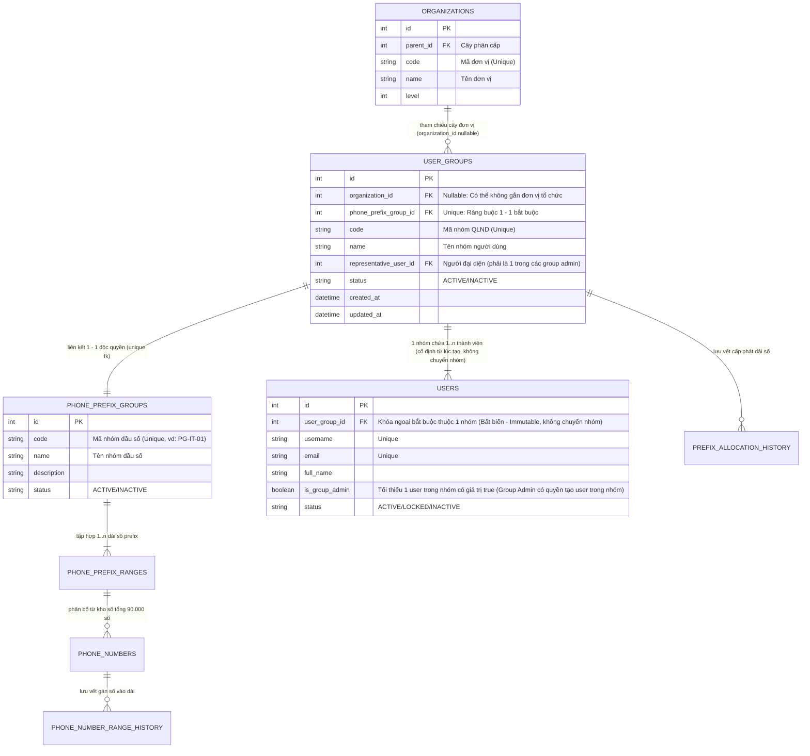

# MODULE 02: QUẢN LÝ NHÓM NGƯỜI DÙNG (USER GROUP / TỔ CHỨC QLND)

## Đường dẫn tài liệu: `docs/modules/02_user_group.md`

## Ánh xạ giao diện mẫu: Đã loại bỏ (Trước đây là `templates/user-management-orgs.html`)

---

## 1. Mục tiêu & Nghiệp vụ (Business Overview)

### 1.1. Bối cảnh nghiệp vụ

Trong kiến trúc quản trị người dùng phân tán và phân định phạm vi dữ liệu (Data Scoping / Multi-tenancy) của hệ thống EVN CDR AS:

- **Cây tổ chức (`organizations`)**: Phản ánh cơ cấu hành chính - điều hành chung của EVN (Tập đoàn -> Tổng công ty -> Khối/Ban/Công ty -> Điện lực/Phòng ban).
- **Nhóm người dùng (User Group / Tổ chức Quản lý Người dùng - QLND)**: Là thực thể trung tâm quản lý tài khoản người dùng và là đơn vị sở hữu không gian dữ liệu cuộc gọi (Tenant Unit).
- **3 Đối tượng người dùng chuẩn hóa trong Nhóm (User Scope)**:
  1. `GROUP_ADMIN` (Quản trị viên nhóm):
     - Bản chất là thành viên của nhóm được trao quyền quản trị nội bộ đơn vị.
     - Toàn quyền CRUD đối với thành viên nội bộ nhóm (`user:create`, `user:view`, `user:edit`, `user:delete`), không được chuyển nhóm thành viên.
     - Cấp / thu hồi quyền Quản trị nhóm cho thành viên khác trong nhóm (`group:manage_admin`), bảo toàn tối thiểu 1 Group Admin đang hoạt động.
     - Phân quyền nghe ghi âm Tầng 2 (`group:toggle_recording` / `can_access_recording = 1/0`) cho từng thành viên khi Tầng 1 mở.
     - Mặc định tự động có quyền nghe trực tuyến & tải ghi âm thoại của nhóm khi nhóm được mở Tầng 1 (`allow_recording_access = 1`).
     - Toàn quyền xem log CDR (chi tiết 87 trường, bộ lọc nâng cao, xuất Excel), phân tích QoS và xem/xuất báo cáo thống kê trong phạm vi nhóm (`Group-Based Data Isolation`).
  2. `USER_RECORDING` (Thành viên có quyền nghe ghi âm):
     - Thành viên được Quản trị viên nhóm cấp quyền `can_access_recording = 1` khi nhóm đã được cấp phép Tầng 1.
     - Được quyền nghe trực tuyến (`cdr:listen_audio`) và tải file ghi âm (`cdr:download_audio`) của nhóm mình.
     - Có toàn bộ các quyền đối với dữ liệu CDR, phân tích QoS và xem/xuất báo cáo thống kê theo nhóm tương tự Quản trị viên nhóm.
     - Không có thẩm quyền quản trị thành viên (không CRUD người dùng, không gán admin, không toggle ghi âm).
  3. `REGULAR_USER` (Thành viên không có quyền nghe ghi âm):
     - Thành viên thông thường có `can_access_recording = 0` (hoặc nhóm chưa mở Tầng 1).
     - **Điểm khác biệt DUY NHẤT so với `USER_RECORDING`**: Bị khóa hoàn toàn quyền nghe và tải file ghi âm cuộc gọi (ẩn trên giao diện, chặn `403 Forbidden` tại API).
     - **Còn lại GIỐNG HỆT 100% `USER_RECORDING` và CÓ QUYỀN TƯƠNG TỰ Quản trị viên nhóm** đối với việc xem nhật ký CDR, xem chi tiết 87 trường, lọc nâng cao, xuất Excel, xem phân tích QoS và xem/xuất báo cáo thống kê trong phạm vi nhóm.
     - Không có thẩm quyền quản trị thành viên.
- **4 Ràng buộc nghiệp vụ cốt lõi của Nhóm người dùng**:
  1. **Chứa nhiều người dùng thành viên (Quan hệ 1 - N) & Tính cố định nhóm**: Mỗi nhóm người dùng quản lý một tập hợp nhiều tài khoản người dùng thành viên (`users`). **Người dùng luôn luôn thuộc về một nhóm người dùng cố định ngay từ lúc tạo ra** (bản chất là người dùng thuộc đơn vị tổ chức), do đó **hoàn toàn không có khái niệm chuyển người dùng giữa các nhóm**. Thuộc tính `user_group_id` là bất biến (immutable) sau khi khởi tạo.
  2. **Có ít nhất một người dùng Quản trị viên nhóm & Thẩm quyền tạo người dùng (Group Admin Rule)**: Mỗi nhóm người dùng bắt buộc phải có **tối thiểu một người dùng đóng vai trò Quản trị viên nhóm** (`is_group_admin = 1` (vai trò `GROUP_ADMIN` được suy ra từ cờ này)). Quản trị viên nhóm **cũng là một thành viên trong nhóm nhưng được trao quyền quản trị**. Tài khoản người dùng có thể được tạo ra bởi:
     - **Quản trị viên hệ thống (System Admin)**: Có toàn quyền tạo người dùng cho bất kỳ Nhóm người dùng nào trong toàn hệ thống.
     - **Quản trị viên nhóm (Group Admin)**: Có quyền tạo mới tài khoản thành viên nhưng **chỉ được phép tạo trong phạm vi nhóm của chính mình**.
  3. **Liên kết với một Nhóm đầu số điện thoại theo ràng buộc 1 - 1 (1-to-1 Phone Prefix Group Binding)**: Mỗi nhóm người dùng liên kết độc quyền với **duy nhất một nhóm đầu số điện thoại** (`phone_prefix_groups`). Toàn bộ dữ liệu cuộc gọi CDR, file ghi âm và lưu lượng cuộc gọi phát sinh từ các đầu số này thuộc quyền quản lý của nhóm. Ngược lại, một nhóm đầu số chỉ được cấp phát cho duy nhất một nhóm người dùng (không chia sẻ giữa các nhóm).
  4. **Tham chiếu Cây tổ chức linh hoạt (0..1 - N Organization Reference)**:
     - **Một đơn vị có nhiều nhóm người dùng**: Một đơn vị trên cây tổ chức có thể có nhiều nhóm người dùng trực thuộc (ví dụ: Khối CNTT có thể có nhóm "Vận hành Hệ thống", nhóm "An toàn thông tin"...).
     - **Có thể không tham chiếu đến đơn vị nào**: Nhóm người dùng có thể độc lập, không tham chiếu đến bất kỳ đơn vị tổ chức nào (`organization_id = NULL`), phục vụ cho các tổ công tác kiểm toán liên đơn vị, nhóm chuyên gia ngoài hoặc các tổ dự án đặc thù toàn hệ thống.

---

### 1.2. Sơ đồ Thực thể Quan hệ Nghiệp vụ (Business ERD)



---

### 1.3. Bốn Quy tắc Nghiệp vụ Chi tiết (Core Business Rules)

| Mã quy tắc | Tên quy tắc | Mô tả chi tiết & Ràng buộc xử lý |
| :--- | :--- | :--- |
| **BR-UG-01** | **Nhóm chứa nhiều thành viên (1 - N) & Không chuyển nhóm** | - Một nhóm người dùng (`user_groups`) chứa một danh sách từ $1$ đến $N$ tài khoản người dùng (`users`).<br>- **Người dùng luôn thuộc cố định 1 nhóm người dùng ngay từ lúc tạo ra** (`users.user_group_id NOT NULL`, bản chất là thuộc đơn vị tổ chức). Hệ thống **không có khái niệm chuyển người dùng giữa các nhóm**; thuộc tính `user_group_id` là bất biến (immutable).<br>- **Thẩm quyền tạo người dùng**: Tài khoản có thể được tạo ra bởi **Quản trị viên hệ thống** (toàn quyền chọn nhóm bất kỳ) hoặc **Quản trị viên nhóm** (cũng là một thành viên trong nhóm có quyền quản trị, chỉ được tạo trong nhóm của mình).<br>- **Phân quyền thành viên thường**: Cả hai loại thành viên thường (`USER_RECORDING` và `REGULAR_USER`) đều không có quyền quản trị (không thể thêm/sửa/xóa thành viên hoặc chuyển quyền admin).<br>- **Ràng buộc an toàn khi xóa**: Không được phép ngừng hoạt động (xóa mềm) nhóm nếu vẫn còn thành viên chưa `INACTIVE`. Hệ thống phản hồi mã lỗi `409 Conflict`. Nhóm không bao giờ bị xóa cứng (`docs/01_database_schema.md` mục 14). |
| **BR-UG-02** | **Tối thiểu 1 Quản trị viên nhóm (Group Admin Rule) & Thẩm quyền quản trị** | - Trong danh sách thành viên của nhóm, bắt buộc phải có **ít nhất 1 người dùng có `is_group_admin = true`**.<br>- Nhóm được phép có nhiều quản trị viên nhóm (Multi-admin).<br>- Người đại diện chính (`representative_user_id`) phải là một trong các Quản trị viên nhóm.<br>- **Thẩm quyền của Quản trị viên nhóm**: Toàn quyền CRUD thành viên nội bộ nhóm (`user:create`, `user:view`, `user:edit`, `user:delete`), quyền phân bổ hoặc thu hồi quyền Quản trị nhóm cho thành viên khác trong nhóm (`group:manage_admin`), và quyền bật/tắt quyền nghe ghi âm Tầng 2 cho từng thành viên (`group:toggle_recording`).<br>- **Bảo toàn Quản trị viên (Safeguard)**: Khi một nhóm chỉ còn đúng 1 Quản trị viên nhóm, hệ thống chặn tuyệt đối các thao tác: hạ quyền admin về user thường hoặc xóa tài khoản user đó (do người dùng cố định vào nhóm, không chuyển nhóm). Phải bổ nhiệm một thành viên khác lên làm Quản trị viên nhóm trước khi chuyển giao. |
| **BR-UG-03** | **Liên kết 1 - 1 với Nhóm đầu số điện thoại & Cô lập dữ liệu CDR** | - Mỗi nhóm người dùng liên kết với duy nhất một nhóm đầu số điện thoại (`phone_prefix_groups`) theo quan hệ **1 - 1** (`phone_prefix_group_id` có ràng buộc `UNIQUE`).<br>- Một nhóm đầu số điện thoại không được phép gán cho nhiều hơn 1 nhóm người dùng.<br>- **Phạm vi phân quyền dữ liệu (Group-Based Data Isolation)**: Bảng `cdr_enriched` được tiến trình Batch Scheduler tự động làm giàu thông tin `caller_group_id` và `called_group_id` dựa trên dải số và máy lẻ của nhóm này.<br>- **Quyền bình đẳng về dữ liệu trong nhóm**: Quản trị viên nhóm (`GROUP_ADMIN`), Thành viên có quyền ghi âm (`USER_RECORDING`) và Thành viên không có quyền ghi âm (`REGULAR_USER`) đều có **quyền hạn tương tự và bình đẳng** đối với việc xem nhật ký cuộc gọi CDR (danh sách, chi tiết 87 trường, lọc nâng cao theo IP/mã ngắt kết nối, xuất file Excel), phân tích chỉ số QoS cuộc gọi và xem/xuất báo cáo thống kê trong phạm vi nhóm mình (`caller_group_id = user_group_id OR called_group_id = user_group_id`).<br>- Nhóm đầu số chỉ chọn lúc tạo nhóm, **không đổi được** sau đó (`409`). |
| **BR-UG-04** | **Tham chiếu Cây tổ chức tùy chọn (0..1 - N)** | - **1 đơn vị có nhiều nhóm (1 - N)**: Một đơn vị trong cây tổ chức (`organizations`) có thể quản lý 0, 1 hoặc nhiều nhóm người dùng trực thuộc.<br>- **Cho phép không thuộc đơn vị nào (Nullable)**: Thuộc tính `organization_id` trong `user_groups` cho phép nhận giá trị `NULL`. Các nhóm này hoạt động như các nhóm độc lập (Standalone Groups) cấp toàn hệ thống hoặc nhóm dự án đặc thù.<br>- **Hierarchy Path**: Nếu `organization_id` có giá trị, hệ thống tính toán chuỗi cấp bậc từ gốc tới đơn vị (ví dụ: `["Tổng công ty 71", "Khối CNTT"]`). Nếu `organization_id = NULL`, `hierarchyPath` trả về mảng rỗng `[]` và hiển thị trên giao diện là "Nhóm độc lập". |
| **BR-UG-05** | **Mô hình Phân quyền Ghi âm Kiểm soát 2 Tầng (2-Tier Recording Access Gate)** | - **Tầng 1 (Cấp nhóm - System Admin kiểm soát)**: Quản trị viên hệ thống (Admin Portal) có thẩm quyền tối cao cấp hoặc thu hồi quyền truy cập ghi âm cho từng Nhóm người dùng thông qua cờ `allow_recording_access` (cấu hình trong form Thêm/Sửa nhóm `PUT /api/v1/admin/user-groups/:id`).<br>  + **Nếu nhóm chưa được cấp phép (`allow_recording_access = 0`)**: Mọi tính năng liên quan đến ghi âm bị triệt tiêu khỏi giao diện người dùng của nhóm đó: Cột "File ghi âm" bị loại bỏ hoàn toàn khỏi bảng lịch sử cuộc gọi (bảng co về 6 cột); trong Modal chi tiết cuộc gọi, khối Audio Player được thay thế bằng thông báo *"Tính năng ghi âm chưa được kích hoạt cho đơn vị của bạn"*; trên giao diện Quản trị nhóm (`group-admin.html`), các cột và nút bấm/switch phân quyền ghi âm cho thành viên bị ẩn triệt để; Backend chặn toàn bộ API stream và download ghi âm với mã lỗi `403 Forbidden`.<br>  + **Nếu nhóm được cấp phép (`allow_recording_access = 1`)**: Kích hoạt Tầng 2.<br>- **Tầng 2 (Cấp thành viên - Group Admin kiểm soát khi Tầng 1 đã mở)**:<br>  + **Quản trị viên nhóm (`is_group_admin = 1`)**: Mặc định tự động có toàn quyền nghe trực tuyến và tải về máy bản ghi âm của nhóm mà không cần thêm bất kỳ cấu hình nào.<br>  + **Người dùng thành viên**: Quản trị viên nhóm có quyền bật hoặc tắt quyền nghe/tải ghi âm cho từng thành viên trong nhóm mình qua trường `can_access_recording` trên bảng `users`.<br>    * **Thành viên có quyền ghi âm (`USER_RECORDING`)**: Khi được bật (`can_access_recording = 1`), thành viên được nghe trực tuyến (`cdr:listen_audio`) và tải file ghi âm (.wav) (`cdr:download_audio`) của nhóm mình.<br>    * **Thành viên không có quyền ghi âm (`REGULAR_USER`)**: Khi tắt (`can_access_recording = 0`), thành viên bị khóa hoàn toàn tính năng nghe/tải (hiển thị trạng thái khóa và bị chặn API). Đây là điểm khác biệt duy nhất giữa hai loại thành viên. |

---

### 1.4. Chức năng chính của Module

1. **Hiển thị danh sách nhóm người dùng**:
   - Mã nhóm (`code`), Tên nhóm (`name`).
   - Người đại diện nhóm (Avatar, Họ tên, Email).
   - Số lượng Quản trị viên nhóm (`adminCount`, bảo đảm $\ge 1$).
   - Số lượng người dùng trực thuộc (`userCount` / `badge-count`).
   - Nhóm đầu số điện thoại liên kết 1-1 (Mã nhóm, Tên nhóm đầu số, các dải số: `42xxx, 46xxx`).
   - Đơn vị tổ chức tham chiếu & Chuỗi cấp bậc (`hierarchyPath`), hoặc nhãn "Nhóm độc lập" nếu `organization_id = NULL`.
   - Ngày thiết lập, trạng thái hoạt động (`ACTIVE`/`INACTIVE`).
   - Thao tác: Xem chi tiết thành viên & admin, Chỉnh sửa, Quản lý phân quyền, Xóa nhóm.
2. **Thiết lập mới & Chỉnh sửa Nhóm người dùng (`#userGroupModal`)**:
   - Chọn vị trí đơn vị trên Cây tổ chức (Tùy chọn: có thể chọn một đơn vị hoặc để trống "Không gắn đơn vị / Nhóm độc lập").
   - Nhập Mã nhóm và Tên nhóm.
   - Chọn Nhóm đầu số điện thoại liên kết (Chỉ hiển thị các nhóm đầu số khả dụng chưa bị liên kết với nhóm nào khác, đảm bảo ràng buộc 1-1).
   - Khai báo **Quản trị viên nhóm đầu tiên** (tên đăng nhập, email, họ tên, số điện thoại, chức danh). Tài khoản này được tạo cùng lúc với nhóm, trong một transaction, vì người dùng không thể tồn tại ngoài nhóm.
   - **Cấu hình Quyền Ghi âm Nhóm (`allowRecordingAccess`)**: Trường chuyển đổi Switch/Checkbox "Cho phép nhóm nghe và tải ghi âm thoại IP" do Quản trị viên hệ thống thiết lập (Chốt chặn Tầng 1 - BR-UG-05).
   - Ghi chú / Mô tả.
3. **Quản lý danh sách thành viên & Quản trị viên**:
   - Thêm thành viên vào nhóm.
   - Bổ nhiệm Quản trị viên nhóm (`Promote to Admin`).
   - Hạ quyền Quản trị viên (Chặn nếu chỉ còn 1 Quản trị viên duy nhất).
4. **Chế độ xem phân nhóm theo tổ chức (`tree-view` / Org grouping)**:
   - Gom nhóm trực quan danh sách User Groups theo từng Đơn vị trên Cây tổ chức.
   - Bổ sung nhóm mục đặc biệt: "Nhóm độc lập (Không gắn đơn vị)" hiển thị các nhóm có `organization_id = NULL`.
5. **Ràng buộc an toàn khi xóa**:
   - "Xóa" nhóm là **ngừng hoạt động** (`status = INACTIVE`, xóa mềm), chỉ thực hiện được khi không còn thành viên đang hoạt động (`status <> 'INACTIVE'`); xem API 3.4 và `docs/01_database_schema.md` mục 14.
   - Khi ngừng hoạt động, dải số của nhóm được thu hồi về kho; liên kết với Nhóm đầu số **được giữ nguyên** (không giải phóng) để báo cáo lịch sử vẫn đúng.

---

## 2. Thiết kế Dữ liệu (Database Schema)

### 2.1. Bảng Nhóm đầu số điện thoại (`phone_prefix_groups`)

Thực thể gom nhóm các dải đầu số viễn thông PABX, dùng để liên kết 1 - 1 với Nhóm người dùng.

> DDL chuẩn của `phone_prefix_groups` (mục 4.1) chỉ định nghĩa tại `docs/01_database_schema.md`. Module này không chép lại DDL để tránh lệch; khi sinh code, entity và migration lấy từ `01`.

---

### 2.2. Bảng Nhóm người dùng (`user_groups`)

- Cột `organization_id`: Cho phép `NULL` (Quan hệ 0..1 - N với `organizations`).
- Cột `phone_prefix_group_id`: Bắt buộc và có `UNIQUE KEY` (Quan hệ 1 - 1 với `phone_prefix_groups`).
- Khóa ngoại `representative_user_id`: Tham chiếu đến 1 user đại diện (đồng thời là 1 trong các group admin). Ràng buộc `fk_ug_rep_user` được bổ sung bằng `ALTER TABLE` sau khi tạo bảng `users` (mục 2.3) để tránh phụ thuộc vòng.

> DDL chuẩn của `user_groups` (mục 5) chỉ định nghĩa tại `docs/01_database_schema.md`. Module này không chép lại DDL để tránh lệch; khi sinh code, entity và migration lấy từ `01`.

---

### 2.3. Bảng Người dùng (`users`) & Quản trị viên nhóm

- Cột `user_group_id`: Tham chiếu bắt buộc tới nhóm người dùng (Quan hệ 1 - N: 1 nhóm chứa nhiều thành viên).
- Cột `is_group_admin`: Đánh dấu Quản trị viên nhóm (Mỗi nhóm có ít nhất 1 người có giá trị `1`).

> DDL chuẩn của `users` (mục 6) chỉ định nghĩa tại `docs/01_database_schema.md`. Module này không chép lại DDL để tránh lệch; khi sinh code, entity và migration lấy từ `01`.

---

## 3. Đặc tả API Contracts

### 3.1. `GET /api/v1/user-groups`

- **Mục đích**: Lấy danh sách nhóm người dùng, kèm thông tin người đại diện, số thành viên, danh sách/số lượng admin, nhóm đầu số 1-1 và chuỗi cấp bậc tổ chức (nếu có).
- **Query params**:
  - `page=1`, `limit=10`, `keyword=IT`
  - `organizationId=2`: Lọc theo đơn vị tổ chức cụ thể.
  - `organizationId=null` hoặc `isStandalone=true`: Lọc các nhóm độc lập không thuộc đơn vị nào.
- **Response**:

```json
{
  "success": true,
  "statusCode": 200,
  "message": "Lấy danh sách nhóm QLND thành công",
  "data": [
    {
      "id": 1,
      "code": "UMO-IT",
      "name": "Khối Công nghệ Thông tin",
      "organizationId": 2,
      "organizationName": "Khối CNTT",
      "hierarchyPath": ["Tổng công ty 71", "Khối CNTT"],
      "phonePrefixGroup": {
        "id": 10,
        "code": "PG-IT-01",
        "name": "Nhóm đầu số Khối CNTT",
        "prefixes": ["42xxx", "46xxx"],
        "totalNumbers": 2000
      },
      "userCount": 45,
      "adminCount": 2,
      "representative": {
        "id": 10,
        "fullName": "Trần Thị B",
        "email": "tran.b@71portal.vn",
        "avatarUrl": "https://ui-avatars.com/api/?name=Tran+B",
        "isGroupAdmin": true
      },
      "admins": [
        {
          "id": 10,
          "fullName": "Trần Thị B",
          "email": "tran.b@71portal.vn"
        },
        {
          "id": 15,
          "fullName": "Lê Văn C",
          "email": "le.c@71portal.vn"
        }
      ],
      "createdAt": "2026-05-24T00:00:00+07:00",
      "status": "ACTIVE"
    },
    {
      "id": 2,
      "code": "UMO-AUDIT",
      "name": "Tổ Giám sát Kiểm toán Độc lập",
      "organizationId": null,
      "organizationName": null,
      "hierarchyPath": [],
      "phonePrefixGroup": {
        "id": 12,
        "code": "PG-AUDIT",
        "name": "Nhóm đầu số Ban Kiểm toán",
        "prefixes": ["49xxx"],
        "totalNumbers": 1000
      },
      "userCount": 8,
      "adminCount": 1,
      "representative": {
        "id": 28,
        "fullName": "Nguyễn Văn D",
        "email": "nguyen.d@audit.evn.vn",
        "avatarUrl": "https://ui-avatars.com/api/?name=Nguyen+D",
        "isGroupAdmin": true
      },
      "admins": [
        {
          "id": 28,
          "fullName": "Nguyễn Văn D",
          "email": "nguyen.d@audit.evn.vn"
        }
      ],
      "createdAt": "2026-06-10T00:00:00+07:00",
      "status": "ACTIVE"
    }
  ],
  "pagination": {
    "page": 1,
    "limit": 10,
    "total": 2,
    "totalPages": 1
  }
}
```

---

### 3.2. `POST /api/v1/admin/user-groups`

- **Mục đích**: Thiết lập nhóm người dùng mới.
- **Ràng buộc kiểm tra (Validation Rules)**:
  - `phonePrefixGroupId`: Bắt buộc. Kiểm tra nhóm đầu số này chưa bị liên kết với bất kỳ nhóm người dùng nào khác (`UNIQUE 1-1`). Nếu đã bị gán, trả về lỗi `409 CONFLICT: Nhóm đầu số điện thoại đã được liên kết với nhóm người dùng khác`.
  - `organizationId`: Không bắt buộc (cho phép `null` hoặc bỏ trống nếu là nhóm độc lập). Nếu có truyền, kiểm tra ID đơn vị phải tồn tại trên Cây tổ chức.
  - `initialAdmin`: Bắt buộc. Thông tin tài khoản Quản trị viên nhóm đầu tiên; `username`/`email` không được trùng với tài khoản **chưa `INACTIVE`** nào (kiểm tra `username_active`/`email_active`, `docs/01_database_schema.md` mục 6); trùng thì `409`.
- **Xử lý Backend (một transaction)**:
  1. Tạo dòng `user_groups`.
  2. Tạo dòng `users` thuộc nhóm vừa tạo với `is_group_admin = 1`, `must_change_password = 1`, mật khẩu tạm ngẫu nhiên 16 ký tự đạt chính sách mật khẩu (`docs/01_database_schema.md` mục 6.1).
  3. Đặt `user_groups.representative_user_id` = id user vừa tạo.
  4. Ghi `audit_logs`: `USER_GROUP / CREATE` và `USER / CREATE`.
  5. Lỗi ở bất kỳ bước nào thì rollback toàn bộ.
- **Mật khẩu tạm** chỉ trả về **một lần** trong response (`initialAdmin.temporaryPassword`) để Quản trị viên hệ thống chuyển cho người phụ trách. Hệ thống chỉ lưu bản băm, không có API xem lại; quên thì dùng đặt lại mật khẩu.
- **Request Body**:

```json
{
  "code": "UMO-KD",
  "name": "Khối Kinh doanh & Dịch vụ Khách hàng",
  "description": "Nhóm quản lý người dùng khối kinh doanh",
  "organizationId": 2,
  "phonePrefixGroupId": 5,
  "allowRecordingAccess": false,
  "initialAdmin": {
    "username": "admin.kd",
    "email": "admin.kd@evn.com.vn",
    "fullName": "Nguyễn Văn Quản",
    "phoneNumber": "0912345678",
    "jobTitle": "Trưởng phòng Kinh doanh"
  }
}
```

- **Response** (`201 Created`):

```json
{
  "success": true,
  "statusCode": 201,
  "data": {
    "id": 7,
    "code": "UMO-KD",
    "representativeUserId": 42,
    "initialAdmin": {
      "id": 42,
      "username": "admin.kd",
      "temporaryPassword": "q7Vt#2mPz9Lw!4Rk",
      "mustChangePassword": true
    }
  }
}
```

---

### 3.3. `PUT /api/v1/admin/user-groups/:id`

- **Mục đích**: Cập nhật thông tin nhóm người dùng.
- **Quy tắc**:
  - Cho phép cập nhật `organizationId` (gán sang đơn vị khác hoặc gán về `null` để chuyển thành nhóm độc lập).
  - **Không cho đổi `phonePrefixGroupId`** sau khi tạo nhóm: request gửi giá trị khác giá trị hiện tại thì trả `409 CONFLICT`. Muốn chuyển số sang nhóm khác thì thu hồi dải ở nhóm cũ và cấp dải cho nhóm mới (`docs/01_database_schema.md` mục 8).
  - Cập nhật tên, mô tả, người đại diện (người đại diện bắt buộc phải là Quản trị viên của nhóm).
  - **Cập nhật quyền ghi âm nhóm (`allowRecordingAccess`)**: Chỉ Quản trị viên hệ thống (Admin Portal) mới có quyền sửa trường này.

```json
{
  "name": "Khối Kinh doanh - Chi nhánh 1",
  "description": "Cập nhật tên nhóm",
  "organizationId": null,
  "phonePrefixGroupId": 5,
  "representativeUserId": 15,
  "allowRecordingAccess": true,
  "status": "ACTIVE"
}
```

---

### 3.4. `DELETE /api/v1/admin/user-groups/:id`

- **Mục đích**: Ngừng hoạt động nhóm người dùng (**xóa mềm**, chính sách tại `docs/01_database_schema.md` mục 14).
- **Quy tắc kiểm tra**:
  - Đếm thành viên còn hoạt động: `SELECT COUNT(*) FROM users WHERE user_group_id = :id AND status <> 'INACTIVE'`.
  - Nếu `> 0`: Từ chối với lỗi `409 CONFLICT: Không thể ngừng hoạt động nhóm khi còn thành viên đang hoạt động`.
- **Khi thành công** (một transaction):
  - `user_groups.status = 'INACTIVE'`.
  - Thu hồi toàn bộ dải số của nhóm đầu số liên kết theo quy tắc thu hồi (`docs/01_database_schema.md` mục 8), ghi `prefix_allocation_history` (`action_type = 'REVOKE'`) và `phone_number_range_history`.
  - **Giữ nguyên** `phone_prefix_group_id`, CDR và stats của nhóm để báo cáo lịch sử vẫn đúng. Nhóm đầu số này không gán được cho nhóm khác (`UNIQUE`); muốn dùng dải số cho nhóm khác thì tạo nhóm đầu số mới và cấp phát lại dải.
  - Ghi `audit_logs`.

---

### 3.5. Bổ nhiệm / Hạ quyền Quản trị viên nhóm

- Dùng **một endpoint duy nhất** `PUT /api/v1/users/:id/group-admin` với body `{ "isGroupAdmin": true | false }` (có bản `/api/v1/admin/...`), đặc tả tại `docs/modules/03_auth_user.md` mục 3.6. Không có endpoint `/user-groups/:id/admins`.
- Hạ quyền bị chặn (`409`) nếu người đó là Quản trị viên nhóm đang hoạt động cuối cùng (`SELECT COUNT(*) FROM users WHERE user_group_id = :groupId AND is_group_admin = 1 AND status = 'ACTIVE'`).

---

### 3.6. `PATCH /api/v1/user-groups/:id/members/:userId/recording-access` (Ủy quyền Nghe & Tải ghi âm)

- **Mục đích**: Quản trị viên nhóm bật hoặc tắt quyền truy cập nghe và tải bản ghi âm thoại IP cho một người dùng thành viên trong nhóm (BR-UG-05).
- **Quyền hạn truy cập**:
  - Quản trị viên nhóm của nhóm này (`currentUser.is_group_admin === 1 && currentUser.user_group_id === id`).
  - Quản trị viên hệ thống (Admin Portal).
  - Thành viên thường hoặc Quản trị viên của nhóm khác bị từ chối với mã lỗi `403 FORBIDDEN`.
- **Ràng buộc Chốt chặn Tầng 1 (Level 1 Gate Validation)**:
  - Hệ thống kiểm tra trạng thái của nhóm: `SELECT allow_recording_access FROM user_groups WHERE id = :id`.
  - Nếu `allow_recording_access === 0`: Từ chối ngay lập tức với lỗi `400 BAD REQUEST: Nhóm người dùng chưa được Quản trị viên hệ thống kích hoạt tính năng ghi âm. Không thể cấp quyền cho thành viên`.
- **Request Body**:
```json
{
  "canAccessRecording": true
}
```
- **Response**:
```json
{
  "success": true,
  "statusCode": 200,
  "message": "Cập nhật quyền nghe và tải ghi âm cho thành viên thành công",
  "data": {
    "userId": 25,
    "userGroupId": 1,
    "fullName": "Nguyễn Văn An",
    "canAccessRecording": true,
    "updatedAt": "2026-10-20T14:45:00+07:00"
  }
}
```
- **Audit Log**: Tự động ghi bản ghi nhật ký kiểm toán hành động `TOGGLE_RECORDING_ACCESS` (`resource_name = USER`) kèm người thực hiện, thành viên mục tiêu và trạng thái mới.

---

## 4. Kiến trúc Backend NestJS (`backend/src/modules/user-groups/`)

```
user-groups/
├── user-groups.module.ts
├── user-groups.controller.ts
├── user-groups.service.ts
├── dto/
│   ├── create-user-group.dto.ts
│   ├── update-user-group.dto.ts
│   ├── user-group-query.dto.ts
│   └── assign-group-admin.dto.ts
└── entities/
    └── user-group.entity.ts
```

### 4.1. Hàm tính toán Hierarchy Path xử lý `organizationId` Nullable trong `user-groups.service.ts`

```typescript
async getHierarchyPath(organizationId: number | null): Promise<string[]> {
  // Nếu nhóm độc lập không gắn đơn vị tổ chức, trả về mảng rỗng
  if (!organizationId) {
    return [];
  }

  const path: string[] = [];
  let currentId: number | null = organizationId;
  
  while (currentId) {
    const org = await this.orgRepo.findOne({ where: { id: currentId } });
    if (!org) break;
    path.unshift(org.name);
    currentId = org.parentId;
  }
  
  return path;
}
```

### 4.2. Logic kiểm tra ràng buộc 1 - 1 Nhóm đầu số & Tối thiểu 1 Quản trị viên

```typescript
async validatePhonePrefixGroupBinding(prefixGroupId: number, currentGroupId?: number): Promise<void> {
  const existing = await this.userGroupRepo.findOne({
    where: { phonePrefixGroupId: prefixGroupId },
  });

  if (existing && existing.id !== currentGroupId) {
    throw new ConflictException(
      `Nhóm đầu số ID ${prefixGroupId} đã được liên kết với nhóm người dùng "${existing.name}" theo ràng buộc 1-1.`,
    );
  }
}

async validateGroupAdminSafeguard(groupId: number, targetAdminUserId: number): Promise<void> {
  // Đếm Quản trị viên nhóm đang hoạt động, KHÔNG tính người sắp bị hạ quyền / ngừng hoạt động
  const remaining = await this.userRepo.count({
    where: { userGroupId: groupId, isGroupAdmin: true, status: 'ACTIVE', id: Not(targetAdminUserId) },
  });

  if (remaining < 1) {
    throw new ConflictException(
      'Nhóm người dùng bắt buộc phải có ít nhất một Quản trị viên nhóm. Không thể xóa hoặc hạ quyền quản trị viên duy nhất.',
    );
  }
}
```

---

## 5. Kiến trúc Frontend Vue 3 (`frontend/src/views/organization/UserGroupView.vue`)

### 5.1. Cấu trúc Component & Giao diện người dùng

- **Page Header**: Tiêu đề "Quản lý Nhóm người dùng (User Groups)", nút "Thiết lập mới" mở modal `#userGroupModal`.
- **Bộ Tabs**:
  - `list-view`: Hiển thị bảng dữ liệu phẳng hỗ trợ tìm kiếm, lọc theo đơn vị tổ chức hoặc xem riêng nhóm độc lập.
  - `tree-view`: Hiển thị cây phân cấp phân nhánh theo Đơn vị tổ chức. Bổ sung nhánh chuyên biệt: **"Nhóm độc lập (Không gắn đơn vị)"** để hiển thị các User Groups có `organization_id = NULL`.
- **Table Data Grid**:
  - Cột "Tổ chức QLND": Tên nhóm, Mã nhóm.
  - Cột "Đơn vị trên cây tổ chức": Hiển thị chuỗi cấp bậc `.hierarchy-path` (nếu có) hoặc thẻ badge màu trung tính `.badge-standalone: "Nhóm độc lập"`.
  - Cột "Nhóm đầu số điện thoại (1-1)": Badge hiển thị mã nhóm đầu số và danh sách prefix (`PG-IT-01: 42xxx, 46xxx`).
  - Cột "Quản trị viên nhóm": Hiển thị danh sách avatar/tên các admin kèm badge số lượng (`badge-admin-count`), đánh dấu người đại diện chính.
  - Cột "Số thành viên": Badge đếm tổng số users trực thuộc nhóm (`.badge-count`).
- **Modal Thiết lập mới / Chỉnh sửa (`#userGroupModal`)**:
  - Dropdown chọn đơn vị trên Cây tổ chức: Tùy chọn (Optional), cho phép chọn nút tổ chức hoặc chọn tùy chọn "Không gắn đơn vị (Nhóm độc lập)".
  - Dropdown chọn Nhóm đầu số điện thoại: Chỉ hiển thị các nhóm đầu số đang rảnh (chưa bị User Group nào liên kết) để đảm bảo ràng buộc 1 - 1.
  - Khối "Quản trị viên nhóm đầu tiên" (chỉ khi tạo mới): nhập tên đăng nhập, email, họ tên, số điện thoại, chức danh. Sau khi lưu, hiển thị mật khẩu tạm **một lần** trong hộp thoại có nút sao chép và cảnh báo "Mật khẩu chỉ hiển thị một lần".

### 5.2. Quản lý trạng thái Pinia Store (`useUserGroupStore`)

- State: `userGroups: UserGroupItem[]`, `loading: boolean`, `pagination: PaginationInfo`, `availablePrefixGroups: PhonePrefixGroupItem[]`.
- Actions:
  - `fetchUserGroups(query)`: Lấy danh sách nhóm (hỗ trợ filter orgId hoặc standalone).
  - `fetchAvailablePrefixGroups()`: Tải các nhóm đầu số chưa bị gán để chọn trong form tạo/sửa.
  - `createUserGroup(payload)`: Kiểm tra ràng buộc 1-1 và admin tối thiểu $\ge 1$.
  - `updateUserGroup(id, payload)`: Cập nhật thông tin nhóm.
  - `demoteAdmin(groupId, userId)`: Bắt lỗi nếu vi phạm điều kiện tối thiểu 1 admin.
  - `deleteUserGroup(id)`: Ngừng hoạt động nhóm (xóa mềm); chặn khi còn thành viên có `status <> 'INACTIVE'`.

---

## 6. Kịch bản kiểm thử (Test Plan for Agent)

1. **TC-UG-01 (Nhiều thành viên)**: Tạo nhóm và gán 10 người dùng thành viên. Xác nhận API trả về `userCount = 10` và danh sách thành viên thuộc đúng nhóm.
2. **TC-UG-02 (Tối thiểu 1 Quản trị viên nhóm)**:
   - Thử tạo nhóm không có `initialAdmin` -> `400 Bad Request`. Tạo nhóm với `initialAdmin.email` đã tồn tại -> `409` và **không** có dòng `user_groups` nào được tạo (rollback). Tạo nhóm hợp lệ -> nhóm có đúng 1 Quản trị viên, `representative_user_id` trỏ tới người đó, response có `temporaryPassword`, đăng nhập lần đầu bị yêu cầu đổi mật khẩu.
   - Một nhóm có 1 Quản trị viên duy nhất, gọi API hạ quyền hoặc xóa user đó -> Xác nhận hệ thống chặn với thông báo lỗi yêu cầu duy trì ít nhất 1 Quản trị viên.
   - Thêm Quản trị viên thứ 2 vào nhóm -> Xác nhận hạ quyền 1 trong 2 người thành công.
3. **TC-UG-03 (Ràng buộc 1 - 1 với Nhóm đầu số điện thoại)**:
   - Gán Nhóm đầu số `PG-IT-01` cho Nhóm người dùng `UMO-IT` -> Thành công.
   - Tạo tiếp Nhóm người dùng `UMO-KD` và thử gán cùng Nhóm đầu số `PG-IT-01` -> Xác nhận hệ thống trả về lỗi `409 Conflict: Nhóm đầu số đã được liên kết với nhóm khác`.
4. **TC-UG-04 (Tham chiếu Đơn vị Cây tổ chức tùy chọn & Nhóm độc lập)**:
   - Tạo Nhóm người dùng với `organizationId = null` -> Xác nhận tạo thành công, `hierarchyPath` trả về `[]`, giao diện hiển thị nhãn "Nhóm độc lập".
5. **TC-UG-05 (Một đơn vị tổ chức có nhiều nhóm người dùng)**:
   - Tạo 2 nhóm người dùng khác nhau (`UMO-IT-01` và `UMO-IT-02`) cùng trỏ về đơn vị `organizationId = 2` -> Xác nhận cả 2 nhóm đều lưu thành công, cùng hiển thị đúng `hierarchyPath` của đơn vị đó trên cây tổ chức.
6. **TC-UG-06 (Ràng buộc toàn vẹn khi ngừng hoạt động nhóm)**:
   - Khi nhóm còn thành viên chưa `INACTIVE`, gọi API DELETE -> Xác nhận trả về lỗi `409 Conflict`.
   - Ngừng hoạt động toàn bộ thành viên (`status = 'INACTIVE'`; thành viên không bao giờ được chuyển sang nhóm khác), gọi API DELETE -> Xác nhận nhóm có `status = 'INACTIVE'`, mọi số trong dải của nhóm có `range_id = NULL` (số `ALLOCATED` về `FREE`, số `LOCKED` giữ nguyên), CDR và `stats_*` của nhóm vẫn còn nguyên.

